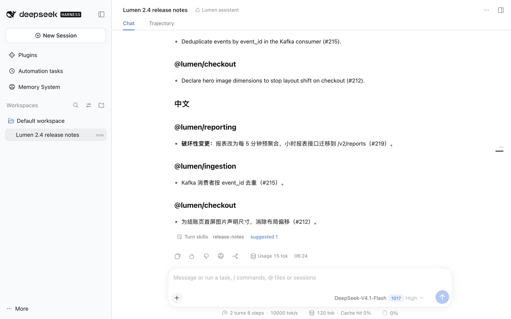

# v0.5.34 Skills, Light WebUI / v0.5.34 技能管理，浅色界面

Captured on **2026-10-21 (Asia/Shanghai)** from a real local DSH 0.2.1-rc.2 WebUI in **light** appearance, in English and Chinese, on the fictional Lumen project. [English guide](../../en/guides/skills.md) · [中文指南](../../zh-CN/guides/skills.md) · [Media index](../README.md) · [Manifest](./manifest.json)

本组素材于 **2026-10-21（Asia/Shanghai）**从真实本地 DSH 0.2.1-rc.2 WebUI 采集，中英文均为**浅色**界面，项目是虚构的 Lumen。

## Screens / 截图

| Surface / 场景 | English | 简体中文 |
|---|---|---|
| A turn that used a skill, and the suggestion its review left / 用到技能的回合，以及复盘留下的建议 | [chat-skills](./en/chat-skills.jpg) | [chat-skills](./zh-CN/chat-skills.jpg) |
| Skills: the list by root, a shadowed copy, a skill with an improvement waiting / 技能：按位置分组、被覆盖的副本、有改进待处理的技能 | [skills-library](./en/skills-library.jpg) | [skills-library](./zh-CN/skills-library.jpg) |
| Evolution, Pending: a suggestion and its evidence / 进化 · 待处理：建议及其证据 | [skills-suggestion](./en/skills-suggestion.jpg) | [skills-suggestion](./zh-CN/skills-suggestion.jpg) |
| The draft, its backtest and its diff / 草案、回测与差异 | [skills-draft](./en/skills-draft.jpg) | [skills-draft](./zh-CN/skills-draft.jpg) |
| Evolution, Evidence: the recorded conversations / 进化 · 证据：记录的对话 | [skills-evidence](./en/skills-evidence.jpg) | [skills-evidence](./zh-CN/skills-evidence.jpg) |
| Evals: cases and a backtest, case by case / 评测：用例与逐个用例的回测 | [skills-evals](./en/skills-evals.jpg) | [skills-evals](./zh-CN/skills-evals.jpg) |
| Market: listed sources and skills.sh / 市场：已添加的来源与 skills.sh | [skills-market](./en/skills-market.jpg) | [skills-market](./zh-CN/skills-market.jpg) |
| A preview with security reviews / 带安全审核的预览 | [skills-market-preview](./en/skills-market-preview.jpg) | [skills-market-preview](./zh-CN/skills-market-preview.jpg) |
| Sources / 来源 | [skills-sources](./en/skills-sources.jpg) | [skills-sources](./zh-CN/skills-sources.jpg) |
| dsh-mnemon's page: Skills, tagged Experimental / 可组合记忆页面：带“实验性”标签的技能管理 | [plugin-skills-row](./en/plugin-skills-row.jpg) | [plugin-skills-row](./zh-CN/plugin-skills-row.jpg) |
| Skills' page under Plugins / 插件下技能管理的页面 | [plugin-skills](./en/plugin-skills.jpg) | [plugin-skills](./zh-CN/plugin-skills.jpg) |

## How it was captured / 采集方式

Each locale is one pass over a fresh fixture: `node scripts/serve-e2e.mjs --docs-demo` (Chinese) or `--docs-demo=en` (English) seeds a disposable Profile, and the fixture puts the project's skills in DSH's first-use workspace. The pass asks for the Lumen 2.4 release notes, then corrects them with `/release-notes`; self-evolution reviews the conversation on its own once it sits idle, with the default settings, and the rest of the pass is clicks: the suggestion, **Draft**, the evidence, the tabs, a market search, a preview, the sources and the settings.

每种语言都在全新的夹具上完整走一遍：`node scripts/serve-e2e.mjs --docs-demo`（中文）或 `--docs-demo=en`（英文）先预置一次性 Profile，夹具把项目技能放进 DSH 首次使用时创建的工作区。随后请助手写 Lumen 2.4 的版本说明，再用 `/release-notes` 纠正格式；对话空闲后，自进化按默认设置自动复盘。其余都是点击：打开建议、**生成草案**、查看证据、切换标签页、在市场中搜索和预览、查看来源与设置。

The model is the docs demo's **scripted** loopback model, not a live one, and no API key is involved. It scripts only the model's decisions: which tools the conversation calls and what it answers, and what the review, the draft and the backtest's executor and judge return. The executor follows the skill text it is given and the judge grades only the answer, so the draft scores higher for the reason a real backtest would. Everything else is real: the Host's capture, scoring and scheduling of the review, the task Agents, the Skills Source and its storage, grading, and the UI. The tour script that drives the browser stays outside the repository, as for the earlier galleries.

模型是文档演示的**脚本化**本地模型，不是真实模型，也不涉及任何 API 密钥。它只决定模型那一侧：对话调用哪些工具、回答什么，以及复盘、草案、回测执行者与评审返回什么。执行者按给定的技能内容作答，评审只依据回答判分，所以草案得分更高的原因与真实回测相同。其余都是真实的：Host 对回合的记录、积分与复盘调度，任务 Agent，技能管理 Source 及其存储，判分，以及界面。驱动浏览器的走查脚本与以往图集一样不在仓库中。

## Environment and data / 环境与数据

| Item / 项目 | Capture environment / 采集环境 |
|---|---|
| Product / 产品 | The `claude/skill-management` branch with the change that adds this gallery, to be released as 0.5.34; the Plugins page shows the package version 0.5.33 it had when captured / 即将发布为 0.5.34 的分支，插件页显示采集时的包版本 0.5.33 |
| Host / 宿主 | Published DSH 0.2.1-rc.2; no Host source modifications / 正式 DSH 包，未修改宿主源码 |
| Model / 模型 | The docs demo's scripted loopback model, for the conversation, the review, the draft and the backtest / 文档演示的脚本化本地模型，用于对话、复盘、草案与回测 |
| Live data / 实时数据 | Market search results, install counts and security reviews from skills.sh at capture time; the Featured list is the catalog shipped with the package / 市场搜索结果、安装量与安全审核来自采集时的 skills.sh；精选列表是随包附带的目录 |
| Runtime / 运行环境 | macOS 27.0.1, Node.js 22.22.0, Mnemon CLI 0.2.12 |
| Browser / 浏览器 | Headless Google Chrome 155 over the DevTools protocol, light color scheme / 通过 DevTools 协议驱动的无头 Chrome 155，浅色 |
| Screens / 截图 | 1280 × 800 at 2x, stored 1920 px wide with the v0.5.32 gallery's JPEG tables; 11 screens per locale / 2 倍像素采集，以 v0.5.32 图集的 JPEG 量化表保存为 1920 像素宽；每种语言 11 张 |
| Data / 数据 | The Lumen project of the [v0.5.32 gallery](../webui-v0.5.32/README.md), plus 6 skills in the four skill roots (one shadowed), 3 earlier reviews (one suggestion waiting, one adopted, one dismissed) with their evidence, 7 test cases and 2 backtests, a 3-skill team catalog, and the 4 changesets of the release / v0.5.32 图集中的 Lumen 项目，另有分布在四个技能目录中的 6 个技能（其中 1 个被覆盖）、3 次较早的复盘及其证据（建议 1 条待处理、1 条已采纳、1 条已忽略）、7 个测试用例与 2 次回测、含 3 个技能的团队目录，以及本次发版的 4 个 changeset |

No personal memory, skills or credentials appear. The fixture keeps DSH's home and the agents home in its own temporary directory, so no skill of the capturing machine is read, and the only paths on screen are that directory's.

素材中没有个人记忆、个人技能或凭据。夹具把 DSH 主目录与 agents 主目录都放在自己的临时目录中，不会读取采集机器上的技能，界面中出现的路径也只有这个临时目录。

## Validation / 校验

Both locales ran the same sequence of model events, and neither logged a browser console error. Each screen was checked by eye for the intended state. The manifest records every file's viewport, dimensions, size and SHA-256. The gallery holds 22 images, 2.7 MB. It reflects the stated revision and environment only; the scripted model shows how the product behaves, not how well a real model reviews, drafts or grades.

两种语言的模型事件序列相同，采集过程中浏览器控制台均无错误。每张截图都经过人工检查。manifest 记录了每个文件的视口、尺寸、大小与 SHA-256。本图集共 22 张图片，2.7 MB。它只代表上述版本与环境；脚本化模型展示的是产品如何运作，不代表真实模型复盘、写草案或判分的水平。
