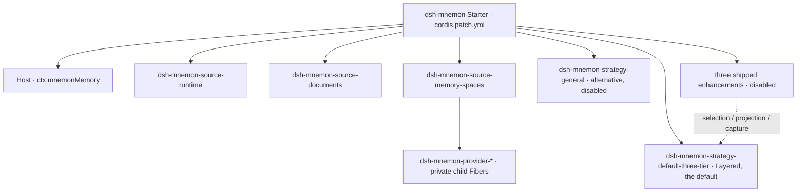
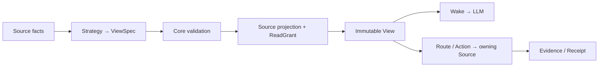
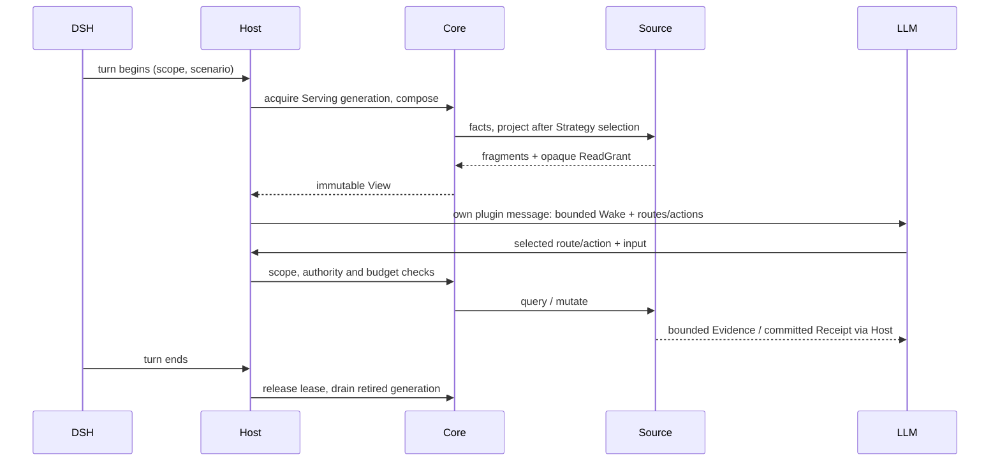

# Composable View Memory Architecture

[简体中文](../../zh-CN/development/architecture.md) | **English** | [Documentation](../README.md)

The system has three domain concepts: a **Source** owns memory and its operations; a **Strategy** proposes how available Sources participate; a **View** is the bounded context and interaction shape presented to the LLM for one scope and scenario. Runtime, Documents and Memory Spaces are the default composition, not Core's universal memory taxonomy.

## Ownership and assembly

Solid edges show Starter installation ownership; the dotted edge shows Strategy contributions that take effect only after the user enables them, not business calls. DSH creates the top-level Entries/Fibers. Sources, Strategies and their contributions use the same `installMemory(ctx, ...)` SDK and Cordis-owned disposer. Core provides only `ctx.mnemonMemory`; it does not implement a Memory Spaces Fiber or publish `ctx.mnemonMemorySpace`.

Memory Spaces authors its **own** child Fibers and Provider protocol. Each configured Provider is an explicitly installed module; two Source instances can use the same child id without sharing their registry or credentials. No dependency scan or global Provider registry selects implementations.

Like a Spring Boot starter, the default distribution chooses dependencies and explicit defaults. It does not turn Source business code into Core. Users still install only `dsh-mnemon`; 18 plugin packages can be independently built, tested and published. The Starter installs every official package. The General strategy and three Strategy enhancements ship as disabled Entries: an enhancement joins the View once its switch is on, and the General strategy composes it only after it is chosen as the main strategy. Replacing the main strategy is always an explicit choice.

| Owner | Owns | Does not own |
|---|---|---|
| Core | Internal registration, contract validation, immutable Views, budgets, generations and leases | Provider drivers, Source data formats/storage decisions, pages, DSH lifecycle policy |
| SDK | Small contribution service, Source/Strategy author contracts, installation helpers and scoped test tools | Engine/registry constructors, installed records or generation handles |
| Source | Storage/remote authority, facts, projections, grants, query/mutation and optional management/Client | Other Sources' controllers or global strategy selection |
| Strategy | Pure deterministic `request + facts + owned-slot contributions → ViewSpec`; owns slot semantics | Raw data, credentials, drivers, side effects or new authority |
| Host | Scope, phase hooks, tool/RPC adapters, authentication, settings and supervised tasks | Source implementations or private registries |
| Starter | Package set, Entry ids and default configuration | A second loader or runtime |

`ctx.mnemonMemory` is a real restricted service object, not the engine cast to a narrower type. It exposes one registration primitive, used through `installMemory`; Host execution stays internal. Provider modules follow the same principle inside their own Source, with only a bound `host.install` capability. Public test fixtures exercise these protocols without handing out their private owners.

## Built-in storage scope

Storage layout is part of the root package's Host infrastructure. The same resolver handles `global`, `workspace`, `custom` and `workspaces`; Core carries the selected operation scope and enforces View authority. Filesystem canonicalization, environment/home defaults and workspace directory hashes stay in Host code, without a storage contribution API or a separate package.

The Host passes the resolved directory to each default Source. Sources continue to own their formats, transactions and Provider state; a layout change does not move their data. The opt-in global USER.md uses a separate global root while project data stays under the chosen workspace root. Settings and read-only inventory use the same layout resolver.

Where the Host copies or counts a Source's files, as a Mnemon Pack, Git sync and the storage inventory on the Status page do, it takes each Source's file names, locks and parsers from that Source's `./contracts`:

- Runtime: its directory, files and lock, and the USER.md/MEMORY.md projection and byte count its controller writes;
- Documents: its directory, index parser and lock;
- Memory Spaces: its store layout, registry parser and space counts. How two copies of a Mnemon store compare and merge ([#370](https://github.com/omdsh-dev/dsh-mnemon/issues/370), [#391](https://github.com/omdsh-dev/dsh-mnemon/issues/391)) lives behind its Node-only `./space-identity` entry.

Only the Pack's own checks of an incoming file stay in the Host: the entries of memories.json, a document's front matter and content hash, and a store's SQLite header. The Pack builds its entry names from the Sources' names, and a test pins them to the version 1 format.

## Default plugin combination

| Plugin | Memory authority | Default View contribution |
|---|---|---|
| `dsh-mnemon-source-runtime` | Runtime JSON, USER/MEMORY projections, branch filtering, capacity | Exact working context, eager |
| `dsh-mnemon-source-documents` | Managed Markdown, index, search, revision and archive | Bounded narrative cover and search route |
| `dsh-mnemon-source-memory-spaces` | Space directory, private Providers, capability/quality policy | Bounded durable-evidence cover and recall/related routes |
| `dsh-mnemon-source-skills` | DSH skill folders under a hash fence; versions, evolution ledger, eval sets, recorded conversations, market sources | None: management-only; skills reach the model through DSH's own `skill` tool |
| `dsh-mnemon-strategy-default-three-tier` | No memory storage | The Layered strategy: selects the three roles and allocates projection/routes/actions |
| `dsh-mnemon-strategy-general` | No memory storage | Offered instead of Layered: admits every available Source in one shared budget and lets the model route |

The nine independent Provider plugin packages are `dsh-mnemon-provider-{mnemon-native,openviking,honcho,mem0,hindsight,holographic,retaindb,byterover,supermemory}`. A Provider runs *inside* Memory Spaces as its storage/retrieval driver, not as a new Core contribution. A Git/Notion/health plugin should normally be a Source; an alternate way to combine them is a Strategy.

The unextended Layered strategy rejects duplicate roles. Enable `strategy-scoped` to compose multiple instances explicitly; disabling restores that ambiguity check rather than guessing by load order. The `selection`, `projection` and `capture` extension slots are standard: both shipped main strategies declare them, so an enhancement keeps working when the main strategy changes. Core only carries bounded contributions and enforces the existing budget and authority contract.

## View data flow

A View holds projection fragments, routes, action offers and Host-only ReadGrants. Only its bounded model-facing representation enters Wake; private grant payloads, controller handles and credentials do not. Route/action schemas accompany the offers. Evidence records provenance and consistency; it is not a new persistent memory store.

Strategy output is only a proposal. Core validates instance identity, manifest capabilities, allowed routes/actions and budgets. The Host checks current authority on execution. Source consistency is explicit: `exact-snapshot` for a captured document/runtime snapshot, or `namespace-pinned-live-read` for a Provider whose namespace can be pinned but remote contents remain live. The latter never promises historical database snapshots.

## Lifecycle and failures

Host `MemoryExecutions` pairs each Core turn with its runtime binding. Agent lifecycles and background coordinators use the same owner: concurrent maintenance shares one View, and a foreground handoff waits for child/tool cleanup before resolving the current runtime. The lifecycle decides whether to cancel idle review; the owner does not cancel unrelated authorized writes or grant new authority.

Candidate composition is validated before publication. A rejected additional candidate does not silently replace the Serving generation. Explicit removal of a required contribution retires that generation and prevents new turns from acquiring it. Existing turns and in-flight operations retain leases until they finish; then the old Source runtime and private resources drain.

Each turn pins one immutable View. Writes yield receipts; later turns see new revisions. Concurrent root/child work cannot substitute another turn's grant. A Source/Provider failure remains scoped and observable; partial, failed, cancelled and committed results are not conflated. Disabling participation does not delete data.

A child captures its delegated View and generation at dispatch, retaining both until disposal even if the parent completes or the Serving generation changes. Each child execution has its own turn identity and retrieval budget; it never falls back to the parent's latest View. Wake is appended after shared context as a `dsh-mnemon` plugin message, without reinjecting or interpolating other plugins' context.

## WebUI and management

Default Sources own their bilingual copy and layout assets under `presentation/`. Their Clients load those assets themselves; the Starter also composes them through public package paths to retain the existing optional page-kit exports. The workbench owns navigation, containers and theme, not Source-specific selectors. This is default-product presentation, not a Core requirement or a new UI framework.

Each Source owns its optional `./client` DSH module, pages, management operations and tests. It registers through the public Source-page SDK into the workspace's `mnemon.source.page` Slot. DSH still owns Client lifecycle and React rendering.

A component's own settings follow the same rule on its page under Plugins: it registers them from its `./client` into the `mnemon.component.settings` region, as Memory Spaces does with its Providers and embedding. Where they need dsh-mnemon's configuration or Host operations, the page lends the settings under that component's key a scoped `host`, not the settings service or the transport. dsh-mnemon also keeps Memory Spaces' settings as a fallback, which draws the page whenever Memory Spaces' own client registers none (while it is off, while its client loads, if that client fails, and beside a version that predates its own settings) and which its own registration replaces; see [Extension development](./extensions.md#a-components-own-settings-and-status-card).

The Host supplies a scoped management client and sanitized instance metadata, not raw RPC/Host Context or an LLM grant. Reads and confirmed revision-fenced mutations address one Source. Default workflow assistance (such as Document-to-Space archival) lives in Host coordination and uses those same public operations. Skill evolution works the same way: the Host captures each turn's steps, scores the window, schedules a review for the next pause and runs reviews, drafts and backtests as task Agents, recording every outcome through the Skills Source's revision-fenced operations; the Source never calls a model. Its settings are a live `mnemon-skills` scope, so they reach the running evolution and the client without rebuilding the runtime graph.

One shared workspace has two mutually exclusive DSH placements. Sidebar contributes the matching `mnemon` entry to the public `sidebar.panellist` and `main` slots of the [supported DSH releases](../reference/compatibility.md). DSH owns the button, icon size, label, selected state and main-panel navigation. The `shell.overlay` registration retains Source child-render authority and portals the workspace into a persistent native main seat, preserving page state across panel switches and the independent Better Sidebar seat. Replacement layouts without the native panel contracts retain the existing launcher and overlay fallback. Sidebar opens without a conversation, keeps its own workspace selection, coordinates with Taskboard/SSH and returns through `layout.selectPanel(null)`. The conversation tab (`builtin`) uses `conversation.view` and the owning session's storage scope for reads, writes and tasks, with no independent workspace picker. Both placements render the same Source-owned child Slots. No separate React root, fallback page registry or cloned business page exists.

## Security boundaries

These are the boundaries the Host keeps around processes, files, the WebUI and the task Agents. They are not a secret scanner; the [operations guide](../guides/operations.md#security-boundaries) says what that means for the data you store, and [SECURITY.md](../../../SECURITY.md) how to report a vulnerability.

### Process

- CLI uses `spawn(command, args, { shell: false })`.
- stdout + stderr are capped at 2 MiB per call. Mnemon Native reads a whole Memory Space for its contents list, its graph and the exact-content check before runtime memory archives entries; those reads grow with the Store and are capped at 128 MiB.
- A call that fails says why: only a failed launch suggests installing Mnemon or setting `mnemon.cliPath`, while a timeout, a cancellation and an output over the cap each name themselves.
- Calls use `timeoutMs` and AbortSignal; cancellation sends `SIGTERM`, then `SIGKILL` after 1.5 seconds.
- One Runner serializes calls; separate DSH processes still rely on Mnemon / SQLite concurrency.

### Files

- Runtime, Documents, and Pack operations use in-process queues or component locks.
- Lock wait defaults to 5 seconds; stale threshold is 30 seconds.
- Writes use temporary files, staging, and rename.
- Runtime revisions block stale compaction; Document revisions block movement of updated originals.
- `sourcePaths` cannot escape the initiating workspace or point into managed Documents.

### Web and model

- DSH owns authentication or pairing for remote RPCs and streams. Mnemon's API Gateway projection additionally requires `remoteAccess: trusted-host` for management; local loopback clients and DSH desktop windows (`dsh-app://app/`) use their own channels.
- Provider catalogs and management responses are redacted; the UI receives configured field names, never saved credential values.
- The WebUI follows the Host's writable settings snapshot instead of inferring capability from transport locality; an unavailable settings channel renders an explicit diagnostic rather than an empty page.
- The WebUI neither reads SQLite, starts processes, calls remote providers, nor supplies arbitrary update commands; provider network access remains inside the Host.
- Workers use persona, tool allowlists, and `maxDepth: 1`. A stable result tool accepts only the current child's revocable request ID and validates each operation's result schema.
- Distillation and supervised writeback workers cannot call `mnemon_forget`. Idle review has only the create-only Documents tool for document writes, so it cannot replace user originals or archive documents to make room. These restrictions are enabled by default and do not require an enhancement plugin.
- Idle review writes each pass to one layer: after it creates a Document, working-memory changes are refused, and after a working-memory change, a Document is refused. `idleReview.runtimeMemory: false` removes its runtime memory tool entirely.
- Queries, candidates, Document bodies, and historical memory are treated as untrusted data.

## Compatibility and future evolution

The default Starter retains storage selection, persisted formats, named tools and user workflows. `displayMode` selects `sidebar` (default) or `builtin`; the Host accepts legacy `buildin` and saves the canonical spelling through DSH's revision-fenced settings writer when writable. This changes one preference, not memory data or Core/Source contracts. Other configuration keys retain their meaning. This does **not** preserve private controllers, old `kernel/layers/provider-sdk` root exports or historical wrapper packages. The current public entry list is in [Extension development](./extensions.md).

The RSI seam is deliberately small: create a candidate Source/Strategy artifact, test/replay it with fixed facts and requests, review its requested authority, then install/select it normally. Generations support verified replacement and drain; they are not an autonomous code-execution or promotion service. Cordis ownership/isolation is not a security sandbox. High-risk external actions require a separate authority boundary and are not authorized merely by being called “memory”.
