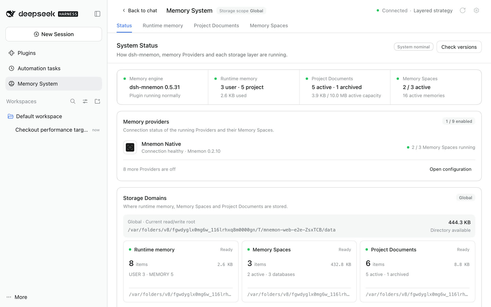
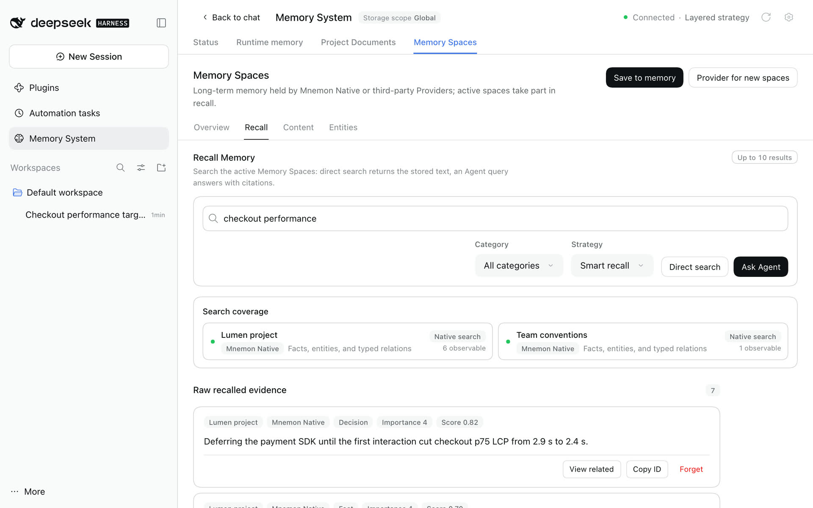
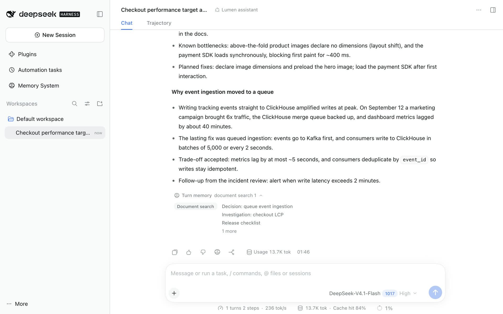
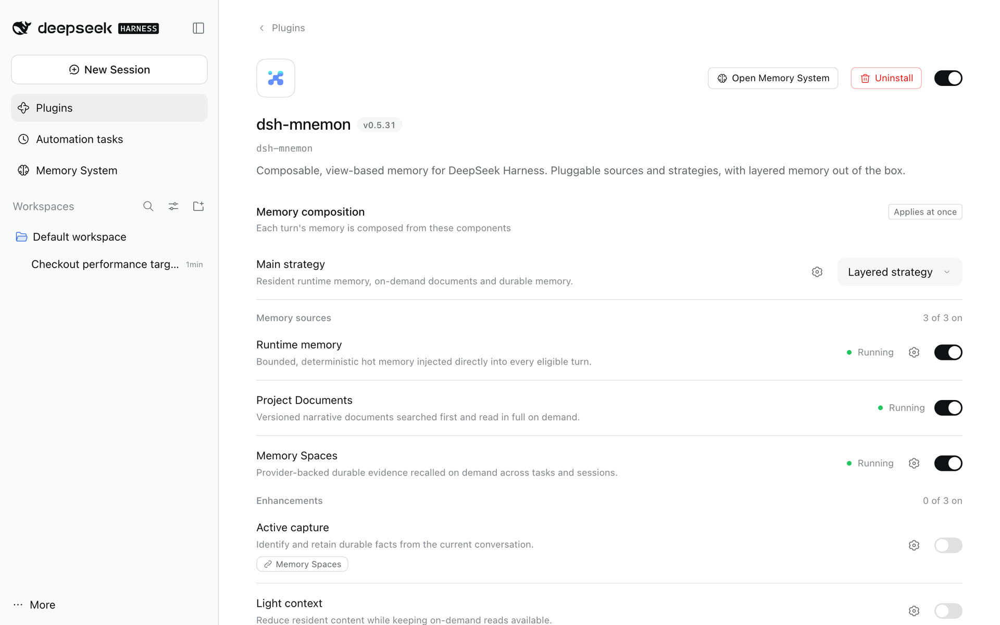

# Getting started

[简体中文](../../zh-CN/guides/getting-started.md) | **English** | [Documentation](../README.md)

This guide starts where dsh-mnemon is installed and ends with memory that a conversation actually uses. It keeps the defaults: the Memory System in the sidebar, global storage and the Layered strategy. You do not need to know about Views or Strategies for everyday use.

<a id="1-install-and-upgrade-from-the-command-line"></a>

Not installed yet? [Install and start](./installation.md) takes you from installing Node.js to your first memory, with a screenshot for every step, and covers [the command line](./installation.md#7-command-line-and-headless), development checkouts, Headless and updates. Upgrading an existing installation? Follow [Compatibility and upgrades](../reference/compatibility.md).

<a id="2-open-the-memory-system"></a>

## 1. Open the Memory System

Click **Memory System** in the sidebar. It opens on **Status**.



Check that:

- the header says **Connected** and names the main strategy, *Layered strategy* by default;
- the engine card shows the dsh-mnemon version, and the Mnemon CLI appears under **Memory providers** if you installed it;
- Runtime memory, Project Documents and Memory Spaces each have a card without errors;
- the storage root matches your storage scope.

Project Documents needs a DSH workspace even with global storage. Select a workspace for the conversation; "Waiting for workspace" means the project context is missing, not the CLI. If the Mnemon CLI is missing, run `command -v mnemon` and `mnemon --version` on macOS or Linux, or `Get-Command mnemon` on Windows. See [troubleshooting](./operations.md#troubleshooting) for other symptoms.

<a id="3-store-your-first-memories"></a>

## 2. Store your first memories

**Runtime memory.** Open **Runtime memory**, choose **Add memory** and save a preference in the user profile or a project fact in working memory. It is injected into every later turn.

**A document.** Open **Project Documents**, choose **New document** and save a short design note or checklist. The Agent searches documents when a question needs them.

**A memory space.** Open **Memory Spaces → Overview** and choose **Create Memory Space**:

1. Pick a Provider. Mnemon Native, the local default, is offered once its CLI is installed; enable third-party Providers on [Memory Spaces' page](./ui-guide.md#on-the-plugins-page) first.
2. Give it a narrow name, such as *Project decisions*, and describe what belongs there.
3. Keep it active so conversations can read it.

In an empty storage root, the first Mnemon Native space uses Mnemon's `default` store id while keeping your name and description; spaces on other Providers get their own ids. Then choose **Save to memory**, enter something stable and secret-free, and choose **Send to task Agent**. An independent task Agent picks the space, removes duplicates and writes, and its receipt says where it went.

**Check it.** Open **Memory Spaces → Recall**, ask a concrete question and choose **Direct search**. Each result keeps its memory space, category, importance and score; copy its id when you need it.



You can also use conversation commands:

```text
/mnemon status
/mnemon recall <focused query>
```

<a id="4-use-memory-in-a-conversation"></a>

## 3. Use memory in a conversation

Ask a question that depends on what you stored, and let the Agent decide whether it needs memory. After the reply:

- a **Turn memory** line appears if the turn used memory; expand it to see the documents and memories each tool read or wrote, and select one to open it where it lives;
- the brain mark under the reply is **Save to memory**: it opens an editable dialog, **Cancel** writes nothing, and sending it to the task Agent returns a receipt.



Ordinary conversation does not force recall. Current requests, repository files and live tool results outrank remembered history.

<a id="5-choose-how-memory-is-composed"></a>

## 4. Choose how memory is composed

Open **Plugins → dsh-mnemon**, or the gear in the Memory System header.



- **Main strategy**: keep the **Layered strategy**, or choose the **General strategy** to offer every available source in one budget and let the model decide.
- **Memory sources**: Runtime memory, Project Documents and Memory Spaces, one switch each. Turning one off stops its context, tools and background work without deleting data.
- **Enhancements**: Active capture, Light context and Scoped composition are off by default; each works with either main strategy.
- **Storage**: Global (default) shares one directory; Workspace keeps each workspace's own `.mnemon`; Centralized keeps each workspace under one root. **Data directory** is Default or Custom. Changing either never moves existing data; [Storage scopes](../reference/configuration.md#storage-scopes) explains each.
- **Interface**: open the Memory System in the sidebar or as a conversation tab, and turn the conversation controls on or off.

Switches and selectors apply at once; storage changes wait for **Apply**. The [UI guide](./ui-guide.md#on-the-plugins-page) covers every page, and [Configuration](../reference/configuration.md) lists the settings behind them.

<a id="6-next-steps"></a>

## 5. Next steps

- Learn every page in the [UI guide](./ui-guide.md).
- Decide what belongs in runtime memory, documents or memory spaces with the [storage model](../reference/storage-model.md).
- Export your first ZIP backup and prepare for upgrades with the [operations guide](./operations.md).
- Connect a long-term backend with the [Provider guide](./memory-providers.md).
