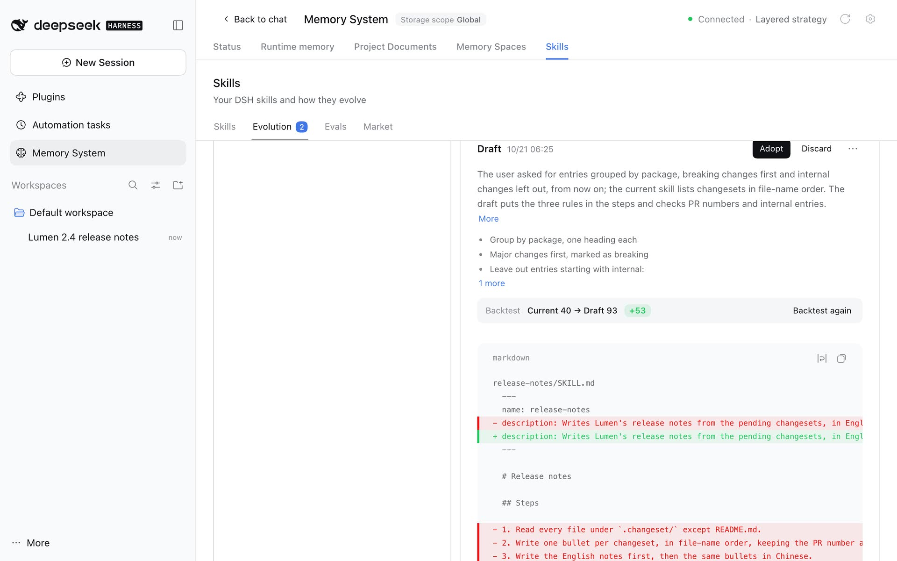

# v0.5.34: Skills That Improve With Use

[简体中文](../../zh-CN/releases/v0.5.34.md) | **English**

This release adds **Skills**, an experimental component for the DSH skills a workspace loads: [#443](https://github.com/omdsh-dev/dsh-mnemon/pull/443). It ships with the Starter and is on; self-evolution, the only part that calls a model, stays off until you turn it on.



- **One place for your skills.** A **Skills** page in the Memory System lists every `SKILL.md` DSH loads from the project's `.dsh/skills` and `.agents/skills` and from `~/.dsh/skills` and `~/.agents/skills`, in DSH's order of precedence, and marks a copy another one shadows. Switch a skill off for the model or the `/` menu with DSH's own frontmatter keys, use it in the conversation in one click, edit it, and go back to any earlier version: every change leaves one, a write never replaces a file edited elsewhere in the meantime, and a deleted skill goes to a trash folder first.
- **Self-evolution.** With it on, the Host records each conversation's steps as turns end, with secrets redacted. Once the conversation has earned a review and sits idle, a task Agent reviews it for corrections, "from now on" instructions, failed tools and reusable procedures, and suggests a new skill or an update that cites the steps it rests on. **Draft** writes the new `SKILL.md`, which is backtested against the current version on the skill's test cases; you adopt, edit, redraft or discard it. Nothing changes a skill without your **Adopt**.
- **Evidence and evals.** The conversations reviews read stay as evidence you can pin, delete or turn into test cases. **Evals** lists every skill's cases and backtests, including skills a suggestion proposes that do not exist yet. A backtest is a simulation: an executor follows the skill without tools, and a judge grades each check.
- **A market of skills.** The market reads skills from sources: a featured catalog, skills.sh searched as you type, any GitHub repository (Claude Code plugin marketplaces included), any site that publishes an Agent Skills discovery index, and catalog files a team keeps. A preview shows the security reviews skills.sh publishes. An install fetches the whole skill folder from its upstream within size and file-count limits, keeps every path inside the folder, checks a site's published SHA-256 digests, and records where the skill came from, so the market can offer an update.
- **In the conversation.** A **Turn skills** line under a turn names the skills it used and what its review suggested, each one click from the page, and the page can become a sidebar entry of its own. Skills' settings sit on its own page under **Plugins → dsh-mnemon**, where it is tagged **Experimental**; they apply at once.
- **Description.** dsh-mnemon now calls itself composable, view-based context for DeepSeek Harness, with layered memory and self-evolving skills out of the box, on the Plugins page and on npm.
- **Docs.** The [Skills guide](../guides/skills.md) walks through every screen, with screenshots from the new [v0.5.34 Skills gallery](../../assets/skills-v0.5.34/README.md); the READMEs, the UI guide and the configuration, storage and interface references describe Skills too.

## Upgrade and compatibility

**DSH 0.2.0-rc.2, 0.2.1-rc.1 and 0.2.1-rc.2:** use **Memory System → Status → Check versions → Update**, then restart DSH. That works from dsh-mnemon 0.5.31 and later on every supported DSH, and on DSH 0.2.0-rc.2 also from 0.5.19 in the WebUI and from 0.5.22 in the desktop app. Older installations, including 0.5.30 and earlier on DSH 0.2.1, where the update stops with `already-installed`, update once by hand: quit DSH, install the exact version, then start DSH again.

```sh
dsh plugin --profile web add dsh-mnemon@0.5.34
```

An explicit version avoids pnpm selecting an older release during its 24-hour release window. The command line does not manage the desktop app's `desktop` profile: there, **Uninstall** dsh-mnemon on the Plugins page, add it again with **Add plugin** as `dsh-mnemon@0.5.34`, then quit the app completely and open it again. Your memory data and settings stay.

After the restart, Skills is a tab of the Memory System and a row of **Memory composition** under Plugins. It reads the skills DSH already loads and changes none of them until you edit, install or adopt; its own data goes to a new `skills/` folder in the storage root, outside ZIP backups and Git sync. The market contacts GitHub, skills.sh and the sites you add only when you search, preview, install or refresh, or when a list it keeps is over six hours old.

**Supported DSH releases** are unchanged: DSH 0.2.0-rc.2 and 0.2.1-rc.1, and the 0.2.0 and later 0.2 releases after them (`>=0.2.0-rc.2 <0.2.1-0 || >=0.2.1-rc.1 <0.3.0-0`), which includes 0.2.1-rc.2, npm's `latest` and `next`.

Existing memory and settings need no migration. The new `skills` key in dsh-mnemon's configuration is optional; an earlier dsh-mnemon ignores it, and going back to one leaves your skills and the `skills/` folder in place.

## Changed packages

| Package | Previous | New |
| --- | --- | --- |
| `dsh-mnemon` | 0.5.33 | **0.5.34** |
| `dsh-mnemon-source-skills` | New | **0.5.1** |

The other 17 component versions are unchanged.

## Verification

[Release acceptance](../../pr-assets/release-v0.5.34/README.md) installs the new Starter through **Add plugin** on fresh DSH 0.2.1-rc.2 and 0.2.0-rc.2 hosts. On each it checks Status, Runtime memory, Check versions, a skill created on the Skills page, the **Experimental** tag and Skills' settings under Plugins, and updates a v0.5.33 installation through Check versions; Skills appears with the restart. On DSH 0.2.1-rc.2, the new skill also shows in DSH's `/` menu. The release branch passes the full workspace verification on the pinned DSH 0.2.1-rc.2 and the root tests against an installed DSH 0.2.0-rc.2, and the upgrade from 0.5.29 that publication runs passes against the candidate.

The [pull request](https://github.com/omdsh-dev/dsh-mnemon/pull/443) records the change and its local evidence; the [Skills plan](../../plans/skill-management.md) holds its design, and the [v0.5.34 Skills gallery](../../assets/skills-v0.5.34/README.md) its screens.

Publication verifies the complete pinned composition, registry installation and a real upgrade before creating the GitHub release.

Previous release: [v0.5.33](./v0.5.33.md).
