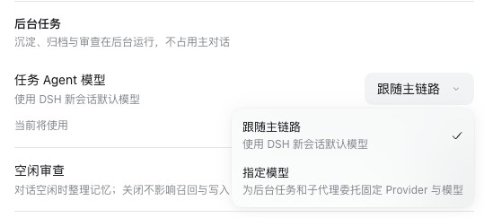
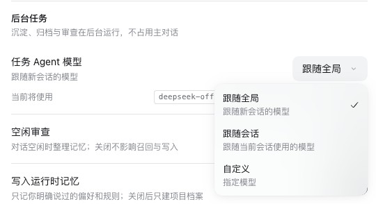
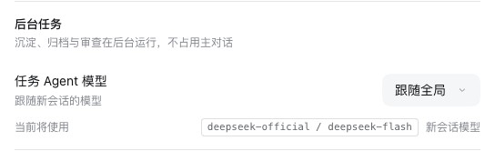
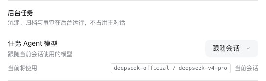

# Task Agents that can follow their conversation — PR #354

[简体中文](./README.zh-CN.md) | [Verification record](./verification.json)

PR #354 lets the task Agents behind Save to memory, Ask Agent, tidying and archiving run on the model of the conversation that asks for the work. As first submitted, it had three problems:
- it changed what `taskAgentModel: inherit` means for every profile;
- it fell back to another open conversation's model when the asking one was not open;
- it added a second editor for the setting on the Memory System's status page.

The maintainer adjustments keep the author's commits and the feature. It becomes one of three choices on the page where the setting already was. The status page is as on main.

Revisions:
- baseline: main `c00e6d7a`;
- the author's commits: `6e6a4921` and `3977b974`;
- main merged in: `1fb83599`;
- the adjustments: `4a40ace5` and `8ab1322a`.

The runs took place on 2026-10-17 (Asia/Shanghai):
- macOS 15.6 arm64, Node 24.19.0, Mnemon CLI 0.2.10;
- headless Chrome at 1280×800, zh-CN, light;
- DSH 0.2.0-rc.2 (npm `latest` and `next`) and 0.2.1-alpha.2, through `scripts/serve-e2e.mjs`.

## What DSH does with a model choice

On both hosts, DSH handles a model choice in two ways:
- A model picked in a conversation applies to that conversation's next request. DSH also saves it as the new-session default (`agentDefaultModel.saveSelection` in its session controller). Task Agents used that default, so they ran on the model picked last, in any conversation.
- A delegated child takes its parent's route: the provider, model and reasoning effort of the parent's last request, or its creation route before the first. Idle review and the other delegations a conversation starts therefore always follow that conversation.

So a task Agent usually ran on its conversation's model already. The two part once another conversation picks a different model afterwards, for example a fast model for one conversation and a stronger one for another. Save to memory in the first conversation then ran on the second one's model, while review in the first still used the first one's.

## The change

**Task Agent model**, under Plugins → dsh-mnemon → Layered strategy → **Background tasks**, is one choice of three:

| Choice | What a task Agent runs on | Stored as |
|---|---|---|
| **Follow global**, the default (was **Follow the main route**) | The new-session model DSH keeps, as before | `{ mode: inherit }` |
| **Follow the conversation** (new) | The model the asking conversation uses, as its review does, while it is open. Otherwise Follow global | `{ mode: inherit, followConversation: true }` |
| **Custom** (was **Choose a model**) | A Provider and model of its own | `{ mode: fixed, provider, model }` |

- **The route Follow the conversation takes.** It is the one DSH gives the conversation's own delegated work: the model and reasoning effort of its last request, or its creation route before the first.
- **Only the asking conversation counts.** The first version fell back to whichever conversation happened to be open.
- **A downgrade keeps working.** Follow the conversation is a key on the inherited route rather than a mode of its own. v0.5.30's schema keeps a key it does not know, and its resolver still reads `inherit`, so a downgraded Host follows global; an unknown mode would fail to load.
- **The page states the route.** It reads the stored choice live, so a choice made elsewhere shows at once, and the route line names where the route comes from: **New-session model**, **Current conversation** or **Custom**.
- **The author's dialog fix stays.** A dialog leaves Escape and Tab to a menu opened above it.

The first version's own screenshots show the editor it put on the status page: [the card](./status-background-tasks-zh.png), [a fixed route](./status-background-tasks-fixed-model-zh.png) and [its Provider list](./status-background-tasks-provider-zh.png). The first adjustment kept a stated route and a gear there. Since the setting already lives on the Layered strategy's page, that was removed too.

An independent review of the first adjustment found what else the page needed, and each item now has a test on the Layered strategy's page:
- giving up a custom model that was never written must keep the choice;
- **Read again** on a custom route must read the whole model directory;
- the route stated must be the Host's when DSH keeps no default, or before the page has the settings;
- the route must carry the conversation's reasoning effort.

## The run

The same steps ran on both hosts. A loopback model stub, [harness/stub.mjs](./harness/stub.mjs), recorded the model each request named. It is the fixture's own stub with the Save to memory script, reached through `--live-model` with a test key.

1. Conversation A picks DeepSeek-V4-Pro and gets a reply.
2. A new conversation B picks DeepSeek-V4.1-Flash and gets a reply.
3. Back in A, **Save to memory → Send to task Agent** on its reply.
4. Plugins → dsh-mnemon → Layered strategy: the choices. On this branch, **Follow the conversation**, then another reply in A and a second Save to memory.

| | A's replies | B's reply | The task of A's Save to memory |
|---|---|---|---|
| main, DSH 0.2.0-rc.2 | `deepseek-v4-pro` | `deepseek-flash` | `deepseek-flash` |
| This branch, **Follow global**, both hosts | `deepseek-v4-pro` | `deepseek-flash` | `deepseek-flash` |
| This branch, **Follow the conversation**, both hosts | `deepseek-v4-pro` | | `deepseek-v4-pro` |

Following global, the branch does what main does: A's task runs on B's model, DSH's default. Following the conversation, it runs on A's own. The choice was stored as `taskAgentModel: { mode: inherit, followConversation: true }`. No step logged a browser console error.

| The choices on main | The choices on this branch |
|---|---|
|  |  |

| Follow global | Follow the conversation |
|---|---|
|  |  |

## Tests

- **Host:**
  - An inherited route keeps DSH's new-session model unless it follows its conversation.
  - Following it, Runtime maintenance and a page task asked from the conversation take its route, reasoning effort included. A conversation that has not run yet takes its creation route, as DSH's delegations do.
  - A conversation that is not open, a caller without one, and half a request header keep the default.
  - The model directory reports the conversation's route and the inherited route either way.
- **Config:** the key is off unless set, has no effect on a custom route, and must be a boolean.
- **The Layered strategy's page:**
  - It asks with its conversation, follows it only once that is chosen, and reads a choice stored elsewhere at once.
  - Giving up a custom model keeps the choice, and **Read again** reads the whole directory for a custom route.
  - The route is right without a DSH default and before the settings are read.
  - The older cases use the renamed choices.
- **On the first version (`1fb83599`), 13 of these fail.** 8 fail for what they check. The other 5 fail only because the choices were renamed (3) or because the catalog now also reports the inherited route (2). For example, a task asked from a conversation that is not open took the open conversation's `ai / space-bunny`.

## Validation

`pnpm run verify` (Node 24.19.0, pnpm 11.25.0) passed with the adjustments:
- docs, typecheck and the deterministic build;
- every plugin's build, typecheck and tests;
- root tests: 2,019 passed, 6 skipped;
- Headless activation and the legacy settings import;
- package contents: 59 files, 1,984,169 unpacked bytes, under the 2,500,000-byte ceiling;
- publint and attw.

[verification.json](./verification.json) has the requests, the stated routes and the steps of each run.
