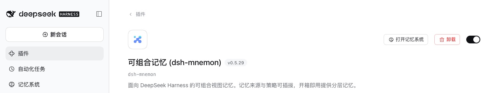
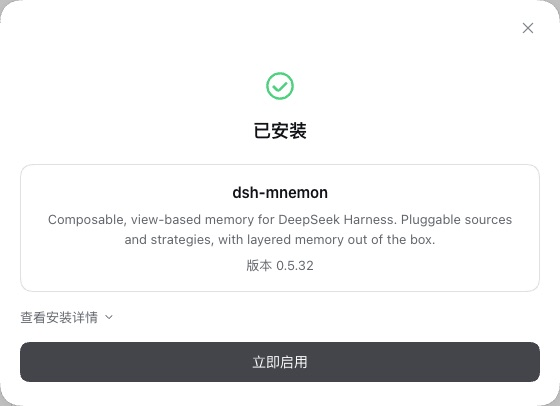

# Updating from 0.5.30 and earlier in the desktop app on DSH 0.2.1

[中文](README.zh-CN.md) | [Validation record](validation.json)

Verified on 2026-10-19 (Asia/Shanghai), for [#433](https://github.com/omdsh-dev/dsh-mnemon/issues/433) and [#436](https://github.com/omdsh-dev/dsh-mnemon/issues/436).

## The gap

Both reports come from the desktop app on DSH 0.2.1-rc.2, with a dsh-mnemon that does not support DSH 0.2.1: 0.5.29 in #433 (memory subagents fail) and 0.5.27 in #436 (a peer the host does not install). 0.5.31 fixed both, so the answer is to update. The documentation did not say how:

- On DSH 0.2.1, **Check versions → Update** in dsh-mnemon 0.5.30 and earlier stops with `already-installed`, since DSH no longer installs over a plugin the profile has.
- For that case the documentation gave `dsh plugin --profile web add dsh-mnemon@<version>`, but the command line does not manage the desktop app's `desktop` profile. Two more places still sent readers to "the command" or "the command line".
- Uninstalling dsh-mnemon on the Plugins page and adding it again was documented for 0.5.21 and earlier only. DSH 0.2.1's Plugins page gives the same advice for a plugin it installed: "This plugin is already installed. To upgrade it, uninstall it and install it again".
- Two passages said a newly upgraded DSH turns an unsupported release off. DSH 0.2 does that to releases before 0.5.19. On DSH 0.2.1, 0.5.19 to 0.5.30 keep running, as both reports and the runs below show, while their memory subagents and Check versions fail.

## The change

Documentation only, in English and Chinese:

- Install and start:
  - Desktop app: 0.5.30 and earlier on DSH 0.2.1 join 0.5.21 and earlier. They update once by uninstalling dsh-mnemon on the Plugins page and adding it again with **Add plugin**, typing the version, for example `dsh-mnemon@0.5.32`.
  - Update and uninstall: the `already-installed` line gives both routes. For the WebUI, quit DSH, run the command and start DSH again; in the desktop app, uninstall and add again.
  - Common problems: within 24 hours of a release, DSH 0.2.1 says which version Add plugin installed, and DSH 0.2.0 does not.
  - Upgrading DSH: what an upgraded DSH does to older releases, and a pointer to the update steps instead of "the command".
- Compatibility:
  - Upgrade order: what DSH 0.2 and 0.2.1 do to older releases, and the desktop app's route beside the command line.
  - DSH 0.2.0 and 0.2.1: the `already-installed` note points to Upgrade order instead of the command line.
- Operations:
  - Version checks and updates: why DSH 0.2.1 stops there, and that the desktop app uninstalls and adds again.
  - Troubleshooting: the 0.5.18 row says to uninstall and add again instead of updating on the Plugins page, which cannot update a plugin.
- v0.5.32 notes: the desktop sentence gives the route with the exact version, after the sentence on why to name one.

## Verification

Each run used unmodified npm DSH 0.2.1-rc.2 (npm `latest` and `next`) with a fresh home, DSH home and pnpm store, and the real npm registry. The web profile stands in for the desktop app's `desktop` profile: both use DSH's Plugins page and installer.

1. Installed the older release before starting the WebUI: 0.5.29, 0.5.27, and 0.5.29 again with a saved setting. The saved setting was a USER.md limit of 6000 bytes, kept where DSH saves a plugin's settings, the profile's patch layer. Status reported the release with System nominal, and a Runtime memory entry was added on the page.
2. Opened dsh-mnemon on the Plugins page and clicked **Uninstall**: [the detail page on 0.5.29](detail-0.5.29.jpg). DSH asked for confirmation ("卸载「可组合记忆 (dsh-mnemon)」？ 卸载后它提供的功能会消失。"), removed the plugin, and the Memory System left the sidebar.
3. **Add plugin** installed 0.5.32 ([result](added-0.5.32.jpg)), and **Enable now** showed 0.5.32 with System nominal at once.
   - In the first two runs only `dsh-mnemon` was typed. The release was 43 hours old, past pnpm's 24-hour minimum release age.
   - In the third, `dsh-mnemon@0.5.32` was typed, and the profile recorded that exact version.
4. After a restart, Status reports **dsh-mnemon 0.5.32 / System nominal** ([Status](status-after-restart.jpg)).
   - The Runtime entry written before the removal is still there ([Runtime memory](runtime-kept.jpg)).
   - In the third run the USER.md limit still reads 5.9 KB, and the setting is still in the patch layer.
   - Check versions calls 0.5.32 current. The profile holds the 17 components at the Starter's pins, and the restart logged no activation warning.

All three runs passed every step with no console error; [validation.json](validation.json) has each result.

| Detail page on 0.5.29, with Uninstall | After Add plugin |
|---|---|
|  |  |

`pnpm run verify:docs` checks the links and the English and Chinese twins.

## Limits

- The desktop app itself was not run; its Plugins page and installer are DSH's, as in the web profile.
- Within 24 hours of a release, Add plugin without a version installs an earlier release, which can be one that still stops with `already-installed`. That is why the documentation types the version.
