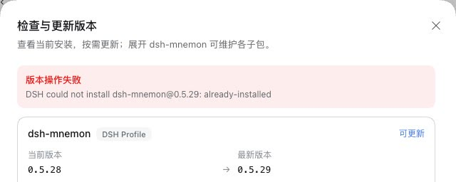
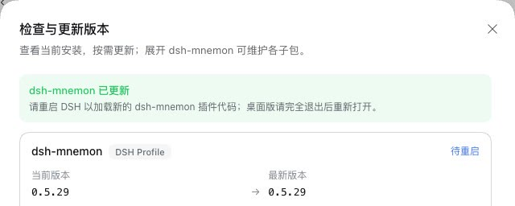
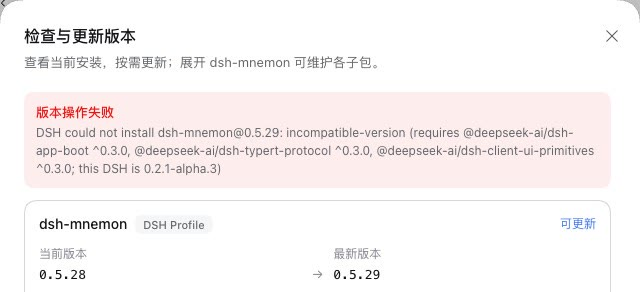
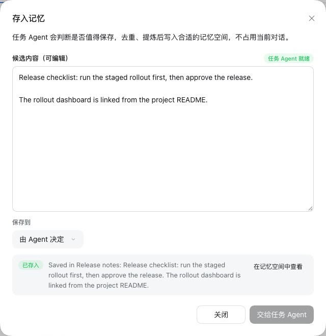
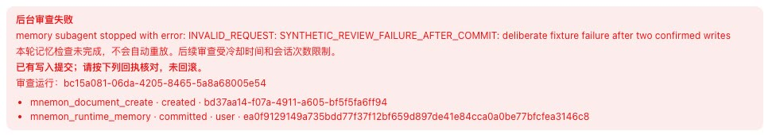

# dsh-mnemon 在 DSH 0.2.1-alpha.3 上

[English](./README.md) | [验证记录](./verification.json)

DSH 0.2.1-alpha.3（npm `alpha`，2026-10-14 发布）改变了子 Agent 的组装方式和插件的替换方式。在它上面，dsh-mnemon 0.5.29 无法启动任何记忆子 Agent，**检查版本 → 更新**也会失败。本记录说明哪些地方不同、本次改动如何处理，以及在 0.2.1-alpha.3、0.2.1-alpha.2 和 DSH 0.2.0-rc.2（npm `latest` 与 `next`）上运行了什么，以说明 dsh-mnemon 在三者上都能工作。

实测版本：分支 `claude/dsh-021-alpha3`，基于 v0.5.29（main `4feee034`）。运行于 2026-10-14 至 15 日（Asia/Shanghai）：
- macOS 15.6 arm64，Node 24.19.0；
- 无头 Chrome 155，zh-CN，浅色；
- DSH 0.2.1-alpha.3、0.2.1-alpha.2 与 0.2.0-rc.2，各自安装在独立的 npm prefix；
- Mnemon CLI 0.2.10。

## 0.2.1-alpha.3 的不同之处

| DSH 0.2.1-alpha.3 | 对 dsh-mnemon 0.5.29 的影响 | 现在 |
|---|---|---|
| 启动请求不再携带 `persona` 与 `toolFilter`，也没有 provider 声明这两项；子 Agent 沿用父 Agent 的组装，或使用为它指定的 Agent 预设 | 所有记忆子 Agent 在启动前就失败：`dsh-mnemon requires a non-inheriting DSH subagent provider with tool filtering, persona, and depth limiting` | 在 DSH 发布子 Agent 时，把它的指令和工具清单注册在它自己的作用域里 |
| 开启热重载时，插件管理器拒绝安装 profile 中已有的包（`already-installed`）；要换成另一个版本，只能先移除 | **检查版本 → 更新**停在 `DSH could not install dsh-mnemon@0.5.29: already-installed` | 由 DSH 自己的 `dsh plugin add` 替换该包，带有 DSH 的锁与兼容性检查，之后照常重启 |
| 已结束的子 Agent 被续接时，只有日志里记录了人设与工具过滤才会恢复它们，而 DSH 现在不再记录 | 从对话的子 Agent 列表续接已结束的记忆任务，它会带着对话的工具与指令运行 | 写入[兼容性说明](../../zh-CN/reference/compatibility.md#dsh-02) |
| `dsh-session-persistence-jsonl` 直接导出插件本身（`name`、`Config`、`apply`），不再以默认导出提供类 | 对用户无影响；直接加载它的测试报 `invalid plugin` | 测试兼容两种形式 |
| API Gateway 以调用所代表的 Peer 分派每次调用：`fetch(request, peer)` | 对用户无影响；不带 Peer 调用共享处理器的契约测试失败 | 在 Connection 能创建 Peer 时，测试传入一个 owner Peer |
| 插件管理器通过 HMR 的 `reconcileProfile` 应用变更 | 对用户无影响；激活夹具里替身 HMR 没有这个方法 | 替身改用 app-boot 的 `recomposeProfile` 重组 |
| 插件页把插件分为内置、实验性与已安装三组 | 无：dsh-mnemon 页面、配置与组件列表的显示与 0.2.1-alpha.2 相同 | — |

dsh-mnemon 从 DSH 包导入的每个具名值（例如 `dsh-client-ui-primitives` 的 20 个）在 0.2.1-alpha.3 中都存在。它的其他变化，例如凭据的优先顺序、针对非 owner Peer 的远程访问策略，不影响 dsh-mnemon：GitHub 登录使用凭据存储的记录部分，用启动令牌认证的浏览器就是 owner。

### 记忆子 Agent

dsh-mnemon 给每个记忆子 Agent 配上自己的指令（其中带有本次运行的完成协议），并只开放任务所需的工具，例如 USER.md 压缩只开放结果工具。到 0.2.1-alpha.2 为止，这两项随启动请求传入，由 DSH 的 spawn 与 fork provider 注册在子 Agent 自己的作用域里。0.2.1-alpha.3 把这两项从请求和 provider 能力中都移除了，dsh-mnemon 0.5.29 因此找不到可用的 provider。受影响的有存入记忆、记忆空间写入、空闲审查、USER.md 压缩、工作记忆归档、项目档案归档以及 Git 同步的核对审查。

当 provider 两项能力都未声明时，本次改动不带这两项启动子 Agent，并在 DSH 发布子 Agent 时自己注册它们。DSH 组装完子 Agent、提交任务之前会通告它，dsh-mnemon 的监听器最先执行，在子 Agent 的作用域里加入人设段落和工具限制；DSH 0.2.1-alpha.3 为旧版本记录了这两项的子 Agent 恢复它们时，也是这样做的。两者随子 Agent 的作用域一起释放。这只用于由 DSH 在本进程中创建子 Agent 的 provider，也就是像 DSH 的 spawn 与 fork 那样准备本地 activation 的 provider。其他 provider 在启动任何东西之前就被拒绝；dsh-mnemon 没有看到创建的子 Agent，其运行也会被释放并拒绝，所以记忆任务不会带着对话的工具运行。在 DSH 0.2.1-alpha.2、0.2.0 与 0.1.7 上，这两项仍随请求传入。同时发起的多个启动按各自的异步上下文区分，每个子 Agent 都拿到自己的指令。

真实宿主上的压缩测试现在还会检查子 Agent 的模型请求提供了哪些工具。在三个已安装的宿主上都只有 `mnemon_subagent_result`。去掉工具限制后，在 0.2.1-alpha.3 上同一请求会提供测试对话的全部 17 个工具。

已结束的记忆任务不应再被续接，但 DSH 会把它列在对话的子 Agent 中。[`harness/resumed-memory-task-host.probe.ts`](./harness/resumed-memory-task-host.probe.ts) 先通过子 Agent 压缩 USER.md，再让对话给这个子 Agent 发消息：

| DSH | 压缩子 Agent | 续接后的同一子 Agent |
|---|---|---|
| 0.2.1-alpha.3，本次改动 | `mnemon_subagent_result` 与 Mnemon 的指令 | 对话的工具（探针中为 17 个），没有 Mnemon 的指令 |
| 0.2.1-alpha.2 | `mnemon_subagent_result` 与 Mnemon 的指令 | `mnemon_subagent_result` 与 Mnemon 的指令，从日志中恢复 |
| 0.2.0-rc.2 | `mnemon_subagent_result` 与 Mnemon 的指令 | 无法续接 |

### 检查版本 → 更新

开启热重载时，DSH 0.2.1-alpha.3 会在运行 pnpm 之前拒绝安装 profile 中已有的包。它自己的插件页更新官方插件时，先移除再安装新版本。dsh-mnemon 不能这样处理自己：移除会停掉正在执行更新的代码，安装失败还会让 profile 失去它。当 DSH 以 `already-installed` 拒绝时，本次改动对 `add <包>@<版本> --save-exact` 运行 `@deepseek-ai/dsh-plugin-manager/operations` 中的 `runPluginCommand`。这正是 `dsh plugin add` 背后的代码，由 DSH 的运行时解析从 DSH 所在的安装中提供。它持有 profile 的写锁，使用启动器提供的包管理器。它在运行 pnpm 之前读取该版本的清单，DSH peer 不包含当前 DSH 的版本会被拒绝，什么都不安装。其他失败会恢复 profile 的清单与锁文件，并在 `.plugin-manager/logs` 下留下日志。更新成功后照常提示重启。若安装中没有导出这个命令，错误信息会给出应在 DSH 停止时运行的 `dsh plugin --profile <profile> add …`。在 0.2.0 与 0.2.1-alpha.2 上，仍由 DSH 的安装器更新。

在全新的 0.2.1-alpha.3 web profile 中检查，WebUI 的**检查版本**提示可更新到 npm `latest` 的 0.5.29：

| 来自 npm 的 dsh-mnemon 0.5.28 | 本次改动，以 0.5.28 安装 | 本次改动，0.5.29 要求 DSH ^0.3.0 时 |
|---|---|---|
|  |  |  |

更新后 profile 记录 `dsh-mnemon` `0.5.29`，profile 的操作日志里有 pnpm 安装它的记录，重启后记忆系统运行 0.5.29。对于不兼容的版本，DSH 记下 `installation rejected` 且没有安装任何东西，profile 保持 0.5.28。同一构建以同样方式安装在 0.2.0-rc.2 上时，通过 DSH 的安装器更新。本地仓库以 0.5.28 的版本号提供本分支的包；第三次运行时，它还把已发布的 0.5.29 的 DSH peer 提高到 `^0.3.0` 后提供。其余请求都转发到 registry.npmjs.org，没有发布任何内容。

### 独立评审

对第一版的评审发现三处问题：更新从 PATH 运行 pnpm，绕过了 DSH 的锁和兼容性检查；发布时组装会接受在别处运行子 Agent 的 provider；它的监听器排在其他插件的监听器之后。本版本处理了这三点，并为并发启动、在别处运行子 Agent 的 provider 以及不兼容的版本补充了测试。评审还建议拒绝续接已结束的记忆任务，这一点改为写入文档：DSH 没有能标明某个子 Agent 属于 Mnemon 的记录，而续接后的子 Agent 拿到的权限并不超过它所在的对话。

## 在已安装的 DSH 上运行测试

[DSH 0.2.1-alpha.2 测试配置](../dsh-021-alpha2/README.zh-CN.md#在已安装的-dsh-上运行测试)在 0.2.1-alpha.3 上无需改动即可运行。那份记录里的任务目录探针按 0.2.1-alpha.2 的导出方式加载 JSONL 持久化，因此不能在 0.2.1-alpha.3 上运行。这里的探针使用同一配置：

```sh
DSH_HOST_ROOT=<prefix>/lib/node_modules/@deepseek-ai/dsh DSH_VERSION=<版本> MNEMON_TEST_DIR=docs/pr-assets/dsh-021-alpha3/harness \
  pnpm exec vitest run --config docs/pr-assets/dsh-021-alpha2/harness/installed-dsh-all.vitest.config.mjs
```

## 结果

### 在已安装宿主上的测试

| 检查 | DSH 0.2.1-alpha.3 | DSH 0.2.1-alpha.2 | DSH 0.2.0-rc.2 |
|---|---|---|---|
| 除六个真实宿主测试外的根测试，v0.5.29 | 48 个失败：`legacy-session-repair` 44 个、激活契约 3 个、Connection 契约 1 个 | 通过 | 通过 |
| 六个真实宿主测试（适配副本），v0.5.29 | 17 个中 12 个失败 | 17 个通过 | 17 个通过 |
| 除六个真实宿主测试外的根测试，本次改动 | 1,948 个通过，6 个跳过（130 个文件） | 1,948 个通过，6 个跳过 | 1,948 个通过，6 个跳过 |
| 六个真实宿主测试，本次改动 | 17 个通过 | 17 个通过 | 17 个通过 |
| Starter 激活契约：冷启动、启动后停用另一个 bundle、组件与 bundle 开关 | 通过 | 通过 | 通过 |
| `--check-declared-rows` | 通过 | 通过 | 在分组行上失败，即已知的列表问题 |
| Headless，默认组合与启用三个可选策略 | 通过 | 通过 | 通过 |
| `scripts/verify-sync-git.mjs` | 64 项检查通过（v0.5.29：在核对审查处失败） | 64 项通过 | 64 项通过 |

`pnpm verify` 与 `verify:plugins` 在锁定的 DSH 0.1.7-rc.2 上通过。

### 0.2.1-alpha.3 上的 WebUI

每项检查都在 e2e 夹具的真实 WebUI 中进行，`MNEMON_E2E_DSH` 指向 0.2.1-alpha.3，由无头 Chrome 驱动；只脚本化了模型的选择。

| 范围 | 结果 |
|---|---|
| 插件页 | dsh-mnemon 列在已安装插件中。它的页面显示配置与 9 个组件（5 个运行中、4 个已停用），没有分组行，也没有说明。开关“轻量上下文”立即生效，没有重启提示（运行中先变为 6 个，再回到 5 个），状态页保持正常。 |
| 存入记忆（`--save-action`） | 任务 Agent 创建 Native 空间并写入回复：“Saved in Release notes”。 |
| 空闲审查（`--idle-review`） | 两轮对话后，fork 审查者在夹具故意制造的失败之前创建了一份档案并添加了一条画像；状态页列出这两条回执。 |
| USER.md 压缩（`--profile-compaction`） | 第三条事实发现 USER.md 已满；压缩子 Agent 合并前两条，第三条随后写入。 |
| 对话记忆（`--docs-demo`） | 一次档案检索与两次记忆空间召回，回答用到 4 条记忆与 2 份档案；替换工作记忆成功。 |
| 远程页面（`--trusted-host`） | 没有授权时，记忆系统与插件设置为只读并说明原因；设置 `remoteAccess: trusted-host` 后，修改在刷新后仍然保留。 |
| 检查版本 → 更新 | 见上文。 |

| 存入记忆 | 状态页上的空闲审查 |
|---|---|
|  |  |

存入记忆、空闲审查、USER.md 压缩与插件页也在 0.2.0-rc.2 上用本次改动运行并通过；在那里页面列出分组行，并由说明解释它。所有运行都没有浏览器控制台错误。

## 限制

- DSH 0.2.1-alpha.3 是 alpha 版本，其 API 可能还会变化。
- 模型是只脚本化模型选择的本地桩；工具、子 Agent、存储与 WebUI 都是真实的。
- 只在 macOS 上运行。DSH 桌面版没有 0.2.1-alpha.3 构建，因此没有检查桌面窗口，也没有检查通过桌面版内置 pnpm 的更新（DSH 的插件命令会使用它）。
- `dsh plugin add` 运行时不带仓库参数，因此在 0.2.1-alpha.3 上更新使用 pnpm 自己的仓库设置，而不是 DSH 插件页选定的仓库。
