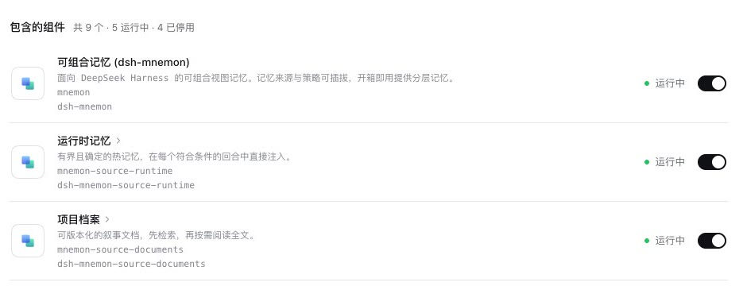
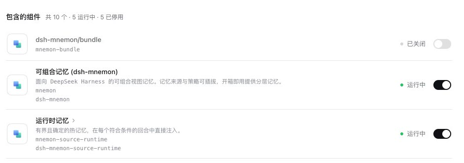
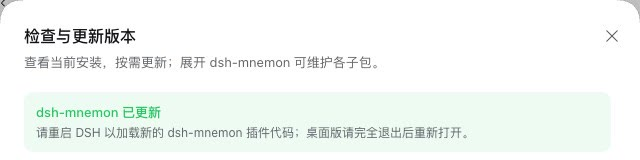
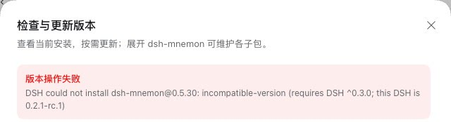
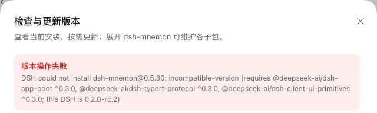

# dsh-mnemon on DSH 0.2.1-rc.1 and 0.2.0-rc.2

[简体中文](./README.zh-CN.md) | [Verification record](./verification.json)

DSH 0.2.1-rc.1 (npm `next`, published 2026-10-17) is the first release candidate of DSH 0.2.1; DSH 0.2.0-rc.2 stays npm `latest`. This change makes those two releases, and the 0.2.0 and 0.2.x releases after them, the hosts dsh-mnemon supports. It moves development to DSH 0.2.1-rc.1, removes what only DSH 0.1.7, 0.2.0-rc.1 and the 0.2.1 alphas needed, and records what was run on both releases.

Tested revision: this branch at `cd999526`, on main `7b7efa49` (v0.5.30 and #354). The commits after it change only the error for a missing subagent provider, the upgrade base of the packed-artifact check, the documentation and this record. The runs took place on 2026-10-17 (Asia/Shanghai):
- macOS 15.6 arm64, Node 24.19.0 and pnpm 10.13.1, the CI version;
- headless Chrome, zh-CN, light;
- DSH 0.2.1-rc.1 and 0.2.0-rc.2, each in an isolated npm prefix;
- Mnemon CLI 0.2.10.

## Supported releases

dsh-mnemon supports `>=0.2.0-rc.2 <0.2.1-0 || >=0.2.1-rc.1 <0.3.0-0`. DSH 0.2.1 reads that range from the Starter's new `engines.dsh`: where a manifest states it, it decides compatibility alone. DSH 0.2.0 reads the Starter's DSH peers, which state the same range. Each release's own check, run on the Starter manifest:

| Runtime | DSH 0.2.0-rc.2's check | DSH 0.2.1-rc.1's check |
|---|---|---|
| The running release | supported | supported |
| 0.1.7-rc.2 | refused | refused |
| 0.2.1-alpha.5 | refused | refused |
| 0.3.0-rc.1 | refused | refused |

`tests/dsh-host-compatibility.spec.ts` runs DSH's check over all 18 manifests for 0.2.0-rc.2, 0.2.0, 0.2.1-rc.1, 0.2.1 and 0.2.2, and checks that the Starter is refused on 0.1.7-rc.2, 0.2.0-rc.1, 0.2.1-alpha.3, 0.2.1-alpha.5 and 0.3.0-rc.1.

What DSH 0.2.1-rc.1 changes for a plugin, compared with 0.2.1-alpha.3:

| DSH 0.2.1-rc.1 | This change |
|---|---|
| `engines.dsh` decides compatibility alone where a manifest states it; otherwise every `@deepseek-ai/dsh*` peer must admit the runtime | The Starter states the supported range in both |
| A refused plugin's record names what it needs `requirements`, keyed `engines.dsh` or by peer package, where 0.2.0 names the peers `peers` | **Check versions → Update** names either: `requires DSH ^0.3.0` or `requires @deepseek-ai/dsh-app-boot ^0.3.0, …` |
| The installation no longer ships `dsh-client-ui-primitives`: the frontend shares it with every client bundle, and DSH's own client plugins list it only as a development dependency | dsh-mnemon and Memory Spaces drop it from their peers |
| The subagent API, hot reload and the Plugins page behave as in 0.2.1-alpha.3 | The alpha.3 paths of this pull request apply unchanged |

## What changes

- **Supported range.** The root's `engines.dsh` and DSH peers, as above. The client primitives peer is gone from the root and from Memory Spaces, which is why Memory Spaces gets a patch release too.
- **Development baseline.** Every DSH development dependency moves to 0.2.1-rc.1, with Cordis 4.0.5. The real-host specs compose whichever DSH they run on through `tests/helpers/installed-dsh.ts`: the working directory service only where the host's version has it, `start` or `startActivation`, Code Mode beside native tools only on 0.2.0. The version decides, not whether a package resolves: under `pnpm run`, NODE_PATH reaches this repository's own DSH 0.2.1 packages from an installed 0.2.0.
- **The other supported release in CI.** `pnpm run test:installed-dsh` runs the root tests against an installed DSH (`scripts/installed-dsh.config.ts`, promoted from the [0.2.1-alpha.2 record](../dsh-021-alpha2/README.md#running-the-tests-against-an-installed-dsh)). A new CI job runs it against DSH 0.2.0-rc.2 from npm. The six adapted copies that [#356](../issue-356-subagent-activation/README.md) needed are no longer needed: the specs themselves run on both.
- **Code and tests for releases no longer supported.** Comments, test fakes and fixtures now name DSH 0.2.0 and DSH 0.2.1 instead of 0.1.7 and the 0.2.1 alphas. The subagent fakes model the two supported hosts; the alpha.2 mix of activations with request composition, and its cases, are gone. The packed-profile fixtures accept any DSH the Starter supports, through DSH's own check, instead of exactly 0.1.7-rc.2. The Electron window fixture defaults to the transport DSH Desktop declares. The code paths themselves are the ones both supported releases take.
- **Copy.** The Status note shown while Agent Teams pauses idle review no longer names DSH 0.1.7-rc.2: the Team review spec passes on both supported releases with their official Teams. The error for a missing subagent provider now says what both releases need, a provider that limits depth and gives each child its own instructions and tools, instead of naming DSH 0.2.0's capabilities.
- **Documentation.** [Compatibility and upgrades](../../en/reference/compatibility.md) is the one place that states the supported releases, with a table of the last dsh-mnemon for older hosts, the differences between DSH 0.2.0 and 0.2.1, and the upgrade order. The guides, the configuration and development references, README and CONTRIBUTING link there instead of repeating 0.1.7-era claims.

## Results

| Check | DSH 0.2.1-rc.1 | DSH 0.2.0-rc.2 |
|---|---|---|
| `pnpm run verify` and `pnpm run verify:plugins` (17 plugin repositories, 18 packed artifacts, the packed Starter upgraded from 0.5.29 in a real DSH) | passed (the pinned baseline) | — |
| Root tests | 2,036 passed, 6 skipped (140 files), pinned | 2,036 passed, 6 skipped (140 files), installed, with no excluded or adapted spec |
| Headless, with the default composition and with the three optional Strategies | passed | passed |
| Starter activation contracts: cold start, isolated, another bundle stopped since startup | passed | passed |
| `--check-declared-rows` | passed | fails on the grouping row, the known listing issue |
| Git sync end to end | 64 checks passed | 64 checks passed |
| WebUI scenarios (below) | 14 of 14 passed | 14 of 14 passed |
| Plugins page | 9 components (“共 9 个 · 5 运行中 · 4 已停用”), no grouping row and no note about it | 10 rows with `dsh-mnemon/bundle` off, and the note above the list explains it |
| Check versions → Update, this branch installed as 0.5.29, to the published 0.5.30 | updated through `dsh plugin add`; after a restart the Memory System runs 0.5.30 | updated through DSH's installer; after a restart the Memory System runs 0.5.30 |
| The same, with a 0.5.30 whose manifest asks for DSH ^0.3.0 | refused before anything installed: `requires DSH ^0.3.0; this DSH is 0.2.1-rc.1` | refused before anything installed, naming the three peers |

The WebUI scenarios drive the e2e fixture in headless Chrome. Only model decisions are scripted; tools, subagents, Sources and Providers are real:
- idle review that commits a Document and a profile entry before a deliberate failure, shown on Status;
- USER.md compaction through a memory subagent;
- Save to memory, and a second save of an edited candidate;
- a remote page that stays read only, and remote management through a trusted host;
- component switches on the Plugins page;
- a second runtime;
- Git sync with an untracked file;
- the recall budget;
- the delegated-task line in a review child's session;
- the Documents format upgrade;
- Memory Space edges;
- a memory saved into a named space, and a switched-off space a model names (#387);
- the settings icons on the dsh-mnemon page.

| Plugins page, DSH 0.2.1-rc.1 | Plugins page, DSH 0.2.0-rc.2 |
|---|---|
|  |  |

| Update on DSH 0.2.1-rc.1 | Incompatible release, DSH 0.2.1-rc.1 | Incompatible release, DSH 0.2.0-rc.2 |
|---|---|---|
|  |  |  |

For the update runs, a local registry served this branch's package as version 0.5.29 and, for the incompatible runs, the published 0.5.30 with its DSH peers and `engines.dsh` raised to `^0.3.0`. It passed every other request to registry.npmjs.org and published nothing.

## Running it yourself

```sh
pnpm install --frozen-lockfile
pnpm run build
pnpm --workspace-concurrency=4 -r build
pnpm run test:root

npm install --global --prefix <prefix> @deepseek-ai/dsh@0.2.0-rc.2
DSH_HOST_ROOT=<prefix>/lib/node_modules/@deepseek-ai/dsh pnpm run test:installed-dsh
MNEMON_E2E_DSH=<prefix>/lib/node_modules/@deepseek-ai/dsh/lib/bin.js node scripts/verify-headless-profile.mjs
MNEMON_E2E_DSH=<prefix>/lib/node_modules/@deepseek-ai/dsh/lib/bin.js node scripts/verify-sync-git.mjs
node --expose-internals tests/fixtures/bundle-activation.mjs <prefix>/lib/node_modules/@deepseek-ai/dsh manager
```

Run the scripts with `node`, not `pnpm`, so they inherit no `NODE_PATH`.

## Limits

- pnpm 11 does not pick a version published less than 24 hours ago, which covers every DSH 0.2.1-rc.1 package until 2026-10-18 03:17 UTC; until then, install this repository with pnpm 10, as CI does.
- The runs used DSH's web profile. DSH Desktop 0.2.1-rc.1 was not tried.
- The scenarios that need an embedding service (vector recall and Save to memory with embeddings, embedding coverage) were not rerun; nothing in them depends on the DSH release.
- The [v0.5.19 gallery](../../assets/webui-v0.5.19/README.md) was captured on DSH 0.1.7-rc.2 and is not recaptured here.
