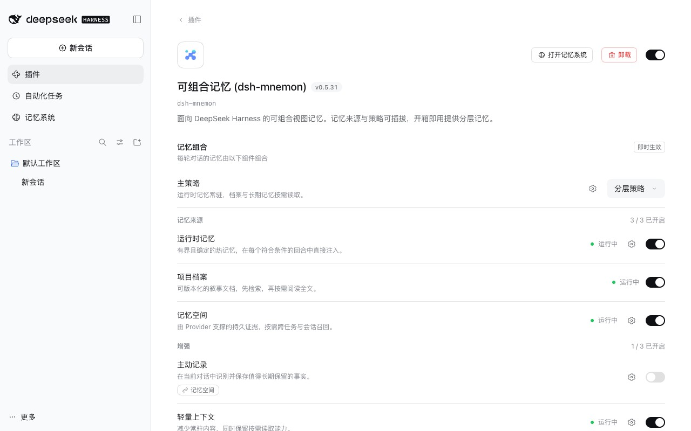
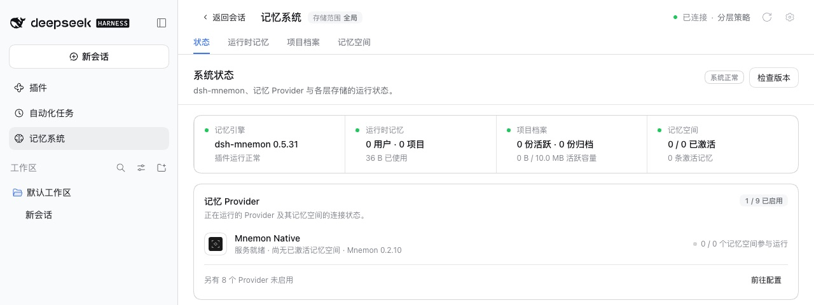

# DSH 0.2.1-rc.2 上的 dsh-mnemon

[English](./README.md)

DSH 0.2.1-rc.2 于 2026-10-17 08:36 UTC 成为 npm `next`；DSH 0.2.0-rc.2 仍是 npm `latest`。本次改动把开发基线从 0.2.1-rc.1 移到 0.2.1-rc.2。支持范围 `>=0.2.0-rc.2 <0.2.1-0 || >=0.2.1-rc.1 <0.3.0-0` 已经包含 rc.2，保持不变，因此 DSH 0.2.1-rc.1 仍可使用。dsh-mnemon 的代码没有改动。

测试于 2026-10-17（Asia/Shanghai）：macOS 15.6 arm64、Node 24.19.0、pnpm 10.13.1（CI 使用的版本）、zh-CN 浅色模式的 headless Chrome，DSH 0.2.1-rc.2 与 0.2.0-rc.2 各自安装在隔离的 npm 前缀中，Mnemon CLI 0.2.10。

## DSH 0.2.1-rc.2 的变化

与 0.2.1-rc.1 相比，新增两个包，六个包的代码有改动，一个包改了文档，两个包只改了其中记录的构建提交；其余包只改了版本号。

| DSH 0.2.1-rc.2 | 对 dsh-mnemon 的影响 |
|---|---|
| `dsh-client-ui-deepseek-model-label-1017` 在输入框的模型选择器中，于 DeepSeek-V4.1-Flash 旁显示临时的 `1017` 标记；`dsh-cordis-client-runner` 的插槽目录把它列为该插槽的占用者 | dsh-mnemon 不使用该插槽 |
| `dsh-web-deepseek-api` 为网页搜索新增 DeepSeek Search 与 Fetch API 提供方；`dsh-web`、`dsh-web-search-deepseek` 与网页搜索设置卡片随之改动 | dsh-mnemon 不使用网页搜索 |
| Headless 也共用的核心层 `dsh-base` 挂载 `dsh-web-deepseek-api`，`dsh-web-app` 挂载模型标记；`dsh-agent-preset` 的包参考列出这两个包；`dsh-client-modules` 与 `dsh-client-ui-sidebar` 只改了其中记录的构建提交 | 插件页列出的 Starter 组件与 rc.1 相同 |
| DSH 自己的侧栏、会话、子 Agent、插件管理器与插槽除版本号外没有变化 | 无需适配 |

## 改动内容

- **版本锁定。** 根包的 33 个 DSH 开发依赖、运行时记忆、项目档案与记忆空间三个 Source 各自的 4 个，以及外部消费者夹具的 4 个，改为 0.2.1-rc.2。开发依赖不属于发布内容。
- **Lockfile。** 用 pnpm 10.13.1 重新生成，只有 `@deepseek-ai` 包变化，两个新包作为 DSH 自身的依赖引入。直接重新解析时，pnpm 为满足其他包的 peer 而安装的 24 个 DSH 包仍停在 0.2.1-rc.1，并给出 peer 未满足的警告；`tests/plugin.spec.ts` 要求所有锁定的 DSH 包都处于基线版本，因此发现了这一点。删除这些条目并重新解析后，所有锁定的 DSH 包都是 0.2.1-rc.2，没有 peer 警告，`--frozen-lockfile` 安装也能通过。
- **测试。** `tests/dsh-host-compatibility.spec.ts` 在 0.2.1-rc.1 之外，把 0.2.1-rc.2 也作为受支持的运行时检查。
- **文档。** README、安装与启动、开发指南以及兼容性与升级，把 0.2.1-rc.2 写为 npm `next` 与开发基线；兼容性页面说明支持范围仍包含 0.2.1-rc.1。一个 changeset 让 README 随下一个 dsh-mnemon 发布。

## 结果

| 检查 | 结果 |
|---|---|
| 锁定的 0.2.1-rc.2 上运行 `pnpm run verify`：构建、类型检查、全部根测试、Headless 与包内容 | 通过；根测试 2,041 项通过、6 项跳过（140 个文件） |
| `pnpm run verify:plugins`：17 个插件仓库、18 个打包制品，以及在真实 DSH 中从 0.5.29 升级打包后的 Starter | 通过 |
| 在已安装的 DSH 0.2.0-rc.2 上运行全部根测试（`pnpm run test:installed-dsh`） | 2,041 项通过、6 项跳过（140 个文件） |
| 已安装的 0.2.1-rc.2 上的 Headless：默认组合，以及启用三个可选策略 | 通过 |
| 0.2.1-rc.2 上的 Starter 激活契约：冷启动、隔离、启动后停用另一个 bundle，以及 `--check-declared-rows` | 通过；18 个包、9 个组件 |
| 0.2.1-rc.2 上的 Git 同步端到端检查 | 64 项通过 |
| 在 0.2.1-rc.2 上运行 [0.2.1-rc.1 记录](../dsh-021-rc1/README.zh-CN.md#结果)中的 14 个 WebUI 场景 | 14 个全部通过，浏览器控制台没有错误 |
| 插件页 | 9 个组件，“共 9 个 · 5 运行中 · 4 已停用”，与 0.2.1-rc.1 相同 |
| 在全新的 0.2.1-rc.2 主目录中，通过添加插件按精确版本安装已发布的 0.5.31 | 状态页正常，Mnemon CLI 0.2.10；运行时记忆写入并读回；Native 空间在 CLI 与 WebUI 中检索结果一致；实体页（Atlas 3 条、相关 1 条）；检查版本显示已是最新；浏览器控制台没有错误 |

本次只移动开发依赖的版本，因此 [0.2.1-rc.1 记录](../dsh-021-rc1/README.zh-CN.md#结果)中根测试以外的 0.2.0-rc.2 检查仍然适用于这份代码。

rc.2 发布当天，直接点**添加插件**安装的是 dsh-mnemon 0.5.29：pnpm 在新版本发布后的 24 小时内会跳过它，而 0.5.30 与 0.5.31 都在这一天发布。0.5.29 能在 DSH 0.2.1 上运行，但记忆子 Agent 与**检查版本 → 更新**无法使用。按[安装与启动](../../zh-CN/guides/installation.md)的说明，按精确版本安装 `dsh-mnemon@0.5.31` 即可避免；发布满一天后，直接安装也会选到 0.5.31。

| 插件页，DSH 0.2.1-rc.2，组件场景进行中 | 状态页，DSH 0.2.1-rc.2 上已发布的 0.5.31 |
|---|---|
|  |  |

## 限制

- pnpm 11 不选用发布不足 24 小时的版本，DSH 0.2.1-rc.2 的所有包在 2026-10-18 08:36 UTC 之前都受此影响：在此之前，用 pnpm 11 运行 `pnpm install --frozen-lockfile` 会拒绝这份 lockfile。在此之前请像 CI 一样用 pnpm 10 安装本仓库。
- 运行使用 DSH 的 web profile，没有试用 DSH 桌面版 0.2.1-rc.2。
- 需要嵌入服务的场景（向量召回、带嵌入的存入记忆、嵌入覆盖）没有重跑；它们不依赖 DSH 版本。
