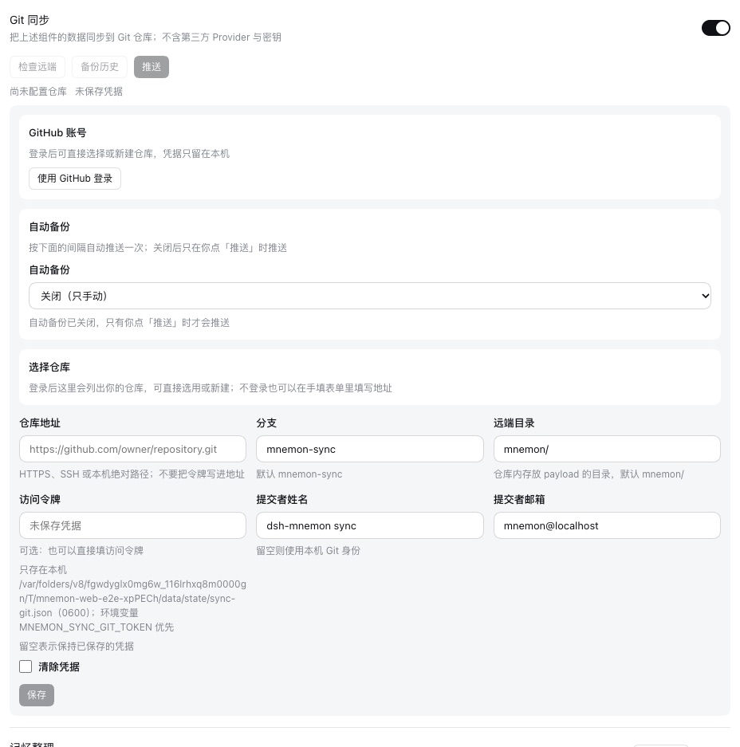
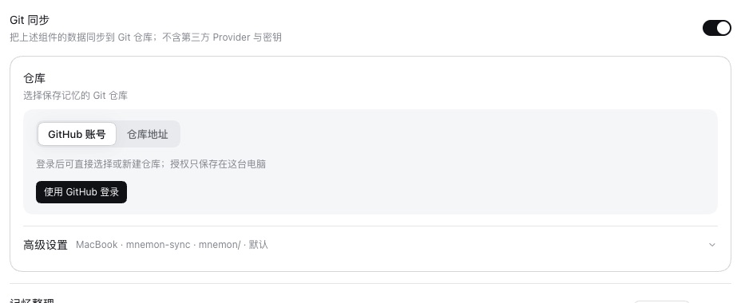
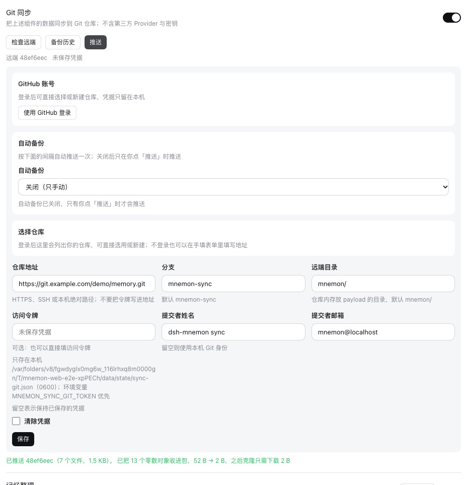
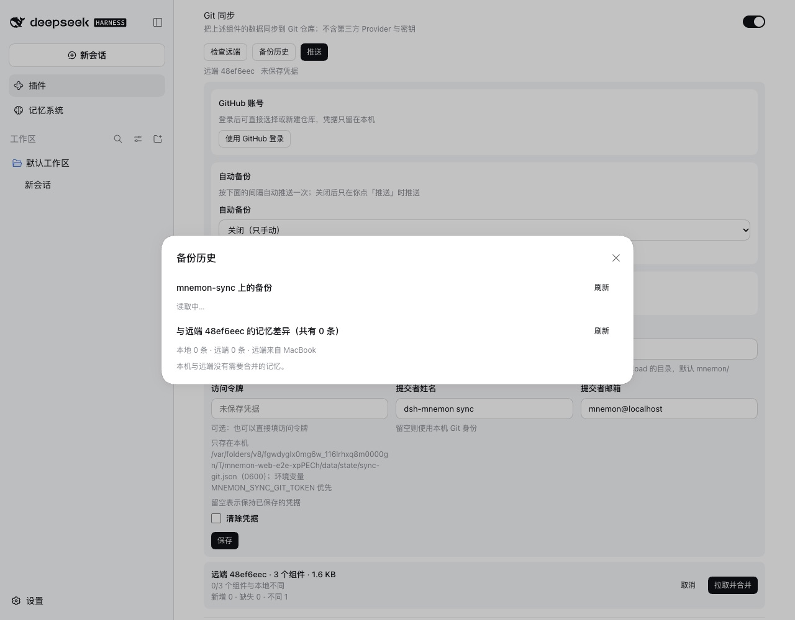
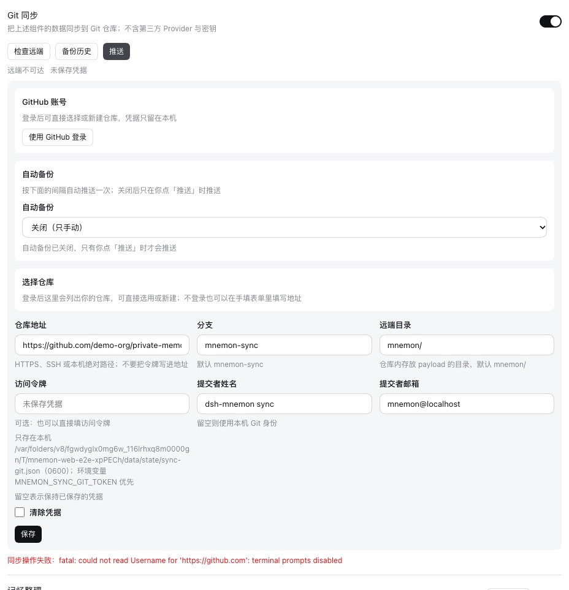
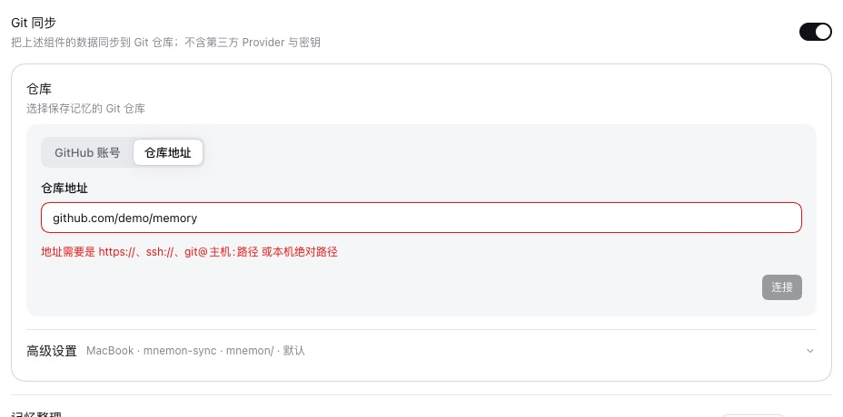
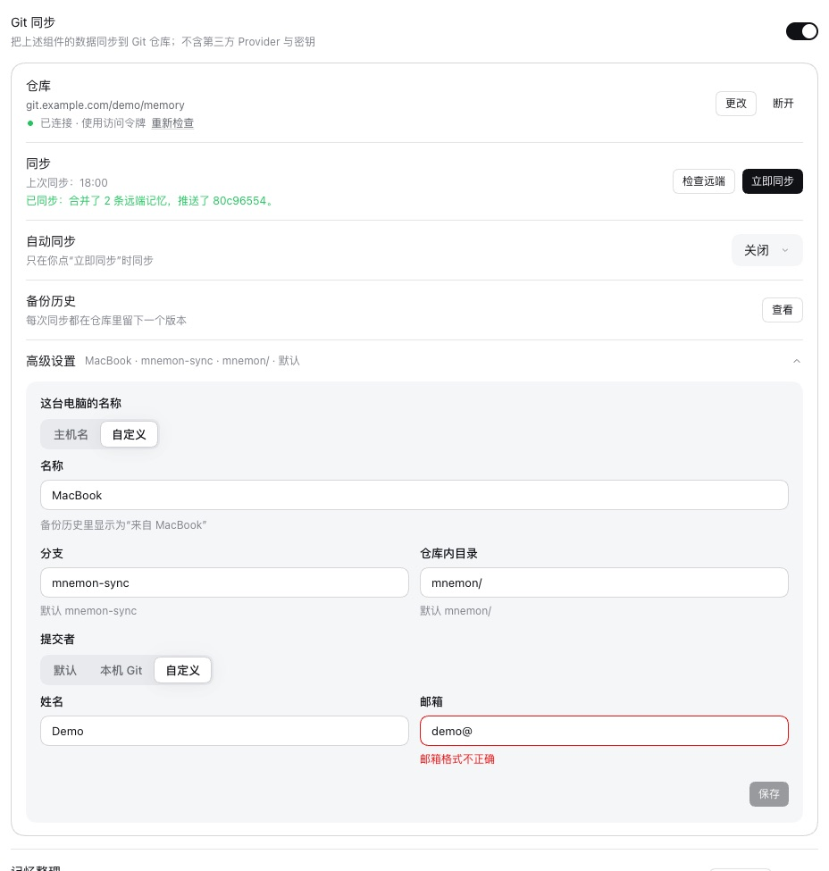
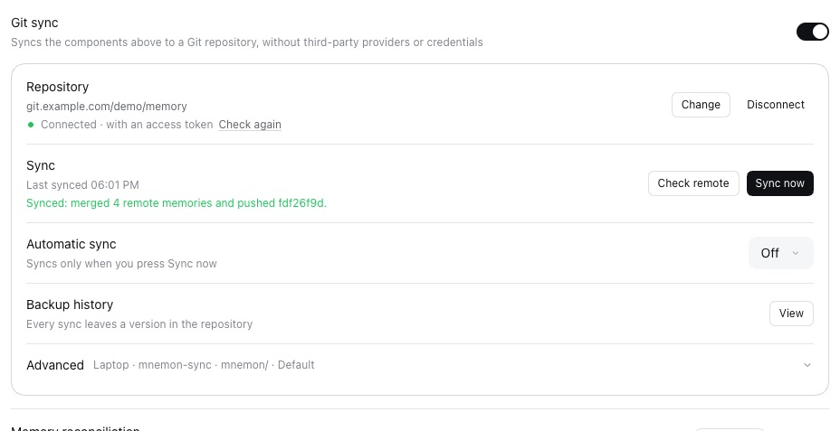
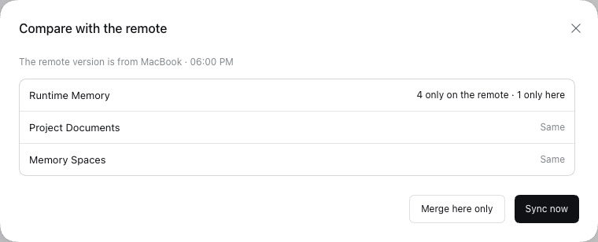

# Git sync: the experience and its edge cases

[简体中文](./README.zh-CN.md) | [Verification record](./verification.json)

Git sync shipped in v0.5.26 with every control in one long form: the operations above the configuration they needed, an automatic backup before a repository existed, four address fields with three hints under the token, a preview bar and a dialog for the same reading, two buttons that ran the same merge, and Git's own error text. This change rebuilds the block around what a person does: connect a repository, sync, check what a sync would change, and only then the advanced choices. Running it also turned up edge cases in the Host, the worst of which published one repository's history into another.

Baseline: `main` `1a6ff881` (v0.5.27). This change: the branch `claude/git-sync-ux`, commits `e2ff299e` (Host), `6700da70` (page), `415a7441` (docs), `78769ec6` (token host), `fcea8525` (opening GitHub, the first sync to an empty branch, the timer on disconnect), `95bd46c4` (the review follow-up below) and `8a73ab09` (this computer's name). The runs took place on 2026-10-11 (Asia/Shanghai):
- macOS 15.6 arm64, Node 24.19.0, Git 2.50.1;
- headless Chrome 154 at 1280×1000, light, zh-CN and en-US;
- DSH 0.2.0-rc.2 (npm `latest` and `next`) for the WebUI, plus 0.2.1-alpha.2 and the pinned 0.1.7-rc.2 for the end-to-end channel checks;
- two WebUI instances as two computers, named "MacBook" and "Studio", syncing through one bare repository. A Git config given only to these instances (`GIT_CONFIG_GLOBAL`) maps the address `https://git.example.com/demo/memory.git` to that repository, so the screens show an ordinary HTTPS address.

## What changed on the page

| | v0.5.27 | This change |
|---|---|---|
| Order | Push, Check remote and Backups first, then GitHub, automatic backup, repository picker and the address fields in one form | One card, in the order it is set up: Repository, Sync, Automatic sync, Backup history, Advanced |
| Connecting | GitHub block, picker block and four address fields side by side; Save disabled without saying why | **GitHub account** or **Repository address**. The device code is copied and GitHub opened in one click; signed in, the repositories are searched, a new private one is created from a typed name, and a public one asks first. The address is checked before it is sent, and the token field appears only for HTTPS |
| State | "远端不可达 · 未保存凭据" for every failure, and "未保存凭据" even for a local or SSH repository | The repository, whether it answers and how it authenticates; a failure is named (credentials, not found, network, timeout) with **Set credentials** where that is the fix; an HTTPS repository without credentials is marked before the first push fails |
| Syncing | **Push** (which already merged the remote) and, after **Check remote**, a preview bar with **Pull and merge** plus **Add them** in the dialog: two buttons for one merge | **Sync now** merges and pushes; the row says what it brought in and when it last ran. **Check remote** compares each component and the runtime entries, writes nothing, and offers **Merge here only** and **Sync now** |
| Failures | Git's text, such as `fatal: could not read Username for 'https://github.com': terminal prompts disabled` | The page's language: "需要凭据，请用 GitHub 登录或填写访问令牌"; anything it cannot name keeps Git's words |
| Automatic sync | A native `<select>` that saved at once among fields that waited for Save | The DSH selector, with when it runs next or why it last failed |
| History | Opened by both Backups and Check remote, and stuck on "读取中…" when opened by Check remote | Its own dialog: time, computer, what each component held, and a message only where a person wrote one |
| Advanced | Branch, directory and author always visible; an author field showing the default identity whose hint said "empty uses this computer's Git identity" | Behind a disclosure; each field shows the value in use, and the author is an explicit choice: Default, This computer's Git, Custom |
| Computer name | History and Check remote named each computer by the host name its identity was minted with, fixed in `state/machine.json` and changeable only by editing that file | **This computer's name** under Advanced: **Host name** follows the current host name, **Custom** keeps a typed one; the next sync publishes it, and earlier versions keep theirs |
| Leaving | No way to remove a repository; a "Clear token" checkbox applied on Save | **Disconnect**, confirmed, deleting nothing here or in the repository and turning automatic sync off; **Remove** beside a saved token |
| Memory reconciliation | A standing three-paragraph "运行规则" block | Gone; each consequence is said where it applies |

## Before and after

| v0.5.27 | This change |
|---|---|
|  |  |
|  |  |
|  |  |
|  |  |

| An address the Host would refuse | Backup history | Advanced | Disconnect |
|---|---|---|---|
|  |  |  |  |

| English: after a sync | English: Check remote |
|---|---|
|  |  |

## Edge cases in the Host

Each row has a test that fails on `main` and passes with this change (`tests/git-sync.spec.ts` unless noted).

| Case | v0.5.27 | This change |
|---|---|---|
| Switching to an empty repository | The mirror kept the first repository's commits, so the first push to the second one published that whole history there. Reproduced through the WebUI: after a push to A, the empty B held `214968c` on top of A's `0b70d12` | The mirror names the repository it was filled from (`mnemon.origin`) and is rebuilt for another one; B holds one root commit |
| The remote branch was deleted to start over | The next push republished every earlier payload | A branch the remote does not hold starts a new history |
| Another machine pushes between this machine's fetch and push | Committed locally, "push did not finish: [rejected] (fetch first)" | The branch is folded in again and the push tried once more; only a second refusal is reported |
| A Host stopped mid-operation | Its lock directory stayed, and every later sync failed with "another Mnemon sync operation is still running" until someone deleted it | The lock records its owner. One whose process is gone is taken over at once, one an older version left without a record after 15 minutes, any lock after an hour, and a lock is renamed aside before it is removed so two Hosts cannot both take it. The one-command credential files such a Host left are removed |
| The same version merged twice, as a retried sync does (`tests/pack.spec.ts`) | Each diverging document or memory space was copied again under another new id | The copy already made is found by its content, so each divergence keeps one copy |
| Git 2.20 to 2.27 | `git init --initial-branch` needs 2.28, so the first sync failed while the channel declared 2.20 | The mirror is initialized without it |
| A blank commit author on a machine with no Git identity | The commit failed, or Git published an identity guessed from the account and host names | This machine's configured identity, else the channel's own |
| A token saved for one host, then a repository on another host (`78769ec6`) | The token was handed to the new host by the next status probe and push | The token is forgotten unless a new one comes with the move |
| A host that drops packets | The page waited up to 120 s for the status | The status probe gives up after 20 s and says "仓库没有及时响应" |
| A refused operation | `code: internal` and Git's text only | `details.reason` names it (`remote-auth`, `remote-not-found`, `remote-network`, `remote-timeout`, `push-rejected`, `remote-empty`, `busy`, `no-repository`, `git-missing`, `github-unauthorized`), checked through real DSH by `scripts/verify-sync-git.mjs` |
| Preview counts | "0/3 components differ" beside "1 changed": the re-stamped manifest was counted | Only payload files are counted |
| Compaction sizes | KiB from `git count-objects` shown as bytes ("52 B → 2 B") | Converted to bytes; the page no longer announces the housekeeping |
| A push read the remote twice | `ensureMirror` ran inside `readRemote` again after the push had just prepared the mirror | One read per attempt |
| More than 100 GitHub repositories | Only the first page was listed | Up to five pages, newest-updated first, searched in the page |
| A GitHub grant revoked on github.com | "GitHub 登录失败：listing GitHub repositories failed: Bad credentials" | "GitHub 授权已失效，请重新登录" with **Sign in again** |

## Review

An independent review of the first five commits found the following; `95bd46c4` fixes each, with a test where the behavior can be tested.

- The status probe never had its 20-second limit: `git()` ignored the per-call timeout, so a silent host still held the page for 120 s.
- A push tried again after a refusal merged the remote twice, adding a second copy of each diverging document or space, and reported only what the second attempt brought in.
- An ownerless lock was taken over after one minute, which could take the lock of an older Host in the middle of a slow push; two Hosts could also both take the same stale lock.
- An automatic sync failure kept its reason after the error was gone, and a sync skipped because another was running counted as a failure.
- The comparison read the preview and the file differences at the same time, so the second could meet the first's lock and fail.
- Its counts listed entries held back for review and local removals a second time, under "only on the remote" and "only here".
- A sync started from the comparison, and a disconnect that failed, said so behind their dialogs.
- HTTPS hosts other than github.com were told to sign in with GitHub; a repository GitHub reported as not found offered no way to set credentials.
- One failed poll ended the GitHub sign-in; an existing repository of the same name under another owner blocked creating one's own; the history did not say that it stops at the latest 100 versions.
- An author saved by an earlier version with only one field blocked saving any other advanced change.
- The token's Remove button sat inside the field's label, so a click meant for the caption could remove the token.
- The guide said an unreachable remote still commits locally (the read fails first), did not say that `MNEMON_SYNC_GIT_TOKEN` comes before a GitHub sign-in, and described the history as unlimited.

## Tests

- Host: with `main`'s Host sources under this branch's tests, 16 cases fail, and all pass here: 13 in `tests/git-sync.spec.ts`, and one each in `tests/pack.spec.ts` (the second merge), `tests/github-auth.spec.ts` (paging) and `tests/sync-rpc.spec.ts` (the reasons through the RPC handler). The list is in [verification.json](./verification.json).
- This computer's name: `tests/machine-identity.spec.ts` (following the host name, a custom name every reader sees, records from earlier versions, refused names) and one case in `tests/git-sync.spec.ts` (the name in status, a refused name changing nothing else, the published name, back to the host name).
- Page: `tests/client-sync.spec.tsx` (30 cases) drives the section against a fake Host: address checks, the token field, sync results, named failures, the comparison without writes and its first sync, history, the GitHub sign-in in one click, the public repository confirmation, creation, an expired grant, the credentials shortcut, disconnect, the advanced form and English, plus one case for each page finding of the review and two for the computer's name. `tests/client-memory-enhancements.spec.tsx` keeps the switch silent while off.
- End to end: `scripts/verify-sync-git.mjs` with two DSH instances and a real bare repository passes all 64 checks on DSH 0.1.7-rc.2, 0.2.0-rc.2 and 0.2.1-alpha.2, three of them for the computer's name.
- `pnpm verify` and `verify:plugins`: see [verification.json](./verification.json).

## Limits

- The GitHub sign-in was not completed against a real account in these runs. The device flow, the repository list and creation are covered by `tests/github-auth.spec.ts` and the page tests with a fake Host; the screens show the address path.
- macOS only, and the DSH desktop app was not checked.
- The comparison still reads runtime memory entry by entry and the other two components as "same" or "differs", as before.
