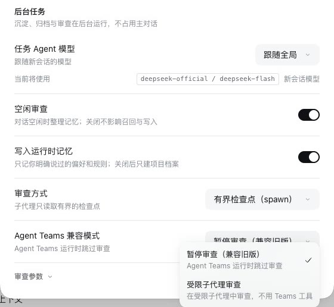
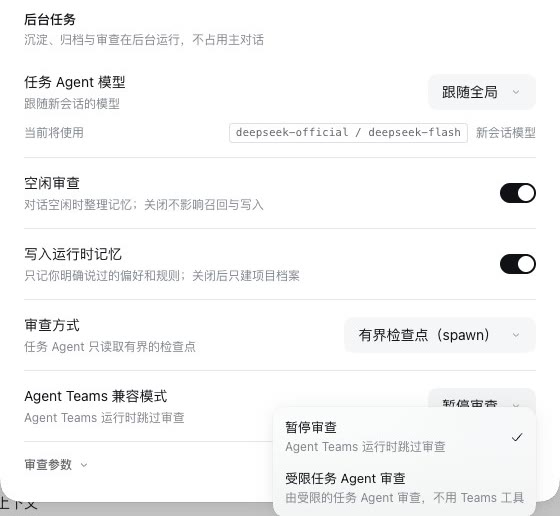
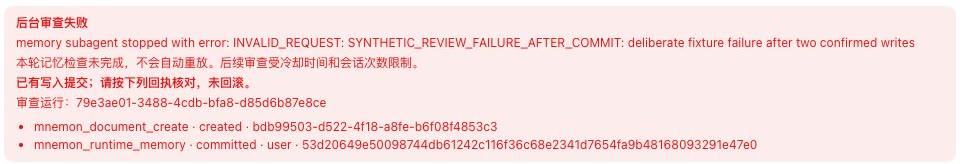

# One name for idle review and its task Agent

[简体中文](./README.zh-CN.md)

The interface named the same feature three ways. The setting is **Idle review**, but the Status alert after a failed run said **Background review failed**. The **Background tasks** card on the Layered strategy's page calls the Agent that does the work a task Agent (**Task Agent model**), and so do Save to memory and the **Task Agent ready** tag on the memory pages, yet the review settings right below it said "child" (子代理 in Chinese) and offered **Scoped child review**. The default Agent Teams choice still read **Pause review (legacy compatible)**, a note from before the scoped choice existed. This change gives each one the name the rest of the interface uses. Nothing else changes: the stored settings (`idleReview.provider`, `idleReview.agentTeams: pause | scoped`) keep their values and meaning.

Tested revision: the branch `claude/idle-review-wording`, on top of [#386](https://github.com/omdsh-dev/dsh-mnemon/pull/386) (`9a09c89e`). Captured on 2026-10-17 in the e2e fixture on DSH 0.2.1-rc.1, headless Chrome, zh-CN, light.

| Before | After |
|---|---|
|  |  |
|  |  |

| Where | Before | After |
|---|---|---|
| Status alert title | 后台审查失败 / Background review failed | 空闲审查失败 / Idle review failed |
| Review method hints | 子代理只读取有界的检查点 / A child reads a bounded checkpoint; 子代理带着完整的父上下文 / A child with the full parent context | 任务 Agent 只读取有界的检查点 / The task Agent reads a bounded checkpoint; 任务 Agent 带着完整的父上下文 / The task Agent has the full parent context |
| Agent Teams choices | 暂停审查（兼容旧版）/ Pause review (legacy compatible); 受限子代理审查 / Scoped child review, 在受限子代理中审查，不用 Teams 工具 / Reviews in a scoped child without Teams tools | 暂停审查 / Pause review; 受限任务 Agent 审查 / Scoped task Agent review, 由受限的任务 Agent 审查，不用 Teams 工具 / A scoped task Agent reviews, without Teams tools |
| Status note while Teams pauses review | names 受限子代理审查 / Scoped child review | names 受限任务 Agent 审查 / Scoped task Agent review |
| Context-window hint after a fork review fails | 任务模型 / a task model | 任务 Agent 模型 / a task Agent model, the setting's own name |

The documentation in both languages now says idle review (空闲审查) where it said background review (后台审查, 空闲复盘), and quotes the new choices. Release notes and earlier records keep the names they shipped with.

## Checks

- `tests/client-settings.spec.tsx` and `tests/client.spec.tsx` choose and read the renamed options and alert; `tests/client-presentation.spec.ts` records the new copy fingerprints (1,346 keys in each language).
- The `review-card` and `idle-review` WebUI scenarios on DSH 0.2.1-rc.1 read the menus and the alert above, with no browser console error.
- `pnpm run verify:docs`: every link and anchor resolves; no heading that another page links was renamed.
