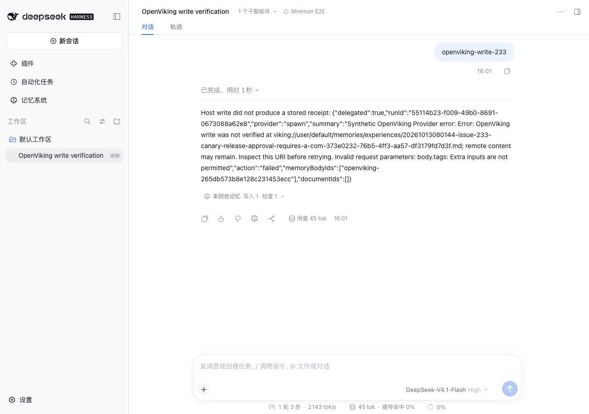
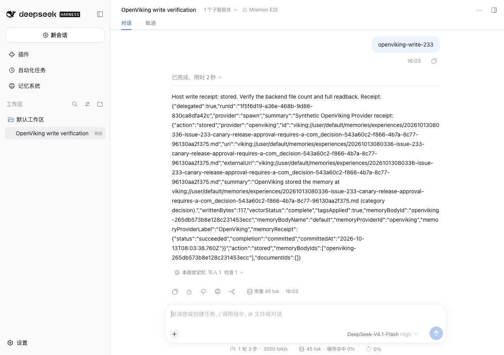
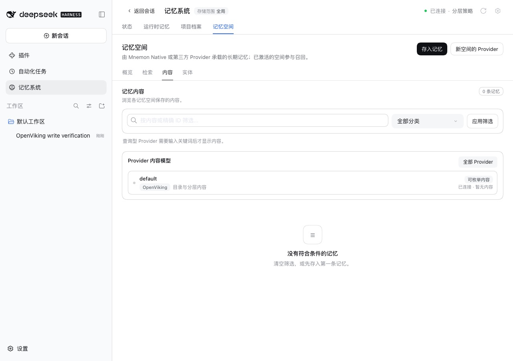
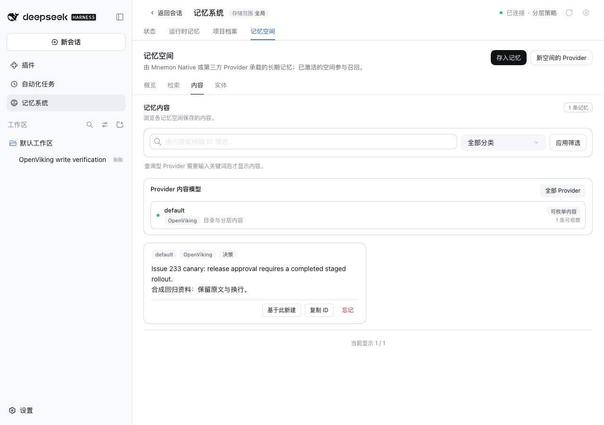

# Storing memories on OpenViking 0.4.16 — issue #353

[简体中文](./README.zh-CN.md) | [Issue #353](https://github.com/omdsh-dev/dsh-mnemon/issues/353) | [Verification record](./verification.json)

Issue #353 reports that every `mnemon_remember` routed to an OpenViking Memory Space fails on OpenViking 0.4.16. The provider sends `tags` in the body of `POST /api/v1/content/write`, that release refuses the undeclared field with HTTP 400 (`extra_forbidden`), and no memory is ever stored. It also reports that a memory reads back with its folder name as its category.

Baseline: main `20e4ab67`. Fix: `c5afe22d`; the fixture change below was made with this record. The runs took place on 2026-10-13 (Asia/Shanghai):
- macOS 15.6 arm64 and Node 24.19.0;
- headless Chrome at 1280×900, zh-CN, light;
- DSH 0.2.1-alpha.2 (npm `alpha`) through `scripts/serve-e2e.mjs --openviking-write --strategy-extensions`;
- OpenViking 0.4.16, 0.4.20 and 0.5.0 from PyPI on Python 3.12.13. Each ran as a disposable loopback server in dev auth mode, with Ollama `nomic-embed-text` embeddings (768 dimensions).

## Cause

- `remember()` posted `uri, content, mode, wait, timeout` and `tags`. OpenViking before 0.4.18 declares the write request with the first five fields plus `telemetry` and `processing_mode`, and refuses any other; 0.4.18 added `tags`. Every write therefore failed on those releases.
- The error then said `remote content may remain. Inspect this URI before retrying`, although the server had refused the request and written nothing.
- Each folder holds two categories (`entities`: fact and general; `experiences`: insight and decision), and a memory read back with its folder name as the category.

## Fix

- The write sends only the declared fields. After the exact readback, `content/set_tags` sets the source, category and importance tags with `mode: replace`, waiting at most 5 s. Only `tags_updated: true` counts; any other answer keeps the verified memory, and the receipt says `tagsApplied: false`.
- A write the server refuses (HTTP 4xx other than 408 and 409) now says nothing was stored.
- The file name ends in `_<category>-<uuid>.md`, so the category reads back as written. Files without it, written by an earlier version or by OpenViking itself, read back by their folder. An unknown category is stored as `general`.
- The slug is cut to 180 bytes, so the longer name stays within the 255 bytes a Linux file name allows.

## Method

1. Start a local OpenViking server in dev auth mode: `openviking-server --config <conf> --host 127.0.0.1 --port 19340`.
2. Serve the WebUI with `MNEMON_CLI_PATH=<mnemon> pnpm e2e:serve --openviking-write --strategy-extensions`, once on the baseline and once on the fix.
3. Open **插件 → 可组合记忆 (dsh-mnemon) → 记忆空间 → OpenViking** and fill in:
   - 服务地址 `http://127.0.0.1:19340`;
   - API Key `synthetic-dev-key` (dev mode accepts any key);
   - Account `default`;
   - User Key 所属用户 `default`.
   Then click 保存并启用, and the space `default` appears.
4. In a new conversation send `openviking-write-233`. The scripted model calls `mnemon_memory_bodies`, then `mnemon_remember` with the canary, category decision and importance 4, through the delegated writer.
5. Open **记忆系统 → 记忆空间 → 内容**.

Only the model's choices are scripted; the Host tools, the provider and OpenViking are real. The fixture's delegated writer used to stop with an assertion when the provider threw, and the model then repeated the call. It now finishes with a failed receipt that carries the provider's error. Only that fixture file was copied into the baseline checkout.

## Before and after

| | main | Fix |
|---|---|---|
| The write |  |  |
| The space's content |  |  |

On main the receipt carries the reported 400, and the space stays empty. With the fix the write is stored with `tagsApplied: true`, and the content page shows the bilingual canary under the category 决策 (decision).

## The loopback integration test

The plugin's opt-in test creates a memory, reads it back exactly, finds it by search and by browsing, then deletes it. It now also checks `tagsApplied` and that search and browse report the category `decision`.

| OpenViking | main | Fix |
|---|---|---|
| 0.4.16 | fails: `Invalid request parameters: body.tags: Extra inputs are not permitted` | passes |
| 0.4.20 | passes | passes |
| 0.5.0 | passes | passes |

## Automated checks

- `plugins/dsh-mnemon-provider-openviking/tests`, 81 tests:
  - the write fields and the separate tag call;
  - unconfirmed and slow tag answers;
  - which failures say nothing was stored;
  - every category's round trip while the server reports another category;
  - file names of four-byte characters;
  - the key-bound tag call.
- Six of these fail on the first version of the fix.
- `tests/openviking-host.spec.mjs` and `tests/openviking-user-host.spec.mjs` check the stored tags through a composed Host. The first fails on main against the 0.4.16-strict fixture with the reported 400.

## Limits

- Only macOS was run. Its file system accepted 258-byte names, so the 255-byte cap is checked by a unit test, not against a Linux server.
- Files written before the fix keep their names and read back by folder: an older `general` memory in `entities` reads back as `fact`, and an older `decision` in `experiences` as `insight`.
- Downgrading restores the old write, which needs OpenViking 0.4.18 or later.
- The tag call adds one request per write: 8 to 15 ms against the local server.
