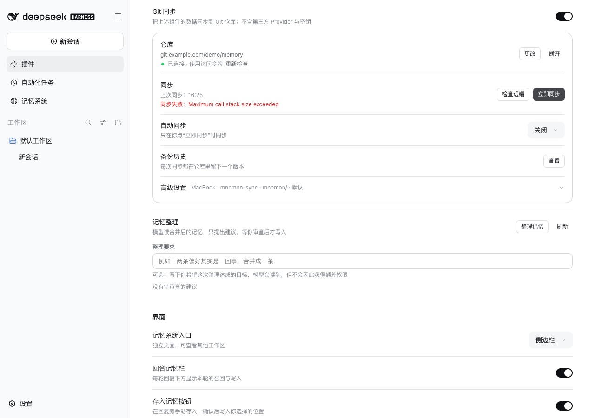
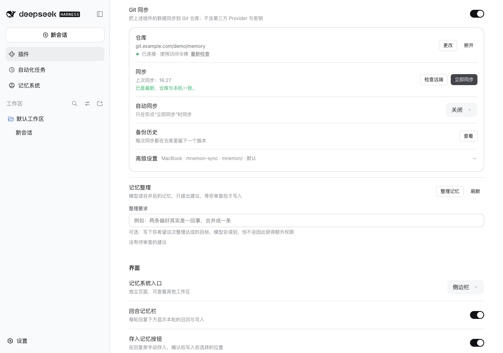

# Mnemon Pack 的 base64 超过 4.5 MB 时的 Git 同步 — issue #368

[English](./README.md) | [Issue #368](https://github.com/omdsh-dev/dsh-mnemon/issues/368) | [验证记录](./verification.json)

Issue #368 报告：Mnemon Pack 的 base64 超过约 4.4 MB 后，Git 同步必然以 `Maximum call stack size exceeded` 失败。`decodeArchive` 用一个重复四字符分组的正则校验载荷，V8 每重复一次就保留一条回溯记录。

基线：main `20e4ab67`。修复：`1358ba7e`。运行于 2026-10-13（Asia/Shanghai）：
- macOS 15.6 arm64，Node 24.19.0（V8 13.6）；
- headless Chrome，1280×900，zh-CN，浅色；
- DSH 0.2.1-alpha.2（npm `alpha`），通过 `scripts/serve-e2e.mjs` 运行，使用真实的 Mnemon CLI 0.2.10；
- 本机裸仓库通过 Git 的 `url.<base>.insteadOf` 代替 `https://git.example.com/demo/memory.git`。

## 原因

`/^(?:[A-Za-z0-9+/]{4})*(?:[A-Za-z0-9+/]{2}==|[A-Za-z0-9+/]{3}=)?$/u` 在 4,473,916 个 base64 字符时栈溢出，对应约 3.4 MB 的 ZIP。推送前会与远端比较，拉取和状态检查也都要解码远端载荷，因此一旦某次同步发布了这样的 Pack，之后的每次同步、以及对它的每次 ZIP 导入都会失败。

## 修复

校验改为“长度是 4 的整数倍”加一个字符类，结尾最多两个 `=`：`/^[A-Za-z0-9+/]*={0,2}$/`，且不带 `u` 标志。带上这个标志时，V8 13（Node 24）遇到含 U+00FF 以上字符的字符串仍会逐字符递归。新校验接受与拒绝的字符串和旧正则完全一致。

## 方法

1. 用 `MNEMON_CLI_PATH=<mnemon> pnpm e2e:serve` 分别启动基线与修复的 WebUI，`GIT_CONFIG_GLOBAL` 把示例地址映射到一个新建的裸仓库。
2. 打开 **插件 → 可组合记忆 (dsh-mnemon)**，打开 **Git 同步**。
3. 创建空间：`node harness/big-space.mjs <存储根目录> routing 路由笔记 2000`。它会写入一个 Mnemon 0.2.10 格式的空间，含 2000 条记忆，每条带 768 维嵌入，并完成登记。嵌入无法压缩，因此数据库为 8.1 MiB，Pack 的 base64 超过阈值。记忆空间页显示为 2000 条记忆、8.5 MB、存储正常。
4. 选择 **仓库地址**，填入 `https://git.example.com/demo/memory.git` 并连接。
5. 点击两次 **立即同步**。第一次发布 Pack，第二次从远端读回。

## 修复前后

| | main | 修复 |
|---|---|---|
| 第二次同步 |  |  |

两次运行同步的空间：

## 单独测校验

[`harness/base64-check.mjs`](./harness/base64-check.mjs) 在 Node 24.19.0 上，对同样的字符串分别运行旧正则、带 `u` 标志的新校验和最终的新校验：

| 输入 | 旧正则 | 带 `u` | 最终校验 |
|---|---|---|---|
| 4 MB base64 | 通过 | 通过 | 通过（2 毫秒） |
| 4.5 MB | `RangeError` | 通过 | 通过（3 毫秒） |
| 6 MB | `RangeError` | 通过 | 通过（4 毫秒） |
| 64 MB，传输上限 | `RangeError` | 通过 | 通过（42 毫秒） |
| 900 万字符、以「中」结尾 | `RangeError` | `RangeError` | 判为非 base64（13 毫秒） |
| 6400 万字符、以「中」结尾 | `RangeError` | `RangeError` | 判为非 base64（99 毫秒） |

对 14 个边界用例，旧正则与最终校验的接受或拒绝完全一致：`AA==`、`AAA=`、`AAAA`、`A===`、`====`、`AAAAA===`、`AA=A`、`AAA`、换行、`AAAAAA==`、`AB==`、以「中」开头、以 NUL 结尾，以及空字符串。

## 自动化检查

`tests/pack.spec.ts` 导出一个含 5 MB 不可压缩数据的记忆空间，在第二台机器上检查并导入。它还检查：
- 中间带填充、分组长度不完整的输入被拒绝；
- 传输允许的最大载荷能通过校验；
- 含「中」的字符串被判为非 base64。

该测试在 main 上以 `RangeError: Maximum call stack size exceeded` 失败，其中的双字节断言在带 `u` 标志的版本上也会失败。

## 限制

- 同步同一分支的每台设备都需要这次修复才能读取这样的 Pack；旧版本仍会失败。
- 只在 macOS 上运行；报告来自 Windows 上的 Node 24.21。阈值在 Node 24、Node 25 与 DSH Desktop 的 Electron 44 上相同，修复不依赖其中任何一个。
