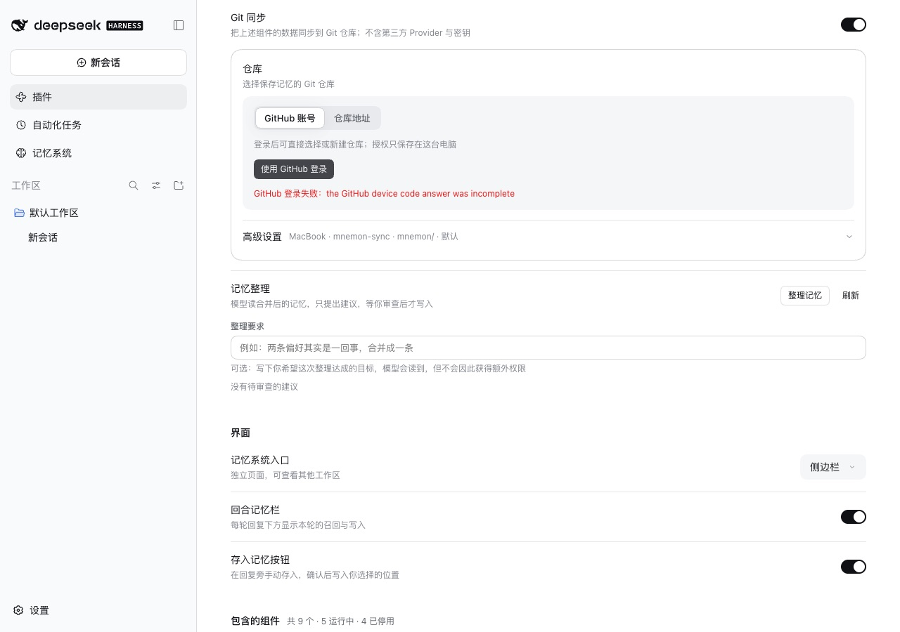
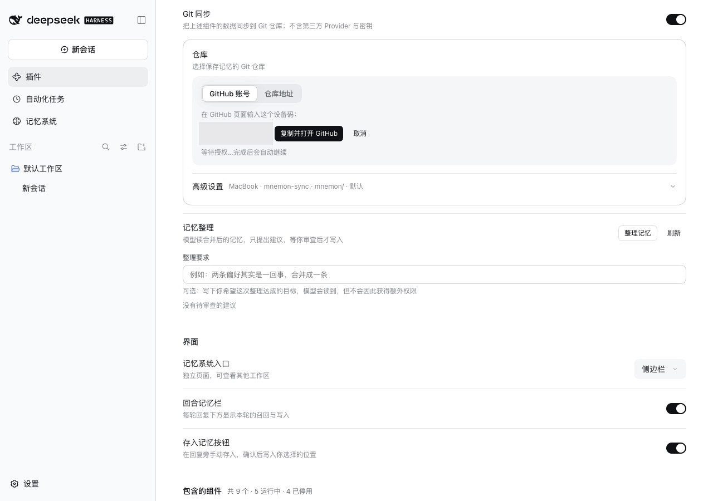

# GitHub sign-in when GitHub answers form-encoded — issue #369

[简体中文](./README.zh-CN.md) | [Issue #369](https://github.com/omdsh-dev/dsh-mnemon/issues/369) | [Verification record](./verification.json)

Issue #369 reports that GitHub sign-in in the Git sync block fails with `the GitHub device code answer was incomplete` on DSH Desktop 0.2.1-alpha.2, with another plugin patching `fetch`. GitHub's OAuth endpoints answer JSON only when `accept: application/json` reaches them. The patch rebuilt the request without that header, GitHub answered form-encoded with every field present, and the sign-in read the answer as nothing.

Baseline: main `20e4ab67`. Fix: `3f1b1d4a`. The runs took place on 2026-10-13 (Asia/Shanghai):
- macOS 15.6 arm64 and Node 24.19.0;
- headless Chrome at 1280×900, zh-CN, light;
- DSH 0.2.1-alpha.2 (npm `alpha`) through `scripts/serve-e2e.mjs`;
- the Host ran with [`harness/strip-accept.mjs`](./harness/strip-accept.mjs) loaded by `--import`. It rebuilds every request to `github.com` without its `accept` header, as the reporter's plugin did. github.com itself answered; no account was authorized, and the flow was cancelled.

## Cause

- The device code request and the token poll ask for JSON with `accept: application/json`. Without that header GitHub answers `application/x-www-form-urlencoded`, and the sign-in parsed only JSON, so every field read as missing.
- The error gave no hint of what had come back.
- The CONNECT tunnel the proxy fallback uses kept only the status and the text of an answer, so through a proxy every answer read as `text/plain`.

## Fix

- A body that is not JSON is read as a form when the answer says `application/x-www-form-urlencoded`, for the device code and the token alike. Its counts are read from strings, and the interval and lifetime stay within the flow's limits.
- The proxy fallback keeps the answer's content type.
- A device code answer that still cannot be used names its HTTP status, content type and field names, never their values.

## Method

1. Serve the WebUI with `NODE_OPTIONS=--import=<this record>/harness/strip-accept.mjs MNEMON_CLI_PATH=<mnemon> pnpm e2e:serve`, once on the baseline and once on the fix.
2. Open **插件 → 可组合记忆 (dsh-mnemon)** and switch **Git 同步** on. Keep **GitHub 账号** and click **使用 GitHub 登录**.
3. On the fix, the device code was covered in the screenshot, and the flow was cancelled with **取消**.

## Before and after

| main | Fix |
|---|---|
|  |  |

## Against github.com without the page

With the same header removed, `POST https://github.com/login/device/code` answered HTTP 200, `application/x-www-form-urlencoded`, with the fields `device_code`, `expires_in`, `interval`, `user_code` and `verification_uri`. Main reported the answer as incomplete. The fix started the flow with the user code, `https://github.com/login/device` and a 5 s interval.

## Automated checks

- `tests/github-auth.spec.ts`:
  - a whole sign-in from form-encoded answers: the device code, a pending poll, the token;
  - the error for an HTML answer, a partial JSON answer and a body that only claims to be a form, none of which repeats a value;
  - a form-encoded refusal with an unusual content type;
  - the interval and lifetime bounds.
- `tests/github-transport.spec.ts`: the tunnel answer keeps its content type.
- The five new tests fail on main.

## Limits

- The reporter's plugin was not installed. The preload reproduces the header loss the report's Host log shows.
- No account was authorized, so the token step against github.com is covered by the form-encoded tests, not live.
- Only macOS was run; the report came from Windows. Neither the cause nor the fix depends on it.
