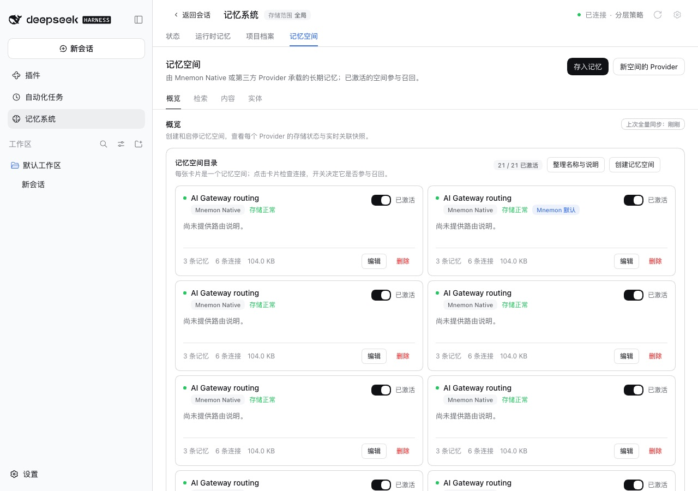
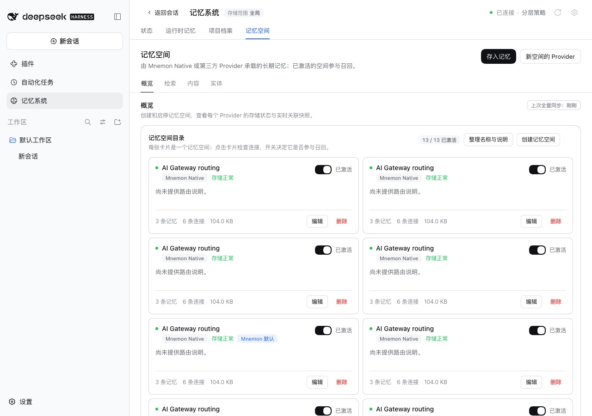
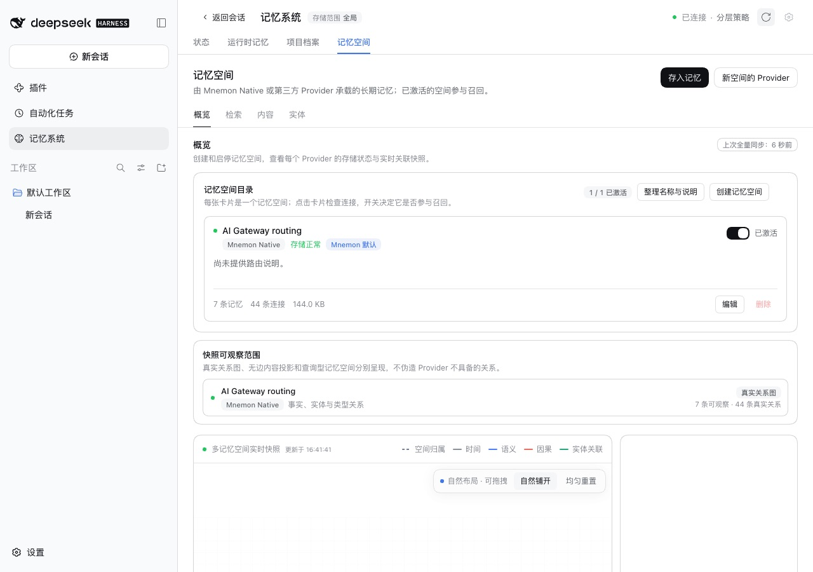
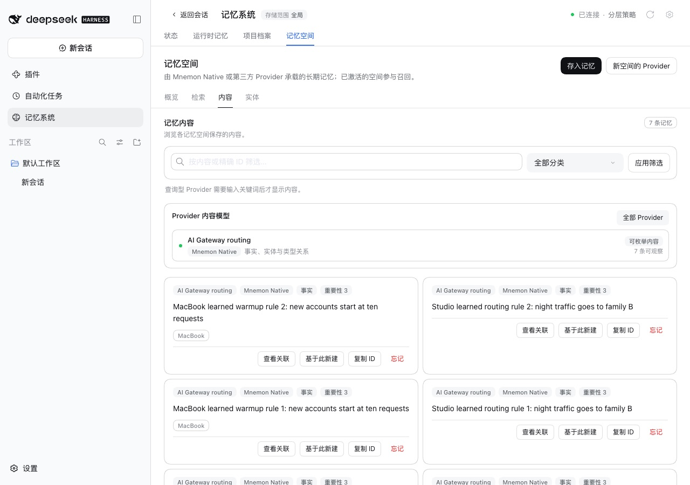

# 两台设备通过 Git 同步读写记忆空间 — issue #370

[English](./README.md) | [Issue #370](https://github.com/omdsh-dev/dsh-mnemon/issues/370) | [验证记录](./verification.json)

Issue #370 报告：每同步一轮，记忆空间就翻一倍：6 个、13 个，然后 30 个，其中 22 个是副本。合并时比较整个 `mnemon.db` 的摘要，而 Mnemon 每次读取空间都会改写它。

基线：main `20e4ab67`。修复：`fee03752`。运行于 2026-10-13（Asia/Shanghai）：
- macOS 15.6 arm64，Node 24.19.0；
- headless Chrome，1280×900，zh-CN，浅色；
- DSH 0.2.1-alpha.2（npm `alpha`），通过 `scripts/serve-e2e.mjs` 运行，使用真实的 Mnemon CLI 0.2.10；
- 本机裸仓库通过 Git 的 `url.<base>.insteadOf` 代替 `https://git.example.com/demo/memory.git`。

## 原因

- 召回、检索或查看都会增加 `access_count`、写入 `last_accessed_at`，并在 `oplog` 中记一行。两台只读取空间的设备，字节永远不同，于是每次同步都把对方的版本以随机 id 存成一个新空间，两边都是如此。
- 一台设备新增记忆也会造成同样的结果：从另一台设备回流的旧版本同样会被存成副本。

## 修复

- 按空间里的内容比较：每张表、每一列、每一行（包括关联），但不含使用计数列、读取日志，以及派生的嵌入和有效重要度。列按名称比较。
- 同一空间的两个版本会合并：只有传入版本才有的行被加入本机数据库，本机已有的行、召回计数、读取日志与表结构保持不变。一边写、一边读，或两边都写，都只保留一个空间。
- 某条记忆在一边被编辑或遗忘时，合并会被拒绝。此时另一边的版本保留为一份副本，它之后的版本会继续更新这份副本；已经有空间包含它时，不会再复制一份。
- 含虚拟表、超过 50 万行（单次合并共 200 万行）或无法读取的数据库，仍按字节比较，与以前相同。

## 方法

1. 启动两个 WebUI，**Studio** 与 **MacBook**，各自用 `MNEMON_CLI_PATH=<mnemon> pnpm e2e:serve`，示例地址指向同一个裸仓库。
2. 在 Studio 上用 Mnemon CLI 创建存储 `gateway` 并写入三条记忆，登记名为 **AI Gateway routing**。
3. 在两台设备上打开 **插件 → 可组合记忆 (dsh-mnemon)**，打开 **Git 同步**，选择 **仓库地址**，填入示例地址并连接。先由 Studio 同步，再由 MacBook 同步。
4. 每一轮，MacBook 先用 `mnemon recall routing` 召回每个空间并点击 **立即同步**，然后 Studio 做同样的事。
5. 三轮之后打开 **记忆系统 → 记忆空间**。修复版之后再加两轮：每台设备先用 CLI 各写入一条记忆，然后依次由 MacBook、Studio、MacBook 同步。

## 修复前后

main，三轮召回之后：

| Studio | MacBook |
|---|---|
|  |  |

修复版，同样三轮召回、再加两轮两边都写入之后：

| Studio | MacBook |
|---|---|
|  |  |

这几次运行中每轮之后各自持有的空间数：

| | 开始 | 第 1 轮 | 第 2 轮 | 第 3 轮 |
|---|---|---|---|---|
| main | Studio 1，MacBook 1 | 3，2 | 8，5 | 21，13 |
| 修复 | 1，1 | 1，1 | 1，1 | 1，1 |

修复版的两轮写入之后，每台设备仍只有一个空间，先后含 5 条和 7 条记忆。

## 真实 CLI 下的四种情形

[`harness/real-cli-sync.probe.ts`](./harness/real-cli-sync.probe.ts) 在两个数据目录上直接驱动 Git 同步通道，使用真实的 Mnemon CLI 与裸仓库。最后一轮之后 Studio 与 MacBook 持有的空间数：

| 情形 | main | 修复 |
|---|---|---|
| 两边都只召回，3 轮 | 21，13 | 1，1 |
| 一边写入、一边召回，4 轮 | 46，31 | 1，1 |
| 两边都写入，4 轮 | 46，31 | 1，1，各含 10 条记忆 |
| 一边遗忘一次后继续写入、另一边召回，4 轮 | 46，31 | 2，2 |

遗忘的情形从遗忘的那一轮起，每台设备保留一份副本，之后不再增加。这次修复的两个早期版本也按同样方式测过：只比较不合并的版本，在一边写入时仍让两台设备每轮各多一个空间（5，5）；把空间推进到只新增了内容的版本，在两边都写入（8，5）或遗忘之后（2，4）仍会增长。

## 自动化检查

- `tests/space-identity.spec.ts`，13 个测试：读取不改变身份；包含关系；按名称比较列，包括新版 Mnemon 增加的列；保留不同的数据类型；按字节比较的回退与行数上限；虚拟表；保留本机计数、日志与表结构的合并；两边都写入时的合并；记忆被编辑或遗忘时拒绝合并；清理。
- `tests/pack.spec.ts`：在 Mnemon 0.2.10 表结构上跨多轮的 5 个测试：只读取、一边写入、两边写入、遗忘一条记忆、已有副本与改过名的副本。这 5 个在 main 上全部失败；在推进空间的早期版本上，新测试中有 12 个失败。

## 限制

- 某条记忆在一边被编辑或遗忘时，另一边的版本会保留为副本。副本是启用状态，被遗忘的记忆仍可能从副本中被召回。要把编辑或遗忘同步过去，需要规定哪个版本胜出（issue 提议取 `updated_at` 较新的一方），这次修复留给单独的修复处理。
- 早期版本已经产生的副本保持不变，不会被合并或删除。
- 同步并入新记忆后，已经打开的记忆系统页面要刷新后才显示新的数量。
- Node 22.13 或 23.4 之前的版本仍按字节比较。Node 25 在首次加载 `node:sqlite` 时，每个进程打印一次 `ExperimentalWarning`。
- 只在 macOS 上运行；报告来自 Windows。
