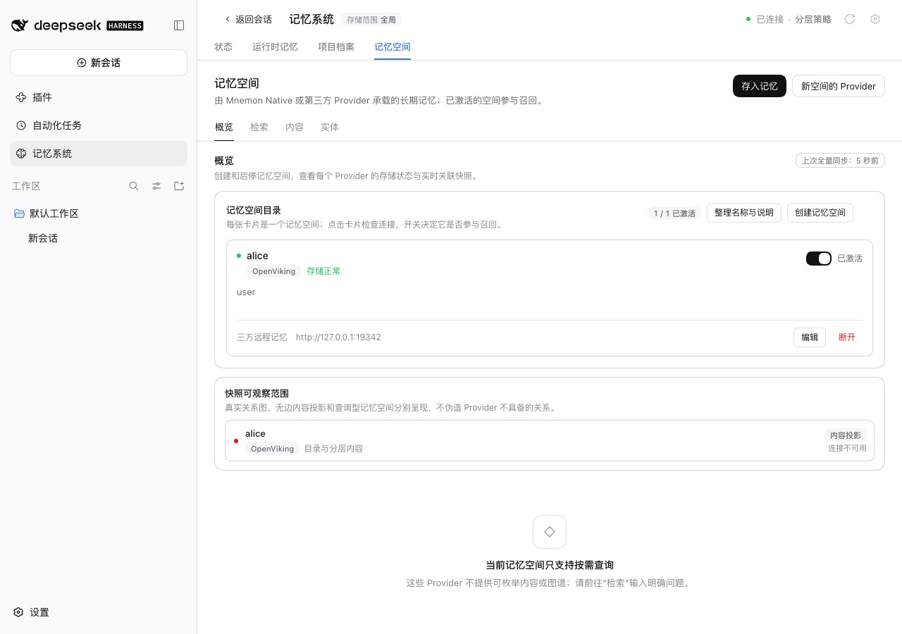
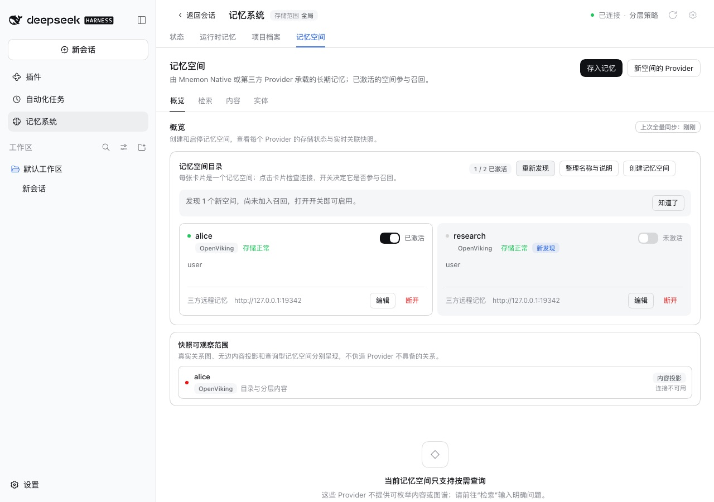
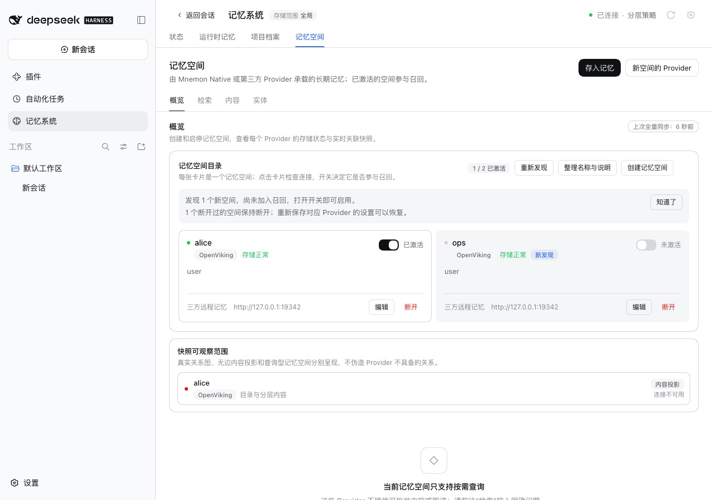

# 设置保存之后新建的 Provider 命名空间——issue #373

[English](./README.md) | [验证记录](./verification.json)

Issue #373 报告了一个含 2,100 条记忆的 Hindsight bank，13 天里一直没有参与召回。这个 bank 是在 DSH 保存 Provider 设置之后才在 Hindsight 端创建的；重启也没有用，因为 dsh-mnemon 只在保存 Provider 设置时查找它的命名空间。

基线：main `20e4ab67`；修复：`71d0cb4f`。WebUI 运行使用的是 `33f5b1bf` 的构建，代码相同，只是当时还没有更新展示测试的基线。运行于 2026-10-14（Asia/Shanghai）：
- macOS 15.6 arm64，Node 24.19.0；
- 无头 Chrome，1280×900，zh-CN，浅色；
- DSH 0.2.1-alpha.2（npm `alpha`），通过 `scripts/serve-e2e.mjs` 启动；
- OpenViking 0.4.20，`api_key` 模式，使用本地 root key，DSH 通过管理 API 列出账户 `default` 的用户；embedding 使用 Ollama `nomic-embed-text`。

## 原因

保存 Provider 设置时会询问它有哪些命名空间，并把每个挂载为记忆空间；之后不会再问。之后才在 Provider 端新建的命名空间，除了再保存一次设置，没有办法进入目录。

## 修复

记忆空间 Source 可以按需再次询问每个已启用的 Provider，只挂载目录里还没有任何空间读取的命名空间：
- 新空间以未激活状态挂载，打开开关后才参与召回，每轮成本不会自行增长。
- 已挂载的空间保持原有的激活状态、名称、描述与设置。
- 手动创建的空间，只要指向同一个 bank、workspace、user、tag、记忆 URI 或目录，就算作该命名空间，其余设置（如召回预算或单个 peer）不同也一样。
- 断开过的命名空间（无论是发现的还是手动创建的）保持断开，直到再次保存该 Provider 的设置。断开记录保存在注册表旁边的 `state/memory-provider-disconnects.json`；早于它的版本重写注册表时，会丢掉自己不认识的内容。
- 各 Provider 并行询问，每个最多 30 秒；出错或超时的 Provider 保留原有空间，页面说明原因。

Host 开始服务一个运行时后十秒，对每个数据目录询问一次，每个进程只问一次；Source 暂时无法访问时，稍后再试。只读运行时、记忆空间层关闭，或其 `maintenance` 参与方式不是 `automatic` 时，不会询问。

**记忆系统 → 记忆空间 → 概览**页面：
- **重新发现**可以随时询问；
- 卡片上方的一行提示说明本次找到了什么，关闭后不再显示；
- 新空间带**新发现**标记；
- 在 Host 询问期间打开的页面，会在询问结束后显示结果。

## 方法

OpenViking 账户 `default` 的用户 `alice` 代表保存设置时已经存在的 bank，另外两个用户代表之后新建的 bank。每次运行都用新的 WebUI fixture 连接同一个 OpenViking 0.4.20 服务器，main 与修复各跑一次：

1. 运行前，服务器上只有 `alice`。
2. 在**插件 → 可组合记忆 → 记忆空间**中打开 OpenViking，填入服务地址、root key 与账户 `default`，「User Key 所属用户」留空，让发现列出账户里的用户；点**保存并启用**。`alice` 被挂载并激活。
3. 通过 OpenViking 管理 API 创建用户 `research`，打开**记忆系统 → 记忆空间 → 概览**。
4. 仅修复版：
   1. 点**重新发现**；
   2. 在 `research` 卡片上点**断开 → 确认断开**。
5. 创建用户 `ops`，用 fixture 的重启信号重启 DSH（数据保留），十秒多之后再打开同一页面。

## 修复前后

| | main | 修复 |
|---|---|---|
| Provider 端创建 `research` 后 |  |  |
| 创建 `ops` 并重启 DSH 后 | 与上图相同：只有 `alice` |  |

main 上两步之后页面完全一样，两张截图逐像素相同：只列出 `alice`（1 / 1 已激活）；除了再保存设置，没有办法再问一次，重启也不会改变什么。

修复后：
- **重新发现**挂载了 `research`，开关关闭并带**新发现**标记，卡片上方的提示说明了这一点；
- 重启后，Host 自己的那次询问以同样方式挂载了 `ops`，无需点击；
- 重启前断开的 `research` 保持断开，页面也说明了；
- `alice` 始终保持激活。

## 自动化检查

Source 与页面——`plugins/dsh-mnemon-source-memory-spaces/tests/provider-rediscovery.spec.ts` 与 `rediscovery-page.spec.tsx`，19 个测试：
- 哪些会挂载、哪些保持不动；
- Hindsight、Honcho 与 Mem0 中手动创建的空间；
- 断开记录，包括手动创建的空间，以及早期版本重写注册表之后；
- 共用同一连接的命名空间；
- 并行询问、超时，以及加入或离开正在进行的询问；
- 只读部署与管理操作；
- 页面：提示、在别处发起的询问，以及在 Host 询问期间打开、之后开关仍然可用的页面。

Host——`tests/provider-rediscovery-host.spec.ts`，7 个测试：
- 每个数据目录一次；
- 只读运行时、层关闭，以及 `maintenance` 为 `manual` 或 `off`；
- Source 无法访问时的重试及其上限；
- 运行时被替换时中断的询问；
- 较旧的 Source；
- 真实组合上的启动询问。

在 main 上，19 个 Source 与页面测试中有 18 个失败；只读页面那个通过，因为 main 上本来也没有按钮。Host 测试无法在 main 上运行，因为 main 没有启动时的询问。

对第一版 `ca57972d` 的审查发现了六个需要修复的问题：
- 手动创建的空间被重复挂载；
- 断开手动创建的空间后不被记住；
- 断开记录会被早期版本丢掉；
- 启动时的询问不看参与方式；
- 页面停在“正在发现…”；
- Provider 明明回复了错误，失败文案却说它没有响应。

在 `ca57972d` 上，19 个 Source 与页面测试中有 11 个失败，Host 的参与方式与重试测试也会失败。

## 限制

- Honcho 与 OpenViking 只列出前 100 个命名空间，与保存设置时相同。
- OpenViking 的发现把 agent peer 设为 `dsh`；为同一 user 手动创建、但 agent peer 不同的空间不算作该命名空间，所以该命名空间会以未激活状态挂载在它旁边。
- Provider 一直不可用时，每次重启都会再次显示启动时的失败。这样坏掉的 Provider 不会被忽视；关闭提示只隐藏那一次的结果。
- 询问在运行时开始服务数据目录后十秒进行，不按计划重复；DSH 运行期间新建的命名空间，要在点**重新发现**或下次启动后出现。
- **快照可观察范围**卡片里 `alice` 在 main 与修复上都显示“连接不可用”，与本次改动无关。
