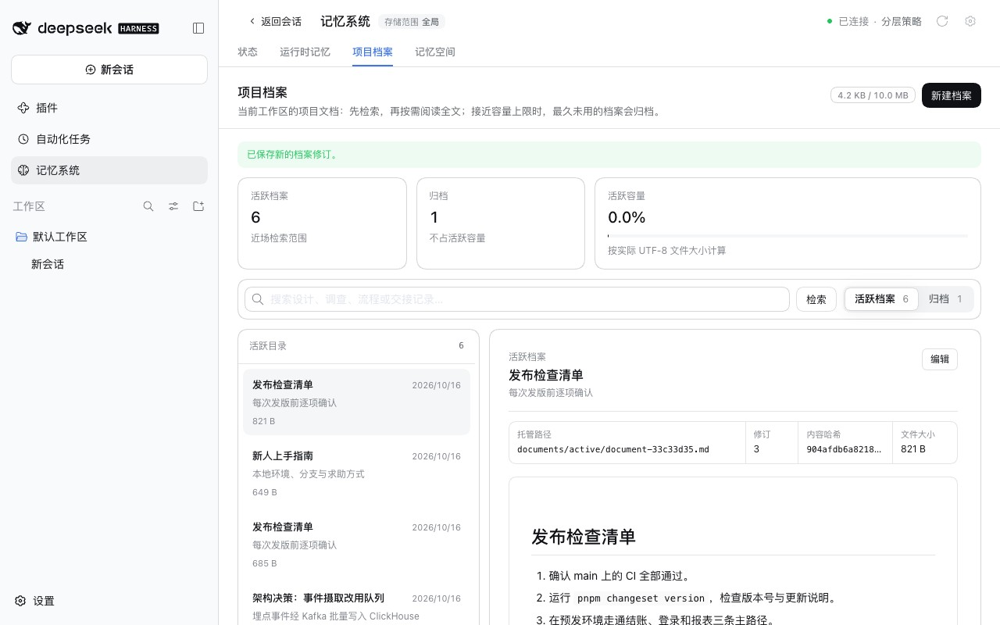
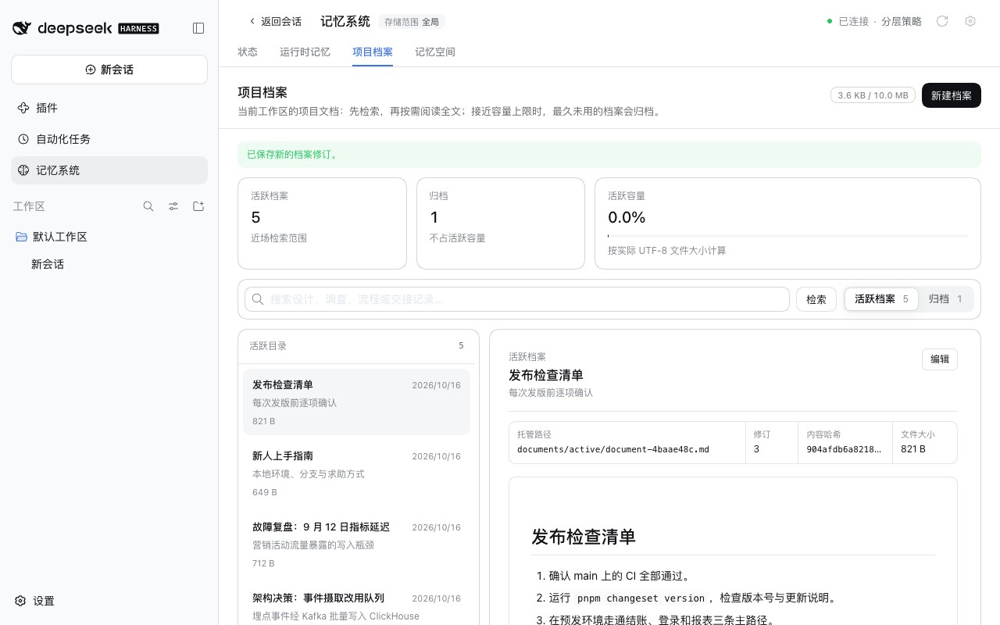

# 从 0.5.28 升级后的第一次 Git 同步 — issue #385

[English](./README.md) | [验证记录](./verification.json)

issue #385 在 dsh-mnemon 0.5.28 上于两次同步之间把一份项目档案编辑了两次。第二次同步把分支上的旧修订当作新档案导入：同一标题出现两条活跃记录，副本的文件名里带着第二个 id。v0.5.29 通过 PR #381 修复了这个问题：每次合并与发布之后，设备会记下它与分支此时一致的每份档案版本（`state/sync/base.json`），此后只有本机改动过的档案会作为修改发布。报告者打算在 0.5.29 上回验。但他的设备最后一次同步是在不保存这份记录的 0.5.28 上，所以升级后的第一次同步时合并仍无可比较，上次同步之后编辑过的档案又一次以副本的形式回来。

基线：main `4feee034`，即 v0.5.29。修复：`2c271089`，以及审查后的 `74bdcf82`。运行于 2026-10-16（Asia/Shanghai）：
- macOS 15.6 arm64，Node 24.19.0，Git 2.50.1；
- 无头 Chrome，1280×800，zh-CN，浅色；
- DSH 0.2.1-alpha.2（npm `alpha`），通过 `scripts/serve-e2e.mjs --docs-demo` 运行；
- 同步远端是一个本机裸仓库。

## 原因

这份一致记录要等 0.5.29 的一次合并或发布写下之后才存在。没有它时，合并会为正文不同的每份档案保留副本，这在两段无关的历史之间是稳妥的做法。但从 0.5.28 升级上来时，两段历史并非无关：0.5.28 已经在 `state/sync/last-run.json` 里记下了上次同步的提交，而在那个提交上，本机与分支持有相同的档案，因为设备刚刚发布了那份载荷或把它合并进来。

## 修复

没有一致记录时，合并会读取上次同步那个提交里的档案索引（在镜像中执行 `git show <commit>:<directory>/payload/documents/index.json`），只要合并时的分支仍从那个提交延续下来，就把其中的版本当作一致记录使用。已有的一致记录照旧使用或拒绝，包括属于另一个仓库、分支或目录的记录，以及分支已经离开的提交上的记录。对已经在 0.5.29 上同步过的设备，没有任何变化。

这样读到的每个版本都在分支自己的历史里，因此它只可能让合并替换一份与分支先前发布过的版本相同的档案，绝不会替换没有发布过的正文。

审查发现，回退到上次运行的做法在两种情况下会丢掉另一台机器的版本，而 main 会保留一份副本：只合并运行时记忆的拉取也会被记为一次运行，尽管没有带回任何档案；上次运行的记录在更换分支或目录后仍然保留。本机认可过的版本必然是它持有过的版本，所以现在高于本机自身修订号的认可版本会被忽略，该档案按没有认可版本的方式合并，保留一份副本；更换分支或目录会清除上次运行的记录；回退通过 `git show` 读取旧索引，读取失败视为没有认可版本，不带回档案的拉取会跳过它。

## 方法

`pnpm e2e:serve --docs-demo` 预置六份项目档案，其中五份活跃。
1. 在 **插件 → 可组合记忆** 中打开 **Git 同步**，通过 **仓库地址** 连接到裸仓库，点 **立即同步**。
2. 从存储根目录删除 `state/sync/base.json`。这样它就是 dsh-mnemon 0.5.28 留下的样子：`state/sync` 里只有 `last-run.json` 和镜像，没有一致记录。
3. 在 **记忆系统 → 项目档案** 中打开「发布检查清单」，点 **编辑**，加一行，点 **保存修订**。做两次，档案到达修订 3。
4. 再点一次 **立即同步**。

基线使用同一构建，只把 `src/host/git-sync.ts` 换成 main 的版本。

## 修复前后

| main | 修复后 |
|---|---|
|  |  |

main 上，同步把「发布检查清单」的修订 1 作为一份新的活跃档案 `document-33c33d35-cb5532c7.md` 保留在修订 3 旁边，并把两份都发布出去。修复后，存储根目录和分支上都只有一份「发布检查清单」，为修订 3，活跃档案共五份。

## 自动化检查

`tests/git-sync.spec.ts`，基于真实裸仓库：
- 从 0.5.28 升级、上次运行是推送时，第一次同步前做的编辑作为修改传递，分支上只有一份最新修订的档案；
- 从 0.5.28 升级、上次运行是合并时，分支上更新的版本会替换本机合并进来的那份，两台设备最终一致；
- 从 0.5.28 升级、而分支已被删除并从另一段历史重新发布时，合并仍像以前一样保留副本。

前两项在 main 上失败；第三项在 main 和修复版本上都通过。原有的、模拟 0.5.28 之前版本设备的用例，现在也会删除 `last-run.json`，因为那样的版本从不写这个文件。

## 限制

- 从 0.5.28 之前的版本升级的设备没有 `last-run.json`，它的第一次同步仍会像以前一样为正文与分支不同的每份档案保留副本。
- 如果上次同步之后改过同步目录，会从那个提交的新目录读取索引；那个提交里不存在该目录时，不使用它。
