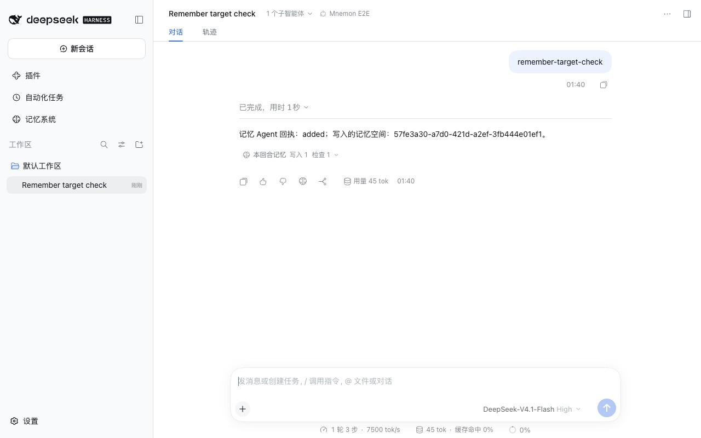
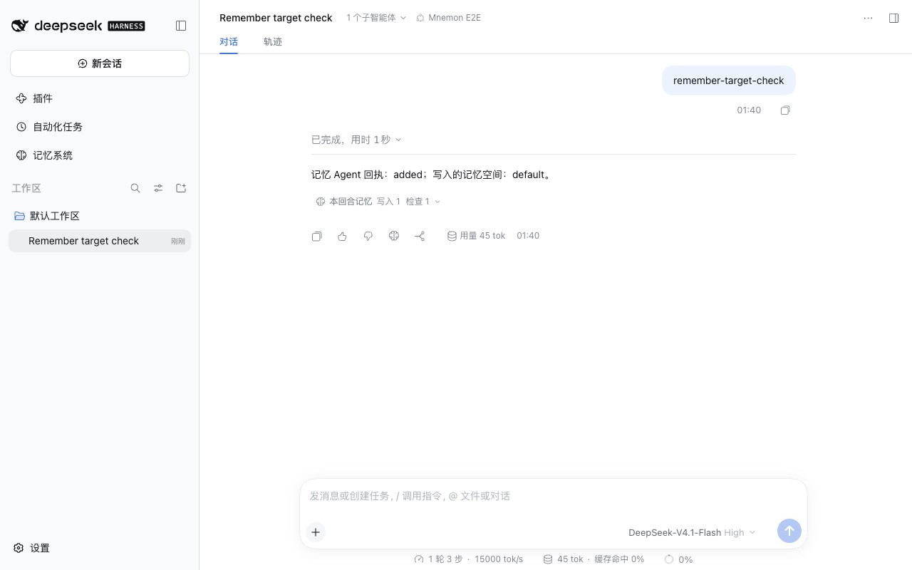
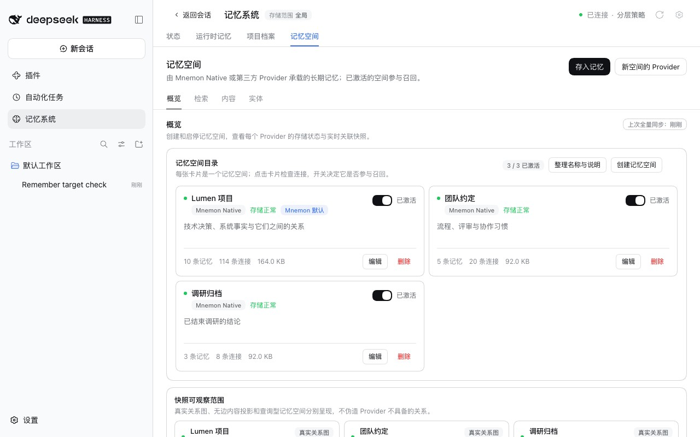
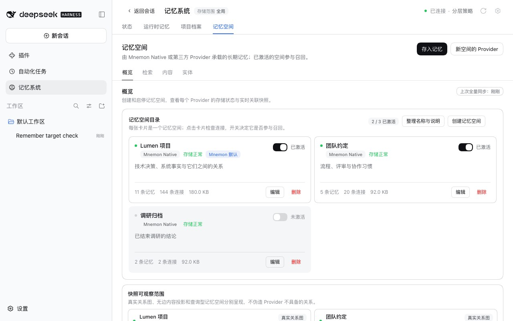
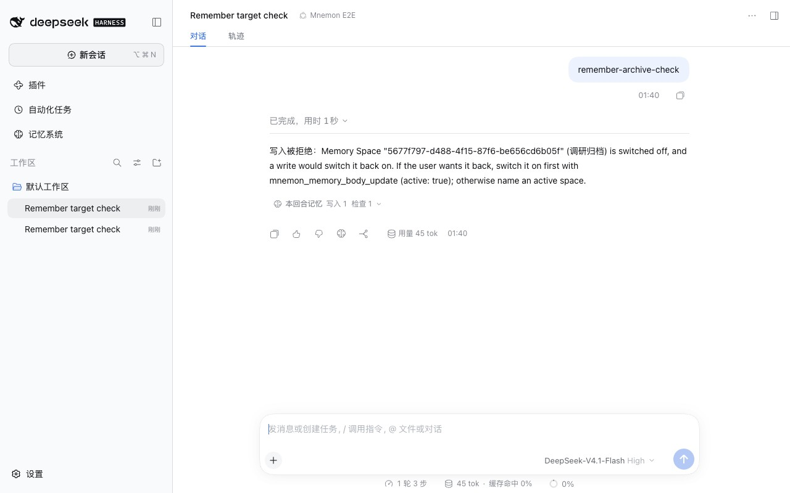

# 记忆存入 mnemon_remember 指定的记忆空间 — issue #387

[English](./README.md) | [验证记录](./verification.json)

issue #387 以 `memoryBodyId: "default"` 调用 `mnemon_remember`，存一条提到「工具实测批次 3」的记忆。结果记忆进了一个描述里含有这几个字的测试空间，而这个原本停用的空间被重新打开；回执只是顺带提了一句。另一条与任何描述都不沾边的记忆则进了 `default`。issue 期望指定的空间优先于任何路由，写入停用的空间应当失败或需要确认，而不是让它重新打开。

基线：main `4feee034`。修复：`3849ec82`，以及审查后的 `b91d4ba9`；端到端夹具在 `232530dd` 和 `6c0ca215`，宿主测试在已安装 DSH 上的运行在 `9c79a8c9`。运行于 2026-10-17（Asia/Shanghai）：
- macOS 15.6 arm64，Node 24.19.0，Mnemon CLI 0.2.10；
- 无头 Chrome，1280×800，zh-CN，浅色；
- DSH 0.2.1-alpha.2（npm `alpha`），通过 `scripts/serve-e2e.mjs` 运行。

## 原因

`mnemon_remember` 把写入交给一个写入子 Agent。子 Agent 收到的请求把调用方的 `memoryBodyId` 写成「Preferred Memory Space ID」（首选记忆空间），人设又要它选择最贴切的空间，还写着「写入可以针对停用的空间，并会激活它」。issue 提到的「主动记录」策略只是加了一条记录指引，做选择的是写入子 Agent。记忆空间 Source 本身会遵守精确的 id，并在提交的写入或关联落到某个空间时打开它；同一次运行中新建的空间正是这样变成激活的。

## 修复

写入子 Agent 启动前，Host 读取记忆空间目录并检查指定的空间：
- 不存在的 id、Provider 已关闭或不接受写入的空间，以及已停用的空间，都会立即失败并说明原因，不启动写入子 Agent。
- 模型想重新启用某个停用的空间时，要先用 `mnemon_memory_body_update` 打开它；拒绝信息会这样说明。用户在记忆空间页对话框中选中的停用空间，仍会随写入重新打开，结果会在 `activatedMemoryBodyIds` 中列出它。
- 无法读取目录时不保存任何内容，并说明原因。

写入子 Agent 随后在一个 DSH 工具守卫之下运行。守卫在 DSH 发布子 Agent、它开始运行之前挂上，与空闲审查已经使用的机制相同（抽取为通用的 `startGuardedChild`）：
- 指定了空间时，守卫拒绝写入或关联到其他空间的 `mnemon_remember` 与 `mnemon_link`，也拒绝任何创建或修改空间的操作。
- 没有指定空间时，守卫拒绝写入或关联运行开始时就处于停用状态的空间，也拒绝把它打开。子 Agent 在本次运行中新建的空间仍可像以前一样接收第一次写入。从不指定空间的「存入记忆」遵循同样的规则。
- 存入记忆从不合并空间：合并会打开目标空间、停用来源空间，它是单独的请求。
- 运行结束后，委派的子 Agent 不能再使用记忆工具。在 DSH 0.2.1 上，其他 Agent 给已结束的子 Agent 发消息，会让它从保存的状态恢复运行，而它原来运行时的守卫已经不在；这一条也覆盖空闲审查的子 Agent。

结果报告的内容取自 Source 回执，而不是写入子 Agent：
- `memoryBodyIds` 是写入回执实际存入记忆的空间，包括 Code Mode 程序中写入成功、之后程序才失败的那次写入。写入子 Agent 报告了写入、却没有任何回执能证明时，结果为 `unknown`。这也覆盖了 issue #390 第 11 项。
- 提示把指定的空间标为「Target Memory Space ID (write only here)」，明确的请求则标为「Memory Space ID」，不再是「Preferred」。

不支持 Agent 归属或工具守卫的 DSH，或不在本地运行子 Agent 的 provider，像以前一样不受守卫地运行写入子 Agent。DSH 在守卫看不到的地方发布了一个本可以受守卫的子 Agent 时，写入会失败。

## 方法

`pnpm e2e:serve --remember-target` 预置中文 Lumen 演示项目：「Lumen 项目」（`default`）与「团队约定」已激活，「调研归档」（已结束的调研）已停用，内有两条记忆。
1. 发送 `remember-target-check` 后，脚本化的根 Agent 先列出空间，再带着「Lumen 项目」的 id 调用 `mnemon_remember`，保存一条关于 TimescaleDB 的调研结论。脚本化的写入子 Agent 先尝试描述更贴切的「调研归档」，再尝试「Lumen 项目」。
2. 在新会话中发送 `remember-archive-check` 后，根 Agent 自己指定「调研归档」，并回复 `mnemon_remember` 的返回内容。

只有模型决策是脚本化的；DSH、子 Agent、守卫、工具和 Mnemon Native 写入都是真实运行。基线使用同一构建，只把 `src/host/subagent.ts`、`src/host/review-tools.ts`、`src/host/tools.ts` 与 `src/host/lifecycle.ts` 换成 main 的版本；它的第 2 步在一个新的夹具上运行，那里的「调研归档」仍是停用的。

## 修复前后

| | main | 修复后 |
|---|---|---|
| 第 1 步：回复 |  |  |
| 第 1 步：**记忆系统 → 记忆空间** |  |  |
| 第 2 步：根 Agent 指定「调研归档」 |  |  |

第 1 步在 main 上，写入子 Agent 的第一次尝试就成功了：调研结论进了「调研归档」，它被重新打开，变成 3 条记忆；回执写的是这个空间，尽管调用方要的是 `default`。修复后，守卫以 `This write was requested for Memory Space "default"…` 拒绝了第一次尝试，写入子 Agent 写进了「Lumen 项目」，回执写的是 `default`，「调研归档」保持停用，仍是两条记忆。

第 2 步在 main 上，写入落进「调研归档」并把它打开。修复后，Host 在任何写入子 Agent 运行之前就拒绝了这个空间：`Memory Space "…" (调研归档) is switched off, and a write would switch it back on. If the user wants it back, switch it on first with mnemon_memory_body_update (active: true); otherwise name an active space.`「调研归档」保持停用。

## 自动化检查

`tests/remember-target-host.spec.ts` 在两个 Holographic 空间上运行 DSH 真实的 agent loop 和 spawn provider，其中一个已停用、描述更贴切。它通过已安装 DSH 的测试工具，在 DSH 0.1.7-rc.2（仓库锁定的版本）、0.2.0-rc.2 与 0.2.1-alpha.2 上都通过：
- 指定已激活空间的写入，写往另一个空间时被拒绝，最终落在被要求的空间；停用的空间保持停用；
- 不指定空间的写入，写往停用空间时被拒绝，最终落在已激活的空间；`memoryBodyIds` 取自回执，而不是写入子 Agent 的报告；
- 模型指定的停用空间在任何写入子 Agent 运行之前就被拒绝；
- 用户选中的停用空间接收写入、重新打开，并在 `activatedMemoryBodyIds` 中列出；
- 其他 Agent 给已结束的写入子 Agent 发消息后，它无法写入：在 0.2.1-alpha.2 上 DSH 会恢复它，它读到的是拒绝信息；更早的 DSH 不会恢复它。

`tests/subagent.spec.ts` 新增：
- 守卫对 `mnemon_remember`、`mnemon_link`、空间修改与合并的判断，分别在指定和未指定空间时；
- 对指定空间的检查：不存在、Provider 已关闭、不接受写入与已停用，都不启动写入子 Agent，以及用户的 `activateTarget`；
- 无法读取目录时不保存任何内容；
- 失败的 Code Mode 程序中那次写入的 `memoryBodyIds`，以及写入子 Agent 声称写入却没有回执时报告为 `unknown`。

`tests/review-tools.spec.ts` 新增可选守卫的规则：已发布的子 Agent 受守卫，无法受守卫的子 Agent 像以前一样运行，在守卫看不到的地方发布的可受守卫子 Agent 会失败。

这 15 个测试中有 14 个在 main 上失败。恢复运行的情况在 main 上用仓库锁定的 DSH 时通过，因为它从不恢复已结束的子 Agent；在 0.2.1-alpha.2 上，去掉新的守卫后它会失败。审查、子 Agent、命令与续接相关的测试都通过，包括现在改用通用启动函数的空闲审查守卫。

## 限制

- 守卫只把写入限定在某个空间，不判断记忆是否属于那里。指定了已激活空间的调用方被视为已经做出选择。
- 所有空间都停用时，除非写入子 Agent 新建一个空间，否则 `/mnemon remember` 和「存入记忆」不会保存任何内容。
- 写入子 Agent 自己的摘要仍由模型撰写；实际发生了什么由结构化字段说明。
- 不支持 Agent 归属或工具守卫的 DSH 上，写入子 Agent 像以前一样运行，只靠人设把它限定在指定的空间。
- 已结束子 Agent 的列表保存在 Host 进程中，最多 1,000 个：Host 重启后被 DSH 恢复的子 Agent 不会被拒绝。
- 团队成员或其他自行调用 `mnemon_remember` 的子 Agent 直接经由 Source 写入，仍会打开它指定的空间。
