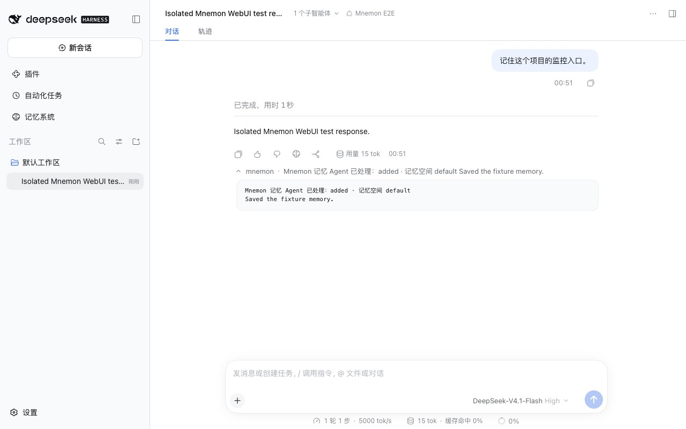
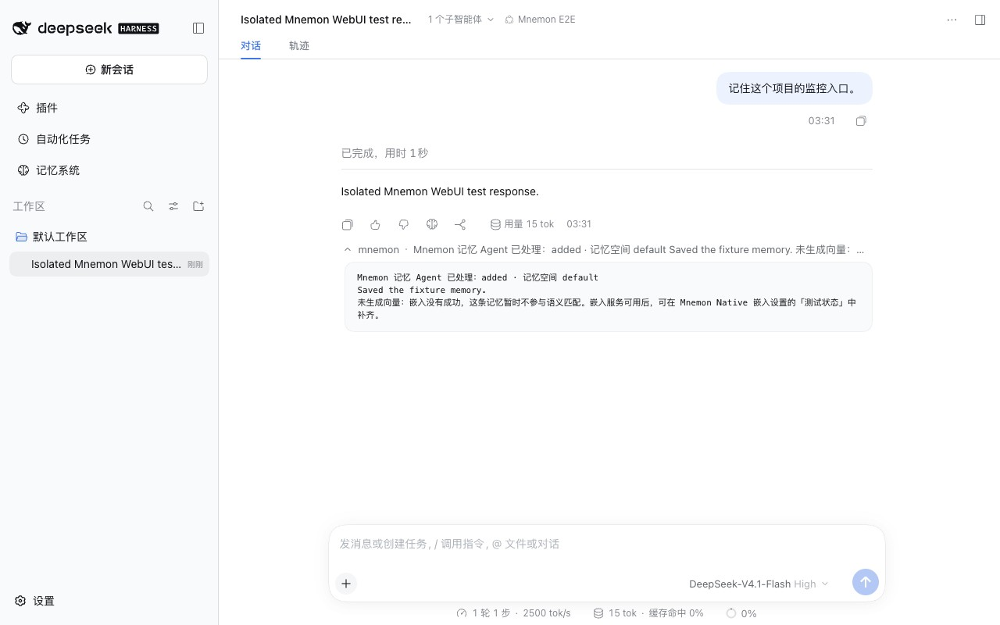
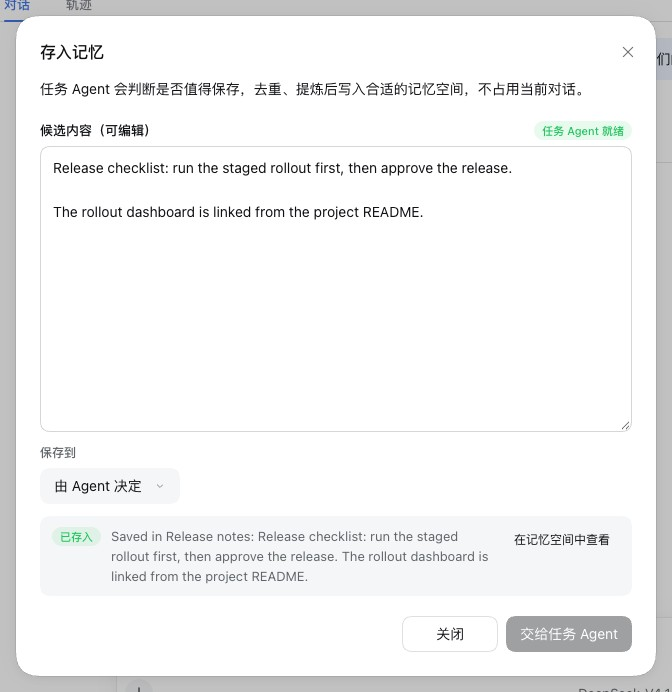
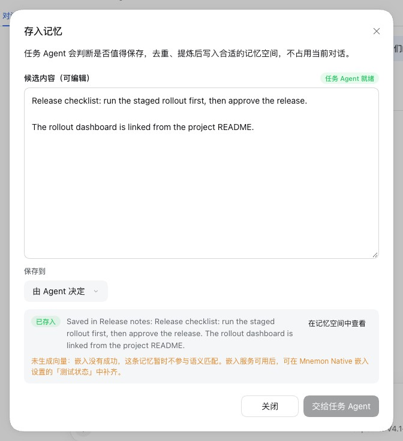
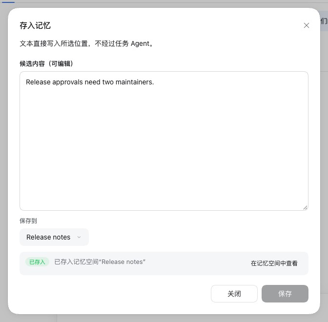
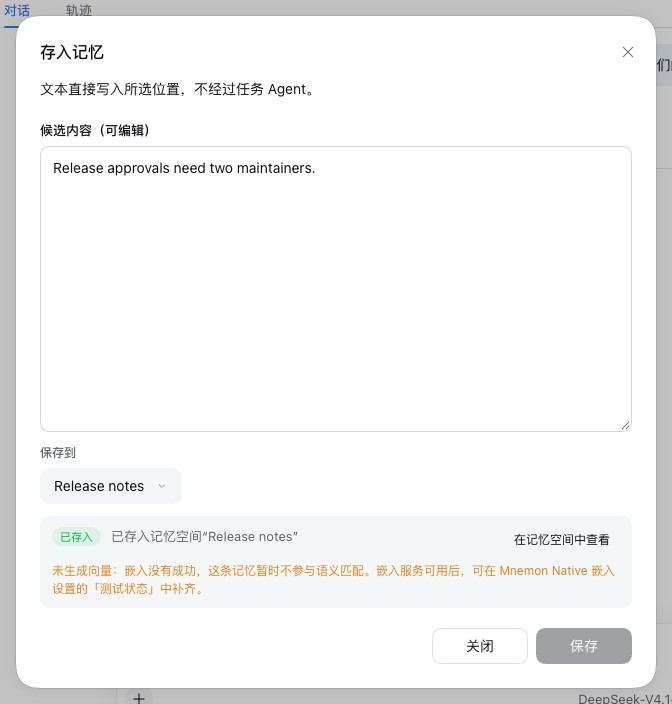

# A memory saved without a vector says so — issue #388

[简体中文](./README.zh-CN.md) | [Verification record](./verification.json)

Issue #388 wrote memories while the embedding service (Ollama) was not running. Every write came back as succeeded, committed and added, exactly as with the service up, yet the memory had no vector, and semantic recall missed it until `mnemon embed --all` filled the gap. Only `mnemon embed --status` showed it later: 17 of 48 memories had vectors on the first count, 51 of 52 on the second. The issue asked the write receipt itself to say that a memory has no vector yet.

Baseline: main `4feee034`. Fix: `d05ad398` (the write result and `/mnemon remember`), `c554f75c` (the Save to memory receipts) and, after review, `46759447` (the next step and the wording). The runs took place on 2026-10-17 (Asia/Shanghai):
- macOS 15.6 arm64, Node 24.19.0 and Mnemon CLI 0.2.10, with no embedding service on the machine;
- headless Chrome at 1280×800, zh-CN, light;
- DSH 0.2.1-alpha.2 (npm `alpha`) through `scripts/serve-e2e.mjs`, with `MNEMON_CLI_PATH` set to the real CLI.

## Cause

Mnemon Native already says it: a `remember` whose embedding call fails, the service down or its model missing, still saves the memory, and its receipt carries `embedded: false`. dsh-mnemon dropped that field on the way to the people and the Agent who read the write:
- `mnemon_remember` and Save to memory hand the write to a writer child Agent, and its result carried only the action, the spaces and the writer's own summary;
- `/mnemon remember` printed that result;
- the Save to memory receipts in a conversation and on the Memory Spaces page showed the outcome and the summary, including for a write straight to a space, where the field was in the Provider's receipt.

A probe with the real CLI ([harness/remember-without-vector.py](./harness/remember-without-vector.py)) points the embedding endpoint at a port nothing listens on: `remember` answers `added` with `embedded: false`, a keyword recall still finds the memory (keyword 1, similarity 0), and `embed --status` reports 0 of 1 embedded.

## Fix

- A write through the task Agent lists every memory a Provider receipt reported as `embedded: false` in `unembedded`, with a `hint`: semantic matching misses it until its vector is filled in, from Test status in the Mnemon Native embedding settings once the embedding service answers, while keyword, link and recency recall still reach it. That runs through the storage root and embedding settings DSH uses; a terminal `mnemon` command may reach neither. The root Agent reads both in the `mnemon_remember` result.
- `/mnemon remember` adds the line 未生成向量：嵌入没有成功，这条记忆暂时不参与语义匹配。嵌入服务可用后，可在 Mnemon Native 嵌入设置的「测试状态」中补齐。 ("Saved without a vector: embedding did not succeed, so this memory is left out of semantic matching for now. Once the embedding service answers, fill it in from Test status in the Mnemon Native embedding settings.")
- The Save to memory receipts add the same line in a caution tone, in a conversation and on the Memory Spaces page, whether the task Agent wrote the memory or the text went straight to a space.
- The line appears only when the write put a memory somewhere: a run that ended as a skipped duplicate says nothing about a vector.

Review changed three things in the first version. Its hint suggested `mnemon --store <id> embed --all`, which runs against the default data directory unless `--data-dir` names DSH's storage root, and without DSH's managed embedding settings: run against another directory, it answered that every memory already had its vector and created an empty Store besides. Its line said the service did not answer, while a missing model gives the same receipt. And the writer's persona asked the summary to repeat what the line already says. A later review, of the change for #392, found that "only keyword recall finds" the memory overstated the loss: Mnemon recall also reaches it through links and recency, and only the semantic match is missing. `5a371060` says so in the line and the hint, and the screenshots below were taken again on it.

The **补齐** (Fill in) action under Test status that the next step points to comes with the change for issue #392, which lists every space's vectors there.

## Method

1. `pnpm e2e:serve --exact-id`: after one message, `/mnemon remember 预发集群的 Grafana 在 3300 端口，排查监控问题时先看它。`, and the command's row expanded. The scripted writer lists the spaces and calls `mnemon_remember` once.
2. `pnpm e2e:serve --save-action`: **存入记忆** (Save to memory) on the assistant's reply, then **交给任务 Agent** (Send to task Agent). The scripted task Agent creates a space, Release notes, and writes the reply into it. The dialog is then opened again, its text changed to `Release approvals need two maintainers.`, **保存到** (Save to) set to Release notes, and **保存** (Save) clicked: a write straight to the space, with no Agent.

Only the model decisions are scripted; DSH, the child Agents, the dialogs and every Mnemon Native write through the real CLI are real. The baseline ran the same build with `src/host/subagent.ts`, `src/host/commands.ts`, the client files the change touches and the Memory Spaces page's client files from main.

## Before and after

| | main | Fix |
|---|---|---|
| `/mnemon remember` |  |  |
| **存入记忆** through the task Agent |  |  |
| **存入记忆** straight to a space |  |  |

On main every receipt reads like a write that has its vector. With the fix each one says the memory has none yet, what that means for recall and where to fill it in. The line sits under the receipt row in smaller type and a caution tone, so the outcome and the link to the memory stay where they were.

## Automated checks

- `tests/subagent.spec.ts`: a write whose receipt says `embedded: false` lists the memory in `unembedded` with the hint, which names Test status and no terminal command; one with `embedded: true` has neither field; a run with mixed receipts and a skipped duplicate lists only the memory without a vector.
- `tests/commands.spec.ts`: `/mnemon remember` adds the line for a stored write and none for a skipped one.
- `tests/client-interaction-surfaces.spec.tsx`: Save to memory in a conversation shows the line for the task Agent's result and for a write straight to a Mnemon Native space, not for a memory saved with its vector, and not under a skipped outcome.
- `tests/client.spec.tsx`: the Memory Spaces page's dialog shows the line for the task Agent's result and for a write with constraints, and not for a memory saved with its vector.
- `tests/client-presentation.spec.ts`: the copy baseline holds 1,323 keys per language with the new line.

Of the eight new tests, five fail on main; the three that pass there guard that no line appears where it should not.

## Limits

- The issue's second request, listing which memories lack a vector in `mnemon embed --status`, belongs to the Mnemon CLI: its status reports counts only. Issue #392 covers the coverage the Settings page shows.
- dsh-mnemon does not fill the vectors by itself: the receipt says where, and the user presses **补齐** once the service answers.
- A Provider other than Mnemon Native reports no `embedded` field, and its receipts read as before.
- Archiving MEMORY.md entries into a space (`mnemon import`) reports no `embedded` field, and a View Action write returns Mnemon's own `embedded: false` without the hint; Test status shows their coverage.
