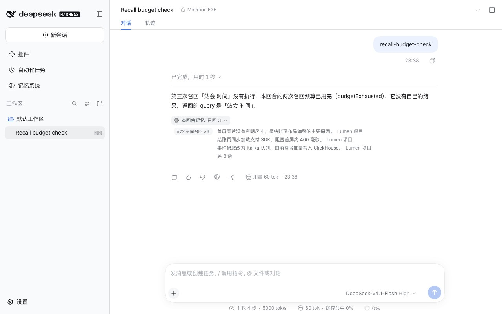

# 超出回合预算的召回 — issue #389

[English](./README.md) | [验证记录](./verification.json)

issue #389 在同一回合内用 `mnemon_recall` 问了三个不同的问题。第三次返回的内容与第二次完全相同，条目 id 和摘录都一样，只有提示里写着 `budget exhausted`。只看结果、不看提示的调用方，就会把一个问题的答案当成另一个问题的答案。issue #390 第 1 项报告的是项目档案一侧：第二次 `mnemon_document_search` 返回 `notRun: true` 和空列表，看起来像是"没有这份档案"。

基线：main `4feee034`。修复：`c05c1efe`，以及审查后的 `20c0264e`，端到端夹具在 `590aab2b`。运行于 2026-10-16（Asia/Shanghai）：
- macOS 15.6 arm64，Node 24.19.0，Mnemon CLI 0.2.10；
- 无头 Chrome，1280×800，zh-CN，浅色；
- DSH 0.2.1-alpha.2（npm `alpha`），通过 `scripts/serve-e2e.mjs` 运行。

## 原因

分层策略每个 Agent 回合允许两次召回查询和一次 Related 遍历。超出之后，它会重放最近一次查询已准入的 evidence 来回答新查询，并且用的是那次查询的文本；新的 Related 遍历也会重放上一次遍历的相邻条目。重放本意是在不让调用失败的前提下停止检索，但结果看起来就是新问题的一次正常命中。

## 修复

超出预算的另一次读取不执行查询，也不返回任何内容，并以它自己的查询返回：`notRun: true`、`budgetExhausted: true`、空的 `results`，以及一句提示，说明空列表并不代表没有匹配。从另一个条目出发的第二次 Related 遍历同样如此。重复回合内已运行过的读取仍会重放它自己的 evidence，那正是它真正的答案。第二次项目档案搜索也带上 `budgetExhausted: true`；从本回合召回未准入的条目出发的 Related 调用带上 `notRun: true`。宿主的召回计数不再把没有执行查询的读取算进去。参考文档说明了预算的计算方式：按执行中的 Agent 回合计，委派的子 Agent 整个任务算一个回合。

审查发现，并行的第三次召回在占用预算的读取仍可能失败、归还名额时，就回答预算已用尽，于是在 main 会报错的情况下，第三次读取返回了空结果。现在超出预算的并行召回会等待进行中的读取，然后再判断；第二次关联遍历和第二次项目档案搜索也一样，失败的搜索现在会归还它的名额。`/mnemon recall` 与 `/mnemon related` 在查询没有运行时会说明，而不是报告没有找到。

## 方法

`pnpm e2e:serve --recall-budget` 预置中文 Lumen 演示项目（与文档截图集相同），并使用一个脚本模型：发送 `recall-budget-check` 后，它依次提出三个不同的召回问题：结账页 性能、ClickHouse 写入、站会 时间。只有模型决策是脚本化的；DSH、View、策略、Mnemon Native 空间和三次工具调用都是真实运行。回复会说明第三次调用返回了什么。基线使用同一构建，只把 `src/host/subagent.ts` 与策略插件的 `src/retrieval.ts` 换成 main 的版本。

## 修复前后

| main | 修复后 |
|---|---|
|  |  |

main 上，关于站会时间的问题拿回了三条关于 ClickHouse 写入的记忆，结果中的 `query` 字段是 `ClickHouse 写入`。修复后它返回 `notRun: true`、`budgetExhausted: true`、没有结果，`query` 是它自己的 `站会 时间`。本回合记忆栏只列出前两次查询找到的内容：

## 自动化检查

- `plugins/dsh-mnemon-strategy-default-three-tier/tests/retrieval.spec.ts`：第三个不同的召回查询，以及从另一个条目出发的第二次 Related 遍历，都不执行也不返回内容，并带着自己的查询；相同的召回查询和相同的遍历仍重放各自的 evidence；第二次项目档案搜索带有 `budgetExhausted`；从本回合未准入的条目出发的 Related 带有 `notRun`。
- `tests/default-three-tier-host.spec.ts`：通过真实的 `mnemon_recall`、`mnemon_document_search` 与 `mnemon_view_route` 工具检查同样的行为，并确认召回计数不包含没有执行的那次读取。
- `tests/subagent.spec.ts`：协调器的二次查询测试现在期望超出预算的查询不返回内容，而不是返回二次查询的 evidence。

这些测试中有 8 个在 main 上失败。

## 限制

- 本回合记忆栏统计的是工具调用次数，所以三次调用仍显示「召回 3」，其中一次实际没有执行。
- 预算本身不变：每个 Agent 回合两次召回查询、一次 Related 遍历、一次项目档案搜索。委派的子 Agent 整个任务算一个回合。
- 通用策略没有这层信封：路由超过自身的 `maxCalls` 时调用失败，与以前相同。
