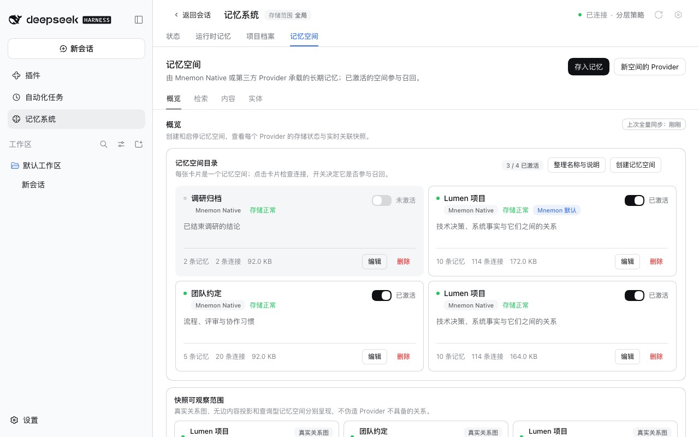
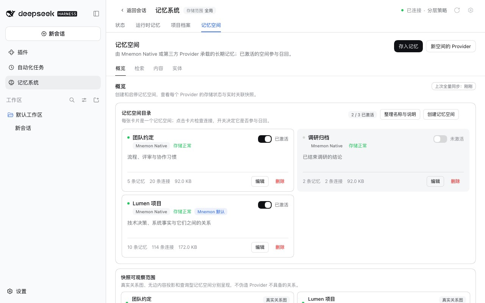

# A Memory Space copied on every sync after a merge — issue #391

[简体中文](./README.zh-CN.md) | [Verification record](./verification.json)

Issue #391 found a new store after **Sync now**: a complete subset of a space still in use, active, and answering recall in its place. A comment on the issue traced it to the merge of Memory Spaces in Git sync. A Mnemon `edges` row is keyed by its two memories and its type, but the merge compared every column. A local merge of spaces had rewritten every edge of the main space (weight 0.5, a new note, a new time), while the branch still held the edges as published. The next merge tried to insert the branch's edges as new rows, hit the key, gave up, and kept the branch's version as a new space. That copy then got merged back, and the cycle went on: five copies on the commenter's machine.

Baseline: main `4feee034`. Fix: `4eaa205d`, with the review fix in `cc4272c1`. The runs took place on 2026-10-17 (Asia/Shanghai):
- macOS 15.6 arm64, Node 24.19.0, Git 2.50.1 and Mnemon CLI 0.2.10;
- headless Chrome at 1280×800, zh-CN, light;
- DSH 0.2.1-alpha.2 (npm `alpha`) through `scripts/serve-e2e.mjs --docs-demo`;
- a local bare repository as the sync remote.

## Cause

Since #370 a merge compares two versions of a space by what they hold, row by row, and adds the rows only the other version holds. Every column took part except the usage columns and the vector. Two kinds of value are not usage, but Mnemon writes them again without changing what a row holds:
- An edge's `weight`, `metadata` and `created_at`. `mnemon import` writes them again for every edge it receives, and dsh-mnemon's own space merge (`mnemon_memory_body_merge`) imports the source space's memories and edges into the target this way, at weight 0.5 with the edge type as the note. Merging a copy of a space back into it therefore rewrites the values of every edge the two share. A probe with the real CLI imported a store into itself and found all 12 edges with the same keys and new values.
- A memory's `updated_at`. `mnemon embed --all` stamps it on every vector it fills in once the embedding service answers again, and `mnemon gc --keep` on the memory it keeps. Review found this second case: a machine that backfilled its vectors after a sync could not merge the published version either.

## Fix

- An edge's weight, metadata and time no longer take part in the comparison: an edge is the two memories it links and its type, which is its table's key. A merge keeps this machine's values for the edges both hold and still adds the memories and edges only the other version holds.
- A memory's update time no longer takes part either. An edit still changes its content and a forget still sets `deleted_at`, so a memory edited or forgotten on one side still keeps a copy, as before.
- The values left out per table are kept in a `Map`. The plain object before it answered a table named `constructor` with `Object` itself, and reading such a space threw and fell back to its bytes.

## Method

1. `pnpm e2e:serve --docs-demo` seeds three Mnemon Native spaces; Lumen 项目 holds 10 memories and 114 edges.
2. Under **插件 → 可组合记忆** (Plugins → Composable memory), switch **Git 同步** (Git sync) on, connect the bare repository by **仓库地址** (Repository address), and click **立即同步** (Sync now).
3. Write Lumen 项目's memories and edges into it again with the real Mnemon CLI, as merging a copy of it back does: `mnemon --data-dir <storage root> --store default import`, edges at weight 0.5 with the edge type as the note ([harness/rewrite-edges.py](./harness/rewrite-edges.py)). The import skipped all 10 memories and wrote all 114 edges again: same keys, new values.
4. Click **立即同步** again, and open **记忆系统 → 记忆空间** (Memory System → Memory Spaces).

The baseline ran the same build with `src/host/space-identity.ts` from main.

Two CLI probes build the databases a sync would merge with the real Mnemon CLI, and [harness/merge-identities.mjs](./harness/merge-identities.mjs) merges the published version into the local one with main's and the fix's `MemorySpaceIdentity`:
- [harness/import-rewrites-edges.py](./harness/import-rewrites-edges.py) imports a three-memory store into itself, as a space merge does.
- [harness/embed-backfill.py](./harness/embed-backfill.py) remembers three memories while no embedding service answers, keeps that store as published, then runs `mnemon embed --all` against [harness/fake-embeddings.py](./harness/fake-embeddings.py), a stand-in for Ollama on 127.0.0.1, and `mnemon gc --keep` on one memory.

## Before and after

| main | Fix |
|---|---|
|  |  |

On main the second sync added a second Lumen 项目 under a new id, active, holding the branch's version: the same 10 memories and 114 links. With the fix the directory still holds three spaces, one of them Lumen 项目.

| Probe | main | Fix |
|---|---|---|
| A space merge rewrote all 12 edges | refused: the caller keeps a copy | nothing to add |
| `mnemon embed --all` filled in 3 vectors | refused: the caller keeps a copy | nothing to add |
| `mnemon gc --keep` kept one memory | refused: the caller keeps a copy | nothing to add |

Of the columns compared, the backfill and the keep each changed only `updated_at`. On main the identities differ and the local version does not hold the published one; with the fix the identities are equal and it does.

## Automated checks

- `tests/space-identity.spec.ts`:
  - a space whose edges differ only in weight, note or time has the same identity and holds the other version both ways, while another edge type between the same memories is another edge;
  - a merge of such a version keeps this machine's values and adds the memories and edges only the other holds, with every foreign key intact; a memory edited on one side still refuses the merge;
  - a memory whose vector was filled in later, with a new update time, is the same memory, while a forget still refuses the merge;
  - a table named `constructor` is compared by its content.
- `tests/pack.spec.ts`: over three rounds, a machine whose edges a merge rewrote takes in what the other machine learned, keeps one space, keeps its own values on the shared edge and gains the other machine's new edges.
- `tests/helpers/memory-space-db.ts` can now write an edge's type, weight, note and time.

The four edge and vector tests fail on main; the `constructor` test passes there and guards the per-table lookup this change adds. The Memory Space and Git sync suites pass on the fix. During review the same two-machine sync also ran with the real CLI writing both stores, through `MnemonPackManager`: an edge rewrite, a vector backfill, a backfill against this machine's own earlier push, and a kept memory each left one space, and a forget still kept a copy.

## Limits

- Once both machines hold an edge, each keeps its own weight and note: a value changed on one machine, by linking again or by a merge of spaces there, stays on that machine, and the branch holds the values of the machine that synced last. Weights and notes rank related memories; no memory or link is lost either way.
- Merging spaces carries the source's edges at weight 0.5 with the edge type as the note, so an edge both spaces hold takes those values in the target. That comes from `mnemon_memory_body_merge` and is left for a separate change.
- A memory edited or forgotten on one side still keeps the other version as a copy, active as the space it comes from, as #370 designed. That path is rare after this fix, and still silent: the issue's suggestion to report a kept copy in the sync result is left for a separate change.
- A machine still on an earlier version keeps making these copies itself; every machine that syncs needs the update.
- The copies main made before this fix stay where they are; their content is a subset of the space they came from, so deleting them, or merging them back, loses nothing.
