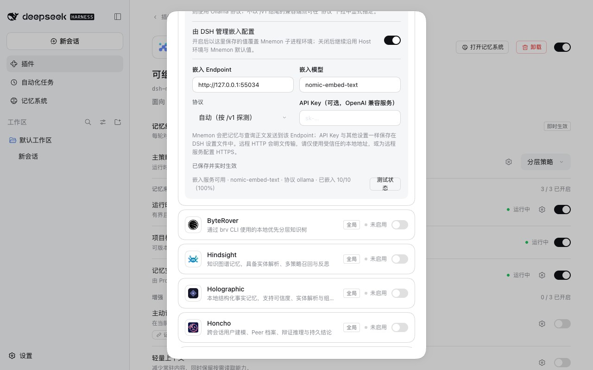
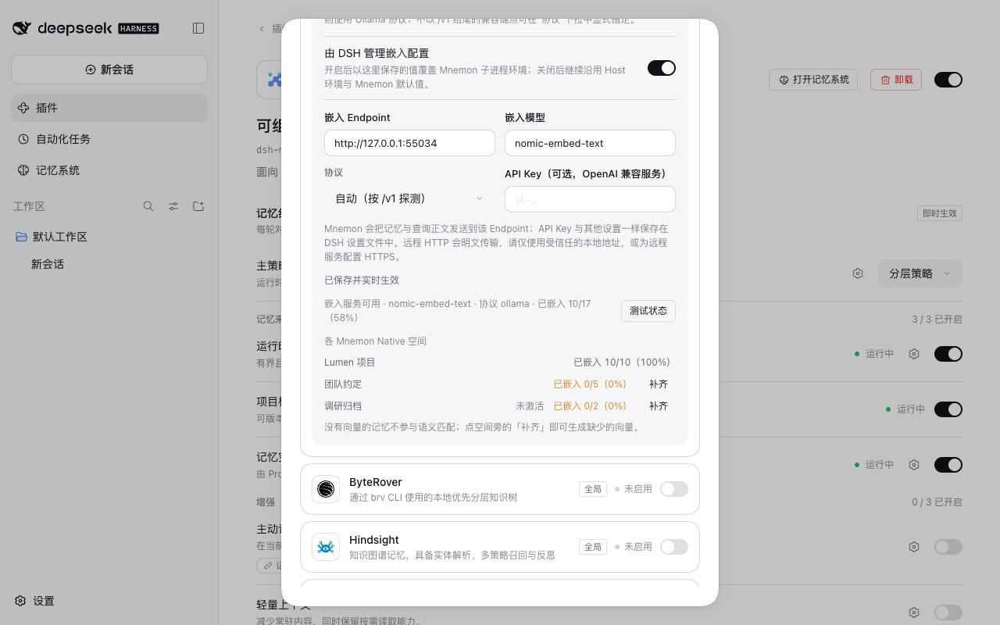
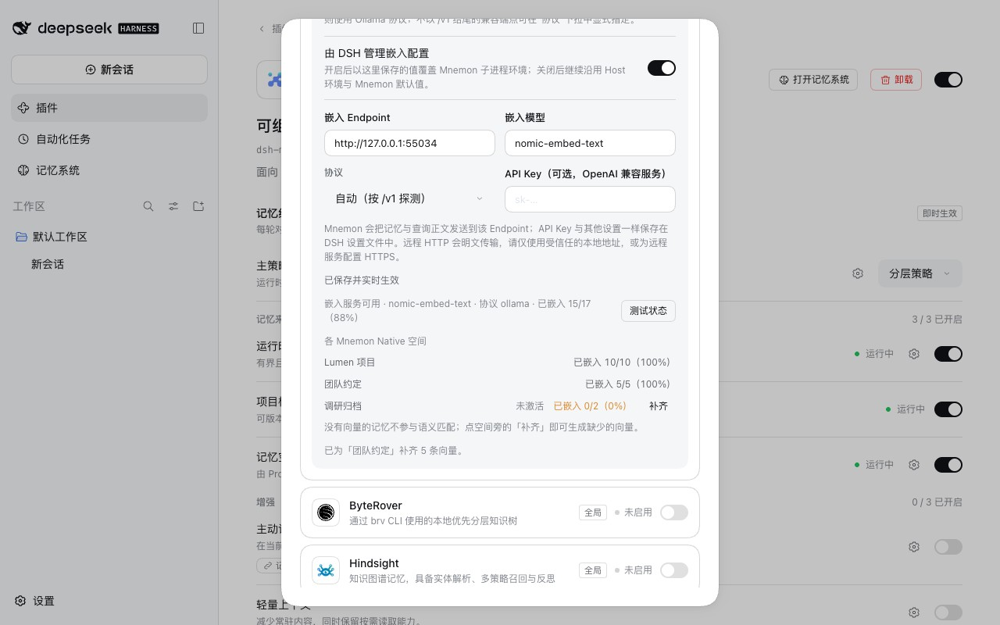

# 每个记忆空间的向量覆盖率 — issue #392

[English](./README.md) | [验证记录](./verification.json)

issue #392 执行 `mnemon embed --status`，读到 `"coverage": "100%"`、94 条中 94 条已嵌入，于是认为记忆库是健康的。而它一直在写入的记忆在另一个 store 里，64 条中有 31 条没有向量，`mnemon embed --all` 还回答所有记忆都已有向量：两个命令都只看一个 Store，也都不说是哪一个。issue 希望把这个范围说出来，让一个 store 的满覆盖率不会被读成所有 store 都健康。

dsh-mnemon 显示的也是同一个数字。设置 → 记忆空间页面 → Mnemon Native → **测试状态**只对 Mnemon 自己的 Store 执行一次 `mnemon embed --status`，而每个 Mnemon Native 空间都是一个独立的 Store。CLI 自身的输出属于 Mnemon CLI，留给它处理。

基线：main `4feee034`。分支建立在 #391（`2c625b4d`）之上：补齐会改写每条记忆的更新时间，没有 #391 时，下一次 Git 同步会保留一份空间副本。修复：`2cb1b847`、`0a033fc8` 与 `b083b95b`，审查后为 `28fe25f9`。运行于 2026-10-17（Asia/Shanghai）：
- macOS 15.6 arm64，Node 24.19.0，Mnemon CLI 0.2.10；
- 无头 Chrome，1280×800，zh-CN，浅色；
- DSH 0.2.1-alpha.2（npm `alpha`），通过 `scripts/serve-e2e.mjs --docs-demo` 运行，使用真实 CLI；
- WebUI 运行的嵌入服务是 [harness/fake-embeddings.py](./harness/fake-embeddings.py)，在 127.0.0.1 上代替 Ollama；CLI 探针使用 [harness/fake-ollama.py](./harness/fake-ollama.py) 的三个实例：一个正常响应，一个缺少模型，一个每个向量需要 0.75 秒。

## 原因

[harness/status-scope.sh](./harness/status-scope.sh) 用真实 CLI 建两个 Store：`default` 里两条记忆，`other` 里三条，都没有向量。`mnemon embed --status` 统计到两条；`--store other` 统计到三条。对不存在的 Store 使用 `--store` 会创建它：执行 `mnemon --store nosuch embed --status` 之后，数据目录里有 `default`、`nosuch` 和 `other`。

## 修复

- **测试状态**统计每个数据库存在的 Mnemon Native 空间，各用 `--store <id>` 统计。合计覆盖所有空间，下面的列表逐个列出空间及其数字，包括未激活的空间。缺少向量的空间会被标出。无法统计的空间显示 Mnemon 给出的原因（不带用法说明），不计入合计，列表下方会说明这一点。各行百分比与合计一样向下取整。
- 统计不会创建 Store。数据库缺失的空间不会被读取；调用拿到存储锁后还会再检查一次，所以在等待期间被移除的空间会被跳过。没有可统计的空间时，在一个临时数据目录里询问嵌入运行时。
- 嵌入服务可用时，缺少向量的空间会有**补齐**。Host 用自己的存储根目录，以及 DSH 管理嵌入时的地址、模型和密钥，为该空间执行 `embed --all`；在终端运行的 `mnemon embed --all` 两者都未必一致。Mnemon 每次调用最多补 100 个向量，所以补齐分步进行，每步不超过一次 Mnemon 调用的时限（`timeoutMs`，最多十秒），直到没有缺少的向量、某一步一个也没写入，或满一分钟。其他记忆操作在步与步之间拿到存储锁。[harness/embed-all-timeout.sh](./harness/embed-all-timeout.sh) 让 `embed --all` 对着每个向量 0.3 秒的服务运行 1.5 秒后停止：停止前写入的 4 个向量都保留了，所以被停止的一步不会丢失任何东西。
- 列表下方的一行说明补齐做了什么：补齐了多少个向量；还缺多少（再点**补齐**即可继续）；或者嵌入服务没有返回向量，这种情况按失败显示，并写出模型名。
- 提示说明缺少向量的代价（不参与语义匹配），并且只在页面能补齐的地方承诺补齐。**补齐**和**测试状态**的文字保持一行，「未激活」标记放在名称旁边，不再随名称一起被截短；窄卡片中，一行放不下时数字会移到第二行；补齐进行中时**测试状态**会等待。

## 方法

1. `pnpm e2e:serve --docs-demo` 用真实 CLI、在没有嵌入服务响应的情况下预置三个 Mnemon Native 空间，所以没有任何记忆有向量：「Lumen 项目」（`default`，10 条）、「团队约定」（5 条）和「调研归档」（2 条，未激活）。
2. 真实 CLI 只为「Lumen 项目」补齐：对着假服务执行 `mnemon --data-dir <存储根目录> --store default embed --all`，就像用户只为 Mnemon 的默认 Store 执行了这条命令。
3. 在 **插件 → 可组合记忆** 中点 **记忆空间** 的齿轮打开它的页面，展开 Mnemon Native，打开 **由 DSH 管理嵌入配置**，把地址设为假服务并应用，然后点 **测试状态**。
4. 在修复后的版本上，点「团队约定」那一行的 **补齐**。

基线使用同一构建，只把记忆空间的 service、contracts、runner 与 Source，`src/client/component-settings.tsx` 及其样式表，`src/client/locales.ts`、`src/client/api.ts` 与 `src/host/rpc.ts` 换成 main 的版本。

[harness/real-cli-fill.probe.ts](./harness/real-cli-fill.probe.ts) 用真实 CLI 运行记忆空间服务，对着三个探针服务；[harness/fill-then-sync.probe.ts](./harness/fill-then-sync.probe.ts) 像下一次 Git 同步那样，把补齐之前发布的空间合并进补齐之后的空间。

## 修复前后

| main | 修复后 |
|---|---|
|  |  |

main 上状态显示 已嵌入 10/10（100%）：这是 CLI 刚补齐的「Lumen 项目」的数字，而另外两个空间里的 7 条记忆都没有向量。修复后合计显示 10/17（58%），列表指出缺口在哪里。在「团队约定」上点 **补齐** 后，数字被重新读取，列表下方显示 已为「团队约定」补齐 5 条向量。：

## 真实 CLI

- **状态：** Default（3 条）、Work（3 条中 2 条有向量）、Notes（未激活，1 条）、Broken（不是数据库）和 Gone（已登记，没有数据库），active 文件指向一个不存在的 Store。Work 显示 66%，与合计一样向下取整；Broken 显示 `open database: migrate: file is not a database (26)`，不计入合计（7 条中 2 条，28%）。数据目录前后都是同样的四个 Store。
- **没有数据库：** 唯一的空间没有数据库时，显示 0/0，没有任何行，数据目录也没有新增 Store。
- **缺少 130 个：** 一次补齐写入全部 130 个向量，分两次调用，每次最多 100 个。
- **缺少模型：** 服务响应可用性探测但不返回向量时，结果是 `filled: 0, remaining: 4, stopped: "refused"`。
- **服务不可用：** 补齐失败，只显示 Mnemon 给出的原因：`Ollama embedding provider not available at http://127.0.0.1:9 — install with: brew install ollama && ollama pull nomic-embed-text`。
- **慢服务（每个向量 0.75 秒）：** 补齐在 51 秒后停止，130 个中写入 65 个，`stopped: "time"`。补齐开始一秒后，在另一个空间发起的搜索等了 9.8 秒，即正在进行的那一步。审查前同样的搜索要等 59.8 秒。
- **补齐后同步：** `embed --all` 改写更新时间之后，合并补齐前发布的 Pack，仍是一个空间。换用 main 的 `src/host/space-identity.ts` 时，合并多保留了一个「AI Gateway routing」，这就是分支建立在 #391 之上的原因。

把列表的样式规则复制出来，在 360 px 宽度下渲染：**补齐**的文字保持一行；「Customer research notes」、未激活、已嵌入 1203/2950（40%）与**补齐**这一行完整显示名称，数字和按钮移到第二行；无法读取的空间显示名称，原因在下一行。在 560 px 下每一行都保持一行。

## 自动化检查

- `plugins/dsh-mnemon-source-memory-spaces/tests/service.spec.ts`：
  - 状态用各自的一次调用统计每个已登记的空间：一个未激活的空间，一个数据库缺失的空间（不读取，也不创建 Store），以及一个统计失败的空间（显示 Mnemon 给出的原因，不计入合计）；各行百分比向下取整；
  - 没有可统计的空间时，在一个用后即删的临时数据目录里询问运行时；
  - 调用等待存储锁期间被移除的空间，既不统计也不补齐，也不会创建 Store；
  - 一次补齐分两步写入 130 个向量，第一步期间发起的召回在第二步之前运行，每一步都受一次已配置调用的时限约束；
  - 在时限处被停止的一步保留它的向量，更长的配置时限不会让一步变长，满一分钟后补齐停止；
  - 服务不返回向量时结果为 `refused`，服务不可用时以 Mnemon 的原因失败，没有缺少向量的空间什么也不运行；
  - 没有数据库的空间和只读部署在 CLI 运行之前就被拒绝。
- `tests/client-settings.spec.tsx`：列表、名称旁的未激活标记、标记、提示与无法读取的说明；补齐期间**补齐**处于忙碌状态，**测试状态**等待，随后重新读取数字，并显示补齐做了什么；提前停止、服务拒绝和失败的补齐各有对应的一行；状态显示服务不可达时不提供**补齐**，只读 Host 也不承诺补齐。
- `tests/rpc.spec.ts`：`embedding-fill` 经由写通道到达 Source，读通道拒绝它。
- `tests/client-presentation.spec.ts`：文案基线变为每种语言 1,338 个键。

全部十二个新增或修改的测试，在使用 main 的源码时都失败。使用第一版 `b083b95b` 的源码时，有十个失败：只读拒绝与 RPC 通道两个测试在两边都通过。

## 审查

独立审查用真实 CLI 复现了第一版的以下问题：
- 服务缺少模型时，一个向量也没写入的补齐仍显示为成功；
- 一次补齐最多嵌入 100 个向量；
- 补齐最多占用存储锁一分钟，召回因此等了 59.8 秒；
- 被停止的补齐虽然保留了向量，却显示为失败；
- 统计出错时带着 Mnemon 的整段用法说明；
- active 文件指向没有数据库的 Store 时，第一次统计仍可能创建它。

审查还发现：没有 #391 时，补齐会让下一次同步保留一份空间副本；另外列出了一些文案、布局与无障碍方面的小问题。`28fe25f9` 修复了全部问题，分支也改为建立在 #391 之上。

## 限制

- 在终端运行的 `mnemon embed --status` 与 `embed --all` 仍然只统计、只补齐一个 Store，也不说明是哪一个；这部分输出属于 Mnemon CLI。
- 一次补齐最多运行一分钟；较大的空间或较慢的服务可能需要点不止一次。每一步最多占用存储锁十秒。
- 「没有返回向量」的提示写出模型名，因为这是最常见的原因，但它无法与服务不返回向量的其他原因区分开。
- 这里只有 Mnemon Native 空间有向量；其他 Provider 有自己的索引，不在列表中。
- 每点一次测试状态，都会访问每个 Native 空间的 Store 一次，每次统计都会询问嵌入服务是否可用。
