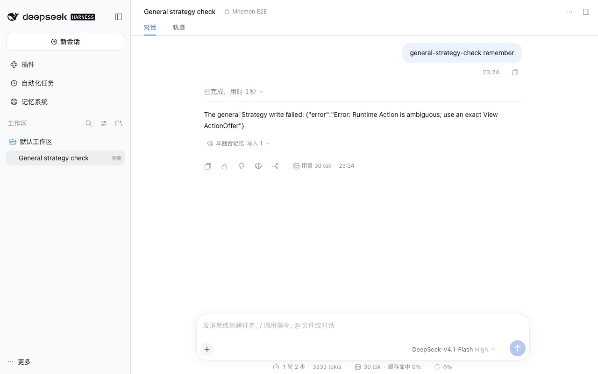
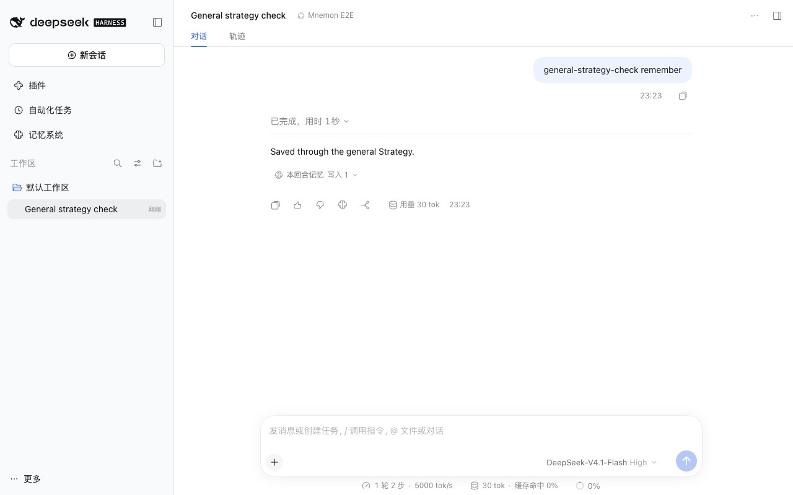
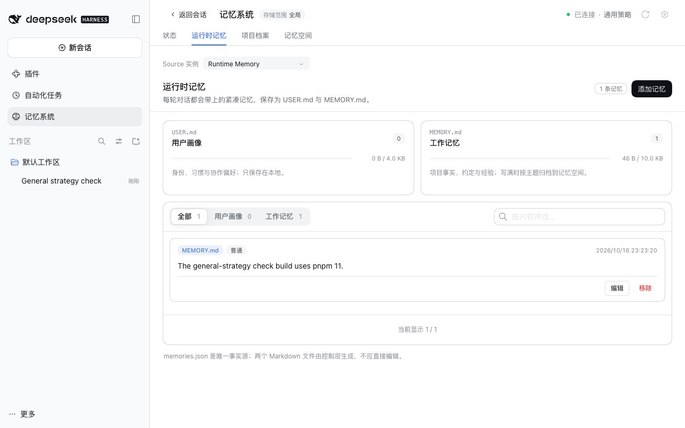

# A second runtime Source beside the Starter's — issue #397

[简体中文](./README.zh-CN.md) | [Verification record](./verification.json)

Issue #397 mounts a second runtime Source next to the Starter's, a shared track beside the project one, under the General strategy. From then on every `mnemon_runtime_memory` call failed with `Runtime Action is ambiguous; use an exact View ActionOffer`, and there was no exact offer to use instead.

Baseline: main `4feee034`. Fix: `63ab00dc` and, after review, `e0173301`. The runs took place on 2026-10-16 (Asia/Shanghai):
- macOS 15.6 arm64 and Node 24.19.0;
- headless Chrome at 1280×800, zh-CN, light;
- DSH 0.2.1-alpha.3 (npm `alpha`) through `scripts/serve-e2e.mjs`.

## Cause

`mnemon_runtime_memory` collected the `mutate` offer of every runtime Source in the View and required exactly one. With two runtime Sources there are two. The View binds the named tool to the Starter instance, as it does for every named tool, and leaves that instance's offer out of the route envelope the model reads. So the tool refused to choose, and the model had no exact offer for the Starter instance either.

## Fix

The tool runs the offer of the instance the View binds it to: the Starter instance, or the only runtime Source there is. The rule now lives in one function, `namedToolInstance`, which the View's bindings use as well. Every other runtime Source keeps its own exact offer in the envelope for `mnemon_view_action`. When several runtime Sources are mounted and none is the Starter's, the tool still refuses, and the error now lists the exact offers to use. A profile with one runtime Source works as before.

Review found that the first version refused a View that offers `mutate` on one runtime Source only when that Source is not the Starter's, which a Scoped composition can produce and which main served. The tool now takes the bound Starter instance's offer, else the only offer, and refuses only when several runtime Sources offer `mutate` and none is the Starter's; the selection a Source session makes by default follows the same rule. The docs define the Starter instance and say that a second Source of one role under Layered needs Scoped composition.

## Method

`pnpm e2e:serve --general-strategy --second-runtime` selects the General strategy and inserts `mnemon-source-runtime-global`, a runtime Source with its own directory in the fixture, as the profile patch in the issue does. In a Mnemon E2E conversation, send `general-strategy-check remember`. The scripted model checks which Sources the View admits, then saves one fact with `mnemon_runtime_memory`. Only the model's decisions are scripted; DSH, the Strategy, its View, both Sources and the write are real. The same build ran with `src/host/subagent.ts`, `src/host/protocol.ts` and `src/host/view-presentation.ts` taken from main for the baseline.

## Before and after

The View admitted both runtime Sources on main and with the fix: `source:include:mnemon-source-runtime` and `source:include:mnemon-source-runtime-global`, beside Documents and Memory Spaces.

| main | Fix |
|---|---|
|  |  |

With the fix, **记忆系统 → 运行时记忆** (Memory System → Runtime Memory) shows the fact in the Starter instance's MEMORY.md:

## Automated checks

`tests/source-instances.spec.ts` composes the real Sources and the General strategy with a second runtime Source:
- `mnemon_runtime_memory` writes into the Starter instance and leaves the other untouched; the other instance's offer is listed in the route envelope and still takes a write through `mnemon_view_action`, while the Starter instance's offer is not listed;
- with two runtime Sources and neither the Starter's, the error names both exact offers.

Both tests fail on main.

## Limits

- The Layered strategy still refuses a second Source of one role when it composes the View; the issue's profile uses the General strategy, which composes several.
- The General strategy does no Runtime capacity maintenance, so a full MEMORY.md reports its capacity error in either track, as before.
