# 不论 Git 配置了什么，Git 同步都能找到令牌，并以各主机接受的用户名提供它

**简体中文** | [English](./README.md)

对应 Issue [#408](https://github.com/omdsh-dev/dsh-mnemon/issues/408) 及其补充评论。测试分支 `claude/fix-408-git-credential-username`，基于 main `2143a1ed`（v0.5.32）编写并按两轮审查意见修订，2026-10-19 至 2026-10-20（Asia/Shanghai），Node 24.19.0、pnpm 10.13.1、Git 2.50.1（Apple Git-155），宿主为固定的 DSH 0.2.1-rc.2 与已安装的 DSH 0.2.0-rc.2。没有使用任何账号或令牌，也没有请求到达任何 Git 主机：每条 Git 命令都针对本地仓库或回环地址上的 HTTPS 远端，令牌均为虚构，不经过任何代理，Git 读取的是检查自己写入的配置（`GIT_CONFIG_GLOBAL`、`GIT_CONFIG_NOSYSTEM=1`；唯一测试系统配置文件的用例用 `GIT_CONFIG_SYSTEM` 指定自己的文件，且只在 Git 2.32 及以后运行，这些版本读取该文件而不是本机的系统配置），从未读取本机自己的配置。

审查确定的原则：现在能用的配置保持原样，只在失败的地方改变行为。

## 问题所在

Git 同步通过一个只为一条命令存在的凭据存储把令牌交给 Git：一个权限 `0600` 的文件，内容为 `https://x-access-token:<令牌>@<主机>`，命令参数清空 helper 列表后加上 `store --file=<文件>`。有两种情况 Git 在其中找不到凭据，第三种情况则在主机一侧失败：

- **为该主机配置了用户名。** Git 按地址对应的用户名查找凭据；地址里没有用户名时，取 `credential.username` 或 `credential.<url>.username`。Git Credential Manager 的配置里带有 `credential.https://github.com.username`，报告者的机器正是如此。凭据存储里是 `x-access-token`，于是匹配不到，Git 退回交互提示，被 `GIT_TERMINAL_PROMPT=0` 拒绝，`could not read Password` 被归为认证失败：账号明明已登录，页面却显示“需要凭据，请用 GitHub 登录或填写访问令牌”，重新登录也无济于事。
- **`credential.useHttpPath`。** 开启后 Git 会把仓库路径加入查找条件，只写明主机的条目就匹配不上了。Git Credential Manager 安装时会设置 `credential.https://dev.azure.com.useHttpPath = true`（[源码](https://github.com/git-ecosystem/git-credential-manager/blob/main/src/Microsoft.AzureRepos/AzureReposHostProvider.cs) 中的 `ConfigureAsync`）。
- **gitee.com 拒绝 `x-access-token`。** 补充评论用有效令牌实测 Gitee：账户名与 `oauth2` 都可以，`x-access-token` 得到 `The token username invalid` 与 HTTP 403。在 Gitee 上用令牌走 HTTPS 同步从来不可能成功，页面同样要求填写一个已经填写了的令牌。

三种情况最后都提示用户去登录或填写令牌。此外，凭据存储里的主机写作 `new URL(地址).host`，即转为小写并去掉默认端口，而 Git 按地址原样比较主机：`https://GitHub.com/...` 或 `https://host:443/...` 也同样匹配不到。

## 改动内容

**用户名。** 凭据存储写入地址中写明的用户名；没有写明时，`gitee.com`（写作 `gitee.com.` 时也一样）用 `oauth2`，其他主机都与以前一样用 `x-access-token`（`src/host/git-sync.ts` 的 `credentialTarget`）。主机完全按地址原样写入；令牌做百分号编码，Git 读取时会解码还原；由字母、数字、`-`、`_`、`.`、`~` 组成的令牌（GitHub、GitLab、Gitee 与 Gitea 的令牌都是如此）写入的字节与之前完全相同。

**查找。** 不论这台电脑配置了什么，Git 都必须按这个用户名查找令牌，而命令在其他方面保持一直以来的样子：

- **Git 2.26 及以后的版本**得到 `-c credential.useHttpPath=false -c credential.username=<用户名>`，交给 Git 的地址不带用户名。从 2.26 起，Git 读到的最后一个 `credential.username` 生效，而命令行在所有配置文件之后读取（[82eb2498](https://code.googlesource.com/git/+/82eb249853868582d8ba65e3afc5a7dcaeb620ea%5E%21/)，“credential: use the last matching username in the config”）。凭据配置段不论 URL 模式如何都按读取顺序应用，因此更具体的模式也不会胜出：测试覆盖了 `credential.https://github.com/<owner>.username` 与只针对一个仓库的写法、被包含的文件、所有 Git 都能读取的写法的 `GIT_CONFIG_PARAMETERS`、Git 2.31 起的 `GIT_CONFIG_COUNT` 与 Git 2.32 起的系统配置文件，每一处都先确认配置确实生效。正常工作的配置发出的请求与以前相同；这两个键只是补上 Git 本来会从凭据存储取得的用户名。
- **更早的 Git**（同步通道支持 2.20 及以后）保留第一个配置的用户名，命令行上的用户名会输给全局配置。这类 Git 运行的命令与 main 一直以来的相同，除非在该命令自身的环境与目录中运行 `git config --get-urlmatch credential <地址>` 发现为这个地址配置了与凭据存储不同的用户名（包括空用户名）：此时把凭据存储中的用户名写进地址，即 `https://<用户名>@<主机>/...`，所有 Git 都优先采用地址中的用户名（[gitcredentials](https://git-scm.com/docs/gitcredentials)：`username` 是“a default username, if one is not provided in the URL”）。配置的用户名正是凭据存储中的用户名时，例如在 main 上就能用的 `credential.https://github.com.username = x-access-token`，命令仍与 main 相同。按 Git 读取布尔值的方式发现开启了 `credential.useHttpPath` 时，命令将其关闭。
- **地址中已写明用户名时**同样处理：在 Git 2.26 及以后，用户名放在命令行上，交给 Git 的地址不带它；更早的 Git 按原样得到地址。

Git 版本取自同步通道在每次操作前本来就会读取的版本（`gitStatus`）。镜像的 `mnemon.origin` 仍是配置的地址，Git 写入 `FETCH_HEAD` 时不带用户名部分。

**为什么把用户名放在命令行上，而不是写进地址。** 地址中的用户名是 Git 文档写明优先的方式，但这样 Git 会经由 curl 先以空密码提供一次这个用户名，然后才去查凭据存储。对着回环远端追踪，一次 `ls-remote` 发出的请求（用户名:密码）如下：

| 用户名如何交给 Git | 请求 |
|---|---|
| 不做固定，issue 中的配置（main） | 无认证，然后 Git 放弃：`could not read Password for 'https://alice@…'` |
| `-c credential.username=<用户名>` 加不带用户名的地址（Git 2.26 及以后，本改动） | 无认证 → `<用户名>:<令牌>` → `<用户名>:<令牌>` |
| `https://<用户名>@host/...`（配置了用户名的更早 Git，本改动） | 无认证 → `<用户名>:<空>` → `<用户名>:<令牌>` → `<用户名>:<令牌>` |

上表各主机对空密码的请求都回答 401，随后拿到令牌；但这多出一次请求，而如果某个主机对它回答 403，就会拒绝。因此只有在没有其他办法能胜过已配置用户名的 Git 上、且确实配置了另一个用户名时，地址才带上用户名。issue 自带的补丁 `-c credential.username=x-access-token` 正是 github.com 在 Git 2.26 及以后的写法，报告者已在真实 GitHub 上用 `ls-remote`、`fetch` 与 `push --dry-run` 验证过。

**地址中的用户名。** 表单与 Host 共用的 `src/host/sync-rules.ts` 接受用户名部分是用户名的 HTTPS 地址，并按 Git 读取它的方式判断：

- 用户名部分只能包含 RFC 3986 允许的字符（字母、数字、`-._~!$&'()*+,;=` 与转义），判断前先解码；无法解码的一律拒绝；
- 解码后的用户名不能含有冒号（即密码）、`@`、控制字符或空白，最长 100 个字符，因此 `alice%3Ahunter2@`、`alice%40example.com@`、`alice%0A@` 与 `alice%20smith@` 都会被拒绝；
- 解码后的用户名不能形似令牌：GitHub（`ghp_`、`gho_`、`ghu_`、`ghs_`、`ghr_`、`github_pat_`）、GitLab（`glpat-`、`gldt-`、`glcbt-`）、Hugging Face（`hf_`）与 Atlassian（`ATBB`、`ATCTT`、`ATATT`）令牌的前缀，因此转义过的前缀如 `%67hp_…` 也会被拒绝；连续 32 个及以上的十六进制数字（Gitee、Gitea 的令牌与 GitHub 旧式令牌都是这样）；或连续 52 个及以上的字母数字（Azure DevOps 的令牌是这样）。52 超过 GitHub 用户名（39）、Bitbucket 用户名（30）与 Azure DevOps 组织名（50）的上限，因此较长的组织名可以写在地址中；第一版把连续 32 个字母数字视为令牌，会拒绝它。

表单的拒绝提示为：地址里只能写用户名，令牌请填在“访问令牌”里（英文为 Only a user name may go in the address; enter the token under Access token）。

**提示文案。** Host 提供了凭据而主机拒绝时，仓库这一行、手动同步、自动同步以及两个对话框都如实说明，并指出被拒绝的是哪一个，因为保存的令牌与 `MNEMON_SYNC_GIT_TOKEN` 优先于 GitHub 登录，对它们来说重新登录无济于事：

| 凭据 | github.com | 其他主机 |
|---|---|---|
| GitHub 登录 | GitHub 拒绝了登录凭据，请重新登录，或检查它能否访问这个仓库 | —（GitHub 登录只用于 github.com） |
| 保存的令牌 | GitHub 拒绝了保存的访问令牌，请更换令牌 | 仓库主机拒绝了保存的访问令牌，请更换令牌，或在地址中写上它要求的用户名 |
| `MNEMON_SYNC_GIT_TOKEN` | GitHub 拒绝了 MNEMON_SYNC_GIT_TOKEN 中的令牌，请更换它 | 仓库主机拒绝了 MNEMON_SYNC_GIT_TOKEN 中的令牌，请更换它 |
| 无 | 不变：需要凭据，请用 GitHub 登录或填写访问令牌 | 不变：需要凭据，请填写访问令牌 |

英文文案见 `src/client/locales.ts`。客户端依据 `credentialSource` 判断，状态里本来就带有它，且与每条命令使用的凭据出自同一次解析。SSH、本地路径、找不到仓库、网络与超时的文案都不变，页面不显示 Git 的原始输出。每条文案都放进实时页面的状态行中、与**设置凭据**和**重新检查**并排，在记录采用的 1280 像素宽度下测量，中英文都保持一行。英文文案在两个按钮旁有 514 像素。带上环境变量名之后，指向地址中用户名的提示在试过的每种措辞下都要 534 至 666 像素（审查给出的 "The host rejected the token in MNEMON_SYNC_GIT_TOKEN; replace it, or put the user name it expects in the address" 要 666 像素），因此环境变量这一行在两种语言中都与 GitHub 的那一行说法相同（399 像素），这一提示保留在保存的令牌那一行（496 像素）与操作指南中。第一版的英文文案（"The host rejected the credential; check the token, or put the user name it expects in the address"）同样放不下。

## 各主机接受的令牌用户名

| 主机 | 搭配令牌的用户名 | 依据 |
|---|---|---|
| github.com | `x-access-token`，保持不变；GitHub 登录的凭据同样适用 | [通过 HTTP 使用 installation token](https://docs.github.com/en/apps/creating-github-apps/authenticating-with-a-github-app/authenticating-as-a-github-app-installation)；报告者用 `-c credential.username=x-access-token` 所做的验证 |
| GitHub Enterprise Server，以及带数据驻留的 GitHub Enterprise Cloud（`*.ghe.com`） | `x-access-token`，保持不变：它们的文档为 installation token 给出的只有这个用户名 | [GHES 3.17](https://docs.github.com/en/enterprise-server@3.17/apps/creating-github-apps/authenticating-with-a-github-app/authenticating-as-a-github-app-installation)、[Enterprise Cloud](https://docs.github.com/en/enterprise-cloud@latest/apps/creating-github-apps/authenticating-with-a-github-app/authenticating-as-a-github-app-installation)、[GHE.com 的数据驻留](https://docs.github.com/en/enterprise-cloud@latest/admin/data-residency/about-github-enterprise-cloud-with-data-residency) |
| GitLab | 个人、项目与群组令牌接受任意非空用户名，包括 `x-access-token`；OAuth 令牌推荐 `oauth2` | [Personal access tokens](https://docs.gitlab.com/user/profile/personal_access_tokens/)、[OAuth 2.0](https://docs.gitlab.com/api/oauth2/) |
| gitee.com | `oauth2`（现在的默认值）或账户名；`x-access-token` 被拒绝，HTTP 403 | 补充评论在 0.5.32 上的实测；没有找到 Gitee 的相关文档 |
| 自建的 Gitee | 推测相同；按拒绝提示所说，在地址中写明 `oauth2` 或账户名 | — |
| Gitea | 不检查：密码是令牌时由令牌确定用户 | [services/auth/basic.go](https://github.com/go-gitea/gitea/blob/main/services/auth/basic.go) |
| Forgejo | 各部署的文档写的是账户名加令牌作密码；它源自 Gitea，Gitea 的检查忽略用户名，但这里没有核对它当前的代码 | — |
| Azure DevOps | 不检查：“the username can be empty” | [Use personal access tokens](https://learn.microsoft.com/en-us/azure/devops/organizations/accounts/use-personal-access-tokens-to-authenticate) |
| Bitbucket Cloud | `x-token-auth`（access token 与 API token），API token 也可用 Bitbucket 用户名；在地址中写明 | [Access tokens](https://support.atlassian.com/bitbucket-cloud/docs/using-access-tokens/)、[API tokens](https://support.atlassian.com/bitbucket-cloud/docs/using-api-tokens/) |
| AWS CodeCommit | IAM 为 Git 凭据生成的用户名；在地址中写明 | [Git credentials](https://docs.aws.amazon.com/codecommit/latest/userguide/setting-up-gc.html) |

因此 `x-access-token` 仍是所有主机得到的用户名：github.com、GitHub Enterprise Server 与 `*.ghe.com` 的文档写的都是它，GitLab、Gitea 与 Azure DevOps 也接受它；没有发现接受它却拒绝 `oauth2` 的主机，但也没能排除这样的主机。只有已知会拒绝它的 gitee.com 改用 `oauth2`。其他要求特定用户名的主机，如自建的 Gitee、Bitbucket 或 CodeCommit，从地址中得到用户名，这也正是 Bitbucket 文档写克隆地址的方式（`https://x-token-auth@bitbucket.org/{workspace}/{repository}.git`）。

## 改动前后

### 离线：用同步通道交给 Git 的参数，`git credential fill` 能找到什么

[`harness/credential-lookup.probe.ts`](./harness/credential-lookup.probe.ts) 在一次性凭据存储还存在时，用同步通道构造出的那一组参数运行 `git credential fill` 来回答状态检查的 `ls-remote`，然后通过回环 HTTPS 远端同步并列出每个远端收到的请求，最后打印页面上的文案。在本分支上运行一次，再换回 main 的 `git-sync.ts`、`sync-rules.ts`、`sync-view.ts`、`MnemonSyncSection.tsx`、`MnemonSyncDialogs.tsx` 与 `locales.ts`（即它开头注释列出的六个模块）运行一次：

| 场景 | main | 本改动 |
|---|---|---|
| `credential.https://github.com.username = alice`（issue 的情况） | `could not read Password for 'https://alice@github.com'` | `username=x-access-token password=<令牌>` |
| `credential.https://github.com/octocat.username = alice` | `could not read Password for 'https://alice@github.com'` | `username=x-access-token password=<令牌>` |
| `credential.username = alice` | `could not read Password for 'https://alice@github.com'` | `username=x-access-token password=<令牌>` |
| `credential.https://dev.azure.com.useHttpPath = true` | `could not read Username for 'https://dev.azure.com/contoso/project/_git/memory'` | `username=x-access-token password=<令牌>` |
| gitee.com，无任何配置 | `username=x-access-token`（Gitee 拒绝） | `username=oauth2 password=<令牌>` |
| 其他主机，无任何配置 | `username=x-access-token password=<令牌>` | 相同 |
| 地址写作 `GitHub.com:443` | `could not read Username for 'https://GitHub.com:443'` | `host=GitHub.com:443 username=x-access-token password=<令牌>` |
| 接受任意用户名的 HTTPS 远端；为它配置了 `alice` | 状态：auth，`could not read Password for 'https://alice@127.0.0.1:…'`；没有请求 | 推送成功；`x-access-token:<令牌>`（200） |
| 代 gitee.com 应答的 HTTPS 远端：拒绝 `x-access-token`、接受 `oauth2` | 状态：auth；`x-access-token:<令牌>`（403） | 推送成功；`oauth2:<令牌>`（200） |
| 同一远端换一个地址 | 状态：auth；`x-access-token:<令牌>`（403） | 相同，页面提示在地址中写明用户名 |
| ……地址中写明 `oauth2@` | 拒绝：`sync repository must not embed credentials` | 推送成功；只有 `oauth2:<令牌>`（200） |
| 要求 `x-token-auth`、在地址中写明的 HTTPS 远端 | 拒绝：`sync repository must not embed credentials` | 推送成功；只有 `x-token-auth:<令牌>`（200） |
| 页面，凭据被拒绝（各种来源、两类主机） | 需要凭据…… | 上文表格中的文案 |

代 gitee.com 应答的是回环远端：Git 通过 `http.curloptResolve` 把 `gitee.com` 解析到 127.0.0.1，远端证书写明了这个主机名，Git 不经过任何代理。2.37 之前的 Git 没有 `http.curloptResolve`，会去解析真实主机，因此探针与测试在这类 Git 上跳过这个远端。

### WebUI

在 DSH 0.2.1-rc.2 上运行真实 WebUI（`scripts/serve-e2e.mjs`），配合 [`scripts/fixtures/git-https-remote.mjs`](../../../scripts/fixtures/git-https-remote.mjs) 启动的四个回环远端：一个接受任意用户名下的令牌，WebUI 的 Git 配置为它写明了用户名 `alice`；一个代 gitee.com 应答，拒绝 `x-access-token`、接受 `oauth2`；一个以自己的地址做同样的事，相当于自建的 Gitee；一个只接受 `x-token-auth`。WebUI 的 Git 通过 `GIT_SSL_CAINFO` 信任它们的证书，且不经过代理。同样的步骤分别在 main 的构建与本分支的构建上、以中文与英文运行；另一次运行给 WebUI 一个错误的 `MNEMON_SYNC_GIT_TOKEN`。

无头 Chrome，1280×900，浅色。在**插件 → 可组合记忆**中打开 **Git 同步**，选择**仓库地址**，填入第一个远端的地址与令牌，点击**连接**。之后每次都经由**更改**与**保存**：gitee.com 的地址加令牌；自建远端加令牌；同一远端写上 `oauth2@`；第一个远端加错误令牌；`x-token-auth` 远端写上 `x-token-auth@`，随后同步；同一地址写成 `x-token-auth:secret@`，被表单拒绝，点击**取消**。基线是在用 main 的六个模块构建的版本上执行同样的步骤。

为该主机配置了用户名，令牌有效：

| main | 本改动 |
|---|---|
|  | 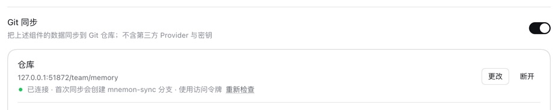 |
|  | 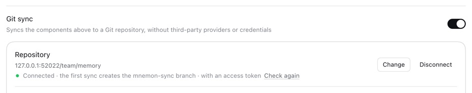 |

gitee.com，令牌有效（由回环远端代为应答）：

| main | 本改动 |
|---|---|
| 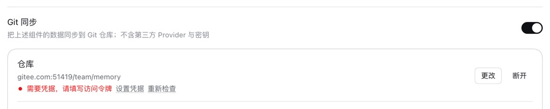 | 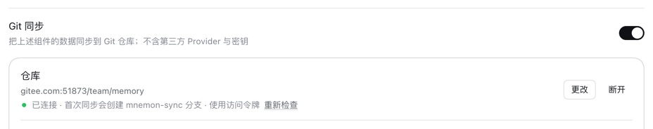 |
| 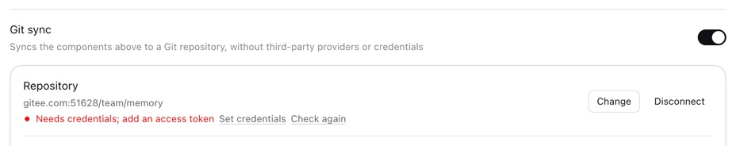 |  |

保存的令牌错误：

| main | 本改动 |
|---|---|
|  | 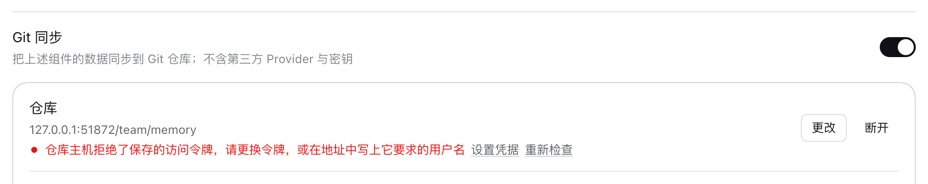 |
|  | 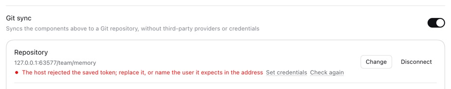 |

拒绝 `x-access-token` 的自建远端，令牌有效、地址中没有用户名时，本分支显示同样的一行，提示在地址中写明用户名；写上 `oauth2@` 后即可连接。main 对前者显示“需要凭据，请填写访问令牌”，对后者在表单中拒绝地址。

| 中文 | English |
|---|---|
|  |  |

`MNEMON_SYNC_GIT_TOKEN` 错误：

| main | 本改动 |
|---|---|
| 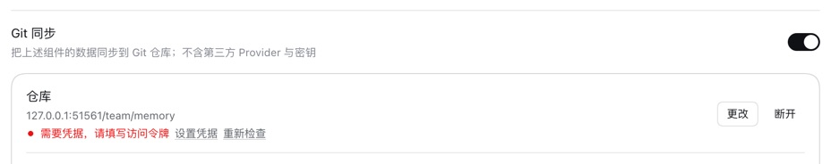 | 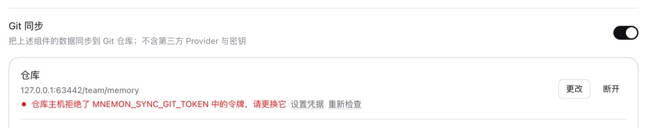 |
|  | 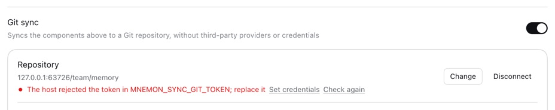 |

`x-token-auth` 远端，写在地址中：

| main | 本改动 |
|---|---|
| 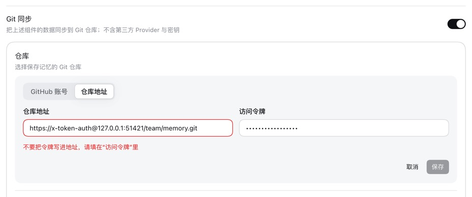 | 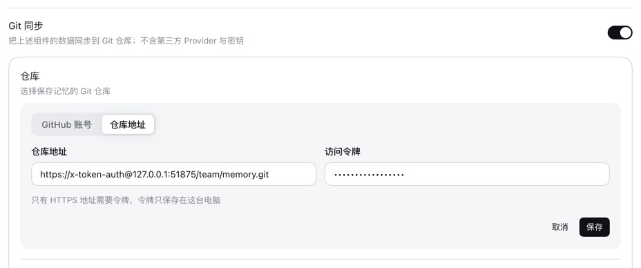 |
| 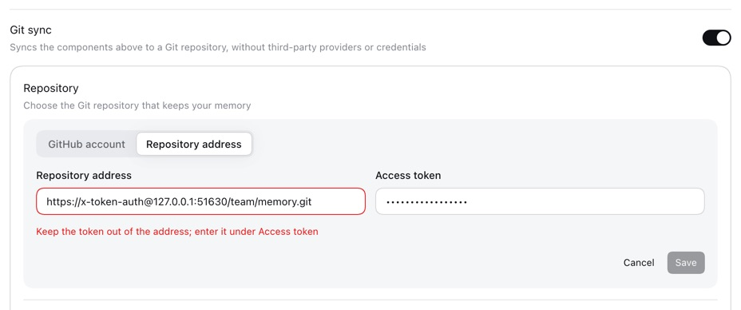 | 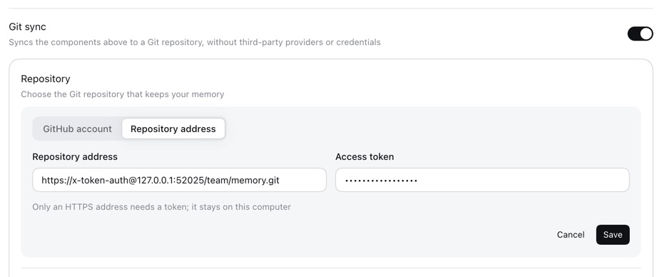 |

在本分支上，这个地址成功连接，**立即同步**也成功推送。地址中的密码仍会被拒绝：

| 中文 | English |
|---|---|
| 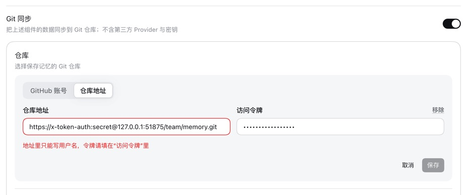 | 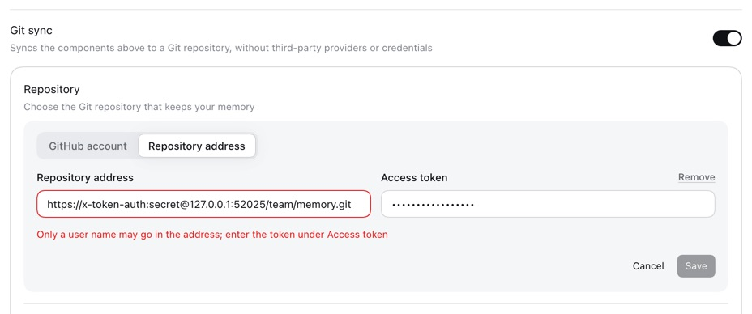 |

本分支上各远端收到的请求：第一个是 `x-access-token:<令牌>`（200；错误令牌与错误环境变量时为 401）；代 gitee.com 的是 `oauth2:<令牌>`（200）；自建的是 `x-access-token:<令牌>`（403），写明用户名后是 `oauth2:<令牌>`（200）；`x-token-auth` 远端只有 `x-token-auth:<令牌>`（200），没有空密码的请求。在 main 上：第一个远端没有收到任何带认证的请求，代 gitee.com 的与自建的收到 `x-access-token:<令牌>`（403）。本分支在 DSH 0.2.0-rc.2 与单独安装的 0.2.1-rc.2 上运行同样的步骤，得到同样的状态与请求。每条状态都保持一行，所有运行都没有浏览器控制台错误。

### 在 main 的模块上运行测试

换回 main 的六个模块后运行新增与改动的测试：69 个中有 17 个失败，失败的正是本改动修复的内容（各次查找、GitHub 登录的凭据、写明与转义的用户名、主机的大小写与端口、Git 2.26 与 2.25 的两种写法、各主机的用户名、HTTPS 同步、两侧的地址规则、表单文案与拒绝提示），其余通过，其中包括 `reports a credential the host refuses as an authentication failure with a credential offered`，它固定的是页面所依赖的 Host 分类。

## 兼容性

- **正常工作的配置。** 除 gitee.com 外，所有主机都与以前一样得到 `x-access-token`，因此原本能用的主机不会收到别的用户名。在 Git 2.26 及以后，命令多出两个 `-c` 键，发出的请求相同；写明用户名的地址不再先发出空密码的请求。在更早的 Git 上，命令与 main 运行的相同，除非这台电脑为该地址配置了与凭据存储不同的用户名或开启了 `credential.useHttpPath`，这正是原本失败的情况。
- **存储的数据与设置。** 没有键名变化：`state/sync-git.json` 仍是 `repoUrl` 与 `token`，以前保存的配置读取结果相同。变化在于接受哪些地址：写明用户名的地址现在有效。更早的 dsh-mnemon 读到这样的地址会拒绝整个文件（`sync repository must not embed credentials`），其页面既不能更改也不能断开这个仓库；回退到旧版本、或与旧版本共用数据目录之前，请先去掉地址中的用户名。操作指南写明了这一点。
- **用户看到的变化。** 大小写混写或写明端口的地址现在能匹配到它的凭据。只有提供了凭据且被拒绝时，页面才显示“拒绝”，并指出是哪一个。
- **镜像与进程参数。** 令牌只进入一次性凭据存储。用户名只按上文所述进入命令参数，Git 也不会把它写到任何地方：测试在真实的 HTTPS 同步之后扫描两个存储根目录，令牌只出现在 `sync-git.json` 中，用户名哪里都没有，`FETCH_HEAD` 与镜像的配置都包括在内。
- **`url.<base>.insteadOf`。** 在 Git 2.26 及以后，交给 Git 的地址不带用户名，改写规则与对普通地址一样生效。在把用户名写进地址的更早 Git 上，为 `https://<主机>/` 写的规则不再匹配。
- **版本错配。** 只涉及 Starter：Host 与页面在同一个包中发布，插件没有改动。`credentialTarget` 是 `src/host/git-sync.ts` 新增的导出，不经由任何公开入口暴露；客户端的文案函数可选地接受凭据来源，`MnemonKey` 增加了五个键。
- **公开 SDK、RPC 与工具。** 任何公开入口的导出、RPC 名称、存储键、工具及工具描述都没有变化。

## 验证

| 检查 | 结果 |
|---|---|
| `pnpm exec vitest run tests/git-sync-credentials.spec.mjs` | 13 个通过：8 个离线（在独立 home 中运行 Git；对 21 组主机与配置以及另外四处 Git 读取配置的位置运行 `git credential fill`；GitHub 登录的凭据；写明与转义的用户名；主机的大小写与端口；Git 2.26 与 2.25 两种写法在没有配置用户名、配置了另一个、配置了凭据存储自己的或空用户名、以及配置了路径时的表现；各主机的用户名），5 个走 HTTPS（git http-backend；越过已配置的用户名同步；Git 2.37 起经回环远端访问 gitee.com；被拒绝的令牌；写明用户名的地址不发出空密码请求） |
| 客户端、规则、配置与呈现测试（`tests/client-sync.spec.tsx`、`tests/sync-rules.spec.ts`、`tests/sync-config.spec.ts`、`tests/client-presentation.spec.ts`） | 61 个通过 |
| 同样的新增与改动测试在 main 的模块上 | 69 个中 17 个失败，见上文 |
| `pnpm exec vitest run tests/git-sync.spec.ts tests/sync-rpc.spec.ts tests/auto-backup.spec.ts tests/github-auth.spec.ts` | 107 个通过 |
| `pnpm run typecheck` | 通过 |
| DSH 0.2.1-rc.2 上的 `pnpm run e2e:sync` | 64 项全部通过 |
| `MNEMON_E2E_DSH=…/dsh-0.2.0-rc.2/… node scripts/verify-sync-git.mjs` | 64 项全部通过 |
| WebUI：main 与本分支、中文与英文，DSH 0.2.1-rc.2，有无环境变量各一次；本分支另在 DSH 0.2.0-rc.2 与单独安装的 0.2.1-rc.2 上 | 见上文 |
| `pnpm run verify` | 通过：5061 个本地链接与 371 个锚点；根测试 154 个文件中 2138 个通过、7 个跳过；17 个插件测试套件 597 个通过、3 个跳过；Headless 激活；包内容 66 个文件 |
| `MNEMON_CLI_PATH=/nonexistent/mnemon MNEMON_PLUGIN_VERIFY_CONCURRENCY=1 pnpm run verify:plugins` | 通过：17 个独立插件仓库与 18 个打包产物 |
| `DSH_HOST_ROOT=<prefix>/lib/node_modules/@deepseek-ai/dsh pnpm run test:installed-dsh`，DSH 0.2.0-rc.2 | 154 个文件中 2135 个通过、10 个跳过；只针对 DSH 0.2.1 行为的测试跳过 |

```sh
pnpm install --frozen-lockfile
pnpm build && pnpm --workspace-concurrency=4 -r build
# Git 只读取检查控制的配置，从不读取本机的配置。
export GIT_CONFIG_GLOBAL=<空文件> GIT_CONFIG_NOSYSTEM=1
pnpm exec vitest run tests/git-sync-credentials.spec.mjs tests/client-sync.spec.tsx tests/sync-rules.spec.ts tests/sync-config.spec.ts tests/client-presentation.spec.ts
pnpm exec vitest run tests/git-sync.spec.ts tests/sync-rpc.spec.ts tests/auto-backup.spec.ts tests/github-auth.spec.ts
node scripts/verify-sync-git.mjs
MNEMON_E2E_DSH=<prefix>/lib/node_modules/@deepseek-ai/dsh/lib/bin.js node scripts/verify-sync-git.mjs   # DSH 0.2.0-rc.2
pnpm run verify
MNEMON_CLI_PATH=/nonexistent/mnemon MNEMON_PLUGIN_VERIFY_CONCURRENCY=1 pnpm run verify:plugins
DSH_HOST_ROOT=<prefix>/lib/node_modules/@deepseek-ai/dsh pnpm run test:installed-dsh   # DSH 0.2.0-rc.2
# 探针：在本分支上运行一次，换回 main 的六个模块后再运行一次：
cp docs/pr-assets/issue-408-git-credential-username/harness/credential-lookup.probe.ts tests/credential-lookup.spec.ts
pnpm exec vitest run tests/credential-lookup.spec.ts
for file in src/host/git-sync.ts src/host/sync-rules.ts src/client/sync-view.ts src/client/MnemonSyncSection.tsx src/client/MnemonSyncDialogs.tsx src/client/locales.ts; do git show origin/main:$file > $file; done
pnpm exec vitest run tests/credential-lookup.spec.ts
git checkout -- src && rm tests/credential-lookup.spec.ts
# 手动试用的远端；把它打印的证书交给 WebUI 的 Git，且不经过代理：
node scripts/fixtures/git-https-remote.mjs --account oauth2:<虚构令牌> --refuse x-access-token
```

## 局限

- 这里没有 2.26 之前的 Git。它的写法通过同步通道在报告 `git version 2.25.1` 与 `2.20.0` 时、在没有配置用户名、配置了另一个、配置了凭据存储自己的或空用户名、以及配置了路径的情况下构造的参数检查，哪个用户名生效则依据 Git 自身的历史；`git config --get-urlmatch credential` 已在 Git 2.50 上验证：能报告已配置的 `credential.username`、`credential.<url>.username`、按所有者的模式与 `credential.useHttpPath`，对其他主机的配置则不报告。
- `--get-urlmatch` 按 Git 匹配 `http.<url>.*` 设置的方式匹配配置：地址先规范化，因此路径前缀、通配符、大小写不同的主机或写明默认端口的模式都能匹配，且不论先后顺序，最具体的模式胜出（已在 Git 2.50 上验证）。2.26 之前的 Git 取为该地址配置的第一个用户名，并按原文比较主机与路径。因此在这类 Git 上，它报告了、但该 Git 并不会采用的用户名仍会让凭据存储中的用户名写进地址，这样能用，只是先多一次空密码的请求；而该 Git 先读到另一个用户名、`--get-urlmatch` 却因后面更具体的模式报告凭据存储自己的用户名时，会与 main 上一样失败。
- 没有访问任何真实主机。回环远端按设定的策略应答；各主机的表格依据各自的文档、Gitea 的源码与补充评论对 Gitee 的实测。如果某个主机对空密码的请求回答 403，在 2.26 之前的 Git 上，写明用户名的地址会被它拒绝。
- 命令行上的 `credential.username` 与 `--get-urlmatch` 覆盖 Git 读取的各种配置；这台电脑配置的凭据 helper 对这些命令仍与以前一样被清空。
- GitHub 对凭据无权访问的私有仓库仍回答“找不到”，找不到仓库的文案仍提到登录或令牌；按 issue 的要求，只有认证这一种情况改变了。
- 页面仍不显示 Git 的 stderr；页面无法归类的失败，仍由 Host 的错误信息（令牌已遮蔽）给出原文。
