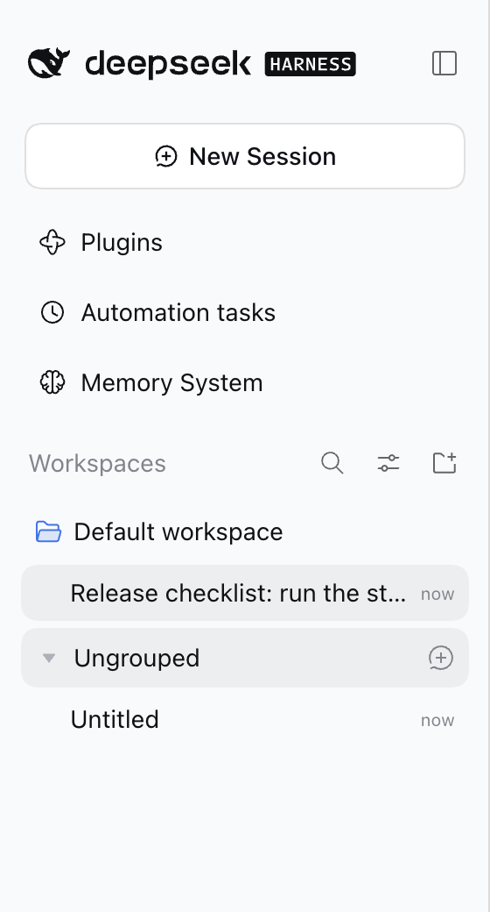
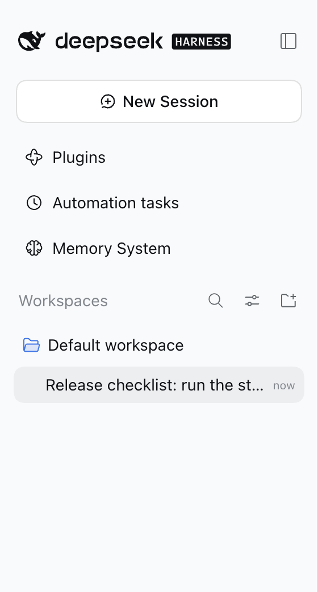
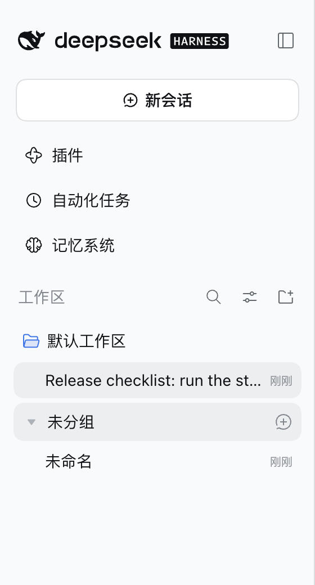
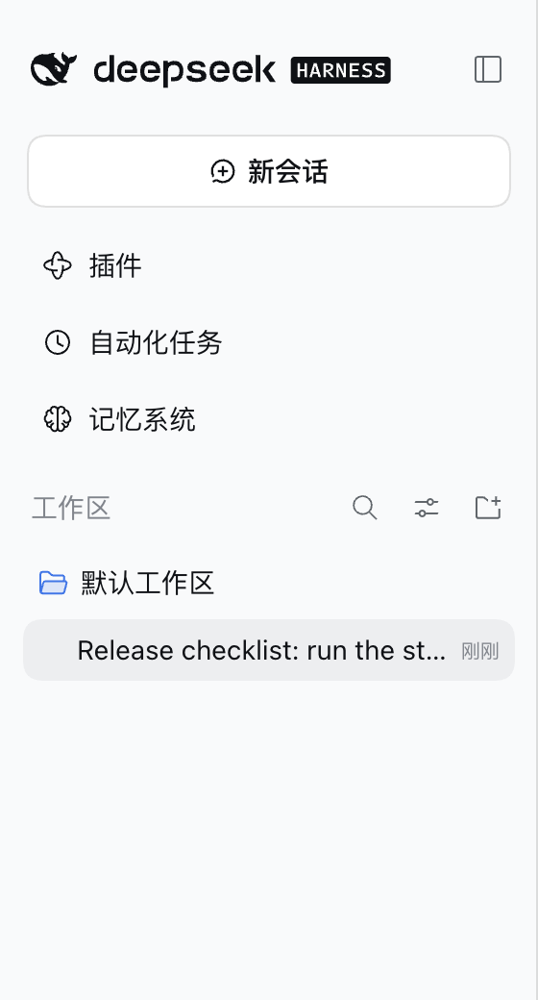
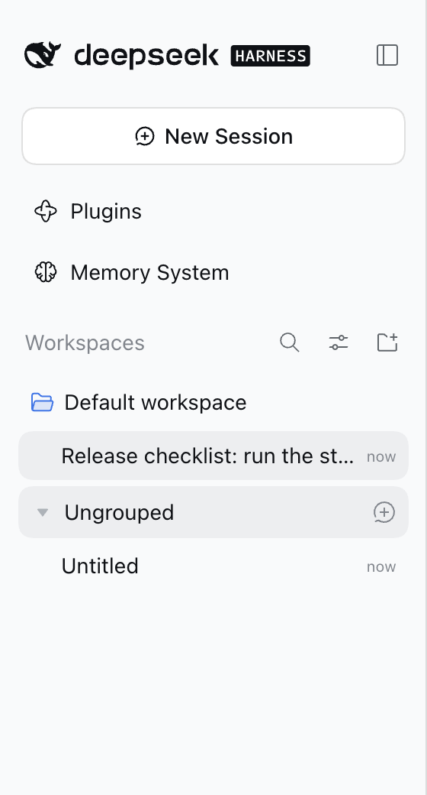
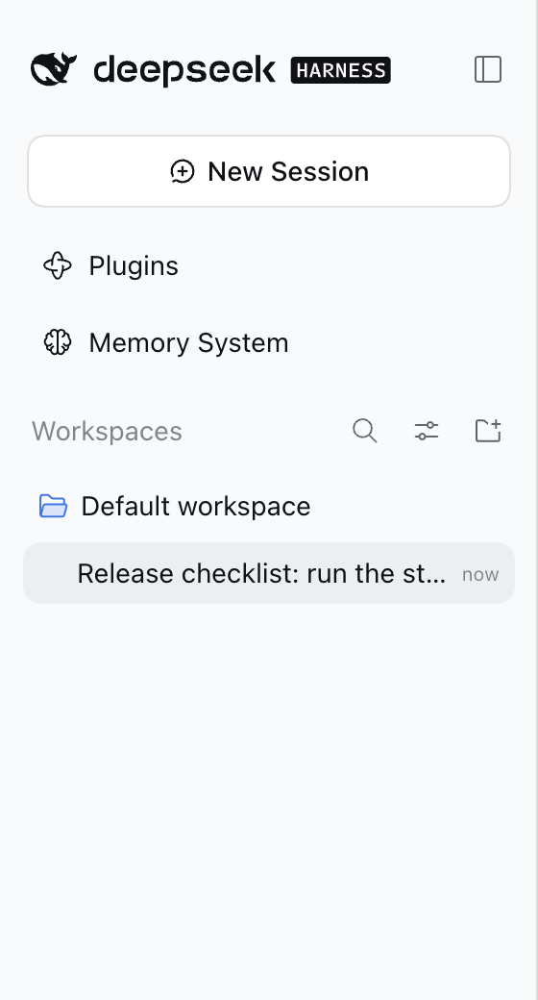
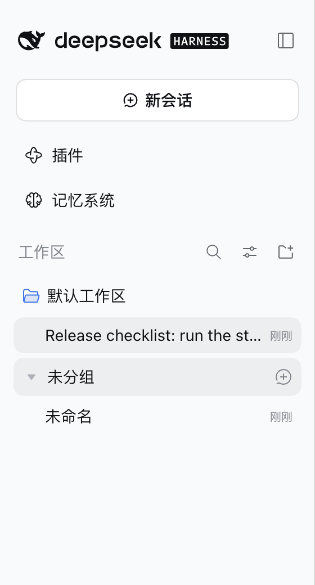
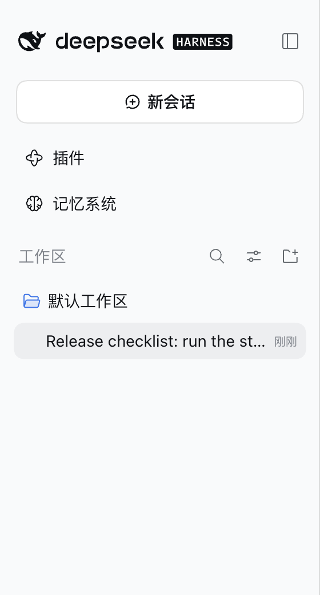
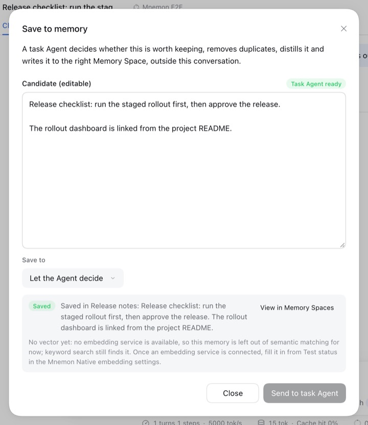
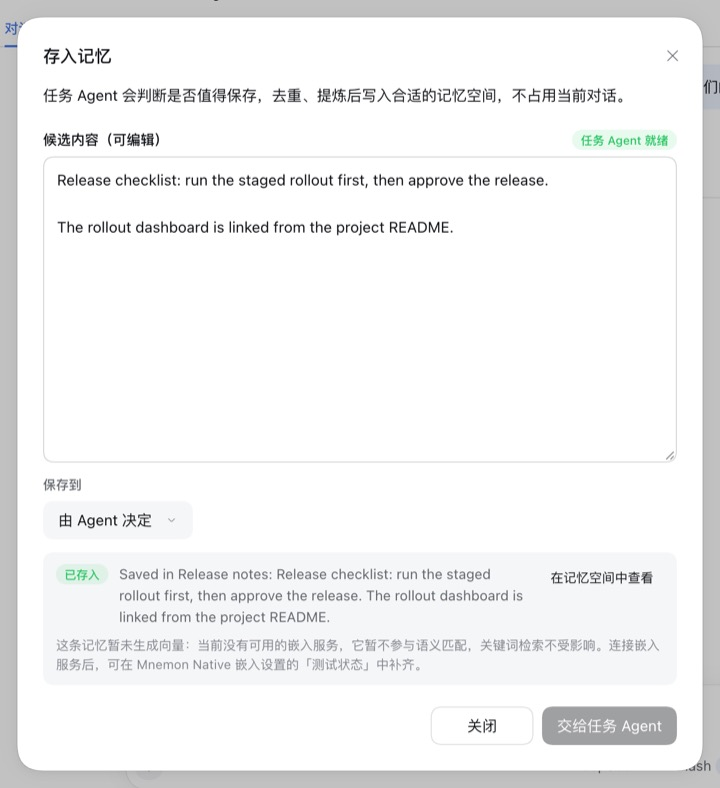

# 任务 Agent 的会话不再出现在对话列表中 — issue #435

[English](./README.md) | [验证记录](./verification.json)

Issue #435：每次运行时容量维护后，DSH 侧栏的“未分组”下都会多出几行“未命名”会话，点开是空的，而且一直不消失。报告者在 DSH 0.2.1-rc.2 与 dsh-mnemon 0.5.32 上数到每次维护 5 行，三次后共 15 行。

基线：main `2143a1ed`（v0.5.32）。修复：`94d28a02`。运行于 2026-10-19（Asia/Shanghai）：
- macOS 15.6 arm64、Node 24.19.0、pnpm 10.13.1；
- 无头 Chrome 155，1280×800，浅色，英文与中文；
- DSH 0.2.1-rc.2（npm `latest` 与 `next`）和 0.2.0-rc.2，各装在独立的 npm prefix 中，经 `scripts/serve-e2e.mjs --save-action` 运行，Mnemon CLI 0.2.11。

## 原因

dsh-mnemon 在对话之外运行的每个记忆任务，都跑在一个新建的顶层 DSH Agent 下：存入记忆（对话中或记忆空间页面）、Agent 查询、档案归档以及为写入腾出空间的档案写入、新记忆空间的 Provider 选择、整理名称与说明、运行时记忆容量维护（MEMORY.md 每个路由批次一个任务 Agent，压缩 USER.md 一个，包括存入记忆写入已满的用户画像之前），以及记忆整理。`runTaskAgent()` 用 `taskAgentCreation()` 创建它，而后者给出的会话元数据只有 `cwd` 和 Agent 预设。DSH 像保存其他会话一样保存这个会话。

DSH 侧栏由 `dsh-client-ui-workspace` 中的 `sessionVisible()` 决定显示与否：会话头带 `origin: "subagent"` 的会话最先被隐藏；其余会话里，被算作空白（blank）的，除当前会话外也被隐藏。任务 Agent 从不开始轮次，所以它在线时的会话是空白的。冷会话只有在 DSH 的投影缓存（projection cache）里有它的记录时才算空白：`dsh-api-session-controller` 的 `summarizeCold()` 返回 `blank: metadata?.blank ?? false`，源码注释写着“A large, metadata-less, or inaccessible cache miss remains unknown and visible”。没有记录，会话就会列出；它不在任何工作区的 `sessionIds` 中，于是落到“未分组”，没有标题就显示“未命名”。报告者的主机上这些会话都没有记录，606 个子代理会话中也有 601 个没有记录；后者仍然隐藏，因为 DSH 自己的子代理带着 `origin: "subagent"`。

在本机，DSH 会在会话创建和释放时写入记录，所以记录存在时，main 在两个版本上都没有显示这一行；记录缺失时才会出现。DSH 的 ACP agent 则无论如何都会列出这个会话：它的 `session/list` 只排除子代理会话与派生（fork）会话，空白会话也照样列出。

## DSH 如何处理 `origin: "subagent"`

`CreateAgentOptions.meta.origin?: 'subagent'` 是两个受支持版本中 `agents.create` 的一部分（“the coarse `origin` classification”），`dsh-subagent` 的 `childSessionMeta()` 也为 DSH 启动的每个子代理写入它，同时写入 `parentSession` 与 `delegationDepth`。会话头不接受其他 origin 取值，也不接受其他字段：DSH 0.2.x 没有隐藏、内部或不持久化的会话，也没有删除会话的 API。

两个安装中所有按会话 `origin` 分支的运行时文件（两边都是同样的 17 个；旧会话格式的会话头校验只接受这个取值），以及它们对任务 Agent 会话的影响。任务 Agent 会话带这个 origin，但没有 `parentSession`，也没有 `delegationDepth`：

| 包 | 对 origin 做什么 | 对任务 Agent 会话 | 版本 |
|---|---|---|---|
| `dsh-client-ui-workspace` | `sessionVisible()` 在空白与归档规则之前隐藏该会话 | 无论有无缓存记录，侧栏都不再列出：即本次修复 | 两者 |
| `dsh-acp` | `session/list` 跳过它，与跳过派生会话相同；`session/resume` 拒绝它 | ACP 编辑器不再列出或恢复它 | 两者 |
| `dsh-api-session-controller`（Host） | `hasApiSessionSubagentOwner()`：通用会话路由拒绝解析、恢复、复用、取消该会话或编辑其队列（`session/agent-busy`）；`validateAddress()` 拒绝经会话地址读取其历史 | 没有任何地方经会话 API 打开任务 Agent 会话：dsh-mnemon 通过 `ctx.agents` 创建、驱动并释放它 | 两者 |
| `dsh-api-session-controller`（Host） | `underArchivedSession()` 与 `forkWorkspace()` 从子代理会话沿 `parentSession` 向上查找 | 没有 `parentSession`：结果与根会话相同 | 两者 |
| `dsh-api-session-controller`（客户端） | `subagentAddress()` 只在有父会话时生成地址；`handleSessionRemoved()` 把子代理行记为未运行而不删除 | 不生成地址；保留的这一行侧栏本就不显示 | 地址 0.2.1，行两者 |
| `dsh-client-ui-conversation` | 面包屑从子代理会话走向其父会话 | 若有人打开该会话，只显示一级 | 两者 |
| `dsh-client-ui-subagent` | 子代理会话的头部不显示后代计数；谱系切换器需要父会话 | 若有人打开该会话，两者都不显示 | 计数两者，切换器 0.2.1 |
| `dsh-client-ui-reference` | 只有 `parentId` 为当前对话时，`@` 候选才算该对话的子代理 | 仍在“会话”分组，与之前相同；`@` 候选总会列出所有已保存的会话 | 两者 |
| `dsh-client-file-upload` | 拒绝向子代理会话上传文件 | 任务 Agent 本就不收文件 | 两者 |
| `dsh-headless` | 不接管子代理会话或派生会话 | `dsh headless` 不能继续它；带 Agent 预设时以前也不能 | 两者 |
| `dsh-experimental-auto-review` | 通过 `parentSession` 找到子代理的父级指令 | 与根会话相同；任务 Agent 自己不跑轮次 | 两者 |
| `dsh-tool-subagent` | 子代理通过 `parentSession` 继承父会话的模型选择策略 | 走新会话规则，与根会话相同；任务 Agent 不调用工具 | 两者 |
| `dsh-workspace-changes` | 不为子代理会话的轮次拍 git 变更快照 | 任务 Agent 不跑轮次 | 两者 |
| `dsh-subagent` | 为自己的子代理写入 origin；`runningDescendants()`（归档时的活动与停止）同时要求 origin 与 `parentSession`；`delegationDepthOf()` 只读 `delegationDepth` | 不是任何会话的后代；它自己的子代理仍是它的后代，深度为 1，在 Mnemon 启动子代理时给的 `maxDepth: 1` 之内 | 两者 |
| `dsh-session`、`dsh-session-persistence-jsonl`（index 与 worker）、`dsh-session-format-v3-to-v4` | 会话头的 `origin` 只接受 `"subagent"`；旧格式父会话的目录迁移按 origin 与 `parentSession` 收集子会话，并拒绝没有父会话的子代理会话头 | 合法的会话头，从不被当作任何会话的子会话收集；两个版本都写格式 4，没有迁移会读到它 | 两者 |

任务本身的路径上没有任何地方抛错，没有工作被归到某个对话名下，没有页面出错，清理也不变：任务 Agent 照旧被释放，它的子代理照旧在它之下结束。

在 dsh-mnemon 内部，`install()` 仍先按 id 跳过任务 Agent，再看 origin；`forAgent()` 因为没有 `parentSession` 仍按 `cwd` 解析工作区；`isSubagent()` 检查守卫的是工具调用，而任务 Agent 从不调用工具。

## 修复

`taskAgentCreation()` 为每个任务 Agent 加上 `origin: "subagent"`，写在它两个返回分支共用的同一个 `meta` 中，上面每个任务都会带上。它不设置 `parentSession` 和 `delegationDepth`：任务不属于任何对话，它的子代理也保持在一层深度。`src/host/dsh.ts` 中的 `CreateHostAgentOptions.meta` 声明了这个字段。

不采用的方案：
- **设置父会话与深度。** 页面任务没有对话。挂到某个对话下，归档该对话会停住任务并取消它的子代理，对话的模型选择策略会传给它们，而深度 1 会让子代理变成 2，超过 Mnemon 启动子代理时给的 `maxDepth: 1`。
- **`dispose()` 后删除会话。** DSH 0.2.x 只有归档、没有删除，JSONL 存储也没有删除操作。这需要手工改动 DSH 的存储，而子代理的 `parentSession` 还指向它。
- **归档它。** 已归档的会话仍会在侧栏的归档筛选中显示为未命名；任务运行时归档还会停住它的子代理，因为 DSH 的归档闸门沿谱系检查。
- **依赖空白判断。** 空白来自 DSH 的投影缓存，dsh-mnemon 无法保证其中有记录，而 ACP 也会列出空白会话。
- **在对话自己的 Agent 下运行。** 协调器的 `parent` 后备分支会把记忆任务放进对话的子代理列表，而页面任务没有对话；维护刻意与对话分开运行。

## 方法

`pnpm e2e:serve --save-action`，设置 `MNEMON_CLI_PATH`，并用 `MNEMON_E2E_DSH` 指向各版本的 `lib/bin.js`。在 Mnemon E2E 对话中发送 `我们的发布流程是什么？`（英文：`What is our release process?`），在回复上选择“存入记忆”，保持“由 Agent 决定”，选择“交给任务 Agent”，等待回执。然后：
1. 在 DSH 仍有它为任务会话写入的记录时读取侧栏；
2. 在 fixture 的 `DSH_HOME` 上运行 DSH 的 ACP agent（`dsh acp`），经 stdio 调用 `initialize` 与 `session/list`；
3. 从 `DSH_HOME` 的 `session_projcache` 删除该任务会话的记录，如同报告者的主机，在同一份数据上重启 WebUI（`SIGUSR2`），出现“未分组”时展开并读取侧栏；刷新页面后再读一次。

只有模型的决定是脚本化的；DSH、任务 Agent、它的写入子代理与 Mnemon Native 写入都是真实的。基线使用同一构建，但 `src/host/lifecycle.ts` 与 `src/host/dsh.ts` 取自 main。

## 修复前后

重启后、没有该任务会话记录时的侧栏：

| DSH | main | 修复 |
|---|---|---|
| 0.2.1-rc.2，英文 |  |  |
| 0.2.1-rc.2，中文 |  |  |
| 0.2.0-rc.2，英文 |  |  |
| 0.2.0-rc.2，中文 |  |  |

八次运行全部如下：

| | main | 修复 |
|---|---|---|
| DSH 有记录时的侧栏 | 没有“未分组” | 没有“未分组” |
| ACP `session/list` | 2 个会话，其中一个是任务 Agent | 1 个会话，即对话 |
| 无记录重启后的侧栏 | “未分组”下 1 行“未命名” | 没有“未分组” |
| 刷新页面后 | “未分组”下 1 行“未命名” | 没有“未分组” |
| 任务 Agent 会话头 | 无 origin，无父会话，深度 0 | `origin: "subagent"`，无父会话，深度 0 |
| 其写入子代理的会话头 | `origin: "subagent"`，父会话为任务 Agent，深度 1 | 相同 |
| 存入记忆回执 | added | added |
| 浏览器控制台错误 | 0 | 0 |

修复后，存入记忆照常保存：

| 英文 | 中文 |
|---|---|
|  |  |

## 旧版本留下的会话

修复只标记新的任务 Agent；旧版本保存的会话保留原来的会话头，DSH 从不改写会话头。按报告者的判据，这类会话的 id 是裸 UUID（WebUI 新建的对话前面带 `session-`），会话头没有 `origin`，只有寥寥几条事件、没有用户消息，唯一的子代理是一个 Mnemon 任务，例如 `Route runtime memory archive batch 1/5` 或 `Mnemon supervised-writeback`。dsh-mnemon 不动它们：它们的会话头里没有能确定区分于对话的信息，而且它们是用户的 DSH 数据。在这样的行上使用“归档会话”即可隐藏，日志仍保留；在 main 上、两个版本中，归档一次后“未分组”就消失了，会话文件仍在。运维指南的故障排查表也写明了这一点。

## `runtimeModel()` 的分支

报告说得对：在发布的组合中，`runtimeModel()` 里 `parent !== undefined → run(parent)` 这一支不会执行。`src/host/plugin.ts` 总会给协调器传入维护任务运行器，所以运行时容量维护总在任务 Agent 下运行。这是 `583842c2` 以来的设计（“run model-dependent maintenance independently of user conversations”）；后备分支服务于没有运行器的协调器，多个测试就是这样构建的。加上 origin 后任务 Agent 不再显示，这一支与本问题无关，保持不变。

## 自动化检查

- `tests/lifecycle.spec.ts`：Host 启动任务 Agent 的七种方式（维护运行器，它也负责记忆整理与用户画像压缩；以及六个页面操作）都以 `{ cwd, origin: 'subagent', agentPreset }` 创建 Agent，且没有谱系（新增 7 个用例）；六个固定了任务 Agent 精确 `meta` 或会话头的测试加上了 origin。在 main 上这 13 个失败；修复后 84 个全部通过。
- `tests/task-agent-session-host.spec.ts`（新增）用真实 DSH 包组合 JSONL 持久化、会话查询与 DSH 自己的 ACP agent（它从配置接收内存中的消息流，与它自己的测试相同），再加一个对话、Mnemon 的生命周期和 DSH 的 spawn provider。作为对照，`plain` 是一个已结束的会话，创建方式与 main 创建任务 Agent 会话相同：经 `agents.create`，只给 cwd；ACP 会列出它，而仍在线的那个对话不会被列出。页面上的存入记忆（真实写入子代理）和一次带真实子代理的运行时维护任务之后，ACP 的 `session/list` 仍然只给出 `plain`；会话查询显示任务会话头带 origin、没有父会话，它的子代理以任务为父会话、深度 1，记忆写入了记忆空间。在 main 上两者都失败：`expected [ 'plain', '<task id>' ] to deeply equal [ 'plain' ]`。在固定的 DSH 0.2.1-rc.2 和已安装的 0.2.0-rc.2 上都通过。侧栏的规则位于 DSH 的客户端包中，没有导出可调用的函数，所以由上面的 WebUI 运行覆盖。

命令与结果：

| 命令 | 结果 |
|---|---|
| `pnpm exec vitest run tests/lifecycle.spec.ts tests/task-agent-session-host.spec.ts tests/task-agent-cwd-host.spec.ts` | 3 个文件，88 个测试通过 |
| `DSH_HOST_ROOT=<0.2.0-rc.2>/lib/node_modules/@deepseek-ai/dsh pnpm run test:installed-dsh tests/task-agent-session-host.spec.ts tests/lifecycle.spec.ts tests/task-agent-cwd-host.spec.ts` | 86 个通过，2 个跳过（仅 0.2.1 的工作目录用例） |
| `pnpm run typecheck` | 通过 |
| `pnpm run verify` | 119 秒通过：文档、类型、确定性构建（56 个文件）、所有插件测试、根测试（152 个文件通过、2 个跳过；2,131 个测试通过、7 个跳过）、Headless（38 个工具，其中 8 个是 Mnemon 的）、包内容与入口 |
| `MNEMON_CLI_PATH=/nonexistent/mnemon MNEMON_PLUGIN_VERIFY_CONCURRENCY=1 pnpm run verify:plugins` | 211 秒通过：17 个插件仓库与 18 个打包产物、外部使用方、真实 DSH 中的打包 Starter |
| `DSH_HOST_ROOT=<0.2.0-rc.2>/lib/node_modules/@deepseek-ai/dsh pnpm run test:installed-dsh` | 在已安装的 0.2.0-rc.2 上运行全部根测试：150 个文件通过、4 个跳过，2,128 个测试通过、10 个跳过（仅 0.2.1 的工作目录与任务恢复用例，以及两个需手动开启的实时测试） |
| `pnpm run verify:docs`（记录最后一次修改后再次运行） | 5,035 个本地链接与 373 个锚点验证通过 |
| WebUI | 修复前后共 8 次运行（2 个版本、2 种语言）与 2 次归档检查，见 [verification.json](./verification.json) |

## 兼容性

- 只改 Starter：`src/host/lifecycle.ts` 与 `src/host/dsh.ts` 中 Host 自己的类型；没有插件包改动，所以没有版本错配。自行维护插件旧版或新版副本的 Profile 不受影响。
- 公共导出、RPC、工具与设置都不变。这个 origin 是 DSH 文档化的创建元数据，DSH 0.2.0-rc.2 与 0.2.1-rc.2 的 `agents.create` 与会话头都接受，DSH 自己的子代理也带着它。
- 对读取会话日志的插件有一处变化：任务 Agent 会话的头部现在带 `origin: "subagent"`，仍然没有 `parentSession` 与 `delegationDepth`，所以按父会话归组子代理的读取方找不到它的父会话。它的子代理不变，仍带委派行。工作流参考中的[委派的子会话](../../zh-CN/reference/workflows.md#委派的子会话)已写明这一点；此前它把任务会话描述为顶层会话。
- dsh-mnemon 自己的记忆数据不受影响；旧版本保存的会话保留原来的会话头。

## 限制

- 报告者的主机上大多数短时会话都没有投影缓存记录，本记录无法解释原因；这里是手工删除记录来达到那种状态。侧栏规则与 ACP 列表都不依赖于它。
- 任务 Agent 会话仍会被保存，所以 DSH 的 `@` 会话提及仍可能列出它，就像列出 DSH 自己的子代理会话一样。
- 旧版本留下的行在归档前会一直保留。
- 修复后，任务 Agent 会话无法从任何入口打开：DSH 的会话 API 以 `session/agent-busy` 拒绝它（`validateAddress()`），`subagentAddress()` 在没有父会话时也不生成地址，所以它的子代理只能通过直接链接访问。在 main 上，没有投影缓存记录的主机允许用户打开那行“未命名”，从中查看失败的写入子代理的记录。
