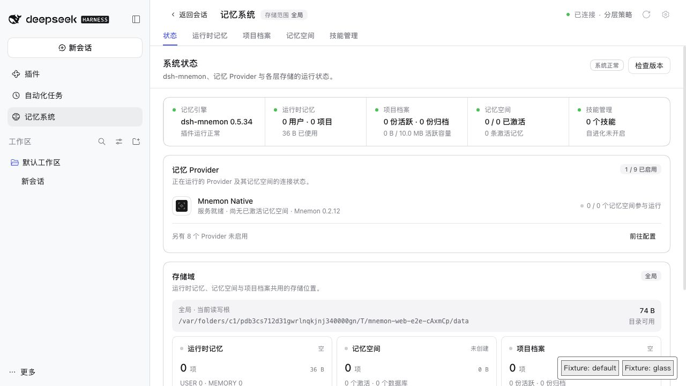
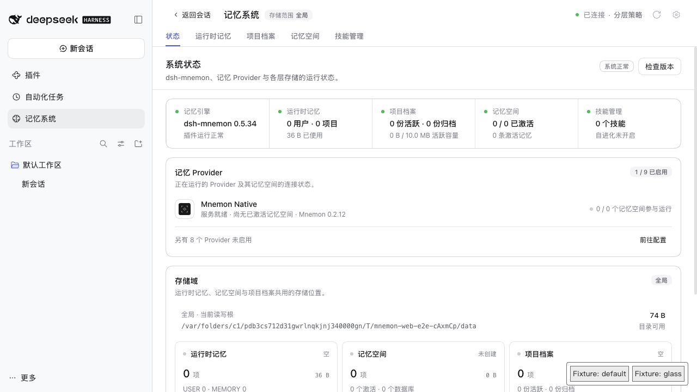
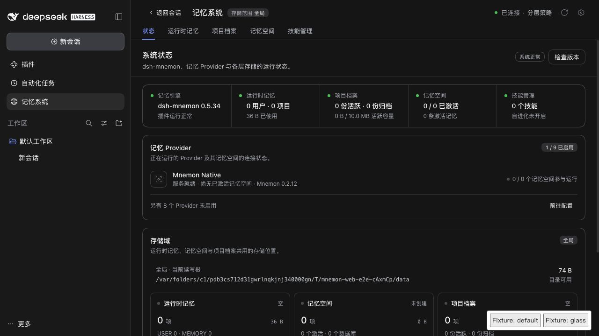
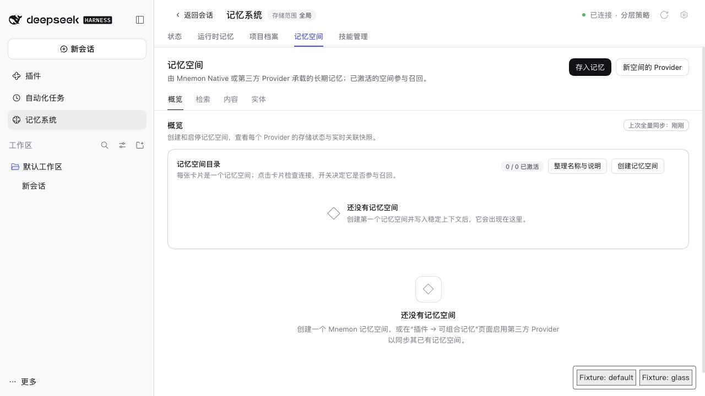

# 信息块皮肤覆盖点 — issue 445

[English](./README.md)

使用本分支代码、已发布的 DSH 0.2.1-rc.2、真实 WebUI 与隔离的合成数据验证。测试皮肤通过公开根选择器设置 `--mn-surface: transparent; --mn-block-fill: transparent`，两个测试按钮启停这条限定范围的规则，不依赖哈希类名。未调用真实模型；截图中的路径仅属于临时测试环境。

| 默认浅色主题 | 信息块透明覆盖 |
| --- | --- |
|  |  |

[default.json](./default.json)、[glass.json](./glass.json)、[light-glass.json](./light-glass.json) 和 [empty.json](./empty.json) 记录实际计算样式：两种主题中，信息块变透明，存储范围徽章保持原有填充；停用皮肤后恢复默认填充。独立打包的记忆空间空目录页面也继承此覆盖点。

`pnpm run verify` 覆盖限定根选择器测试、更新后的已审阅 CSS 指纹、类型、构建、Source 包和真实 Headless 激活。指纹变化仅来自背景变量及其六处信息块引用，类名和规则数量不变。Runtime 只读提示使用同样的继承回退，不改变读写权限逻辑。这些证据不代表已验证 Windows 桌面端或第三方壁纸插件。
