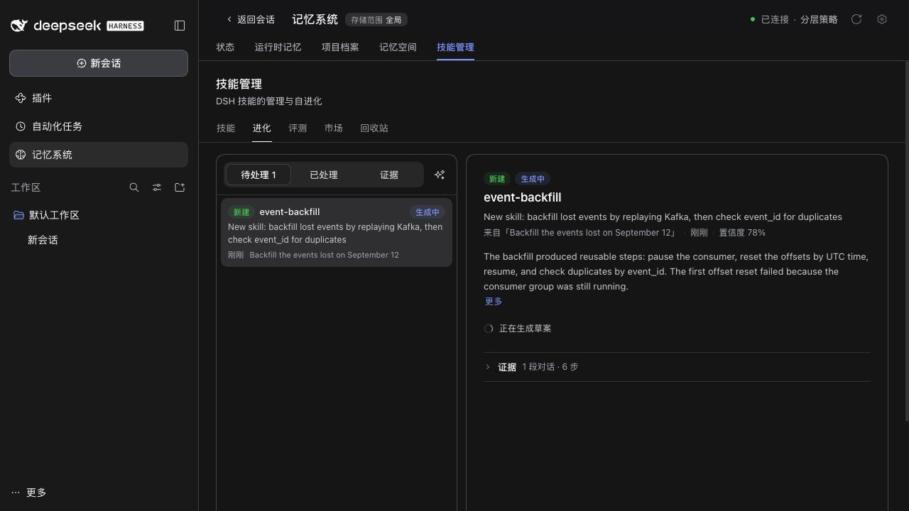
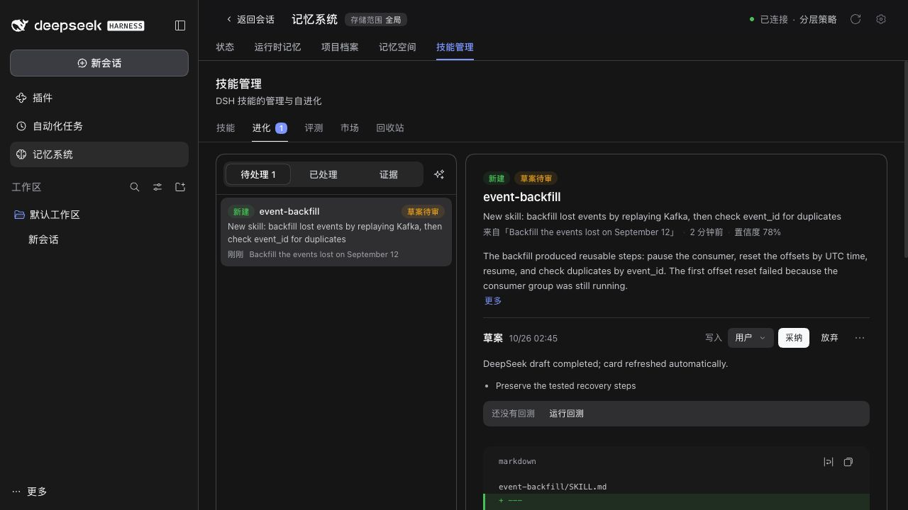

# Issue 448: completion refresh

Captured on 2026-10-26 with the built Skills client in the real DSH 0.2.1-rc.2 WebUI, using the isolated fictional Lumen fixture (`pnpm e2e:serve --docs-demo=en`). No personal memory, credentials or production service state is included.

The drafting screenshot shows the initial state. A second run used DeepSeek `deepseek-flash` to generate a synthetic SKILL.md (94 input + 368 output tokens). Its result was recorded through the public Skills Source `draft-record` management operation. The open Evolution page changed to draft review without clicking refresh or switching tabs. This verifies Source-to-client completion display; it is not an end-to-end test of the DSH Agent drafting orchestrator.

The client regression separately forces the actual race: card reads return the previous drafting ledger while the overview returns completion. It verifies the final refresh and focus recovery.

