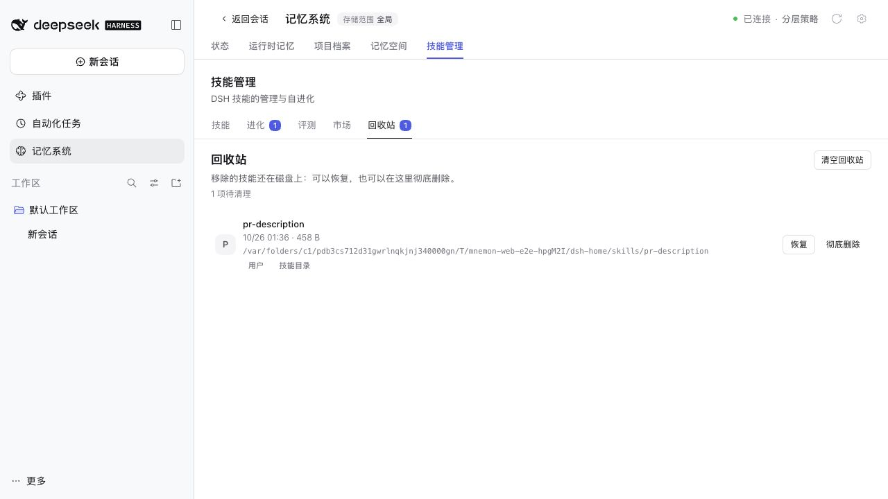
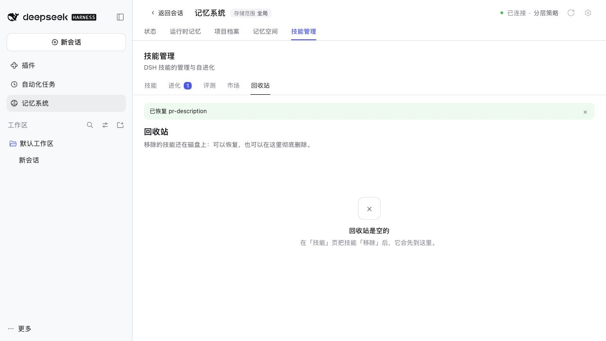
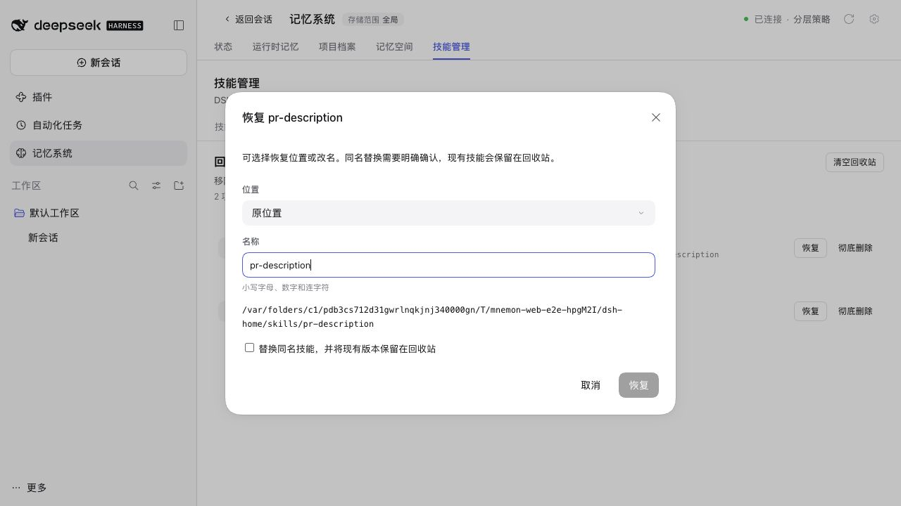
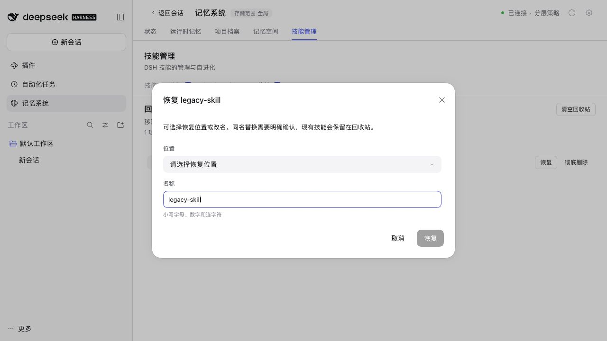
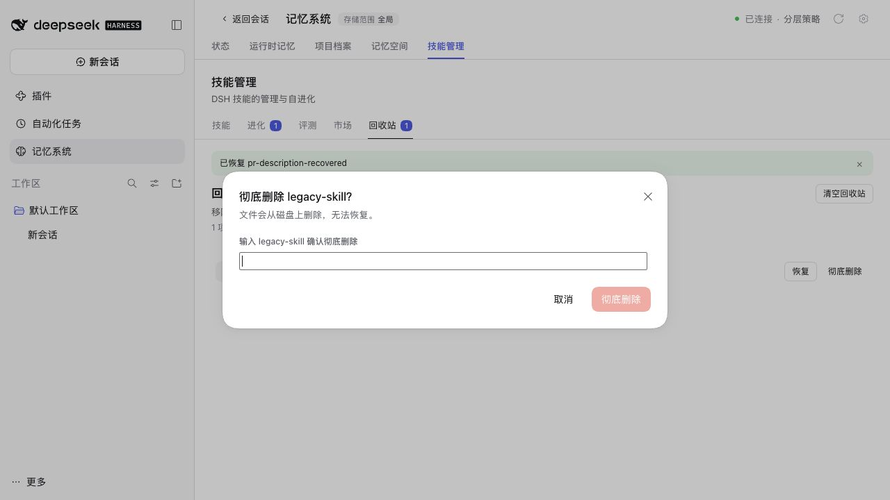

# Skills Trash verification / 技能回收站验证

Issue #451, PR #471. Captured from the revised contributor branch after merging
`main` at `3369efd3`, with the pinned DSH 0.2.1-rc.2 WebUI, Node 22.22.0 and
pnpm 10.13.1. These are real browser captures of the disposable Lumen fixture;
all displayed paths belong to that temporary fixture. No personal data or live
model credentials were used.

截图来自合并 `main` 后的修复版本，使用真实 DSH WebUI 和隔离的 Lumen 演示数据。
画面中的路径均属于临时测试目录，没有使用个人数据或真实模型凭据。

```sh
pnpm install --frozen-lockfile
pnpm run verify
node scripts/serve-e2e.mjs --docs-demo=zh-CN --without-mnemon-cli
```

`pnpm run verify` passed: bilingual docs, types, deterministic builds, every
workspace plugin's tests, 2,174 root tests (7 intentionally skipped), isolated
Headless activation and package checks. The Skills suite passed 56 tests,
including original-project restore, legacy and damaged metadata, cross-layout
conflicts, explicit hash-checked replacement, resource-preserving rename,
relative links and rejected management mutations.

完整验证通过：双语文档、类型、可重复构建、所有插件测试、根包 2,174 项测试
（7 项按条件跳过）、隔离 Headless 启动和发布包检查。技能插件 56 项测试全部通过。

## Browser checks / 界面验证

1. Remove the fictional `pr-description` skill. The Trash shows its date, size,
   original root and path, layout, and count. / 移除演示技能后显示来源、布局、大小与数量。
   
2. Restore once. The success notice appears and the entry and count disappear.
   / 一键恢复后显示成功提示，条目和数量立即刷新。
   
3. Seed a conflicting current skill in the disposable fixture. Restore stays
   disabled until a new name or explicit replacement is chosen. Changing the
   name to `pr-description-recovered` restored the saved bundle while retaining
   the current skill. / 同名冲突需要改名或明确确认替换；实际改名恢复成功。
   
4. A legacy single-file entry has no default destination. Choosing User
   `.agents` restored it there. / 无来源的旧条目需要选择位置，选择用户 `.agents` 后恢复成功。
   
5. Permanent deletion remains disabled without the exact skill name. The browser
   check cancelled this dialog; automated tests exercise confirmed deletion and
   rejection. / 未输入完整技能名时无法彻底删除；界面检查取消操作，自动测试覆盖确认删除与拒绝路径。
   
