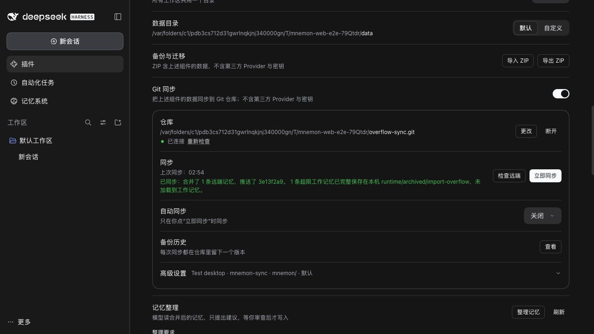

# Issue 468: runtime merge capacity evidence

Captured from this branch with `pnpm e2e:serve` using the pinned published DSH WebUI and two synthetic data roots connected to a local bare Git repository. No external account, real memory or API credential is used.

Each side starts with two valid roughly 4 KB MEMORY entries under a 10 KB limit: a shared normal entry, a local low entry, and a remote critical entry. The union exceeds the limit. Clicking **Sync now** in the actual UI completes the Git merge and push and reports one admitted entry and one archived overflow record.



Disk verification after the visible operation:

```json
{"hot_entries":2,"hot_bytes":8005,"hot_importance":["normal","critical"],"archived_records":1,"archived_importance":["low"]}
```

The archive retains the excluded entry's exact text and metadata. It stays local under `runtime/archived/import-overflow/` and is excluded from ZIP and Git payloads. Regression tests cover repeated merge idempotence, rollback on archive failure, both Git peers, and preservation of explicit deletion propagation.

`pnpm run verify` passed: all plugin suites, 2,178 root tests (7 optional skips), types, deterministic builds, Headless activation and package validation. Node 22.22.0 / pnpm 10.13.1.
