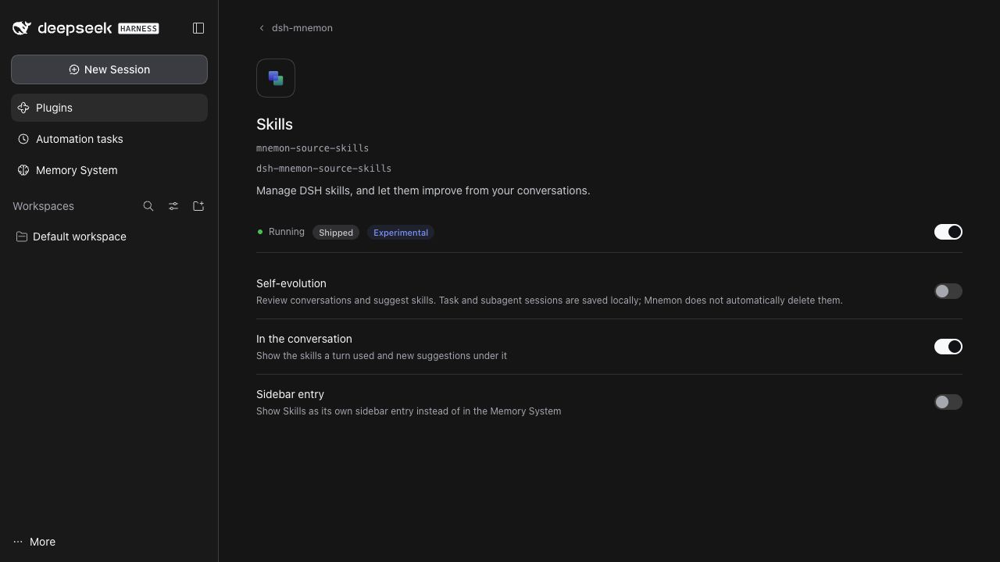
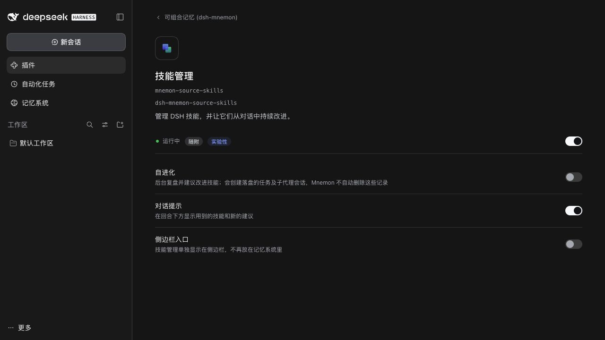

# Session retention notice — issue 472

[简体中文](./README.zh-CN.md)

The real DSH 0.2.1-rc.2 WebUI, running this branch against disposable synthetic state, shows the retention notice beside the disabled Self-evolution switch before a user opts in. Switching the fixture locale confirms both translations fit the existing row. No model call or session cleanup was performed.

This change documents current behavior only: disposing task Agent instances does not delete the sessions saved by DSH. Cleanup, retention controls and historical disk-usage accounting remain follow-up work in #472. Existing settings tests, reviewed locale fingerprints, bilingual documentation validation and the complete `pnpm run verify` pass.
