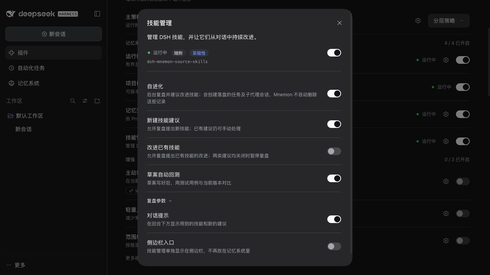
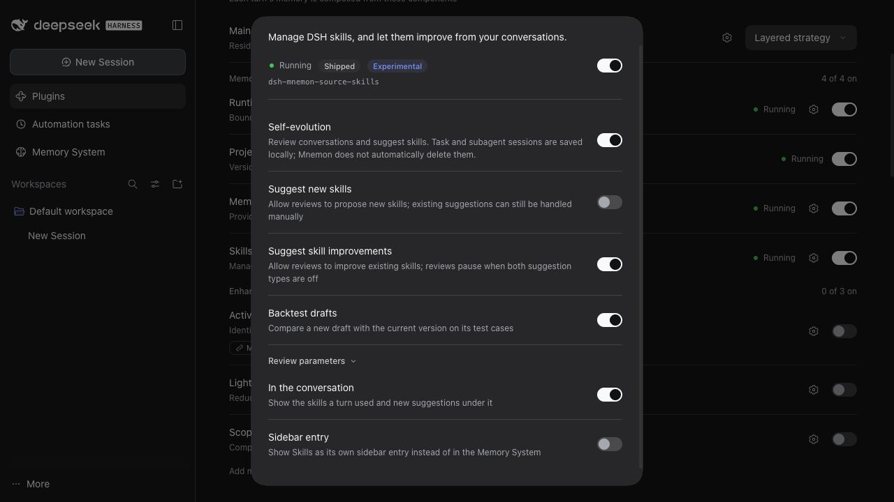

# 独立控制技能建议类型

[English](./README.md)

于 2026-10-26 验证，代码为 `600072a85863d3c16a04aea335696e60b3d5e4a4` 加本 PR 的 `codex/496-skill-suggestion-switches` 改动。环境为 macOS arm64、Node 22.22.0、pnpm 10.13.1 和已发布的 DSH 0.2.1-rc.2 包。截图来自一次性真实 DSH WebUI 配置中运行的本地构建插件，并非模拟设置页面。

保留原有的 `skills.evolution` 总开关。新增 `skills.allowCreate` 和 `skills.allowUpdate`，均默认 `true`，旧配置行为不变。两个开关都关闭后暂停对话评审；已有建议仍支持用户明确发起的草案生成、回测和采纳。

| 检查 | 结果 |
|---|---|
| 真实 WebUI 设置 | 新建/改进四种组合都能独立保存，配置补丁与可见状态一致。 |
| Host 重启 | 真正重启 Host 后，“仅新建”仍开启，改进建议仍关闭。 |
| 中英文文案 | 两个标签与说明均正常显示，下方截图展示相反的组合。 |
| Host 与 Source 测试 | 四种组合、按真实技能目录分类、模型返回被禁用的建议及评测用例、评审期间改变开关、模型启动前关闭两个开关、错误策略字段类型均通过。 |
| 已有操作与只读视图 | 两个开关关闭时仍可手动生成草案/回测/采纳；页面与范围只读设置均通过自动化测试。 |
| 完整验证 | 根包 2,203 项、插件 696 项测试通过；根包 7 项、插件 3 项需要显式启用的测试跳过。文档、类型、确定性构建、Headless 和包验证通过。 |

```bash
env -u HTTP_PROXY pnpm run verify
env -u HTTP_PROXY MNEMON_E2E_PORT=43496 node scripts/serve-e2e.mjs --docs-demo=en
```

界面验证仅使用一次性本地夹具数据和夹具的回环模型，没有使用真实 Provider API 或个人会话。建议接纳行为由 Host/Source 自动化测试证明；截图证明可见控件和持久化选择，不代表真实模型的建议质量。夹具中未改动的全局设置页另有 `permissionPresets/catalog` 404，不影响插件开关。




