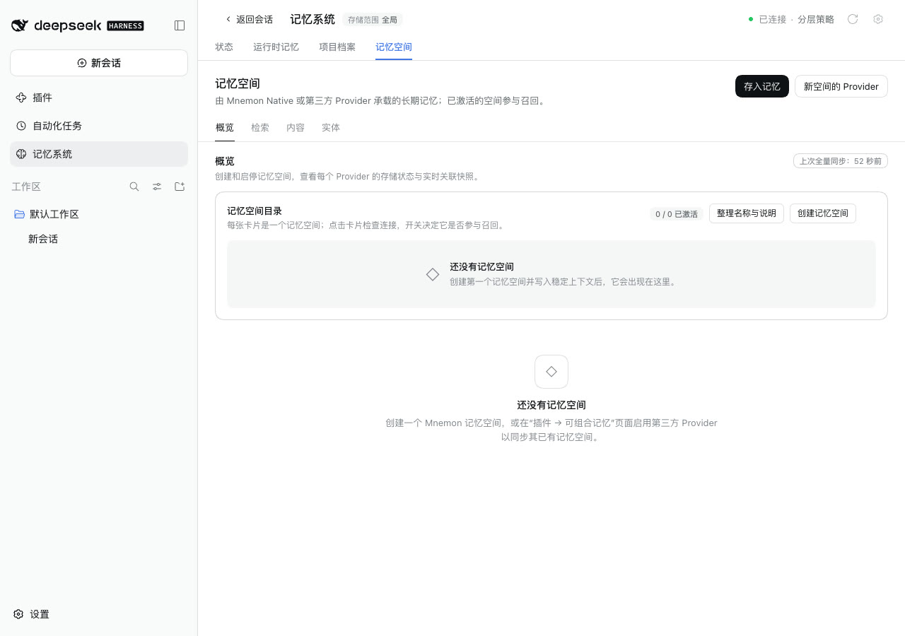
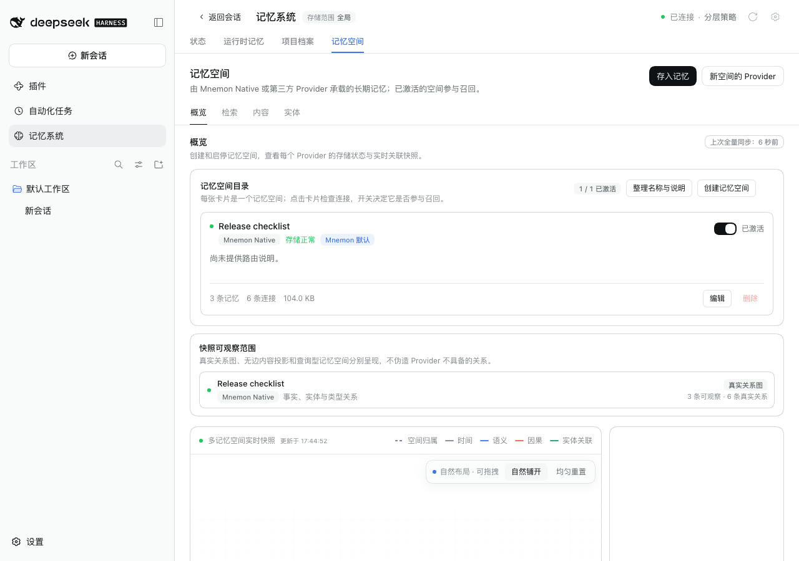
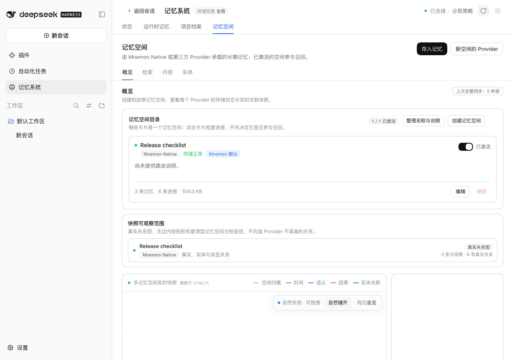
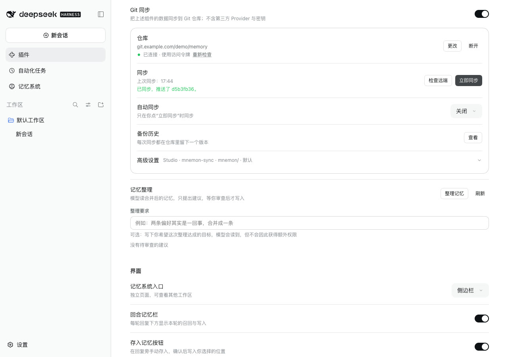

# 在插件页同步或导入后的记忆系统

[English](./README.md) | [验证记录](./verification.json)

这个问题是在核对 issue #370 的修复时发现的：一次 Git 同步之后截取的记忆系统页面，列出的仍是同步之前的记忆空间。同步已经带来了一个空间，页面要点 **刷新** 之后才显示。

基线：main `20e4ab67`。修复：`4cfd979b`。运行于 2026-10-13（Asia/Shanghai）：
- macOS 15.6 arm64，Node 24.19.0；
- headless Chrome，1280×900，zh-CN，浅色；
- DSH 0.2.1-alpha.2（npm `alpha`），通过 `scripts/serve-e2e.mjs` 运行，使用真实的 Mnemon CLI 0.2.10；
- 本机裸仓库通过 Git 的 `url.<base>.insteadOf` 代替 `https://git.example.com/demo/memory.git`。

## 原因

DSH 显示插件页时，记忆系统仍然挂载着。回到记忆系统时会重新读取顶栏状态，但不会重新读取当前打开的页面，因为重新读取它要再查询一遍所有 Provider。当前页面只在点 **刷新**，或它与配置页共用的变更信号变化时，才会重新读取。

此前只有在 DSH 组件列表里切换组件会改变这个信号。插件页上有四个操作会写入记忆，但都不会改变它：
- 同步；
- **检查远端** 里的合并；
- 导入 ZIP；
- 执行一份**记忆整理**方案。

## 修复

这四个操作现在都会改变同一个信号。任一操作完成后，记忆系统立即重新读取当前页面，隐藏时也一样。

同步、导入和整理方案即使报告失败，也会改变信号，因为它们都可能在失败前已经写入：
- 同步在发布任何内容之前，就已经把分支合并进本机；
- 整理方案在某个操作失败时，之前执行过的操作会保留；
- 导入在写入之后会重新读取记忆空间，而这次读取本身也可能失败。

检查远端或检查 ZIP 不写入任何内容，所以不改变信号。

配置页自己的数据也会重新读取。读取期间它继续显示原有内容，所以说明同步结果的那一行会保留在屏幕上。

## 方法

1. 在名为 MacBook 的机器上，用 main 启动 WebUI，打开 **Git 同步**。用真实 CLI 创建一个 Mnemon 空间 **Release checklist**，写入三条记忆。连接 `https://git.example.com/demo/memory.git`，点击 **立即同步**。然后复制这个裸仓库，让下面两次运行从同一个远端开始。
2. 在名为 Studio 的机器上，分别用 main 和修复各执行一遍：
   1. 打开 **记忆系统 → 记忆空间**，此时显示 0 / 0 已激活。
   2. 用齿轮打开配置页，打开 **Git 同步**。
   3. 连接同一个地址，点击 **立即同步**。
3. 像平时那样点击侧栏的 **记忆系统** 回去，不切换标签页，也不点 **刷新**。
4. 点击记忆系统顶栏的 **刷新**。

## 修复前后

| | main | 修复 |
|---|---|---|
| 同步后回到记忆系统 |  |  |

在 main 上，空间要点 **刷新** 后才出现：

两次运行中，同步这一行看起来相同。修复后，配置页重新读取数据，这一行的结果也保留着：

## 自动检查

`tests/client-sync.spec.tsx` 的 “Memory this page changed” 检查：
- 同步和 **检查远端** 里的合并会通知记忆系统，只读取比较结果不会；
- 推送被拒的同步、失败的同步也会通知；
- 在比较窗口里发起的同步只通知一次；
- 执行整理方案会通知，方案中途停止时也会，只接受方案不会；
- 通过真实的配置页，同步和执行方案各改变一次信号，同步结果那一行保持不变。

`tests/client-settings.spec.tsx` 检查：
- 检查 ZIP 时信号不变；
- 导入后信号改变一次，页面继续显示导入结果；
- 报告失败的导入也会改变信号。

这八个测试在 main 上都失败。`tests/client.spec.tsx` 已经检查过：记忆系统隐藏时，只要信号变化，它就会重新读取当前页面。

## 限制

- 自动同步在 Host 后台运行，页面收不到通知。要看它带来的内容，仍需点 **刷新**。
- 这个信号只在一个页面内有效。同一 Host 的其他浏览器标签页或窗口收不到它，要等那边刷新后才会更新。
