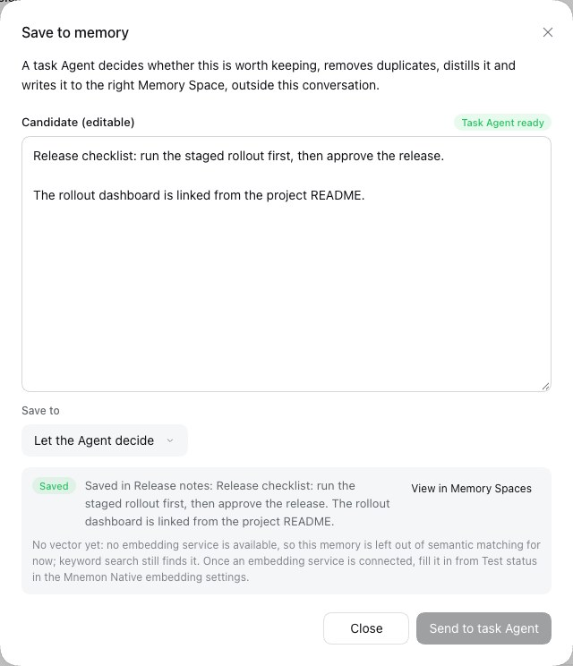

# A save without a vector reads as a note, not a failure

[简体中文](./README.zh-CN.md) | [Plan item 12](../../plans/review-gaps-2026-10.md#12-a-default-installs-save-receipt-reads-as-a-failure) | [Verification record](./verification.json)

On a default install the Mnemon Native embedding settings are not managed by DSH: **Manage embedding settings in DSH** is off, dsh-mnemon supplies no override, and Mnemon uses the Host environment and its own default endpoint. Where no embedding service answers there, every save that lands in a Memory Space comes back with `embedded: false`, and since #388 its receipt ended with "Saved without a vector: embedding did not succeed, …" in the warning colour. That is the expected state of an install without an embedding service, yet it read as a failure on every save, as the receipts of the v0.5.32 gallery show. The maintainer approved this change on 2026-10-17.

Baseline: `main` at `7a7e1ae1` (after #425). Change: `2a6dd501` (code, tests and changeset), then the documentation. The runs took place on 2026-10-18 (Asia/Shanghai) on macOS 15.6 arm64 with Node 24.19.0, pnpm 10.13.1, DSH 0.2.1-rc.2 (npm `next`, the pinned development baseline) and the Mnemon CLI 0.2.10, with no embedding service on the machine.

## What changes

The line under a receipt is worded by whether DSH manages the Mnemon Native embedding settings (`embedding.enabled`):

| Embedding settings | A save without a vector ends with |
|---|---|
| **Manage embedding settings in DSH** off, the default | a neutral note in the hint colour (`--dsw-alias-label-tertiary`): "No vector yet: no embedding service is available, so this memory is left out of semantic matching for now; keyword search still finds it. Once an embedding service is connected, fill it in from Test status in the Mnemon Native embedding settings." |
| on | the caution in the warning colour, as before: a service was set up there and did not produce a vector |

It applies wherever the line appears: **Save to memory** in a conversation, through the task Agent and straight to a space; **Save to memory** on the Memory Spaces page, through the task Agent and with constraints; and `/mnemon remember`. As before, a memory saved with its vector, a write that saved nothing, and a save to working memory or the user profile show no line. The hint the supervising model reads (`UNEMBEDDED_HINT`) does not change. The note shows on every save without a vector, as the caution did: each receipt stands alone, and showing it once per space would need state kept across dialogs and conversations.

## How each surface knows whether DSH manages the embedding

Each reads what it already has; `src/host/protocol.ts` gains nothing.

- **Save to memory in a conversation** reads `embedding.enabled` from the settings snapshot it already holds for its write check: the same `embedding` setting Memory Spaces' own settings read through `host.configuration`. It takes the value when the write answers and keeps it with the receipt, so a dialog opened again on an earlier result words it as it was saved. With no settings value read, it passes nothing and the receipt keeps the caution.
- **The Memory Spaces page** reads it from its Source's own status. `status-summary` and `status` now report `embeddingManaged`, the `embedding.enabled` of the configuration the Source runs with, beside `writeEnabled`, `timeoutMs` and the other effective settings they already report. For the default instance that is the configuration the Host passes it, unless Memory Spaces' own plugin configuration overrides it (see below); another instance reports its own. The field is optional in `MemorySpacesStatus`, Memory Spaces' `./contracts`.
- **`/mnemon remember`** reads the Host's resolved configuration, `embedding.enabled` of the graph that served the command.

`WriteReceipt`, the receipt both dialogs draw from `dsh-mnemon/client`, takes the value as a new optional prop, `embeddingManaged`. `false` gives the neutral note with `data-tone="neutral"`; `true`, or nothing, gives the caution with `data-tone="caution"`. The Host's `status` read spreads Memory Spaces' status into its answer, so the field reaches that answer too, outside the declared `StatusView`; nothing reads it there.

The conversation's dialog and `/mnemon remember` read the Starter's `embedding`, while the Memory Spaces page reads the configuration its Source runs with, in which Memory Spaces' own plugin configuration overrides what the Host passes (`create` in Memory Spaces' `src/source.ts`). A profile that sets `embedding` in the Memory Spaces plugin's own YAML would therefore see the two word the line differently; for the default instance without such an override, as the Starter installs it, they match.

## Before and after

`node scripts/serve-e2e.mjs --save-action` with `MNEMON_CLI_PATH` set to the real CLI and `MNEMON_E2E_PORT` at 19641 (Chinese) and 19642 (English), on the DSH 0.2.1-rc.2 installation; headless Chrome 155 at 1280×800, light, device scale 1. Only the model's decisions are scripted: the reply is the fixture's release checklist, and the task Agent writes the candidate it is sent into the space it finds or creates, Release notes. The dialogs, the Host, the task Agent's tools and every Mnemon Native write through the CLI are real. Nothing listened on 11434, Mnemon's default endpoint. One run per language and build:

1. send one message; **Save to memory** under the reply, **Send to task Agent**;
2. open the dialog again, write `Release approvals need two maintainers.` (`发布审批需要两位维护者同意。` in Chinese), choose Release notes under **Save to**, **Save**;
3. **Memory System**, **Memory Spaces**, **Save to memory** in its header, a new candidate, **Send to task Agent**;
4. **Plugins**, dsh-mnemon, the gear of Memory Spaces, Mnemon Native: switch **Manage embedding settings in DSH** on, set the endpoint to `http://127.0.0.1:9`, where nothing listens, and **Apply** ("Saved and applied live");
5. a new session, then steps 1 to 3 again with candidates of their own, since Mnemon skips a duplicate.

The baseline is the same script on `main` built at `7a7e1ae1`; this change ran on `2a6dd501`.

### Settings at their default: the change

| | `main` | This change |
|---|---|---|
| Task Agent, Chinese |  |  |
| Straight to a space, Chinese |  |  |
| Task Agent, English |  |  |
| Straight to a space, English |  |  |

### DSH managing the embedding, a service that does not answer: unchanged

These receipts are byte-identical on `main` and with the change, in both languages and on both paths; [verification.json](./verification.json) lists their SHA-256.

| | Chinese | English |
|---|---|---|
| Task Agent |  |  |
| Straight to a space |  |  |

### The Memory Spaces page and `/mnemon remember`, with the change

| | Settings at their default | DSH managing the embedding |
|---|---|---|
| Memory Spaces page, Chinese |  |  |
| Memory Spaces page, English |  |  |
| `/mnemon remember` |  |  |

The command ran in its own fixture, `--exact-id` on port 19643, the same way: `/mnemon remember 预发集群的 Grafana 在 3300 端口，排查监控问题时先看它。` with the settings at their default, then, with DSH managing the embedding as above, a second one in a new session. Its text is Chinese in every interface language.

In every run the note's computed style was 12 px in `rgb(129, 133, 140)`, DSH's hint colour, for the neutral note, and `rgb(221, 134, 41)`, the warning label, for the caution, which `main` draws for every save. No run logged a browser console error.

## Compatibility

### Starter and Memory Spaces versions

A profile can keep its own Memory Spaces, older or newer than the one the Starter pins.

| Starter | Memory Spaces | Save to memory in a conversation | Memory Spaces page | `/mnemon remember` |
|---|---|---|---|---|
| this change | this change | by the setting | by the setting | by the setting |
| this change | 0.5.21 or earlier | by the setting: it reads the Starter's settings | the caution: its page passes nothing | by the setting |
| 0.5.31 or earlier | this change | the caution | the caution: the older `WriteReceipt` ignores the prop; nothing fails | the caution |

The page's rows were checked with the published bundles: the built Memory Spaces client of this change loaded beside the published `dsh-mnemon@0.5.31` client, and the published `dsh-mnemon-source-memory-spaces@0.5.21` client beside the built Starter client of this change, each through `loadMemoryClientArtifact`, rendering the Memory Spaces page with a status that says DSH does not manage the embedding and saving through the task Agent and with constraints. Both pages drew both receipts with the caution and logged no error; the pair from this change drew the neutral note. The check is not committed, since the published bundles are not in the repository; the committed tests cover a `WriteReceipt` without the prop and a Memory Spaces status without the field, which keep the caution.

### Public SDK

- `WriteReceipt` in `dsh-mnemon/client` gains the optional `embeddingManaged`; its other props, and every export of every entry, stay as they were. The [extension guide](../../en/development/extensions.md) describes the prop.
- `MemorySpacesStatus` in Memory Spaces' `./contracts` gains the optional `embeddingManaged`.
- Peer floors: at run time Memory Spaces works beside every dsh-mnemon its peer range admits, since an older `WriteReceipt` ignores the prop, so its `dsh-mnemon` peer floor need not move. To compile, it needs this release's `WriteReceipt` type, as it already needs this release's exports since #421, so its development dependency follows the release as it does for #421.

### Data, settings, names and what the model sees

No persisted format, settings key, RPC name, tool name or model-visible text changes; `embedding.enabled` is read, never written. The copy gains `receipt.unembeddedNoService` in Chinese and English; `receipt.unembedded` keeps its wording, and the copy baseline now holds 1,342 keys per language.

## Automated checks

- `tests/client-write-receipt.spec.tsx` (new): `WriteReceipt` in both languages draws the neutral note for `embeddingManaged: false`, the caution for `true` and for no value; no line for a memory with its vector, a skipped, queued or unfinished write, or a failure, whatever the setting; and the style sheet gives the warning colour only to the caution.
- `tests/client-interaction-surfaces.spec.tsx`: Save to memory in a conversation, through the task Agent and straight to a Mnemon Native space, with the settings at their default and managed: the note, its tone, and no line for a memory saved with its vector; working memory and the user profile show neither line; a skipped write shows neither.
- `tests/client.spec.tsx`: the Memory Spaces page in the workbench, through the task Agent and with constraints, with a status that leaves the field out, says `true` and says `false`.
- `tests/commands.spec.ts`: `/mnemon remember` for a stored and a skipped write, with the setting at its default and managed.
- Memory Spaces' `tests/service.spec.ts`: `status-summary` and `status` report `embeddingManaged` from the configuration; its `tests/client.spec.tsx`: the page over the built Starter client, as above.
- `tests/client-presentation.spec.ts`: the copy baseline with the new key.

With the sources this change touches put back at `main` and the tests kept, 14 of these tests fail: every receipt case that expects a line, since `main` words it as the caution in every state and gives it no tone (the managed and older-status cases match `main`'s text and fail on the tone alone), the Memory Spaces status test, the style sheet check and the copy baseline. The cases that expect no line, and `/mnemon remember` with DSH managing the embedding, pass on `main` too.

## Verification

On the merge with `main` at `bd70979f` (#426), with the documentation in place, Node 24.19.0 and pnpm 10.13.1. The same checks passed on `2a6dd501` before the merge.

- `pnpm run verify` passed in 149 s: 4,875 local links and 370 anchors in the documentation, the deterministic build of 56 files, every plugin's build, typecheck and tests (Memory Spaces 296 passed, 2 skipped), the root tests (2,120 passed, 7 skipped, in 150 files), the Headless profile with 38 tools, and the package's 66 files, public entries, publint and attw.
- `MNEMON_CLI_PATH=/nonexistent/mnemon MNEMON_PLUGIN_VERIFY_CONCURRENCY=1 pnpm run verify:plugins` passed in 286 s: 17 independent plugin repositories and 18 packed artifacts, Memory Spaces' standalone typecheck against the packed Starter of this change included.
- `DSH_HOST_ROOT=<DSH 0.2.0-rc.2> pnpm run test:installed-dsh` passed in 84 s: 2,117 root tests passed and 10 skipped on the installed DSH 0.2.0-rc.2.
- `pnpm run release:intent` against `main`: it covers `dsh-mnemon` and `dsh-mnemon-source-memory-spaces`, the two packages whose published artifacts change, through `.changeset/neutral-vector-note.md`.

## Limits

- The line is worded by `embedding.enabled` alone, the scope approved for this change; nothing probes the service or reads the environment the Mnemon CLI inherits. A service DSH does not manage therefore also gets the neutral note when it produces no vector: one set up only in that environment, such as through `MNEMON_EMBED_ENDPOINT`, and an Ollama at Mnemon's default endpoint that is down or lacks the model. The note's advice holds for them, and **Test status** tells them apart.
- The receipts of the [v0.5.32 gallery](../../assets/webui-v0.5.32/README.md) still show the caution until the gallery is captured again.
- The task Agent is scripted, so its summaries are the fixture's text.
- A Provider other than Mnemon Native reports no `embedded` field, and its receipts read as before.
