# 未生成向量的记忆显示为说明，而不是失败

[English](./README.md) | [计划第 12 项](../../plans/review-gaps-2026-10.md#12-a-default-installs-save-receipt-reads-as-a-failure)（英文） | [验证记录](./verification.json)

默认安装时，Mnemon Native 的嵌入配置不由 DSH 管理：**由 DSH 管理嵌入配置**处于关闭状态，dsh-mnemon 不提供任何覆盖，Mnemon 沿用 Host 环境和自己的默认地址。那里没有嵌入服务响应时，每次存入记忆空间的写入都会返回 `embedded: false`；自 #388 起，回执末尾会以警告色显示“未生成向量：嵌入没有成功，……”。这本是没有嵌入服务的安装应有的状态，却让每次存入都读起来像失败，v0.5.32 图集中的回执就是如此。维护者在 2026-10-17 批准了这项改动。

基线：`main` 的 `7a7e1ae1`（#425 之后）。改动：`2a6dd501`（代码、测试与 changeset），以及之后的文档提交。运行于 2026-10-18（Asia/Shanghai），环境为 macOS 15.6 arm64、Node 24.19.0、pnpm 10.13.1、DSH 0.2.1-rc.2（npm `next`，固定的开发基线）和 Mnemon CLI 0.2.10，机器上没有任何嵌入服务。

## 改了什么

回执下方这一行的措辞取决于 DSH 是否管理 Mnemon Native 的嵌入配置（`embedding.enabled`）：

| 嵌入配置 | 未生成向量的写入，回执末尾显示 |
|---|---|
| **由 DSH 管理嵌入配置**关闭（默认） | 一条使用提示色（`--dsw-alias-label-tertiary`）的中性说明：“这条记忆暂未生成向量：当前没有可用的嵌入服务，它暂不参与语义匹配，关键词检索不受影响。连接嵌入服务后，可在 Mnemon Native 嵌入设置的「测试状态」中补齐。” |
| 打开 | 与之前相同、使用警告色的提醒：那里配置了服务，但它没有生成向量 |

凡是出现这一行的地方都按此处理：对话中的**存入记忆**，包括交给任务 Agent 与直接写入空间；记忆空间页面上的**存入记忆**，包括交给任务 Agent 与按约束交给任务 Agent；以及 `/mnemon remember`。与之前一样，已生成向量的记忆、没有存入任何内容的写入，以及写入工作记忆或用户画像，都不显示这一行。监督模型读到的提示（`UNEMBEDDED_HINT`）不变。和原来的提醒一样，每次未生成向量的写入都会显示这条说明：每张回执各自独立，若要每个空间只显示一次，就得跨对话框和会话记住状态。

## 各处如何知道 DSH 是否管理嵌入配置

各处都读取自己已有的信息，`src/host/protocol.ts` 没有新增任何内容。

- **对话中的存入记忆**从它为写入检查而持有的设置快照中读取 `embedding.enabled`，与记忆空间自己的设置通过 `host.configuration` 读取的是同一项 `embedding` 设置。它在写入返回时取值，并随回执一起保存，因此重新打开对话框查看之前的结果时，措辞与写入当时一致。尚未读到设置值时它不传任何值，回执保持提醒。
- **记忆空间页面**从所属 Source 自己的状态中读取。`status-summary` 和 `status` 现在报告 `embeddingManaged`，即该 Source 运行所用配置中的 `embedding.enabled`，与它们早已报告的 `writeEnabled`、`timeoutMs` 等生效设置并列。默认实例报告的是 Host 传给它的配置，除非记忆空间自己的插件配置覆盖了它（见下文）；其他实例报告各自的配置。这个字段在记忆空间 `./contracts` 的 `MemorySpacesStatus` 中是可选的。
- **`/mnemon remember`** 读取 Host 解析后的配置，即处理该命令的图的 `embedding.enabled`。

两个对话框都使用 `dsh-mnemon/client` 中的 `WriteReceipt` 绘制回执，它通过新的可选属性 `embeddingManaged` 接收这个值。`false` 显示中性说明，带 `data-tone="neutral"`；`true` 或不传则显示提醒，带 `data-tone="caution"`。Host 的 `status` 读取会把记忆空间的状态展开到自己的应答中，因此这个字段也会出现在那里，但不在声明的 `StatusView` 之内，那里也没有任何代码读取它。

对话中的对话框和 `/mnemon remember` 读取 Starter 的 `embedding`，记忆空间页面读取的则是其 Source 运行所用的配置，其中记忆空间自己的插件配置会覆盖 Host 传入的值（记忆空间 `src/source.ts` 中的 `create`）。如果某个 Profile 在记忆空间插件自己的 YAML 中设置了 `embedding`，两处的措辞就可能不同；默认实例没有这种覆盖时（Starter 就是这样安装的），两者一致。

## 改动前后

使用 `node scripts/serve-e2e.mjs --save-action`，`MNEMON_CLI_PATH` 指向真实的 CLI，`MNEMON_E2E_PORT` 为 19641（中文）和 19642（英文），运行在 DSH 0.2.1-rc.2 安装上；无头 Chrome 155，1280×800，浅色，设备缩放 1。只有模型的决定是脚本化的：回复是夹具的发布清单，任务 Agent 把收到的候选内容写入它找到或新建的空间 Release notes。对话框、Host、任务 Agent 的工具以及每次经由 CLI 的 Mnemon Native 写入都是真实的。Mnemon 的默认地址 11434 端口上没有任何服务监听。每种语言、每个构建各运行一次：

1. 发送一条消息；在回复下方点**存入记忆**，**交给任务 Agent**；
2. 再次打开对话框，写入 `发布审批需要两位维护者同意。`（英文运行中为 `Release approvals need two maintainers.`），在**保存到**中选择 Release notes，**保存**；
3. **记忆系统**，**记忆空间**，点页头的**存入记忆**，填写新的候选内容，**交给任务 Agent**；
4. **插件**，dsh-mnemon，记忆空间的齿轮，Mnemon Native：打开**由 DSH 管理嵌入配置**，把地址设为没有服务监听的 `http://127.0.0.1:9`，**应用**（“已保存并实时生效”）；
5. 新建会话，用各自不同的候选内容重复第 1 至 3 步，因为 Mnemon 会跳过重复内容。

基线是同一脚本在 `7a7e1ae1` 构建的 `main` 上的运行；本改动运行在 `2a6dd501` 上。

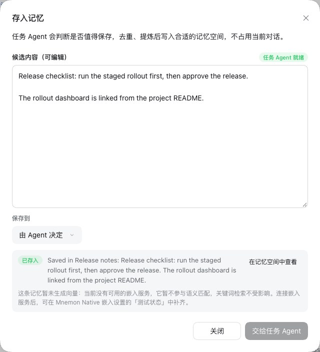

### 嵌入配置保持默认：改动所在

| | `main` | 本改动 |
|---|---|---|
| 任务 Agent，中文 | 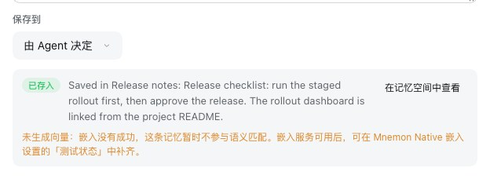 | 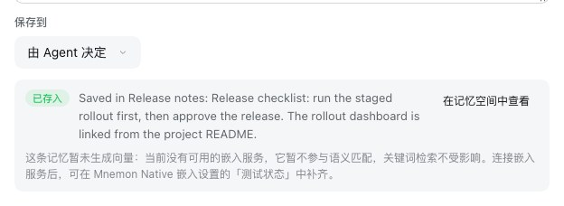 |
| 直接写入空间，中文 |  |  |
| 任务 Agent，英文 | 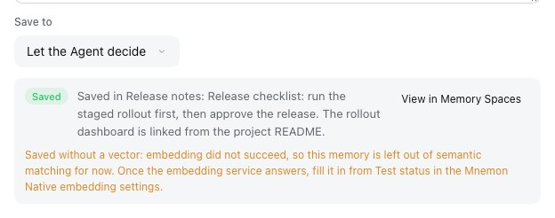 | 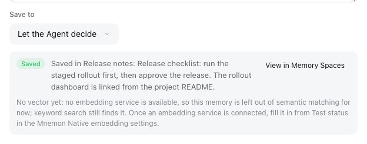 |
| 直接写入空间，英文 | 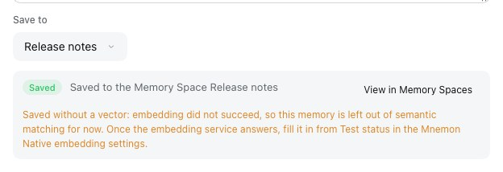 | 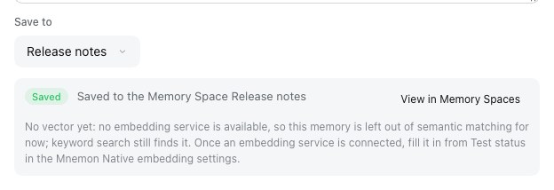 |

### DSH 管理嵌入配置、服务没有响应：保持不变

这些回执在 `main` 和本改动下逐字节相同，两种语言、两条路径都是如此；[verification.json](./verification.json) 列出了它们的 SHA-256。

| | 中文 | 英文 |
|---|---|---|
| 任务 Agent |  | 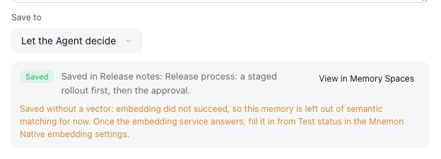 |
| 直接写入空间 |  |  |

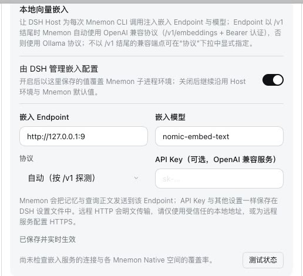

### 本改动下的记忆空间页面与 `/mnemon remember`

| | 嵌入配置保持默认 | DSH 管理嵌入配置 |
|---|---|---|
| 记忆空间页面，中文 |  |  |
| 记忆空间页面，英文 | 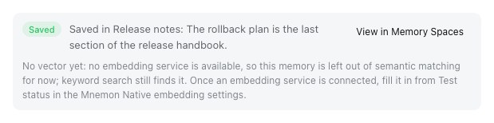 | 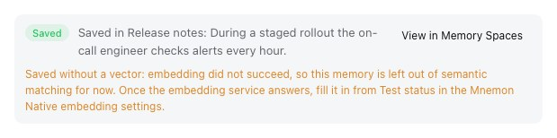 |
| `/mnemon remember` | 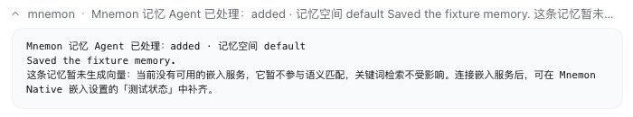 |  |

命令在单独的夹具中运行（`--exact-id`，端口 19643），步骤相同：在嵌入配置保持默认时执行 `/mnemon remember 预发集群的 Grafana 在 3300 端口，排查监控问题时先看它。`，然后像上面一样让 DSH 管理嵌入配置，在新会话中再执行一次。无论界面语言是什么，它的文本都是中文。

所有运行中，这一行计算后的样式都是 12 px：中性说明为 DSH 提示色 `rgb(129, 133, 140)`，提醒为警告标签色 `rgb(221, 134, 41)`，`main` 在每次写入中都使用后者。所有运行都没有浏览器控制台错误。

## 兼容性

### Starter 与记忆空间的版本组合

Profile 可以自行维护一份记忆空间，版本可能比 Starter 固定的更旧或更新。

| Starter | 记忆空间 | 对话中的存入记忆 | 记忆空间页面 | `/mnemon remember` |
|---|---|---|---|---|
| 本改动 | 本改动 | 按设置 | 按设置 | 按设置 |
| 本改动 | 0.5.21 或更早 | 按设置：它读取 Starter 的设置 | 提醒：它的页面不传任何值 | 按设置 |
| 0.5.31 或更早 | 本改动 | 提醒 | 提醒：旧的 `WriteReceipt` 会忽略这个属性，不会出错 | 提醒 |

页面这两行用已发布的包验证过：把本改动构建出的记忆空间客户端放在已发布的 `dsh-mnemon@0.5.31` 客户端旁边，再把已发布的 `dsh-mnemon-source-memory-spaces@0.5.21` 客户端放在本改动构建出的 Starter 客户端旁边，都通过 `loadMemoryClientArtifact` 加载，渲染记忆空间页面，状态中写明 DSH 不管理嵌入配置，然后分别交给任务 Agent 与按约束保存。两个页面的两张回执都显示提醒，没有任何错误；两者都来自本改动时显示中性说明。由于仓库中没有这些已发布的包，这项检查没有提交；已提交的测试覆盖了不传该属性的 `WriteReceipt` 和不含该字段的记忆空间状态，它们都保持提醒。

### 公开 SDK

- `dsh-mnemon/client` 的 `WriteReceipt` 新增可选属性 `embeddingManaged`；其他属性以及各入口的全部导出都保持不变。[扩展开发](../../zh-CN/development/extensions.md)说明了这个属性。
- 记忆空间 `./contracts` 的 `MemorySpacesStatus` 新增可选字段 `embeddingManaged`。
- Peer 最低版本：运行时，记忆空间可与其 peer 范围允许的每个 dsh-mnemon 一起工作，因为旧的 `WriteReceipt` 会忽略这个属性，所以它对 `dsh-mnemon` 的 peer 最低版本无需调整。编译时它需要本版本的 `WriteReceipt` 类型，正如自 #421 起它已经需要本版本的导出，所以它的开发依赖与 #421 一样随发布调整。

### 数据、设置、名称与模型看到的内容

持久化格式、设置键、RPC 名称、工具名称和模型可见的文本都没有变化；`embedding.enabled` 只被读取，从不写入。文案新增中英文的 `receipt.unembeddedNoService`；`receipt.unembedded` 的措辞不变，文案基线现在每种语言有 1,342 个键。

## 自动化检查

- `tests/client-write-receipt.spec.tsx`（新增）：`WriteReceipt` 在两种语言下，`embeddingManaged: false` 显示中性说明，`true` 和不传都显示提醒；对于已生成向量的记忆、被跳过、排队或未完成的写入以及失败，无论设置如何都不显示这一行；样式表只给提醒使用警告色。
- `tests/client-interaction-surfaces.spec.tsx`：对话中的存入记忆，交给任务 Agent 与直接写入 Mnemon Native 空间，在嵌入配置保持默认和由 DSH 管理两种状态下：说明、它的色调，以及已生成向量时不显示；工作记忆和用户画像不显示任何一行；被跳过的写入也不显示。
- `tests/client.spec.tsx`：工作台中的记忆空间页面，交给任务 Agent 与按约束保存，状态分别不含该字段、为 `true` 和为 `false`。
- `tests/commands.spec.ts`：`/mnemon remember` 在写入成功和被跳过时，分别处于默认设置和由 DSH 管理两种状态。
- 记忆空间的 `tests/service.spec.ts`：`status-summary` 和 `status` 按配置报告 `embeddingManaged`；它的 `tests/client.spec.tsx`：基于构建出的 Starter 客户端的页面，同上。
- `tests/client-presentation.spec.ts`：包含新键的文案基线。

把本改动涉及的源码恢复为 `main` 的版本、保留测试后，其中 14 个测试失败：所有期望显示这一行的回执用例，因为 `main` 在任何状态下都显示提醒且不带色调（由 DSH 管理和旧状态的用例与 `main` 的文本一致，只因色调失败），以及记忆空间状态测试、样式表检查和文案基线。期望不显示这一行的用例，以及由 DSH 管理时的 `/mnemon remember`，在 `main` 上也通过。

## 验证

在合并 `main` 的 `bd70979f`（#426）之后、文档就位时，使用 Node 24.19.0 与 pnpm 10.13.1。合并之前，同样的检查在 `2a6dd501` 上也已通过。

- `pnpm run verify` 用时 149 秒通过：文档中的 4,875 个本地链接与 370 个锚点、56 个文件的确定性构建、每个插件的构建、类型检查与测试（记忆空间 296 个通过、2 个跳过）、根测试（150 个文件中 2,120 个通过、7 个跳过）、包含 38 个工具的 Headless Profile，以及包的 66 个文件、公开入口、publint 与 attw。
- `MNEMON_CLI_PATH=/nonexistent/mnemon MNEMON_PLUGIN_VERIFY_CONCURRENCY=1 pnpm run verify:plugins` 用时 286 秒通过：17 个独立插件仓库与 18 个打包产物，包括记忆空间针对本改动打包出的 Starter 的独立类型检查。
- `DSH_HOST_ROOT=<DSH 0.2.0-rc.2> pnpm run test:installed-dsh` 用时 84 秒通过：在已安装的 DSH 0.2.0-rc.2 上，2,117 个根测试通过、10 个跳过。
- 针对 `main` 的 `pnpm run release:intent`：覆盖了 `dsh-mnemon` 与 `dsh-mnemon-source-memory-spaces`，即发布产物有变化的两个包，由 `.changeset/neutral-vector-note.md` 声明。

## 限制

- 这一行只按 `embedding.enabled` 决定措辞，这是本改动获批的范围；不会探测嵌入服务，也不读取 Mnemon CLI 继承的环境。因此，不由 DSH 管理的服务没有生成向量时也会显示中性说明，例如只在该环境中配置的服务（如通过 `MNEMON_EMBED_ENDPOINT`），或 Mnemon 默认地址上没有运行或缺少模型的 Ollama。说明给出的做法对它们同样适用，**测试状态**可以区分这些情况。
- [v0.5.32 图集](../../assets/webui-v0.5.32/README.md)中的回执在重新采集之前仍显示提醒。
- 任务 Agent 是脚本化的，因此回执中的摘要是夹具的文本。
- Mnemon Native 以外的 Provider 不报告 `embedded` 字段，它们的回执与之前相同。
