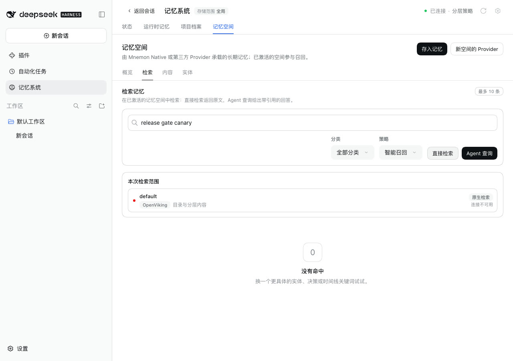
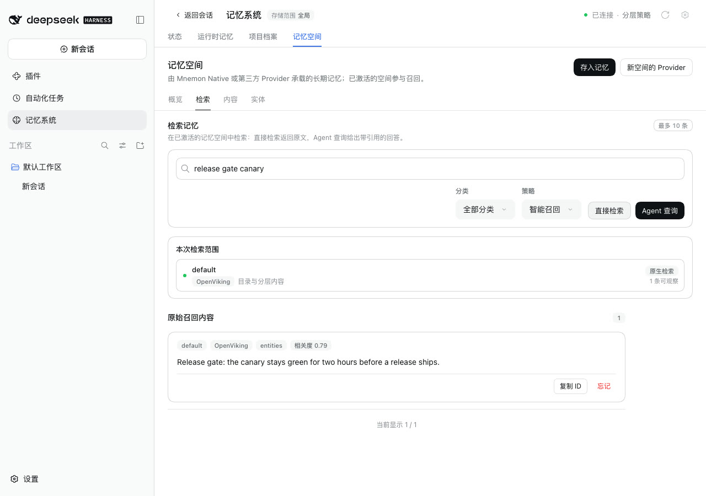

# OpenViking 服务端列出已不存在的文件时的检索

[English](./README.md) | [验证记录](./verification.json)

这个问题是在用真实 OpenViking 服务验证 issue #353 的修复时发现的：一次探测写入了两条记忆，其中一条的文件后来从服务端的工作区里消失了，但服务端的索引仍然列着它。此后，对这个记忆空间的每次检索都以 `File not found` 失败，整个空间看起来像是连不上。

基线：main `20e4ab67`。修复：`b49954b7`。运行于 2026-10-13（Asia/Shanghai）：
- macOS 15.6 arm64，Node 24.19.0；
- headless Chrome，1280×900，zh-CN，浅色；
- DSH 0.2.1-alpha.2（npm `alpha`），通过 `scripts/serve-e2e.mjs` 运行；
- OpenViking 0.4.20，开发模式，嵌入使用 Ollama 的 `nomic-embed-text`。

## 原因

检索先向 OpenViking 查询匹配的记忆，再逐条读取它们的内容。驱动一起等待所有读取，所以只要有一条读取失败，整个检索就失败，能读到的结果也一起丢掉了。在 **内容** 页浏览空间时，也是先列出文件再读取，问题相同。

## 修复

每条读取各自完成：
- 读不到的记忆会被略过；
- 检索结果会说明略过了几条，以及原因；
- 一条都读不到时，仍像以前一样报告第一个错误，所以连不上的服务不会看起来像一个空的空间；
- 取消检索时仍会停止。

## 方法

1. 用 OpenViking Provider 向 `viking://user/default/memories` 写入两条记忆：
   - "Release gate: the canary stays green for two hours before a release ships."
   - "Release gate: a red canary rolls the release back without a vote."
2. 从服务端工作区删除第二条记忆的文件，这时服务端的索引仍列着它。
3. 分别用 main 和修复启动 WebUI。在 **插件 → 可组合记忆 → 记忆空间** 中打开并连接 OpenViking。服务端运行在开发模式，绑定到用户 `default` 的密钥即可。
4. 打开 **记忆系统 → 记忆空间 → 检索**，输入 `release gate canary`，点击 **直接检索**。

## 修复前后

| | main | 修复 |
|---|---|---|
| 直接检索 |  |  |

在 main 上，空间卡片显示「连接不可用」，悬停提示是 `File not found: viking://user/default/memories/entities/…-release-gate-a-red-canary-rolls-the-release-back-….md`。

修复后，卡片显示「1 条可观察」，能读到的那条记忆正常出现。悬停提示是 "1 OpenViking result could not be read and was left out; the server's index can list a file it no longer holds."

## 自动检查

`plugins/dsh-mnemon-provider-openviking/tests/driver.spec.ts` 新增两个测试：
- “leaves out a memory the server lists but can no longer read, and says so”，覆盖检索和浏览；
- “reports why when no listed memory can be read, and stops a cancelled read”。

在 WebUI 运行之前，我们先用一个探测脚本访问同一个 OpenViking 0.4.20 服务。修复后，它返回了能读到的记忆和提示；在 main 上，它以 `File not found` 失败。

## 限制

- 提示是英文的，并且只显示在卡片的悬停提示里，与其他 Provider 的提示一样。
- 过期的条目仍留在 OpenViking 的索引里。修复只保证它不会挡住其余还能读到的记忆。
- WebUI 里只运行了检索。**内容** 页的浏览走同一条路径，已由测试覆盖。
