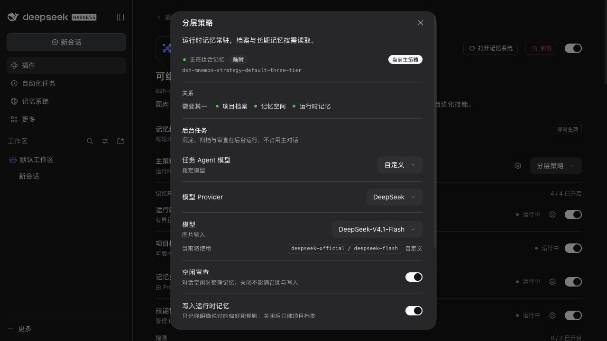

# DSH 0.2.1-rc.3 任务 Agent 模型目录

[English](./README.md) · [验收索引](../README.md)

验收日期为 2026-10-26，代码为 `600072a85863d3c16a04aea335696e60b3d5e4a4` 加本 PR，使用 Node 22.22.0、pnpm 10.13.1。[结构化结果](./verification.json)。

DSH rc.3 联网获取官方 API Key 模型目录，默认请求预算为五秒；Mnemon 原先在三秒时停止等待。本次将官方 Provider 的等待上限改为六秒，其他 Provider 仍为三秒。模型选择、推理超时、已保存设置与存储格式不变。

## 验证

- 四项新增回归在原实现上失败。修复后的生命周期与宿主兼容性定向测试全部 114 项通过，覆盖 3.6 秒和 5 秒返回、上游错误、停滞上限、定时器清理与其他 Provider。
- `pnpm run verify` 通过：根测试 2,196 项通过、7 项条件跳过；插件测试 689 项通过、3 项条件跳过；文档、类型、确定性构建、Headless 与打包公开入口检查通过。
- 独立安装的 DSH 0.2.1-rc.3 上全部根测试也通过：2,196 项通过、7 项条件跳过。CI 增加已安装 rc.3，与 0.2.0-rc.2 并列；开发依赖仍锁定 rc.2。
- [可复用脚本](../../../scripts/verify-task-model-directory.mjs) 运行正式发布的 DSH LLM runtime、API Key adapter 和真实 Mnemon lifecycle。仅模拟 HTTP 返回：官方 `/models` 端点延迟 3.6 秒响应。修复前，首次加载在 3,003 ms 失败，DSH 在 3,607 ms 完成；修复后首次加载在 3,604 ms 成功。rc.2 的静态目录仍立即成功。未发出外部请求，也未使用真实凭据。
- 真实 rc.3 WebUI 中打开任务 Agent 选择器、保存自定义模型，重新打开后正确显示。E2E 回环配置使用 DSH 内置目录；官方目录延迟返回由上面的独立 adapter 验证。本记录不代表真实云服务可用性测试。

使用独立安装的官方 DSH 包复验 adapter：

```sh
node --experimental-transform-types scripts/verify-task-model-directory.mjs /path/to/dsh/package.json /tmp/catalog.json
```


