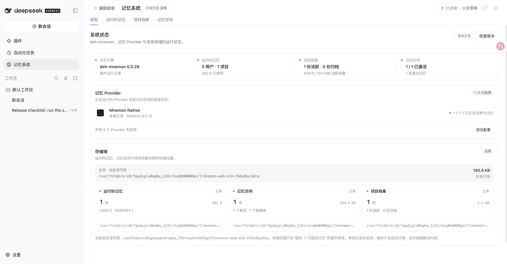

# v0.5.28 发布验收

[English](./README.md) | [验证记录](./validation.json)

2026-10-11（Asia/Shanghai）验证，基于已合并的 `main` `50c75d99`，加上 `pnpm release:version` 生成的改动。候选为 `dsh-mnemon@0.5.28`，锁定 `dsh-mnemon-provider-retaindb@0.5.6`；其余 16 个组件保留已发布的版本。

## 官方 WebUI 与基础记忆流程

使用未修改的 npm DSH **0.2.1-alpha.2**、Node **24.20.0** 与 Mnemon CLI **0.2.10**。`scripts/serve-e2e.mjs --save-action` 将构建后的工作区包链接至一次性 Profile。全部数据为测试数据；模型使用本机 fixture，Host 工具、子 Agent、持久化与 Native CLI 操作均为真实执行。

1. 打开记忆系统，状态显示 **dsh-mnemon 0.5.28 / 系统正常**，Mnemon Native 为 **0.2.10**：[状态](./status-alpha.jpg)。
2. 添加运行时记忆，刷新浏览器后读回同一条内容：[刷新后的运行时记忆](./runtime-alpha.jpg)。
3. 创建项目档案，读取生成的修订号与 Markdown：[档案](./documents-alpha.jpg)。
4. 发送对话消息，打开**存入记忆**并交给任务 Agent。它创建 Native 空间并返回**已存入**：[保存回执](./save-to-memory-alpha.jpg)。
5. 在记忆空间中查看保存结果：[内容](./content-alpha.jpg)。CLI 的 `recall --basic --verbose` 读回同一段完整文本，WebUI 的**直接检索**也返回该内容：[检索](./recall-alpha.jpg)。
6. 保留一次性 Profile 重启宿主。状态仍显示一条运行时记忆、一份活跃档案、一个激活空间与一条记忆，Native 为**连接正常 / Mnemon 0.2.10**：[重启后](./restart-alpha.jpg)。

## 合并与发布检查

- #365 保留原提交，在分支合并最新 main 后通过全部更新后的 CI，再合入 main。
- 合并后的代码通过 `pnpm run verify`：1,881 项主包测试、Headless 激活、包检查，以及每个组件的构建、类型检查与测试。
- 写入发布版本后，同一校验通过全部组件检查与 1,880 项主包测试；并行运行时一个性能用例耗时 15.90 秒，超过 15 秒门槛。单独运行该测试文件时，两项用例分别耗时 1.17 与 1.07 秒并通过。随后独立通过 Headless 与包检查；发布 CI 会再次运行完整校验。
- `pnpm run release:check` 与 `pnpm run release:intent` 通过。包包含 59 个文件，解压大小 1,909,380 字节；公开入口导入、publint 与 attw 均通过。
- 使用两个真实 Web 宿主与临时 bare Git 仓库，`pnpm run e2e:sync` 在 npm DSH **0.2.0-rc.2** 与 **0.2.1-alpha.2** 上各通过 **64/64** 项检查。

## 范围与限制

本次截图来自链接的版本化本地包，不是 Registry 安装。发布流程另行检查完整的 Registry 锁定组合及真实升级。Git UI 的改动有[前后对比证据](../git-sync-experience/README.zh-CN.md)，Desktop 拖动有[计算区域记录](../desktop-window-drag/README.zh-CN.md)。

本次发布验收未调用真实模型 API、登录真实 GitHub 账号、使用付费 Provider 或操作原生 Desktop 窗口。未配置 embedding 服务，Native 检索使用稀疏结果。fixture 关闭无关的子进程工具，DSH alpha 提示四个无关条目等待服务（`ptc-runtime`、`terminal-controller`、`ui-deliverables`、`workspace-changes`），没有 Mnemon 激活警告。未观察到应用控制台错误；Chrome 钱包扩展独立记录了一条 `ethereum` 注入错误。验证后已停止 fixture 并清理其一次性数据。
