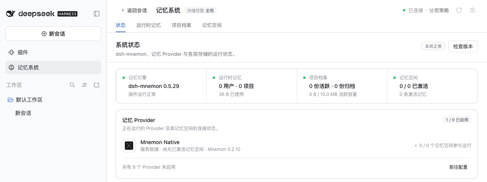

# v0.5.29 release acceptance

[中文](README.zh-CN.md) | [Validation record](validation.json)

Verified on 2026-10-14 (Asia/Shanghai). The packages under test are the four that 0.5.29 changes, as `pnpm release:version` builds them from `main` `c10073bf`, which includes #371, #372 and #375 to #382: `dsh-mnemon@0.5.29`, `dsh-mnemon-source-memory-spaces@0.5.19`, `dsh-mnemon-provider-openviking@0.5.8` and `dsh-mnemon-provider-hindsight@0.5.6`. The other 14 component packages come from npm at the Starter's pinned versions, which 0.5.29 does not change. `main` then gained #383, which changes one test file and no published file.

Each host is unmodified npm DSH, run with Node `24.19.0` and a fresh home, DSH home and pnpm store: `0.2.0-rc.2` (npm `latest` and `next`) and `0.2.1-alpha.2` (npm `alpha`). A loopback registry answered with npm's real metadata plus the four new versions. Every step passed on both hosts.

## A fresh installation from the official WebUI

1. Started the host without Mnemon installed and opened **Plugins → Add plugin**.
2. Installed `dsh-mnemon`. DSH chose the install source itself; its speed check picked the mainland China mirror. The profile then held the four new versions, with every other component at its pinned npm version.
3. Clicked **Enable now**; the Memory System appeared without a host restart. Status reports **dsh-mnemon 0.5.29 / System nominal**, and Mnemon Native names **Mnemon 0.2.10**: [0.2.0-rc.2](status.jpg), [0.2.1-alpha.2](status-alpha.jpg).
4. Added a Runtime memory entry and read it back after reloading the page: [Runtime](runtime.jpg).
5. Created a Mnemon Native space in the WebUI and activated it on its card: [Memory Spaces](spaces.jpg). Wrote a fact with Mnemon CLI `0.2.10`, recalled it with the CLI, then found the same fact with the WebUI's **Direct search**: [Recall](recall.jpg).
6. Wrote three more memories with the CLI that carry the entity `Atlas`, and one that only mentions Atlas. On **Entities**, `Atlas` counts 3 and lists exactly those three; **Find related memories** found the one that only mentions it: [Entities](entities.jpg), [Related memories](entities-related.jpg).
7. Opened **Check versions**. dsh-mnemon lists 0.5.29 as installed. Before publication npm's latest is still 0.5.28, so the dialog marks 0.5.29 as a local version and offers no update for it.

## An update from v0.5.28

1. Installed `dsh-mnemon@0.5.28` from npm before starting the WebUI. Status reported **dsh-mnemon 0.5.28 / System nominal**, and Check versions called it up to date.
2. Updated from the command line, as the release notes say for a host without pnpm on its PATH: `dsh plugin --profile web add dsh-mnemon@0.5.29`. Check versions cannot offer the candidates before publication, because it asks npm for the latest version.
3. Restarted DSH. Status reports **dsh-mnemon 0.5.29 / System nominal**, with Runtime memory, Project Documents and Memory Spaces in place: [Status after the update](update-status.jpg). The profile holds the four new versions and the other 14 pinned ones, as after a fresh installation. Neither start logged an activation warning.

Neither host logged a console error. [validation.json](validation.json) has the package digests and the results. Profiles and memories are synthetic.

## Git sync on both hosts

Most of this release changes Git sync, so `pnpm run e2e:sync` ran from the built release branch against each installed DSH: two real Web hosts, a temporary bare repository and the same envelopes the browser sends. It passed **64 of 64** checks on DSH 0.2.0-rc.2 and **64 of 64** on DSH 0.2.1-alpha.2.

## The changes in this release

Each change has its own before-and-after record:
- [Memory Spaces through Git sync](../issue-370-space-merge/README.md) (#376) and [Project Document edits through Git sync](../sync-document-edits/README.md) (#381)
- [Large Mnemon Packs](../issue-368-base64-stack/README.md) (#375) and [GitHub sign-in answered form-encoded](../issue-369-github-form-answers/README.md) (#371)
- [The Memory System after a sync or an import](../memory-view-after-sync/README.md) (#377) and [a failed Merge here only](../sync-merge-failure-message/README.md) (#380)
- [Provider namespaces created later](../issue-373-provider-rediscovery/README.md) (#382)
- [OpenViking 0.4.16 writes](../issue-353-openviking-write/README.md) (#372), [unreadable OpenViking results](../openviking-unreadable-results/README.md) (#378) and [Hindsight entity names](../hindsight-entity-notes/README.md) (#379)

## Validation and release boundary

The ten pull requests were merged one by one after the same combination had passed the full verification locally (1,946 root tests; 17 plugin repositories and 18 packed artifacts); the merged `main` has exactly the tree that passed. `main`'s first CI run then failed once in Verify packed plugins: a new Rediscover page test took 5.5 seconds against the default 5-second limit while every plugin ran from its own install. #383 gave those tests the 15-second limit the plugin's other page tests use, and its CI passed.

`pnpm run release:check` confirms the Starter 0.5.29 on the `latest` tag with its three new pins, and `pnpm run release:intent` matches the consumed changesets to the four packages. No peer floor moves: Memory Spaces keeps `dsh-mnemon ^0.5.19` and the two Providers keep `dsh-mnemon-source-memory-spaces ^0.5.1`, since none uses a new export. The version bump changes eight specifier lines in the lockfile, and pnpm 10.13.1, the CI version, accepts it with `--frozen-lockfile`. With the versions stamped, `pnpm run verify` passes again (1,946 root tests) and the package measures 59 files and 1,937,543 unpacked bytes, under the 2,500,000-byte ceiling.

The release pull request and the publication workflow run the complete workspace and packed-plugin verification. Publication then checks the complete pinned composition, a registry installation and a real upgrade before it creates the GitHub release.
