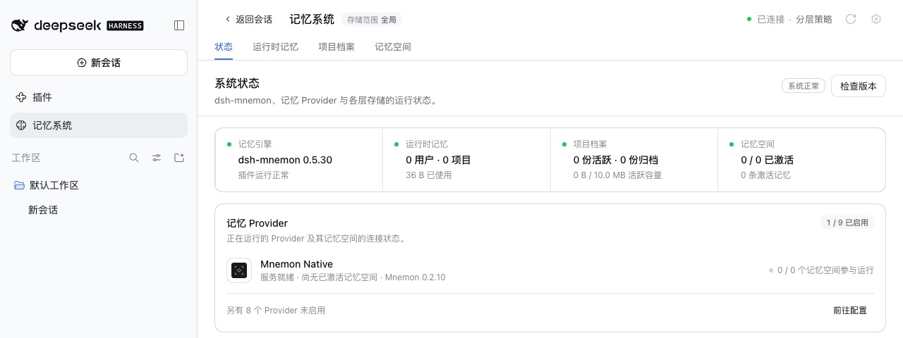

# v0.5.30 发布验收

[English](README.md) | [验证记录](validation.json)

验收于 2026-10-17（Asia/Shanghai）。受测的是 0.5.30 变更的三个包，即 `pnpm release:version` 基于 `main` `3358c270`（包含 #398 至 #407）构建出的 `dsh-mnemon@0.5.30`、`dsh-mnemon-source-memory-spaces@0.5.20` 与 `dsh-mnemon-strategy-default-three-tier@0.5.9`。其余 15 个组件包按 Starter 锁定的版本取自 npm，0.5.30 未改变它们。

每个宿主都是未经修改的 npm DSH，使用 Node `24.19.0` 以及全新的 home、DSH home 与 pnpm store：`0.2.0-rc.2`（npm `latest` 与 `next`）和 `0.2.1-alpha.2`。本地回环 registry 返回 npm 的真实元数据，外加这三个新版本。两个宿主上每一步都通过。

## 在官方 WebUI 中全新安装

1. 启动未安装 Mnemon 的宿主，打开**插件 → 添加插件**。
2. 安装 `dsh-mnemon`。安装源由 DSH 自行选择，测速选中了中国大陆镜像。随后 Profile 中是这三个新版本，其余组件均为锁定的 npm 版本。
3. 点击**立即启用**，无需重启宿主即出现记忆系统。状态页显示 **dsh-mnemon 0.5.30 / 系统正常**，Mnemon Native 显示 **Mnemon 0.2.10**：[0.2.0-rc.2](status.jpg)、[0.2.1-alpha.2](status-alpha.jpg)。
4. 添加一条运行时记忆，刷新页面后读回：[运行时记忆](runtime.jpg)。
5. 在 WebUI 中创建 Mnemon Native 空间，并在卡片上激活：[记忆空间](spaces.jpg)。用 Mnemon CLI `0.2.10` 写入一条事实并用 CLI 召回，再用 WebUI 的**直接检索**找到同一条事实：[检索](recall.jpg)。
6. 用 CLI 再写入三条带有实体 `Atlas` 的记忆，以及一条只在正文中提到 Atlas 的记忆。在**实体**页，`Atlas` 计数为 3，恰好列出这三条；**查找相关记忆**找到了只提到它的那一条：[实体](entities.jpg)、[相关记忆](entities-related.jpg)。
7. 打开**检查版本**。dsh-mnemon 显示已安装 0.5.30。发布前 npm 的最新版本仍是 0.5.29，所以对话框把 0.5.30 标为本地版本，不提供更新。

## 从 v0.5.29 更新

1. 启动 WebUI 前先从 npm 安装 `dsh-mnemon@0.5.29`。状态页显示 **dsh-mnemon 0.5.29 / 系统正常**，检查版本显示已是最新。
2. 按发布说明中对 PATH 上没有 pnpm 的宿主的做法，从命令行更新：`dsh plugin --profile web add dsh-mnemon@0.5.30`。发布前检查版本无法提供候选版本，因为它向 npm 查询最新版本。
3. 重启 DSH。状态页显示 **dsh-mnemon 0.5.30 / 系统正常**，运行时记忆、项目档案与记忆空间均在：[更新后的状态](update-status.jpg)。Profile 中是三个新版本与其余 15 个锁定版本，与全新安装相同。两次启动都没有激活警告。

两个宿主都没有控制台错误。[validation.json](validation.json) 记录了包摘要与各项结果。Profile 与记忆均为合成数据。

## 两个宿主上的 Git 同步

本版本有三项改动涉及 Git 同步，因此用构建好的发布分支对每个已安装的 DSH 运行了 `pnpm run e2e:sync`：两个真实的 Web 宿主、一个临时 bare 仓库，以及与浏览器相同的请求封装。DSH 0.2.0-rc.2 与 DSH 0.2.1-alpha.2 上各通过 **64 / 64** 项检查。

## 本版本的改动

各项改动另有前后对比记录：
- [写入指定的记忆空间](../issue-387-explicit-space-target/README.zh-CN.md)（#405）与[未生成向量的记忆](../issue-388-unembedded-receipt/README.zh-CN.md)（#406）
- [每个记忆空间的向量覆盖率](../issue-392-embedding-coverage/README.zh-CN.md)（#399）
- [合并之后的记忆空间副本](../issue-391-space-merge-edges/README.zh-CN.md)（#398）、[同步镜像中未跟踪的文件](../issue-396-sync-mirror-clean/README.zh-CN.md)（#401）与[从 0.5.28 更新后的第一次同步](../issue-385-document-agreement-upgrade/README.zh-CN.md)（#404）
- [超出回合预算的召回](../issue-389-recall-budget/README.zh-CN.md)（#402）与[工具回答](../issue-390-tool-consistency/README.zh-CN.md)（#407）
- [第二个运行时 Source](../issue-397-default-runtime-instance/README.zh-CN.md)（#400）与[委派任务的第一行](../issue-393-delegated-prompt-marker/README.zh-CN.md)（#403）

## 验证与发布边界

这十个 PR 是在同一组合于本地通过完整校验（`pnpm run verify`：2,000 项主包测试、所有插件测试、确定性构建、Headless 与发布包检查）之后逐个合并的。合并后的 `main` 与通过校验的文件树完全一致，其 CI 在 `3358c270` 上通过。每个 PR 合并前 CI 均已通过；#402 的一项 Windows 检查曾因一个无关的临时文件清理失败一次，重跑后通过。

`pnpm run release:check` 确认 `latest` 标签上的 Starter 0.5.30 及其两个新的锁定版本，`pnpm run release:intent` 确认已消费的 changeset 与这三个包对应。peer 下限不变：记忆空间保持 `dsh-mnemon ^0.5.19`，分层策略保持 `dsh-mnemon ^0.5.17`，因为它们都没有用到新的导出。版本号变更修改了锁文件中的四行 specifier，CI 使用的 pnpm 10.13.1 以 `--frozen-lockfile` 接受它。写入版本号后，`pnpm run verify` 再次通过（2,000 项主包测试），包含 59 个文件、解包后 1,972,633 字节，低于 2,500,000 字节的上限。

发布 PR 与发布工作流会再次运行完整的工作区与打包插件校验。随后，发布流程会在创建 GitHub Release 前检查完整的锁定组合、一次 Registry 安装与一次真实升级。
