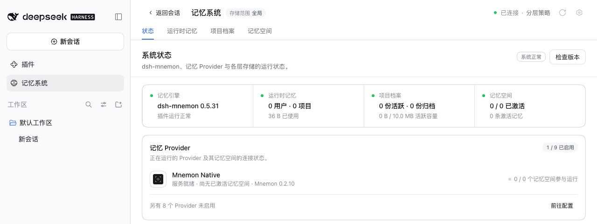

# v0.5.31 发布验收

[English](README.md) | [验证记录](validation.json)

验收于 2026-10-17（Asia/Shanghai）。受测的是 0.5.31 变更的两个包，即 `pnpm release:version` 基于 `main` `af602afc`（包含 #394、#354、#386 以及 #410 至 #412）构建出的 `dsh-mnemon@0.5.31` 与 `dsh-mnemon-source-memory-spaces@0.5.21`。其余 16 个组件包按 Starter 锁定的版本取自 npm，0.5.31 未改变它们。

每个宿主都是未经修改的 npm DSH，使用 Node `24.19.0` 以及全新的 home、DSH home 与 pnpm store：`0.2.1-rc.1`（npm `next`）和 `0.2.0-rc.2`（npm `latest`），即本版本支持的两个 DSH 版本。本地回环 registry 返回 npm 的真实元数据，外加这两个新版本。两个宿主上每一步都通过。

## 在官方 WebUI 中全新安装

1. 启动未安装 Mnemon 的宿主，打开**插件 → 添加插件**。在 DSH 0.2.1-rc.1 上，没有配置模型的新用户会先看到**开始使用**对话框，提示登录或添加 API Key；关闭后，WebUI 其余部分照常可用。
2. 安装 `dsh-mnemon`。安装源由 DSH 自行选择，测速选中了中国大陆镜像。随后 Profile 中是这两个新版本，其余组件均为锁定的 npm 版本。
3. 点击**立即启用**，无需重启宿主即出现记忆系统。状态页显示 **dsh-mnemon 0.5.31 / 系统正常**，Mnemon Native 显示 **Mnemon 0.2.10**：[0.2.0-rc.2](status.jpg)、[0.2.1-rc.1](status-rc1.jpg)。
4. 添加一条运行时记忆，刷新页面后读回：[运行时记忆](runtime.jpg)。
5. 在 WebUI 中创建 Mnemon Native 空间，并在卡片上激活：[记忆空间](spaces.jpg)。用 Mnemon CLI `0.2.10` 写入一条事实并用 CLI 召回，再用 WebUI 的**直接检索**找到同一条事实：[检索](recall.jpg)。
6. 用 CLI 再写入三条带有实体 `Atlas` 的记忆，以及一条只在正文中提到 Atlas 的记忆。在**实体**页，`Atlas` 计数为 3，恰好列出这三条；**查找相关记忆**找到了只提到它的那一条：[实体](entities.jpg)、[相关记忆](entities-related.jpg)。
7. 打开**检查版本**。dsh-mnemon 显示已安装 0.5.31。发布前 npm 的最新版本仍是 0.5.30，所以对话框把 0.5.31 标为本地版本，不提供更新。

## 从 v0.5.30 更新

1. 启动 WebUI 前先从 npm 安装 `dsh-mnemon@0.5.30`。状态页显示 **dsh-mnemon 0.5.30 / 系统正常**，检查版本显示已是最新。
2. 从命令行更新：`dsh plugin --profile web add dsh-mnemon@0.5.31`。在 DSH 0.2.1-rc.1 上这是文档给出的做法，因为 0.5.30 的**检查版本 → 更新**在那里会停在 `already-installed`。在 DSH 0.2.0-rc.2 上，发布前检查版本无法提供候选版本，因为它向 npm 查询最新版本。
3. 重启 DSH。状态页显示 **dsh-mnemon 0.5.31 / 系统正常**，运行时记忆、项目档案与记忆空间均在：[更新后的状态](update-status.jpg)。Profile 中是两个新版本与其余 16 个锁定版本，与全新安装相同。两次启动都没有激活警告。

两个宿主都没有控制台错误。[validation.json](validation.json) 记录了包摘要与各项结果。Profile 与记忆均为合成数据。

## 两个宿主上的 Git 同步

本版本改变了 Git 同步的内容校验（#394），以及在 DSH 0.2.1 上合并同步时的子 Agent（#386），因此用构建好的发布分支对每个已安装的 DSH 运行了 `pnpm run e2e:sync`：两个真实的 Web 宿主、一个临时 bare 仓库，以及与浏览器相同的请求封装。DSH 0.2.0-rc.2 与 DSH 0.2.1-rc.1 上各通过 **64 / 64** 项检查。

## 本版本的改动

- [dsh-mnemon 在 DSH 0.2.1-rc.1 与 0.2.0-rc.2 上](../dsh-021-rc1/README.zh-CN.md)（#386），延续同一 PR 中[在 DSH 0.2.1-alpha.3 上的适配](../dsh-021-alpha3/README.zh-CN.md)
- [可以跟随会话的任务 Agent](../background-tasks-card/README.zh-CN.md)（#354）
- [空闲审查及其任务 Agent 统一命名](../idle-review-wording/README.zh-CN.md)（#410）
- [移除无人使用的代码](../remove-dead-code/README.zh-CN.md)（#411）与[文档导航](../docs-navigation/README.zh-CN.md)（#412）
- #394 的测试随 PR 提交：索引与正文不一致的项目档案内容，在任何发布或导入的位置都会被拒绝。

## 验证与发布边界

这六个 PR 按顺序合并。合并后的 `main` `af602afc` 在本地通过完整校验：`pnpm run verify`（2,035 项主包测试、所有插件测试、确定性构建、Headless 与发布包检查）、`pnpm run verify:plugins`，以及在已安装的 DSH 0.2.0-rc.2 上运行的同一组主包测试（`pnpm run test:installed-dsh`）。它的 CI 已通过，`c00e6d7a`（#394）与 `7b7efa49`（#354）上的 CI 也通过；中间几次合并的运行被下一次推送取消。除 #394 外，每个 PR 的最终提交在合并前都通过了 CI；#394 来自贡献者的 fork，分支上只运行了贡献信息检查，合并后由 main 的 CI 覆盖。

`pnpm run release:check` 确认 `latest` 标签上的 Starter 0.5.31 及其一个新的锁定版本，`pnpm run release:intent` 确认已消费的 changeset 与这两个包对应。peer 下限不变：记忆空间保持 `dsh-mnemon ^0.5.19`，因为它没有用到新的导出。版本号变更修改了锁文件中的两行 specifier，CI 使用的 pnpm 10.13.1 以 `--frozen-lockfile` 接受它。DSH 0.2.1-rc.1 的开发依赖发布未满一天，pnpm 11 暂不安装，所以仓库的构建与测试和 CI 一样使用 pnpm 10.13.1；DSH 宿主内的插件安装使用 pnpm 11.25。写入版本号后，`pnpm run verify` 再次通过（2,035 项主包测试；加上本 PR 新增的测试为 2,036 项），不带 Mnemon CLI 的 `pnpm run verify:plugins`（17 个插件仓库、18 个打包产物）以及在已安装的 DSH 0.2.0-rc.2 上运行的主包测试也都通过。发布包包含 59 个文件、解包后 1,993,128 字节，低于 2,500,000 字节的上限。

发布工作流在创建 GitHub Release 前的最后一项检查，会在 Headless profile 中从 Registry 上较早的版本升级。它原先从 0.5.16 开始，而 0.5.16 只声明支持 DSH 0.1，锁定的 DSH 0.2.1-rc.1 会拒绝安装它，这项检查会在 npm 已有新版本之后才失败。本 PR 改为从 0.5.29 开始，与 `verify:plugins` 的升级起点相同，并用一项测试保证两者一致。按工作流的方式在本地运行、由已验收的候选包提供 0.5.31 时，旧的检查停在 DSH 以与 0.2.1-rc.1 不兼容为由拒绝安装 0.5.16 的地方，新的检查把 0.5.29 升级到 0.5.31，运行时记忆的字节保持不变。

发布 PR 与发布工作流会再次运行完整的工作区与打包插件校验。随后，发布流程会在创建 GitHub Release 前检查完整的锁定组合、一次 Registry 安装与一次真实升级。
