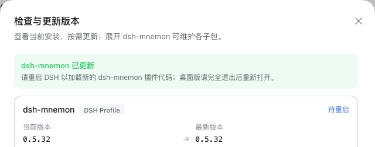

# v0.5.32 发布验收

[English](README.md) | [验证记录](validation.json)

验收于 2026-10-18（Asia/Shanghai）。受测的是 0.5.32 变更的六个包，即 `pnpm release:version` 基于 `main` `244d8985`（包含 #414 至 #430）构建出的 `dsh-mnemon@0.5.32`、`dsh-mnemon-source-runtime@0.5.15`、`dsh-mnemon-source-documents@0.5.11`、`dsh-mnemon-source-memory-spaces@0.5.22`、`dsh-mnemon-strategy-default-three-tier@0.5.10` 与 `dsh-mnemon-strategy-light-context@0.5.6`。其余 12 个组件包按 Starter 锁定的版本取自 npm，0.5.32 未改变它们。

每个宿主都是未经修改的 npm DSH，使用 Node `24.19.0` 以及全新的 home、DSH home 与 pnpm store：`0.2.1-rc.2`（npm `next`）和 `0.2.0-rc.2`（npm `latest`）。本地回环 registry 返回 npm 的真实元数据，外加这六个新版本。dsh-mnemon 的版本检查自己向 npm 发出请求，不经过 pnpm，因此验收环境把这个请求也发往同一个 registry，**检查版本**便像 npm 发布之后那样提供候选版本。每一步在其运行的宿主上都通过；从 v0.5.30 更新只在 DSH 0.2.1-rc.2 上运行，发布说明只在那里给出这条路径。

## 在官方 WebUI 中全新安装

1. 启动未安装 Mnemon 的宿主，打开**插件 → 添加插件**。在 DSH 0.2.1-rc.2 上，没有配置模型的新用户会先看到一个对话框，提示登录或添加 API Key；关闭后，WebUI 其余部分照常可用。
2. 安装 `dsh-mnemon`。安装源由 DSH 自行选择，测速选中了中国大陆镜像。随后 Profile 中是这六个新版本，其余组件均为锁定的 npm 版本。
3. 点击**立即启用**，无需重启宿主即出现记忆系统。状态页显示 **dsh-mnemon 0.5.32 / 系统正常**，Mnemon Native 显示 **Mnemon 0.2.10**：[0.2.1-rc.2](status.jpg)、[0.2.0-rc.2](status-020.jpg)。
4. 添加一条运行时记忆，刷新页面后读回：[运行时记忆](runtime.jpg)。
5. 在 WebUI 中创建 Mnemon Native 空间，并在卡片上激活：[记忆空间](spaces.jpg)。用 Mnemon CLI `0.2.10` 写入一条事实并用 CLI 召回，再用 WebUI 的**直接检索**找到同一条事实：[检索](recall.jpg)。
6. 用 CLI 再写入三条带有实体 `Atlas` 的记忆，以及一条只在正文中提到 Atlas 的记忆。在**实体**页，`Atlas` 计数为 3，恰好列出这三条；**查找相关记忆**找到了只提到它的那一条：[实体](entities.jpg)、[相关记忆](entities-related.jpg)。
7. 打开**检查版本**。dsh-mnemon 显示已安装 0.5.32，已是最新。

## 通过检查版本从 v0.5.31 更新

1. 启动 WebUI 前先从 npm 安装 `dsh-mnemon@0.5.31`。状态页显示 **dsh-mnemon 0.5.31 / 系统正常**，**检查版本**提供 0.5.32。
2. 在 dsh-mnemon 上点击**更新**。两个宿主上，对话框都显示 **dsh-mnemon 已更新**，并提示重启 DSH：[更新后的检查版本](update-versions.jpg)。在 DSH 0.2.1 上，这是 0.5.31 修复后才可用的更新；0.5.30 及更早版本会停在 `already-installed`。
3. 重启 DSH。状态页显示 **dsh-mnemon 0.5.32 / 系统正常**，与全新安装后的页面相同（两张截图完全一致），检查版本显示 0.5.32 已是最新：[更新后的状态](update-status.jpg)。Profile 中 17 个组件均为 Starter 锁定的版本，包括五个新版本，与全新安装相同。两次启动都没有激活警告。

## 在 DSH 0.2.1-rc.2 上从 v0.5.30 更新

发布说明让 DSH 0.2.1 上的较早安装改为执行一次精确安装，本次验收按说明操作：

1. 启动 WebUI 前先从 npm 安装 `dsh-mnemon@0.5.30`。**检查版本**提供 0.5.32，点击**更新**后停在 `DSH could not install dsh-mnemon@0.5.32: already-installed`，与说明一致。
2. 运行 `dsh plugin --profile web add dsh-mnemon@0.5.32`，再重启 DSH。状态页显示 **dsh-mnemon 0.5.32 / 系统正常**，Profile 中是与全新安装相同的 17 个锁定组件，两次启动都没有激活警告。

两个宿主都没有控制台错误。[validation.json](validation.json) 记录了包摘要与各项结果。Profile 与记忆均为合成数据。

## 两个宿主上的 Git 同步

本版本让 Git 同步与备份复制的文件改由各 Source 自己的 contracts 给出（#416），并让同步检查只有一个归属（#426），因此用构建好的发布分支对每个已安装的 DSH 运行了 `pnpm run e2e:sync`：两个真实的 Web 宿主、一个临时 bare 仓库，以及与浏览器相同的请求封装。DSH 0.2.0-rc.2 与 DSH 0.2.1-rc.2 上各通过 **64 / 64** 项检查。

## 本版本的改动

- [未生成向量的存入改为中性提示](../neutral-vector-note/README.zh-CN.md)（#427），这是用户能看到的一项改动
- [记忆空间自带设置与文案](../spaces-owns-settings/README.zh-CN.md)（#421）
- [DSH 0.2.1-rc.2 上的 dsh-mnemon](../dsh-021-rc2/README.zh-CN.md)（#420）
- [策略声明自己驱动的后台工作](../strategy-workflows/README.zh-CN.md)（#414）、[各 Source 拥有自己的存储格式](../source-owned-formats/README.zh-CN.md)（#416）、[共享的值、通信类型与同步检查各归一处](../contracts-one-owner/README.zh-CN.md)（#426）
- [Host 模块拆分](../host-module-splits/README.zh-CN.md)（#428）、[客户端模块拆分](../client-module-splits/README.zh-CN.md)（#425）、[记忆工具集中到一张表](../memory-tool-table/README.zh-CN.md)（#418）、[小规模清理](../small-cleanups/README.zh-CN.md)（#423）、[把测试工具从 PR 记录移入仓库](../test-tooling-from-records/README.zh-CN.md)（#419）
- 文档：[重新组织](../docs-restructure/README.zh-CN.md)（#415）、[v0.5.32 WebUI 图集](../webui-gallery-v0532/README.zh-CN.md)（#424）及其[开启嵌入服务后的重新截取](../webui-gallery-embedding/README.zh-CN.md)（#429），以及路线图与设计计划：[审查发现的缺口](../roadmap-review-gaps/README.zh-CN.md)（#417）、[两个术语与两项新计划](../extensions-terms-roadmap/README.zh-CN.md)（#422）和[又五项缺口](../plan-more-gaps/README.zh-CN.md)（#430）

## 验证与发布边界

这 17 个 PR 按顺序合并，每次合并后的 CI 都通过，最后一次在 `main` `244d8985`（#430）上。

`pnpm run release:check` 确认 `latest` 标签上的 Starter 0.5.32 及其五个新的锁定版本，`pnpm run release:intent` 确认已消费的 12 个 changeset 与这六个包对应。peer 下限不变。#421 的记录曾建议把记忆空间的下限提高到本版本，但记忆空间只在检测到 #421 新增的客户端组件后才用它们绘制设置，与较早的 Starter 一起使用时由那个 Starter 绘制设置，因此保持 `dsh-mnemon ^0.5.19`，#427 的记录对存入回执也得出同样的结论；其他插件没有用到新的导出。版本号变更只修改了锁文件中的 specifier 行，CI 使用的 pnpm 10.13.1 以 `--frozen-lockfile` 接受它。DSH 0.2.1-rc.2 的开发依赖发布未满一天，pnpm 11 暂不安装，所以仓库的构建与测试和 CI 一样使用 pnpm 10.13.1；DSH 宿主内的插件安装使用 pnpm 11.25。写入版本号后，`pnpm run verify` 通过（2,122 项主包测试、所有插件测试、确定性构建、Headless 与发布包检查），不带 Mnemon CLI 的 `pnpm run verify:plugins`（17 个插件仓库、18 个打包产物）以及在已安装的 DSH 0.2.0-rc.2 上运行的主包测试也都通过。发布包包含 66 个文件、解包后 2,035,598 字节，低于 2,500,000 字节的上限。

发布工作流在创建 GitHub Release 前的最后一项检查，会在 Headless profile 中从 Registry 上的 0.5.29 升级。按工作流的方式在本地运行，在锁定的 DSH 0.2.1-rc.2 上由已验收的候选包提供 0.5.32 时，它把 0.5.29 升级到 0.5.32，运行时记忆的字节保持不变，并检查旧设置导入、禁用开关与三个可选策略。

发布 PR 与发布工作流会再次运行完整的工作区与打包插件校验。随后，发布流程会在创建 GitHub Release 前检查完整的锁定组合、一次 Registry 安装与一次真实升级。
