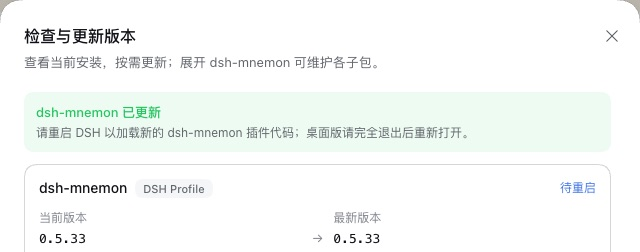

# v0.5.33 release acceptance

[中文](README.zh-CN.md) | [Validation record](validation.json)

Verified on 2026-10-20 (Asia/Shanghai). The package under test is the one 0.5.33 changes, `dsh-mnemon@0.5.33`, as `pnpm release:version` builds it from `main` `708807c1`, which includes #437 to #441. The other 17 component packages come from npm at the Starter's pinned versions, which 0.5.33 does not change.

Each host is unmodified npm DSH, run with Node `24.19.0` and a fresh home, DSH home and pnpm store: `0.2.1-rc.2` (npm `latest` and `next`) and `0.2.0-rc.2`. A loopback registry answered with npm's real metadata plus the new version. dsh-mnemon's version check asks npm with its own request rather than through pnpm, so the harness sent that request to the same registry, and **Check versions** offered the candidate the way it will once npm has it. Every step passed on each host it ran on; the update from v0.5.30 ran on DSH 0.2.1-rc.2, the only host where the release notes give that path.

## A fresh installation from the official WebUI

1. Started the host without Mnemon installed and opened **Plugins → Add plugin**. On DSH 0.2.1-rc.2 a new user without a model first sees a dialog that offers to sign in or add an API key; closing it leaves the rest of the WebUI as usual.
2. Installed `dsh-mnemon`. DSH chose the install source itself; its speed check picked the mainland China mirror. The profile then held the new Starter, with every component at its pinned npm version.
3. Clicked **Enable now**; the Memory System appeared without a host restart. Status reports **dsh-mnemon 0.5.33 / System nominal**, and Mnemon Native names **Mnemon 0.2.11**: [0.2.1-rc.2](status.jpg), [0.2.0-rc.2](status-020.jpg).
4. Added a Runtime memory entry and read it back after reloading the page: [Runtime](runtime.jpg).
5. Created a Mnemon Native space in the WebUI and activated it on its card: [Memory Spaces](spaces.jpg). Wrote a fact with Mnemon CLI `0.2.11`, recalled it with the CLI, then found the same fact with the WebUI's **Direct search**: [Recall](recall.jpg).
6. Wrote three more memories with the CLI that carry the entity `Atlas`, and one that only mentions Atlas. On **Entities**, `Atlas` counts 3 and lists exactly those three; **Find related memories** found the one that only mentions it: [Entities](entities.jpg), [Related memories](entities-related.jpg).
7. Opened **Check versions**. dsh-mnemon lists 0.5.33 as installed and current. On DSH 0.2.0-rc.2 the Mnemon CLI card beside it offered its own npm update, 0.2.11 to 0.2.12, which is not part of this release.

## An update from v0.5.32 through Check versions

1. Installed `dsh-mnemon@0.5.32` from npm before starting the WebUI. Status reported **dsh-mnemon 0.5.32 / System nominal**, and **Check versions** offered 0.5.33.
2. Clicked **Update** on dsh-mnemon. On both hosts the dialog reported **dsh-mnemon updated** and asked for a DSH restart: [Check versions after the update](update-versions.jpg).
3. Restarted DSH. Status reports **dsh-mnemon 0.5.33 / System nominal**, the same page a fresh installation shows (the two screenshots are identical), and Check versions calls 0.5.33 current: [Status after the update](update-status.jpg). The profile holds all 17 components at the Starter's pins, as after a fresh installation. Neither start logged an activation warning.

## An update from v0.5.30 on DSH 0.2.1-rc.2

The release notes give older installations on DSH 0.2.1 one exact install instead, and this pass followed them:

1. Installed `dsh-mnemon@0.5.30` from npm before starting the WebUI. **Check versions** offered 0.5.33, and its **Update** stopped with `DSH could not install dsh-mnemon@0.5.33: already-installed`, as the notes say.
2. Ran `dsh plugin --profile web add dsh-mnemon@0.5.33`, then restarted DSH. Status reports **dsh-mnemon 0.5.33 / System nominal**, the profile holds the same 17 pinned components as a fresh installation, and neither start logged an activation warning.

The desktop app's route for the same case, uninstalling dsh-mnemon on the Plugins page and adding it again, is recorded in [desktop-update-older](../desktop-update-older/README.md).

Neither host logged a console error. [validation.json](validation.json) has the package digest and the results. Profiles and memories are synthetic.

## Git sync on both hosts

This release changes how Git sync hands its token to Git (#441), so `pnpm run e2e:sync` ran from the built release branch against each installed DSH: two real Web hosts, a temporary bare repository and the same envelopes the browser sends. It passed **64 of 64** checks on DSH 0.2.0-rc.2 and **64 of 64** on DSH 0.2.1-rc.2.

## The changes in this release

- [Git sync finds its token whatever Git configures](../issue-408-git-credential-username/README.md) (#441, issue #408)
- [Task Agent sessions out of the conversation lists](../issue-435-task-agent-sessions/README.md) (#438, issue #435)
- [Updating from 0.5.30 and earlier in the desktop app on DSH 0.2.1](../desktop-update-older/README.md) (#437, issues #433 and #436)
- The READMEs end with the star history and a License section (#439, #440)

## Validation and release boundary

The five pull requests were merged in order. #438, #439 and #441 passed CI on their final heads. #440's installed-DSH job failed while installing DSH 0.2.0-rc.2 from npm (a 404 for one AWS SDK tarball), before any test ran, and its other checks passed. #437, documentation only, was merged after its local checks while its CI ran, and passed. On `main`, CI passed on `e268d124` (#438); the runs for #440 and #441 were cancelled by the next push; on `708807c1` (#437) Verify packed plugins timed out once at 5 s in a Memory Spaces client test that none of these pull requests touch, and passed on a rerun.

`pnpm run release:check` confirms the Starter 0.5.33 on the `latest` tag, and `pnpm run release:intent` matches the three consumed changesets to it. No plugin version or peer floor moves, and the lockfile does not change. The repository's builds and tests ran with pnpm 10.13.1, as CI does; inside the DSH hosts, DSH's plugin installs used pnpm 11.25. With the version stamped, `pnpm run verify` passes (2,147 root tests, every plugin suite, the deterministic build, Headless and package checks), as do `pnpm run verify:plugins` without a Mnemon CLI (17 plugin repositories, 18 packed artifacts) and the root tests against the installed DSH 0.2.0-rc.2 (2,144). The package measures 66 files and 2,047,510 unpacked bytes, under the 2,500,000-byte ceiling.

The publication workflow's last check before the GitHub release upgrades a Headless profile from 0.5.29 on the registry. Run locally the way the workflow runs it, on the pinned DSH 0.2.1-rc.2 with 0.5.33 served from the accepted candidate, it upgrades 0.5.29 to 0.5.33 without changing the Runtime Memory bytes, and checks the legacy settings import, the disable gate and the three optional Strategies.

The release pull request and the publication workflow run the complete workspace and packed-plugin verification. Publication then checks the complete pinned composition, a registry installation and a real upgrade before it creates the GitHub release.
