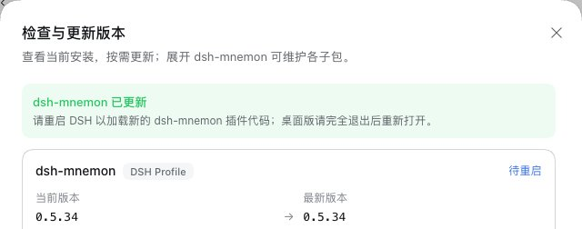

# v0.5.34 release acceptance

[中文](README.zh-CN.md) | [Validation record](validation.json)

Verified on 2026-10-21 (Asia/Shanghai). The packages under test are the two 0.5.34 changes, `dsh-mnemon@0.5.34` and the new `dsh-mnemon-source-skills@0.5.1`, as `pnpm release:version` builds them from `main` `5bfbd7c9`, the merge of #443. The other 17 component packages come from npm at the Starter's pinned versions, which 0.5.34 does not change.

Each host is unmodified npm DSH, run with Node `22.22.0` and a fresh home, DSH home and pnpm store: `0.2.1-rc.2` (npm `latest` and `next`) and `0.2.0-rc.2`. A loopback registry answered with npm's real metadata plus the two candidates. dsh-mnemon's version check asks npm with its own request rather than through pnpm, so the harness sent that request to the same registry, and **Check versions** offered the candidate the way it will once npm has it. Every step passed on both hosts unless this record says otherwise.

## A fresh installation from the official WebUI

1. Started the host without Mnemon installed and opened **Plugins → Add plugin**. A new user without a model first sees a dialog that offers to sign in or add an API key (DSH 0.2.1-rc.2) or to enter an API key (DSH 0.2.0-rc.2); closing it, or choosing to configure later, leaves the rest of the WebUI as usual. No key was entered.
2. Installed `dsh-mnemon` from the registry DSH showed as its install source. The dialog reported **dsh-mnemon, version 0.5.34** with the new description: [Add plugin](install.jpg). The profile then held the new Starter, with all 18 components at their pinned versions, `dsh-mnemon-source-skills` 0.5.1 among them.
3. Clicked **Enable now**; the Memory System appeared without a host restart, with **Skills** as its fifth tab. Status reports **dsh-mnemon 0.5.34 / System nominal** and a Skills card with **0 skills, self-evolution off**: [0.2.1-rc.2](status.jpg), [0.2.0-rc.2](status-020.jpg).
4. Created a skill, `release-check`, from **New** on the Skills page. It was written to `~/.dsh/skills/release-check/SKILL.md` of that host and listed under **User**: [Skills](skills.jpg) (the home path in the detail is blurred). On DSH 0.2.1-rc.2, typing `/release` in the conversation offered it in DSH's own menu with its description: [the `/` menu](slash.jpg). DSH 0.2.0-rc.2's `/` menu lists commands only, not skills, so this step has no counterpart there.
5. Under **Plugins → 可组合记忆 (dsh-mnemon)**, Skills is a row of **Memory composition**, running and tagged **实验性 (Experimental)**: [Plugins](plugin.jpg). On its page, turning **Self-evolution** on showed **Backtest drafts** and **Review parameters**, saved `skills.evolution: true` in the profile, and changed the Status card to **self-evolution on** without a restart; turning it off again restored the default: [Skills' settings](settings.jpg).
6. Added a Runtime memory entry and read it back after reloading the page: [Runtime](runtime.jpg).
7. Opened **Check versions**: dsh-mnemon lists 0.5.34 as installed and current, with 18 sub-packages, and the Mnemon CLI 0.2.12 as current.

## An update from v0.5.33 through Check versions

1. Installed `dsh-mnemon@0.5.33` from npm before starting the WebUI. Status reported **dsh-mnemon 0.5.33**, the Memory System had no Skills tab, and **Check versions** offered 0.5.34.
2. Clicked **Update** on dsh-mnemon. On both hosts the dialog reported **dsh-mnemon updated** and asked for a DSH restart: [Check versions after the update](update-versions.jpg).
3. Restarted DSH. Status reports **dsh-mnemon 0.5.34 / System nominal** with the Skills card, and the Memory System shows the Skills tab: the same page a fresh installation shows (the two screenshots are identical): [Status after the update](update-status.jpg). The profile holds all 18 components at the Starter's pins, as after a fresh installation. Neither start logged an activation warning.

No browser console error was logged on either host. [validation.json](validation.json) has the package digests and the results. Profiles, memories and skills are synthetic.

## The change in this release

- [Skills, an experimental component for DSH skills that improve with use](https://github.com/omdsh-dev/dsh-mnemon/pull/443) (#443): its [guide](../../en/guides/skills.md), [plan](../../plans/skill-management.md) and [gallery](../../assets/skills-v0.5.34/README.md).

## Validation and release boundary

#443 passed CI on its final head, `d188cc02`, on both supported DSH releases, and was merged as `5bfbd7c9`.

`pnpm run release:check` confirms the Starter 0.5.34 on the `latest` tag with `dsh-mnemon-source-skills` 0.5.1 in its composition, and `pnpm run release:intent` matches the consumed changeset to both packages. The new package's `dsh-mnemon` peer range stays `^0.5.33`: everything it imports from dsh-mnemon's SDK and client exists in 0.5.33. The lockfile changes only the two specifiers the version bump touches: the Starter's pin of `dsh-mnemon-source-skills` and that package's development range for `dsh-mnemon`. With the version stamped, `pnpm run verify` passes the documentation, type, deterministic-build and plugin checks (every plugin suite, the Skills Source's 39 tests included) and 2,167 root tests, with 7 skipped; `pnpm run verify:headless` and `pnpm run verify:package` pass; and the root tests against the installed DSH 0.2.0-rc.2 pass 2,164, with 10 skipped. In both root runs one test fails on this machine: *Git sync over HTTPS reports a credential the host refuses as an authentication failure*, which the local Git 2.54.0 classifies as `unknown`. This release changes no Git sync code, and CI passes the test. `pnpm run verify:plugins` passed in CI on Node 24; locally, Node 22's npm 10.9.4 fails while resolving the artifacts' peer sets, before any test runs. The package measures 66 files and 2,153,561 unpacked bytes, under the 2,500,000-byte ceiling.

The publication workflow's last check before the GitHub release upgrades a Headless profile from 0.5.29 on the registry. Run locally the way the workflow runs it, on the pinned DSH 0.2.1-rc.2 with 0.5.34 served from the accepted candidates, it upgrades 0.5.29 to 0.5.34 without changing the Runtime Memory bytes, and checks the legacy settings import, the disable gate and the three optional Strategies.

The release pull request and the publication workflow run the complete workspace and packed-plugin verification. Publication then checks the complete pinned composition, a registry installation and a real upgrade before it creates the GitHub release.
