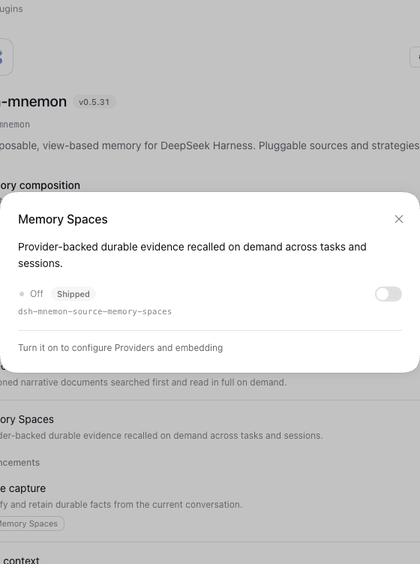
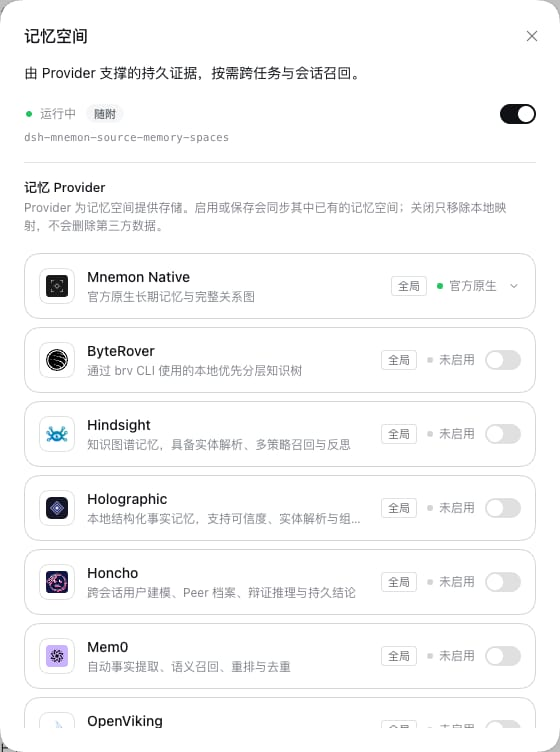
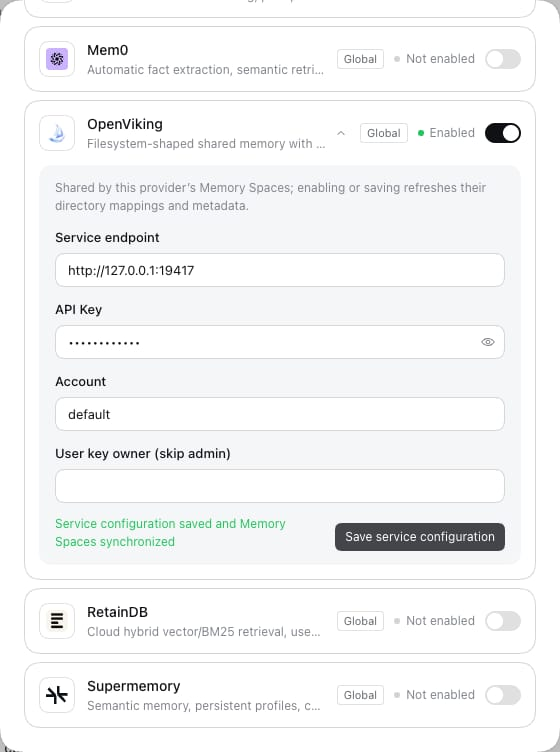

# 记忆空间拥有自己的设置与文案

[English](./README.md)

记忆空间的设置原本由 Starter 代为绘制：Provider 列表、只有 Mnemon Native 读取的嵌入设置和 Mnemon Native 这一行都在 `src/client` 中，记忆空间的 122 条文案也在那里，因此记忆空间要改自己的设置，必须等 dsh-mnemon 发布。`ProviderIcon` 与 Provider 标签辅助函数各有两份，同一个 Provider 描述还生成了两套字段表单。本改动把设置与文案交还记忆空间，所有 Provider 字段改由同一个组件绘制，并且无论 profile 运行的是这两个包的哪个版本，都只有一套设置。用户看到和能做的都没有变化：在 DSH 提供的每种语言下，设置、记忆空间的对话框和它的来源列表与 `main` 的渲染结果逐像素、逐元素一致，打开记忆空间时显示的画面也与 `main` 相同。审计发现的三处差异保持原样，已列入路线图（见[留待以后](#留待以后)）。

测试版本：分支 `claude/spaces-owns-settings`，已合并 `main`（到 #420 为止，该 PR 把开发基线移到 DSH 0.2.1-rc.2），2026-10-17，Node 24.19.0、pnpm 10.13.1，针对锁定的 DSH 0.2.1-rc.2 与已安装的 0.2.0-rc.2。下文的 WebUI 运行都在这次合并之前进行，所用 DSH 版本见各自说明。

## 改了什么

**文案。** 122 个键从 `src/client/locales.ts` 移入记忆空间的 `presentation/locales.json`，文字不变：40 个只有它的页面使用（11 个 `common.*` 键、`card.*` 与 `readSources.*`），82 个只有它的设置使用（`config.provider*`、`config.embedding*`、`config.native*`、`spaces.offNote`、`common.inactive` 等）。Starter 照旧把这个文件合并进自己的词典，因此 `MnemonKey` 和两种语言的词典都保留全部键：`tests/fixtures/presentation-baseline.json` 中的文案指纹不变（每种语言 1,341 个键，SHA-256 相同），因为指纹取自合并后的词典。记忆空间的页面先读自己的文案，再读 dsh-mnemon 的，插值方式相同，所以每条文字（包括缺失的）都与以前一致。移过去的设置键中有三个在 `main` 上就已无人使用（`config.providersSpacesOn`、`config.providersSpacesOffTitle`、`config.providersSpacesOffDetail`，是早先设置布局留下的）；它们仍然保留，因为公开的键类型不能少键。

**设置。** Provider 列表、嵌入设置与 Mnemon Native 这一行移入记忆空间的客户端（`src/client/settings.tsx`、`provider-settings.tsx`），唯一留下的 `ProviderIcon` 与 Provider 标签辅助函数一并移入。记忆空间在自己的 `apply()` 中用 `installMemoryComponentUI` 注册它们，与安装的组件注册设置的方式相同。它们读取同样的配置键、调用同样的 Host 操作，RPC 名称与载荷都不变，只是改为通过页面借给它们的 `host`（见下文）。它们像 dsh-mnemon 绘制时一样，通过 DSH 的语言链与 `mnemon` 命名空间翻译：语言链中先遇到 zh 还是 en，就由自己对应语言的文案回答；排在它前面的语言包会先通过该命名空间被询问；自己文案中没有的键也交给该命名空间。因此像 `ja` 这样回退到英文的语言包会显示英文，翻译了该命名空间的语言包也会被采用，与 `main` 相同。

**一个字段组件。** `ProviderField`（`src/client/provider-field.tsx`）绘制所有 Provider 字段，包括配置页上的服务字段和记忆空间对话框中空间的字段，取代原先根据描述生成的两套表单。它共用标签、选项标签与输入框属性，并按各处原来的样子绘制：配置页保留它的类名、标签在旁的复选框、显示所输入内容的按钮，以及已保存凭据的掩码；对话框保留它们的类名、上方的标签、“留空即保留已保存凭据”的提示和清除凭据的选项。两处对已保存凭据的处理不同，统一成一条规则会改变其中一处的显示，所以各自保留。

**页面借出的内容。** 注册在记忆空间键下的设置会收到 `host`；它跟随键而不是注册者，注册在其他键下的设置不会收到。`host.configuration` 读取借给记忆空间的键（`embedding`、`storageScope`、`writeEnabled`），并通过页面带修订栅栏的设置写入，只写它拥有的 `embedding`。`host.operations.read`/`write` 调用为它提供的五个操作（`status-summary`、`embedding-status`、`provider-services`、`embedding-fill`、`provider-service-update`），并且只在页面自己的对话与工作区中执行：拒绝其他操作，也拒绝带 `sessionId` 或 `workspaceId` 的输入，因此在对话之外打开的页面两者都不发送，与 `main` 相同。记忆空间的设置自行发起的读取（`provider-services`、`status-summary`）在相同读取仍在进行时会与之合并，但只合并在配置当前修订下发起的那一次，因为更早发起的读取回答的是已经改变的配置；嵌入测试从不合并，因为它检查的是此刻的连接。`host.retained` 在页面的客户端运行期间，为每个对话与工作区保存设置重新挂载时需要的内容；`host.changed()` 让记忆系统重新读取它的页面。与 Source 页面的 `management` 客户端一样，设置服务和传输层都不会交出。其他包只有抢先注册在记忆空间的键下才能拿到 `host`，而这不会给它超出 DSH 已与所有客户端插件共享的连接之外的任何权限。

**面向插件作者。** `dsh-mnemon/client` 只新增记忆空间的设置用到的内容：`MNEMON_COMPONENT_FALLBACK_PRIORITY`、`host` 的类型，以及 dsh-mnemon 绘制这些设置时所用的控件与样式：`ToggleRow`、`useLive`、`useStaged`、`PanelActions`、`WriteFailure`、`Callout`、`Reveal`、`GlobalLocationSetting` 与 `memorySettingsStyles`。类名表的键是固定的一组，即记忆空间的设置用到的 45 个类名：它们属于 API，因为比 Starter 更旧或更新的已安装记忆空间按名称查找它们，`tests/client-sidebar-css.spec.ts` 保证样式表中每个都在。`PanelActions` 与 `WriteFailure` 接收设置自己的 `t`，因为配置页不会在组件的设置外层设置翻译。后备注册与记忆空间的注册函数不导出。导出该常量是 dsh-mnemon 的承诺（写在常量声明处）：以该优先级保留这些设置，并借给它们 `host`。没有移除或重命名任何导出。[扩展开发](../../zh-CN/development/extensions.md#组件自己的设置与状态卡片)说明了它们。

**客户端类型声明只留在浏览器一侧。** 导出设置控件后，`dsh-mnemon/client` 的类型声明一度通过内部 hook `useScope` 的参数类型连到 Host 协议，进而连到 SDK 对 cordis `Context` 的扩充。在插件的独立安装中，这使 `Context` 分裂成两个类型，`verify:plugins` 中文档 Source 的独立类型检查因测试里的 `Context` 错误而失败，而 `main` 通过。现在 `useScope` 按它读取的结构定义类型，客户端类型声明重新只包含浏览器一侧的文件（21 个，`main` 上 17 个，新增的四个就是导出的控件），`scripts/verify-public-entries.mjs`（属于 `verify:package`）会在它们连到 `src/host/` 或 `src/sdk/`、连到 cordis Context 扩充，或导入 React 与 DSH 基础组件之外的包时失败。

## 无论运行哪个版本，都只有一套设置

profile 可以自行保留一份记忆空间，比 Starter 固定的版本更旧或更新。DSH 在按键注册的区域中，按键与优先级各保留一个条目，并拒绝同一个键在同一优先级上的第二次注册；同一个键的条目中，它渲染优先级数值最低的那个（`@deepseek-ai/dsh-client-ui-slots`，0.2.0-rc.2 与 0.2.1 相同；DSH 的 `renderSlot` 与 `renderComponentRegion` 选取条目的方式也相同）。因此：

- Starter 以 `MNEMON_COMPONENT_FALLBACK_PRIORITY`（100）自行注册记忆空间的设置。记忆空间以默认优先级注册自己的设置后，只要仍在注册，就会替代后备注册；它注销后，后备注册重新出现。所以只要记忆空间自己的客户端没有注册设置，页面就由后备注册绘制：记忆空间关闭时、打开后其客户端加载期间、客户端加载失败或其条目出错时，以及搭配本身没有设置的 0.5.21 及更早的记忆空间时。
- 记忆空间只在 `dsh-mnemon/client` 导出 `MNEMON_COMPONENT_FALLBACK_PRIORITY` 时注册自己的设置。它的客户端包是通过 DSH 模块加载器加载的 CommonJS，读取已加载的 dsh-mnemon 缺少的导出时得到 `undefined`，并且在绘制时才读取较新的导出，而不是在加载时。dsh-mnemon 0.5.31 以默认优先级注册内置设置，在那里注册会被拒绝，而且它不借出 `host`。

后备注册很小：只注册一次 `MemorySpacesSettings`，由 Starter 从记忆空间的公开客户端入口 `dsh-mnemon-source-memory-spaces/client` 取得，即它所固定版本中的实现。Starter 的客户端构建会打包所有导入，因此通过仓库的 TypeScript 路径把这个入口解析到固定版本的源码（`tsdown.config.ts` 在 `alwaysBundle` 中列出它）。只有一个模块 `src/client/memory-spaces-client.ts` 导入组件的实现；它还为“状态”页提供记忆空间的 `ProviderIcon`，那里的 Provider 列表仍由 Starter 绘制。`tests/plugin-repository-boundary.spec.ts` 只允许这一个模块。若改为在 Starter 中保留一份副本，本改动删除的重复文件就会留下。后备设置会出现在 0.5.21 及更早的记忆空间旁边，所以在 Starter 保留它期间，记忆空间带来的设置必须能与这些版本配合；它们使用的五个操作这些版本都能应答。

版本之间还剩一处差异，只在文案中，且只在 zh 与 en 以外的语言下：此时设置像 dsh-mnemon 绘制时一样，先询问 DSH 的 `mnemon` 命名空间，其中是 Starter 固定的记忆空间版本的文案，因此对于两者都有的键，较新的记忆空间自己的措辞只在 zh 与 en 下显示。

| Starter | 记忆空间 | 为记忆空间注册的设置 | 记忆空间客户端运行时显示 | WebUI，DSH 0.2.1-rc.2 与 0.2.0-rc.2 |
|---|---|---|---|---|
| 本分支 | 本分支 | 它自己的（优先级 0）与 Starter 的后备（100） | 它自己的 | 1 套设置，无控制台错误 |
| 本分支 | 0.5.21 | Starter 的后备 | 后备，由固定版本记忆空间的代码绘制 | 1 套设置，无控制台错误 |
| 0.5.31 | 本分支 | 0.5.31 的内置设置；记忆空间不注册 | 0.5.31 的内置设置 | 1 套设置，无控制台错误 |
| 0.5.31 | 0.5.21 | 0.5.31 的内置设置 | 与以前相同 | 1 套设置，无控制台错误 |

`tests/client-component-fallback.spec.tsx` 用 DSH 自己的 `SlotCore` 按各版本的注册方式构造每一行：0.5.31 的 Starter 以默认优先级注册，其 `dsh-mnemon/client` 没有 `MNEMON_COMPONENT_FALLBACK_PRIORITY`；记忆空间 0.5.21 不注册设置。测试检查 DSH 渲染哪个条目、记忆空间的设置是否恰好渲染一套、记忆空间自己的注册注销后后备是否重新出现，以及 DSH 是否拒绝记忆空间在 0.5.31 内置设置旁边注册，这也是记忆空间先做检查的原因。它还通过 `loadMemoryClientArtifact` 加载构建好的记忆空间客户端 `lib/client.js`，搭配一个导出名恰好是 dsh-mnemon 0.5.31 那 40 个的 `dsh-mnemon/client`（`tests/fixtures/dsh-mnemon-client-0.5.31-exports.json`，取自已发布的客户端包）：它的 `apply()` 注册五个页面而不注册设置，它的创建对话框能绘制 Mem0、Hindsight 与 Holographic 的字段，即共用字段模块的开关、选择项与数字。`test:installed-dsh` 还针对 0.2.0-rc.2 的 slot core 运行这些用例。

WebUI 一列来自 e2e fixture：用已发布的 `dsh-mnemon@0.5.31` 与 `dsh-mnemon-source-memory-spaces@0.5.21` 客户端包替换本分支最终的客户端包（只替换 `lib/client.js`，Host 仍是本分支的），在 DSH 0.2.1-rc.2 与 0.2.0-rc.2 上分别运行。八次运行中，插件页里记忆空间的页面每次都只显示一个**记忆 Provider**标题、一张 Mnemon Native 卡片和一行 OpenViking，打开的 OpenViking 表单都是同样四个字段，控制台没有错误。

### 打开记忆空间

从记忆空间的页面打开它，会把后备注册换成记忆空间自己的设置，即来自另一个包的另一份实现，所以设置会重新挂载。前一次挂载把 Provider 列表以及 Host 是否找到 Mnemon CLI 存在 `host.retained` 中；后一次从这些内容开始，它的读取会合并进在相同配置修订下仍在进行的读取。`tests/client-component-fallback.spec.tsx` 在 DSH 的 `SlotCore` 中做了两次替换，一次在首次读取应答之后，一次在读取进行之中：OpenViking 卡片与 Native 卡片的状态都保持不变，没有出现加载中的状态，第二种情况下不发出自己的读取。

在 WebUI 中录制（在最后一次合并 `main` 之前，使用 DSH 0.2.1-rc.2 与 0.2.0-rc.2 的临时安装，英文，1280×800，本分支与 `main` 各录）：从记忆空间的页面先关闭再打开它，每个动画帧采样一次设置，统计页面发出的读取，并保存 Chrome 绘制的组件开关以下设置区域的每一帧。

- 本分支在点击后 85 到 93 ms 显示后备注册的设置，155 到 244 ms 起显示记忆空间自己的设置；`main` 在约 90 ms 起显示唯一一套。两者的每个采样帧都有 8 行 Provider，Native 卡片也相同。
- 每次运行中两者都发送两次 `provider-services` 与 `status-summary`：一次在设置首次显示时，一次在配置修订变化之后；替换没有增加读取。
- 两者绘制的画面经过相同的状态，在两个 DSH 版本上都停在同一帧。其中加载错误与 Native 卡片的 CLI 状态来自两个各自应答的读取，它们出现的先后在两者上都随运行而变：`main` 三次运行中有一次先显示错误、下一帧才显示 CLI 状态，本分支也有一次如此。
- 两者都没有控制台错误。

记忆空间的 Source 启动期间，第一次 `provider-services` 读取会回答 Source 尚未安装，页面显示这个错误直到下一次读取，`main` 也是如此。

## 改动前后

无头 Chrome，1280×800，浅色，在 DSH 0.2.1-rc.1 上的 e2e fixture 中：`main`（含 #418）在单独的 worktree 中构建，与本分支对照，中英文各一次。每次运行依次打开插件页中记忆空间的页面、Mnemon Native 的嵌入设置、OpenViking 的表单（输入前、输入后，以及带凭据保存后；使用仓库中的 OpenViking 协议 fixture `scripts/fixtures/openviking-protocol.mjs` 和占位密钥）、Mem0 的表单（一个选择项和一个凭据字段）与 ByteRover 的表单（路径、它的位置行和凭据字段）、DSH 为记忆空间这一行提供的页面，以及记忆空间页面带 OpenViking 字段的**创建记忆空间**对话框。下表每个视图在 `main` 与本分支上都相同。

| 视图 | `main` 与本分支 |
|---|---|
| 插件页中记忆空间的页面，中文 |  |
| 同上，英文 |  |
| 展开 Mnemon Native 的嵌入设置，中文 |  |
| 同上，英文 |  |
| 带凭据保存的 OpenViking，字段以掩码显示凭据，中文 |  |
| 同上，英文 |  |
| Mem0 的表单：一个选择项，以及带提示的凭据字段，中文 |  |
| 同上，英文 |  |

- 像素：每种语言九个视图中七个完全相同；另外两个在对话框圆角与开关边缘有 5 到 7 个像素相差一到几个色阶，与此前本分支两次截图之间的抗锯齿差异相同。
- 布局：设置下每个元素以及对话框中 Provider 字段的位置尺寸、文字与计算样式都相同。
- 标记：去掉类名中随构建变化的前缀后，两种语言下八个设置视图的标记全部相同。

## 留待以后

本批改动不改变行为，以下几处因此与 `main` 保持一致；它们已列入路线图（[审查差距](../../plans/review-gaps-2026-10.md)）：

- **没有 `readSources.model.<provider>` 文字的 Provider**：在记忆空间页面的来源列表中，它的空间下方是一行空白。记忆空间为随附的九个 Provider 提供了文字；其他 Provider 可以改为显示描述中的名称。
- **已保存凭据的两条规则。** 配置页用十二个圆点填满字段；在选中掩码时输入会整体替换它，但保留部分圆点的编辑（例如移动光标后删掉一个圆点）会把剩下的圆点存为凭据。如果某个 Host 发来已保存的凭据（`secretValues`，dsh-mnemon 从不发送），配置页还会直接显示出来。记忆空间的对话框则让字段保持为空，说明凭据已保存、留空即保留，并提供清除选项。对话框的规则更安全，适合作为统一的规则。
- **`.providerFieldControl` 有两份不同的样式**：配置页的（`MnemonSettingsCard.module.css`）把字段放在纵向排列的底部，复选框没有外边距；页面工具的（`MnemonView.module.css`，记忆空间 0.5.21 的对话框也用它）是网格，复选框上下各有 2 px 外边距。二者不是副本：合并会改变字段在更高的单元格中的位置以及复选框的尺寸，所以两份都保留。

## 兼容性

- **自行固定记忆空间版本的 profile：** 见上表。比本版本更新的记忆空间会像本版本一样用自己的设置替代后备，并以相同的名称读取后备存在 `host.retained` 中的内容。
- **公开 SDK：** 只有上面列出的新增。移除的 `MnemonClient` 方法和删除的 `src/client` 文件从来不是公开入口。记忆空间的客户端入口新增 `MemorySpacesSettings` 与 `ProviderIcon`。
- **peer 最低版本：** 记忆空间的设置使用 `dsh-mnemon/client` 的新导出。它在运行时检查这些导出，并在绘制时才读取，因此搭配较旧的 Starter 仍能工作，但发布 PR 应把它的 `dsh-mnemon` peer 最低版本提高到导出 `MNEMON_COMPONENT_FALLBACK_PRIORITY` 的那一版。
- **存储数据与 Host：** 没有任何设置、键、RPC 名称、载荷或工具发生变化；Host 未改动。`tests/client-component-host.spec.ts` 检查移走的设置发送的 RPC 名称与载荷、限定在页面的范围、哪些读取会被合并与保留的内容；`tests/client-component-reads.spec.tsx` 检查配置改变后发起的测试或 Provider 列表读取会重新询问 Host 并显示其回答。
- **样式：** 没有任何样式规则变化。移走的设置使用 `dsh-mnemon/client` 提供的配置页类名表，相应规则仍归 Starter 所有；对话框继续使用页面工具的样式。
- **文案：** 较旧的 Starter 搭配本版本记忆空间时，自己的词典里仍有每个键；记忆空间优先读取自己的文案，在设置中则通过 DSH 的语言链读取。

## 检查

| 命令 | 结果 |
|---|---|
| `pnpm run typecheck`；`pnpm --filter dsh-mnemon-source-memory-spaces run typecheck` | 通过 |
| `pnpm run test:root` | 2,086 通过，7 跳过（146 个文件） |
| `DSH_HOST_ROOT=<已安装的 0.2.0-rc.2> pnpm run test:installed-dsh` | 2,083 通过，10 跳过（144 个文件） |
| `pnpm --filter dsh-mnemon-source-memory-spaces run test` | 287 通过，2 跳过（26 个文件） |
| `pnpm run verify` | 通过，用时 126 秒：4,640 个链接与 342 个锚点，54 个文件的确定性构建，17 个插件测试套件 587 通过、3 跳过，根测试同上，Headless，64 个文件的包与 21 个浏览器一侧的客户端类型声明 |
| `MNEMON_CLI_PATH=/nonexistent/mnemon MNEMON_PLUGIN_VERIFY_CONCURRENCY=1 pnpm run verify:plugins` | 通过，用时 196 秒：17 个独立插件仓库与 18 个打包产物 |
| `pnpm run release:intent`（基准：合并后的 `main`） | 通过：`dsh-mnemon` 与 `dsh-mnemon-source-memory-spaces` 的 changeset 覆盖 |

新增测试：`tests/client-component-fallback.spec.tsx`（上表四行、在首次读取之后与之中的替换，以及构建好的记忆空间客户端搭配 0.5.31 的导出）；`tests/client-component-host.spec.ts`（`host` 借出和拒绝的内容、限定在页面的范围、哪些读取会被合并与保留的内容，以及 RPC 名称与载荷，随客户端方法一起从 `tests/client-api.spec.ts` 移来）；`tests/client-component-reads.spec.tsx`（更改 Endpoint 后的嵌入测试，以及更改存储范围后的 Provider 列表，在较早的读取仍在进行时都会重新询问 Host）；`tests/client-sidebar-css.spec.ts` 中的类名检查；记忆空间的 `tests/settings.spec.tsx`（字段在各处的绘制方式，包括两条凭据规则；语言链；它自己的设置基于借来的 `host` 工作；按 dsh-mnemon 版本决定是否注册）。`tests/client-settings.spec.tsx` 中原有的设置测试改为在 Starter 借出的 host 上渲染记忆空间的设置，断言不变，全部通过。
