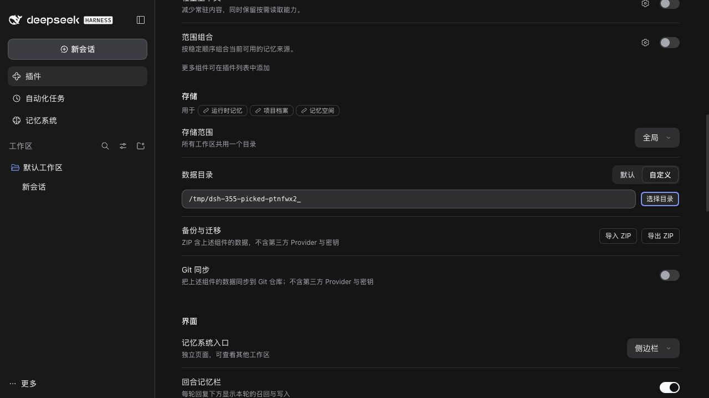
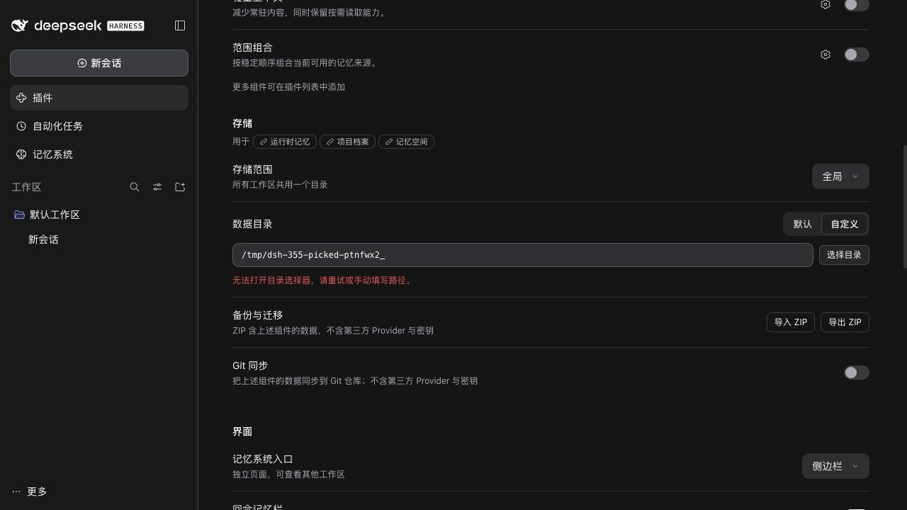
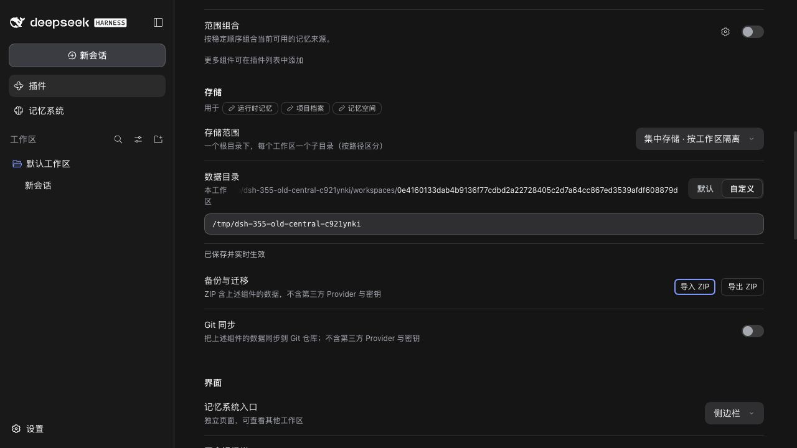

# PR 355：选择目录，不搬移已有数据

[English](./README.md) · [验收索引](../README.md)

验收日期为 2026-10-26，代码为当前 main `600072a85863d3c16a04aea335696e60b3d5e4a4` 加收敛后的 PR，环境为 Node 22.22.0、pnpm 10.13.1。分支保留贡献者截至 `ecef09f793a7c40827257e2e547b548e65c1885c` 的三个原始提交。[结构化结果](./verification.json)。

## 结果与兼容边界

仅当本地 DSH 同时提供原生 Host 目录选择器和公开 Client 操作时，自定义路径旁显示**选择目录**。选择结果先填入草稿，**应用**沿用已有设置保存。取消、放弃修改、只读页面和选择器错误保留现有设置；迟到的返回不能覆盖更新的草稿、范围、工作区或已保存配置。错误提示只提供简短恢复指引，仍可手动填写。浏览式、远程、缺失和较旧的能力继续手动输入。

移除原 PR 的自动迁移、删除和运行时搬移 RPC。全局/默认、全局/自定义、工作区、集中存储的含义不变，ZIP 仍只做合并导入。不改变持久化格式、存储初始化或已有数据处理。Pack target 响应仅增加可选能力布尔值；不使用 DSH 私有桌面桥，也不修改 DSH 源码。

对贡献者原 head 的临时数据复验确认了四种情况：复制遗漏符号链接/空目录、符号链接别名绕过嵌套目录检查、rename 忽略 `remove:false`，以及原目录已经移动后 profile 保存失败。最终版本排除了这些操作，不声称已经修好自动迁移。

## 验证

- `pnpm run verify` 通过：根测试 2,220 通过、7 条件跳过；插件测试 689 通过、3 条件跳过；类型、确定性构建、文档、Headless 与打包公开入口通过。
- 独立 DSH 0.2.1-rc.3：2,220 通过、7 条件跳过。独立 0.2.0-rc.2：2,217 通过、10 条件或宿主版本相关跳过。macOS 上使用规范化的 `/private/tmp/...` 作为 `DSH_HOST_ROOT`，让测试解析器识别宿主内部 import。
- 新增 28 项回归覆盖能力缺失、本地/远程、成功选择、取消、重复点击、保存拒绝/重试、范围保留、只读、过期异步结果，以及拒绝已移除的迁移端点。原有 RPC 测试继续验证请求覆盖 ZIP 时仍执行合并。
- 真实 rc.2 WebUI 加正式原生选择器：按钮出现，调用 DSH 并启动 macOS 选择器进程。仅终止这个临时选择器后，页面能恢复且不显示内部命令。手动保存、放弃修改和 Host 冷重启保留路径均通过；返回默认后取消全局自定义路径。源目录的测试文件 SHA-256、符号链接与空目录始终保留，也没有自动复制。
- 真实 0.2.0-rc.2 浏览式 WebUI：不显示原生按钮；手动保存集中根目录后保持 `storageScope: workspaces`，实际路径使用工作区哈希子目录；返回默认仍保留 `workspaces`，自定义根保存为空。

**未完成的手工检查：**自动化工具无法控制独立的 macOS `osascript` 窗口，因此没有完成真实系统弹窗的选择和取消；对应返回值通过组件测试覆盖。Windows/Linux 原生弹窗没有人工验收。截图证明真实设置保存、兼容回退和错误恢复，不代表完成了系统弹窗选择。

用[已提交的夹具](../../../scripts/serve-e2e.mjs)复验：

```sh
pnpm run build
MNEMON_E2E_PORT=43355 node scripts/serve-e2e.mjs --native-directory-picker
MNEMON_E2E_DSH=/path/to/installed/0.2.0-rc.2/lib/bin.js MNEMON_E2E_PORT=43356 node scripts/serve-e2e.mjs
```

打开插件 → 可组合记忆 → 存储。在原生夹具选择自定义，打开选择器，取消或选择临时目录，再应用/放弃。在浏览式夹具检查手动输入与集中存储范围。测试不要选择个人存储。






