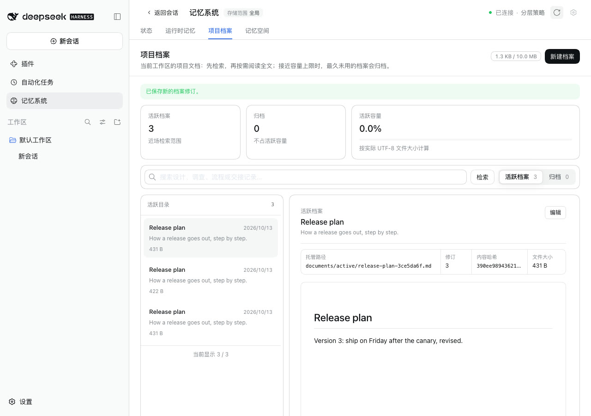
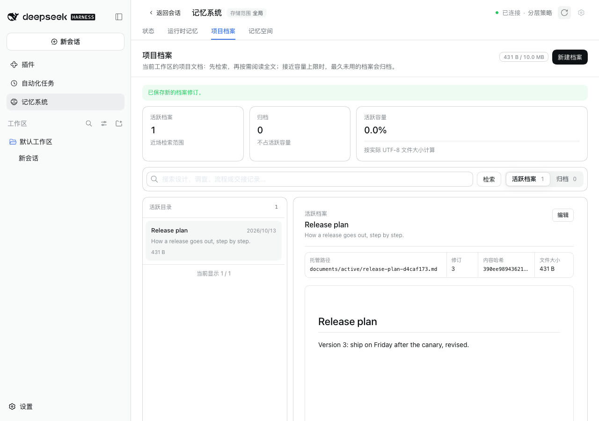
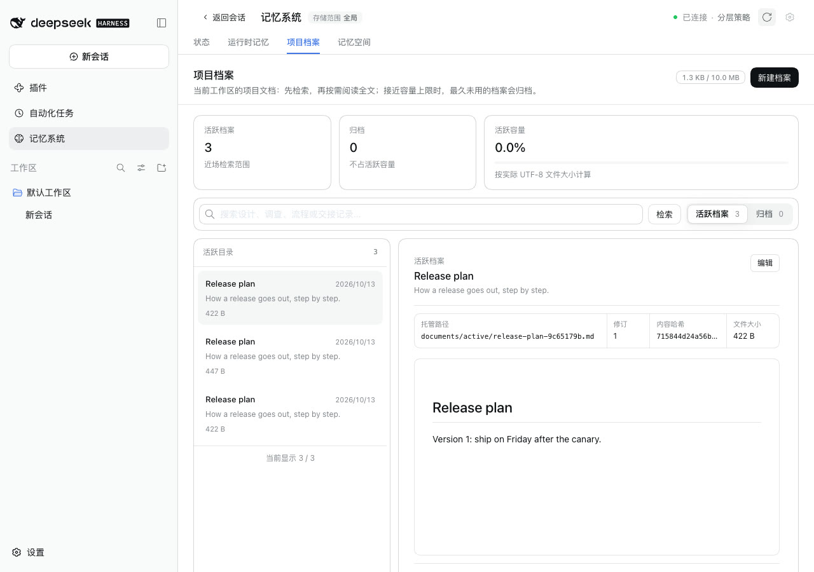
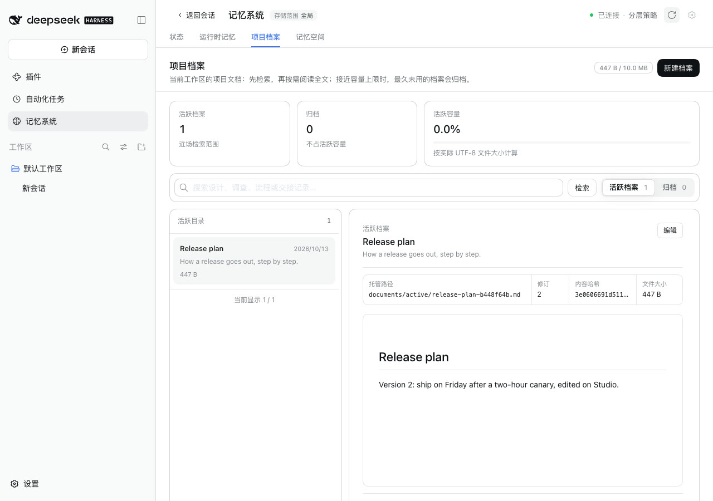

# Project Document edits through Git sync

[简体中文](./README.zh-CN.md) | [Verification record](./verification.json)

This turned up while checking the Memory Spaces fix for issue #370 through Git sync. Every push merges the branch into this machine first. The branch still holds the version of each document that was published last, so an edited document met its own older version under the same id. The merge kept that older version as a copy beside it:
- One machine that edited a document twice and synced three times held three documents.
- With two machines, an edit made on one never reached the same document on the other. It arrived as one more copy.

Baseline: main `20e4ab67`. Fix: `6a0eb318`. The runs took place on 2026-10-13 (Asia/Shanghai):
- macOS 15.6 arm64 and Node 24.19.0;
- headless Chrome at 1280×900, zh-CN, light;
- DSH 0.2.1-alpha.2 (npm `alpha`) through `scripts/serve-e2e.mjs`;
- a local bare repository standing in for `https://git.example.com/demo/memory.git` through Git's `url.<base>.insteadOf`.

## Fix

After every merge and every publish, a machine records each document's version as it and the branch then agree on it, and the commit they agreed at. The record lives in `state/sync/base.json`, scoped to the repository, branch and directory. A version is every field of the document except when it was last read, so a rename or an archive counts as a change.

A merge through the sync channel then compares each document both sides hold with that agreement:

| The branch's version | This machine's version | Result |
|---|---|---|
| unchanged | changed or not | this machine's version stays |
| changed | unchanged | the branch's version replaces it, unless its revision is lower than this machine's |
| changed | changed | this machine's version keeps the id, at a revision above both; the branch's version is kept beside it as a copy, even when only its title or archive differs |

The agreement is recorded right after the merge, not only after a publish. So a push that Git refuses or that fails, and a machine that cannot publish at all, still compare against what they took in.

The agreement is used only while the branch descends from the commit it was made at, which is the commit the mirror checked out. A branch deleted and published again from an older history merges as before, with copies, and loses no text. Disconnecting keeps the agreement, so reconnecting to the same repository uses it again.

A ZIP import has no agreement and merges as before. So do the first sync after an update and the first sync with another repository, branch or directory.

Two independent reviews read earlier versions of this fix. Every case they found is now one of the scenarios below:
- a refused or failed publish;
- a machine that cannot publish;
- a recreated branch;
- an older dsh-mnemon on the other machine;
- a rename or archive;
- a conflict at different revisions;
- an archive and a rename of the same text;
- a disconnect.

## Method

**One machine.**
1. Serve the WebUI, switch **Git 同步** (Git sync) on and connect.
2. Create **Release plan** under **记忆系统 → 项目档案** (Memory System → Project Documents) and click **立即同步** (Sync now).
3. Edit it twice, clicking **立即同步** after each edit.

**Two machines.**
1. Studio creates **Release plan** and syncs.
2. MacBook connects to the same repository and syncs, which brings the document in.
3. Studio edits it to version 2 and syncs.
4. MacBook syncs again, then opens **项目档案** and clicks **刷新** (Refresh).

## Before and after

| | main | Fix |
|---|---|---|
| One machine, after two edits and three syncs |  |  |
| MacBook, after Studio's edit |  |  |

What MacBook holds at the end:

| main | Fix |
|---|---|
| `9c65179b`, revision 1, "Version 1: ship on Friday after the canary." (its own document, never updated) | `b448f64b`, revision 2, "Version 2: ship on Friday after a two-hour canary, edited on Studio." |
| `f885b0be`, revision 2, Studio's version 2, as a copy | |
| `c31cdf14`, revision 1, version 1 again, as a copy Studio made and published | |

## Scenarios

`tests/git-sync.spec.ts` runs each scenario against real bare repositories. `tests/pack.spec.ts` checks the merge rules directly in seven more tests. The table compares main, the first version of this fix (`0eef4f6f`), and this one:

| Scenario | main | `0eef4f6f` | Fix |
|---|---|---|---|
| One machine edits between syncs | fails | passes | passes |
| An edit on one machine reaches the other | fails | passes | passes |
| Both machines edit: one copy, and both end alike | fails | passes | passes |
| Retry after another machine published meanwhile | fails | fails | passes |
| Catch up after a merge that could not publish | fails | fails | passes |
| Edit on top of a merge that could not publish | fails | fails | passes |
| Machine that can read the branch but never publish | fails | fails | passes |
| Branch published again from an older history keeps the newer text | passes | fails (text lost) | passes |
| Other machine on an older dsh-mnemon keeps the newer text | passes | fails | passes |
| Rename and archive kept when the other machine changed the text | fails | fails | passes |
| Title changed on one machine reaches the other | fails | fails | passes |
| Agreement after Merge here only | fails | passes | passes |
| A merge of runtime memory only leaves the agreement alone | fails | passes | passes |
| Unreadable agreement, then disconnect and reconnect | fails | fails | passes |
| Both machines edit at different revisions, and both end alike | fails | passes | passes |
| An archive on one machine and a rename on the other, same text | fails | fails | passes |
| An archive made on one machine reaches the other | fails | fails | passes |
| Another branch's agreement is never used | passes | passes | passes |

The scenarios that pass on main are the safety cases: main keeps a copy of everything, so it never loses text. The fix keeps that property where it cannot be sure. Removing the agreement after **Merge here only** makes its test fail.

## Limits

- A machine on an older dsh-mnemon still makes copies. Every machine that syncs should be updated.
- A document removed outside the product comes back from the branch, as on main. The product only archives documents.
- Documents copied by earlier versions stay where they are. This change stops new copies but does not merge or delete existing ones.
- Switching between branches or directories starts again without an agreement each time, so the first sync after a switch keeps copies.
