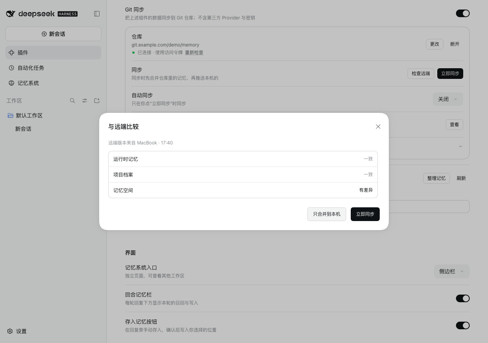
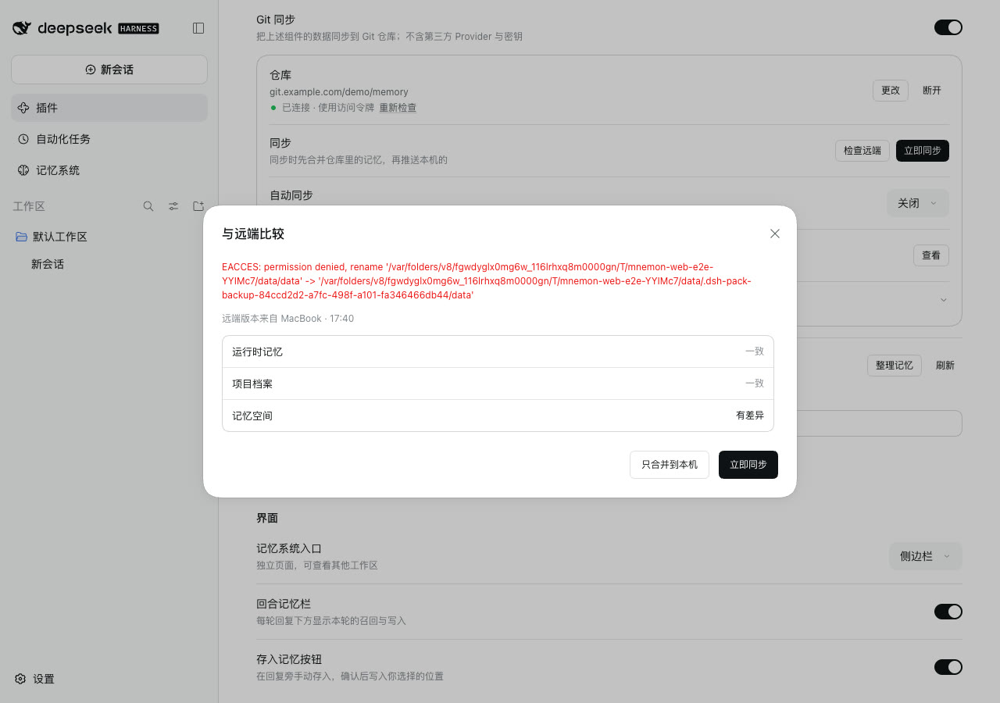

# 检查远端中「只合并到本机」失败时

[English](./README.md) | [验证记录](./verification.json)

这个问题是在测试记忆系统如何跟进插件页上的同步时发现的。在 **检查远端** 中点 **只合并到本机**，如果合并失败，对话框什么也不说，仍显示点击前的比较结果，看起来像是按钮没有反应。

基线：main `20e4ab67`。修复：`af15e43f`。运行于 2026-10-13（Asia/Shanghai）：
- macOS 15.6 arm64，Node 24.19.0；
- headless Chrome，1280×900，zh-CN，浅色；
- DSH 0.2.1-alpha.2（npm `alpha`），通过 `scripts/serve-e2e.mjs` 运行，使用真实的 Mnemon CLI 0.2.10；
- 本机裸仓库通过 Git 的 `url.<base>.insteadOf` 代替 `https://git.example.com/demo/memory.git`。

## 原因

合并结束后，对话框会重新读取比较结果，显示还剩哪些没有合并。这次读取一开始就会清空对话框里的提示行，而合并失败的原因已经写在这一行上，于是被清掉了。从对话框发起的同步会在读取之后再写入失败原因，合并没有这样做。

## 修复

合并先记下失败原因，等比较结果重新读取后再显示。

合并失败后，同步区也会重新读取状态，而不只在合并完成时读取：Host 先写入，再重新读取记忆空间，而这次读取本身也可能失败。

## 方法

1. 在名为 MacBook 的机器上，把一个包含三条记忆的 Mnemon 空间 **Release checklist** 发布到裸仓库。
2. 在名为 Studio 的机器上，分别用 main 和修复各执行一遍：
   1. 打开 **Git 同步**，连接同一个地址。
   2. 把存储根目录下存放记忆空间的 `data` 目录权限设为 555。这样 macOS 不允许移动这个目录，但仍可以读取，也可以在它的子目录里写入。导出和比较都照常进行，只有合并的最后一步会失败：合并要先把旧的 `data` 目录移开，再放入合并后的目录。
   3. 点击 **检查远端**。记忆空间显示「有差异」，运行时记忆和项目档案显示「一致」。
   4. 点击 **只合并到本机**，等比较结果重新读取完。
3. 停止实例前恢复目录的写权限。

## 修复前后

点击前，两次运行的比较结果相同：

| 点击 **只合并到本机** 后 | |
|---|---|
| main |  |
| 修复 |  |

两次运行中，点击后记忆空间都仍显示「有差异」，说明 main 上合并同样没有执行，只是修复后才说明了原因。

## 自动检查

`tests/client-sync.spec.tsx` 新增测试 “says inside the comparison why a merge did not finish”，其中 Host 拒绝合并。测试检查：
- 比较结果重新读取了；
- 失败原因留在对话框里；
- 没有出现「已合并」的提示；
- 同步区重新读取了状态。

在 main 上，这个测试因为找不到失败原因而失败。原有测试 “compares with the remote without writing, and merges only when asked” 仍然通过。

## 限制

- 对话框无法归类的失败，会照原样显示 Host 的报错，和其他同步失败一致。这里显示的是带有实例临时路径的 `EACCES` 报错。
- 只在 macOS 上运行过。Linux 出于同样的原因也不允许移动权限为 555 的目录。Windows 没有 555 权限，未测试。
