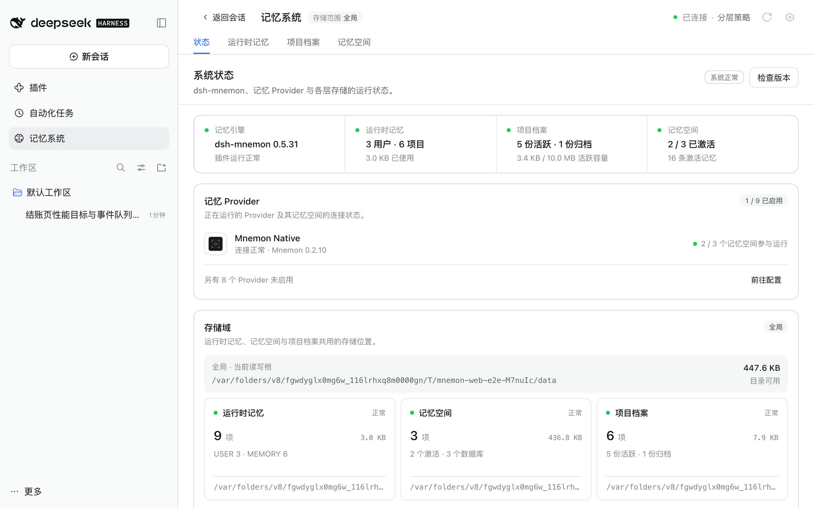
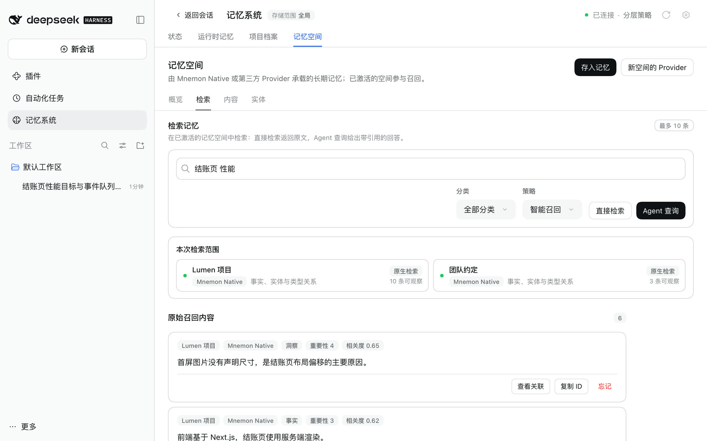
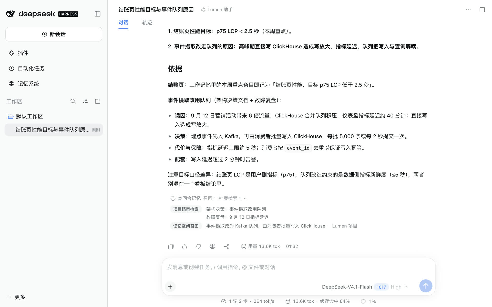
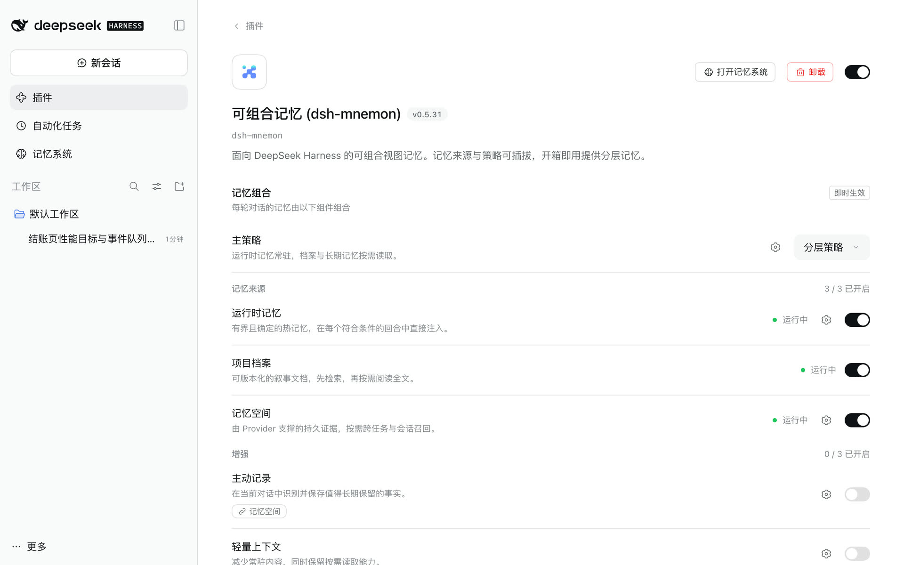

<a id="快速开始"></a>

# 入门指南

**简体中文** | [English](../../en/guides/getting-started.md) | [文档中心](../README.md)

本页从装好 dsh-mnemon 之后开始，一直走到对话真正用上记忆。全程使用默认设置：记忆系统位于侧栏、全局存储、分层策略。日常使用不需要了解 View 或 Strategy。

<a id="1-命令行安装与升级"></a>

还没有安装？[安装与启动](./installation.md)从安装 Node.js 讲到第一条记忆，每一步都有截图，[命令行](./installation.md#7-命令行与-headless)、开发检出、Headless 与更新也都在那里。准备升级已有安装？请按[兼容性与升级](../reference/compatibility.md)操作。

<a id="2-打开记忆系统"></a>

## 1. 打开记忆系统

在侧栏点击**记忆系统**，默认进入**状态**页。



请确认：

- 顶栏显示**已连接**，并写明主策略，默认为“分层策略”；
- 记忆引擎卡片显示 dsh-mnemon 的版本；如果安装了 Mnemon CLI，它会出现在**记忆 Provider** 中；
- 运行时记忆、项目档案与记忆空间各有一张没有错误的卡片；
- 存储根目录与你选择的存储范围一致。

即使使用全局存储，项目档案也需要 DSH 工作区。请为对话选择工作区；“等待工作区”表示缺少项目上下文，而不是缺少 CLI。如果缺少 Mnemon CLI，可在 macOS 或 Linux 上运行 `command -v mnemon` 与 `mnemon --version`，在 Windows 上运行 `Get-Command mnemon`。其他问题见[故障排查](./operations.md#故障排查)。

<a id="3-保存第一批记忆"></a>

## 2. 保存第一批记忆

**运行时记忆。** 打开**运行时记忆**，点击**添加记忆**，在用户画像中写一条偏好，或在工作记忆中写一条项目事实。之后的每一轮都会注入它。

**一份档案。** 打开**项目档案**，点击**新建档案**，保存一份简短的设计说明或检查清单。问题需要时，Agent 会检索档案。

**一个记忆空间。** 打开**记忆空间 → 概览**，点击**创建记忆空间**：

1. 选择 Provider。安装 CLI 后会出现本地默认的 Mnemon Native；第三方 Provider 需要先在[记忆空间页面](./ui-guide.md#在插件页中)启用。
2. 起一个范围明确的名称，例如“项目决策”，并说明其中应该保存什么。
3. 保持激活，对话才能读取它。

在空的存储根目录中，第一个 Mnemon Native 空间使用 Mnemon 的 `default` Store ID，同时保留你填写的名称与说明；其他 Provider 上的空间使用各自的 ID。接着点击**存入记忆**，写下稳定且不含机密的内容，点击**交给任务 Agent**；独立任务 Agent 会选择空间、去重并写入，回执写明存到了哪里。

**验证一下。** 打开**记忆空间 → 检索**，提一个具体的问题，点击**直接检索**。每条结果都保留所属记忆空间、分类、重要性与分数；需要时可以复制 ID。



也可以使用对话命令：

```text
/mnemon status
/mnemon recall <具体的问题>
```

<a id="4-在对话中使用记忆"></a>

## 3. 在对话中使用记忆

提一个依赖已保存内容的问题，让 Agent 自己判断是否需要记忆。回复完成后：

- 如果这一轮用到了记忆，会出现**本回合记忆**，展开后按工具列出读到和写入的档案与记忆，点击一条即在所在页面打开它；
- 回复下的脑形图标是**存入记忆**，打开可编辑的对话框，“取消”不会写入任何内容，交给任务 Agent 后会收到回执。



普通对话不会强制召回。当前请求、仓库文件与实时工具结果的优先级高于历史记忆。

<a id="5-选择记忆的组合方式"></a>

## 4. 选择记忆的组合方式

打开**插件 → 可组合记忆**，或点击记忆系统顶栏的齿轮。



- **主策略**：保留**分层策略**，或选择**通用策略**，在同一份预算内提供全部可用来源，由模型决定如何使用。
- **记忆来源**：运行时记忆、项目档案与记忆空间，各有一个开关。关闭后停止它的上下文、工具与后台任务，但不删除数据。
- **增强**：主动记录、轻量上下文与范围组合默认关闭，两个主策略都可以使用。
- **存储**：全局（默认）让所有工作区共用一个目录；工作区把每个工作区的记忆放在它自己的 `.mnemon`；集中存储把每个工作区放在同一个根目录下。**数据目录**在“默认”与“自定义”之间选择。两者的改动都不会搬移已有数据，各个范围的说明见[存储范围](../reference/configuration.md#存储范围)。
- **界面**：记忆系统可以在侧栏或会话标签页中打开，也可以开关对话中的两个控件。

开关与选择器立即生效，存储的改动需要点击**应用**。[界面指南](./ui-guide.md#在插件页中)介绍了每个页面，[配置参考](../reference/configuration.md)列出了它们背后的设置项。

<a id="6-下一步"></a>

## 5. 下一步

- 在[界面指南](./ui-guide.md)中熟悉每个页面。
- 用[存储模型](../reference/storage-model.md)判断内容该放进运行时记忆、项目档案还是记忆空间。
- 用[运维指南](./operations.md)导出第一个 ZIP 备份，并做好升级前的准备。
- 用 [Provider 指南](./memory-providers.md)接入长期记忆后端。
