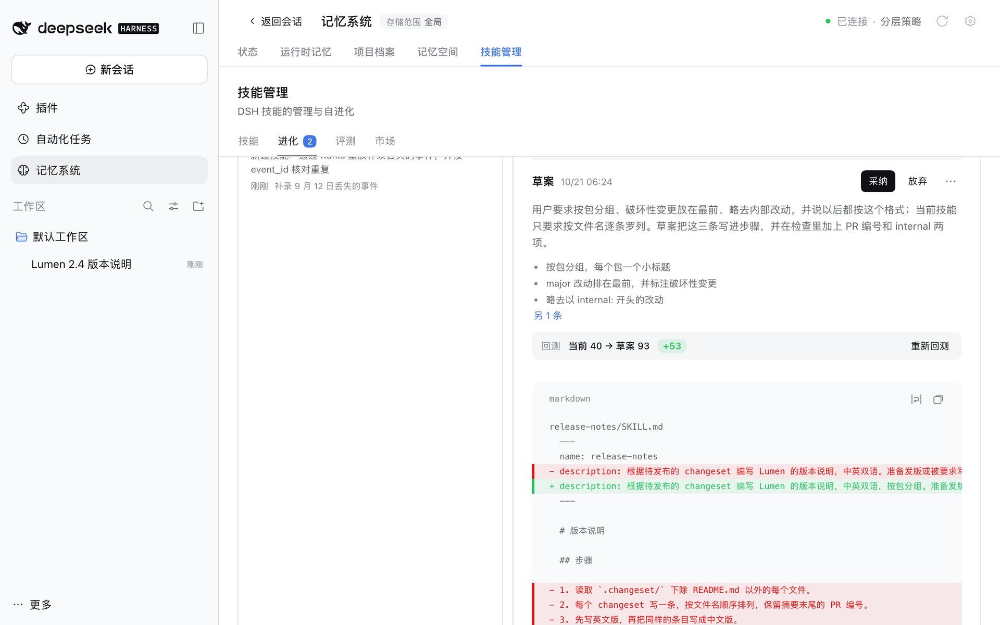

# v0.5.34：越用越好的技能

**简体中文** | [English](../../en/releases/v0.5.34.md)

本版本新增实验性组件**技能管理**，管理工作区加载的 DSH 技能：[#443](https://github.com/omdsh-dev/dsh-mnemon/pull/443)。它随 Starter 安装并默认开启；唯一会调用模型的自进化默认关闭，要等你手动开启。



- **技能集中在一处。** 记忆系统新增**技能管理**页面，按 DSH 的优先顺序列出它从项目的 `.dsh/skills`、`.agents/skills` 以及 `~/.dsh/skills`、`~/.agents/skills` 加载的每个 `SKILL.md`，并标出被覆盖的同名副本。可以用 DSH 自己的 frontmatter 键让技能不被模型加载或不出现在 `/` 菜单中，一键在对话中使用，直接编辑，并回到任意历史版本：每次改动都会留下版本，期间被别处改过的文件不会被覆盖，删除的技能先移入回收区。
- **自进化。** 开启后，每个回合结束时 Host 记录这段对话的步骤，机密会被替换。对话积够复盘分并空闲下来后，任务 Agent 在后台复盘，寻找多次纠正、“以后都这样做”的指示、工具失败和可复用的流程，提出新建或改进技能的建议，并标出所依据的步骤。**生成草案**写出新的 `SKILL.md`，先在这个技能的测试用例上与当前版本回测对比，再由你采纳、编辑、按要求重写或放弃。没有你的**采纳**，任何技能都不会被改动。
- **证据与评测。** 复盘读过的对话作为证据保留，可以置顶、删除，或从中生成测试用例。**评测**集中列出每个技能的用例与回测，包括建议中提出、尚未创建的技能。回测是模拟运行：执行者按技能作答而不调用工具，评审逐项判定检查项。
- **技能市场。** 市场从多个来源读取技能：精选目录、边输入边搜索的 skills.sh、任意 GitHub 仓库（包括 Claude Code 插件市场仓库）、按 Agent Skills 发现协议发布技能的网站，以及团队维护的技能目录文件。预览会显示 skills.sh 公布的安全审核。安装时从上游完整获取技能文件夹，限制大小与文件数，所有路径都保持在文件夹之内，并校验网站公布的 SHA-256 摘要；安装来源会被记录，以便市场提示更新。
- **对话中。** 回合下方的**本回合技能**一行列出这一回合用到的技能和复盘提出的建议，点一下即可打开；页面也可以作为独立的侧边栏入口。技能管理的设置在**插件 → 可组合记忆**下它自己的页面上，带有**实验性**标签，改动即时生效。
- **包描述。** 插件页与 npm 上的介绍改为：面向 DeepSeek Harness 的可组合视图上下文，开箱即用提供分层记忆与自进化技能。
- **文档。** [技能管理指南](../guides/skills.md)逐一介绍每个页面，截图来自新的 [v0.5.34 技能管理图集](../../assets/skills-v0.5.34/README.md)；README、界面指南以及配置、存储与接口参考也都加入了技能管理。

## 升级与兼容性

**DSH 0.2.0-rc.2、0.2.1-rc.1 与 0.2.1-rc.2：**使用**记忆系统 → 状态 → 检查版本 → 更新**，然后重启 DSH。dsh-mnemon 0.5.31 及更高版本在所有受支持的 DSH 上都可以这样更新；在 DSH 0.2.0-rc.2 上，网页从 0.5.19 起、桌面版从 0.5.22 起也可以。更早的安装，包括 DSH 0.2.1 上更新会停在 `already-installed` 的 0.5.30 及更早版本，需要手动更新一次：请退出 DSH，安装精确版本，再启动 DSH。

```sh
dsh plugin --profile web add dsh-mnemon@0.5.34
```

写明版本可以避免 pnpm 在新版本发布后 24 小时内选用较早的版本。命令行不管理桌面版的 `desktop` profile：请在插件页**卸载** dsh-mnemon，再通过**添加插件**以 `dsh-mnemon@0.5.34` 重新安装，然后完全退出并重新打开应用。记忆数据与设置都会保留。

重启后，技能管理出现在记忆系统的标签页中，也出现在插件页**记忆组合**的组件行里。它读取 DSH 已经在加载的技能，在你编辑、安装或采纳之前不会改动任何技能；它自己的数据放在存储根目录新增的 `skills/` 文件夹中，不在 ZIP 备份和 Git 同步之内。市场只在你搜索、预览、安装或刷新时，或它缓存的列表超过六小时后，才会访问 GitHub、skills.sh 和你添加的网站。

**受支持的 DSH 版本**不变：DSH 0.2.0-rc.2 与 0.2.1-rc.1，以及其后的 0.2.0 与更高的 0.2 版本（`>=0.2.0-rc.2 <0.2.1-0 || >=0.2.1-rc.1 <0.3.0-0`），其中包括 npm `latest` 与 `next` 上的 0.2.1-rc.2。

已有记忆与设置无需迁移。dsh-mnemon 配置中新增的 `skills` 键是可选的；较早的 dsh-mnemon 会忽略它，退回较早版本时，你的技能和 `skills/` 文件夹都会保留。

## 变更的包

| 包 | 上一版本 | 新版本 |
| --- | --- | --- |
| `dsh-mnemon` | 0.5.33 | **0.5.34** |
| `dsh-mnemon-source-skills` | 新增 | **0.5.1** |

其余 17 个组件版本不变。

## 验证

[发布验收](../../pr-assets/release-v0.5.34/README.zh-CN.md)在全新的 DSH 0.2.1-rc.2 与 0.2.0-rc.2 上通过**添加插件**安装新的 Starter。在两个版本上都检查了状态页、运行时记忆、检查版本、在技能管理页面新建的技能、**实验性**标签以及插件页上的技能管理设置，并通过检查版本把 v0.5.33 的安装更新到新版本，重启后技能管理随之出现。在 DSH 0.2.1-rc.2 上，新建的技能也出现在 DSH 的 `/` 菜单中。发布分支在固定的 DSH 0.2.1-rc.2 上通过完整的工作区验证，针对已安装 DSH 0.2.0-rc.2 的根测试也通过；发布流程中从 0.5.29 升级的检查，在候选包上同样通过。

[PR](https://github.com/omdsh-dev/dsh-mnemon/pull/443) 记录了这项变更及其本地验证，设计见[技能管理计划](../../plans/skill-management.md)，界面见 [v0.5.34 技能管理图集](../../assets/skills-v0.5.34/README.md)。

发布流程在创建 GitHub Release 之前，会验证完整的固定组合、Registry 安装与真实升级。

上一版本：[v0.5.33](./v0.5.33.md)。
